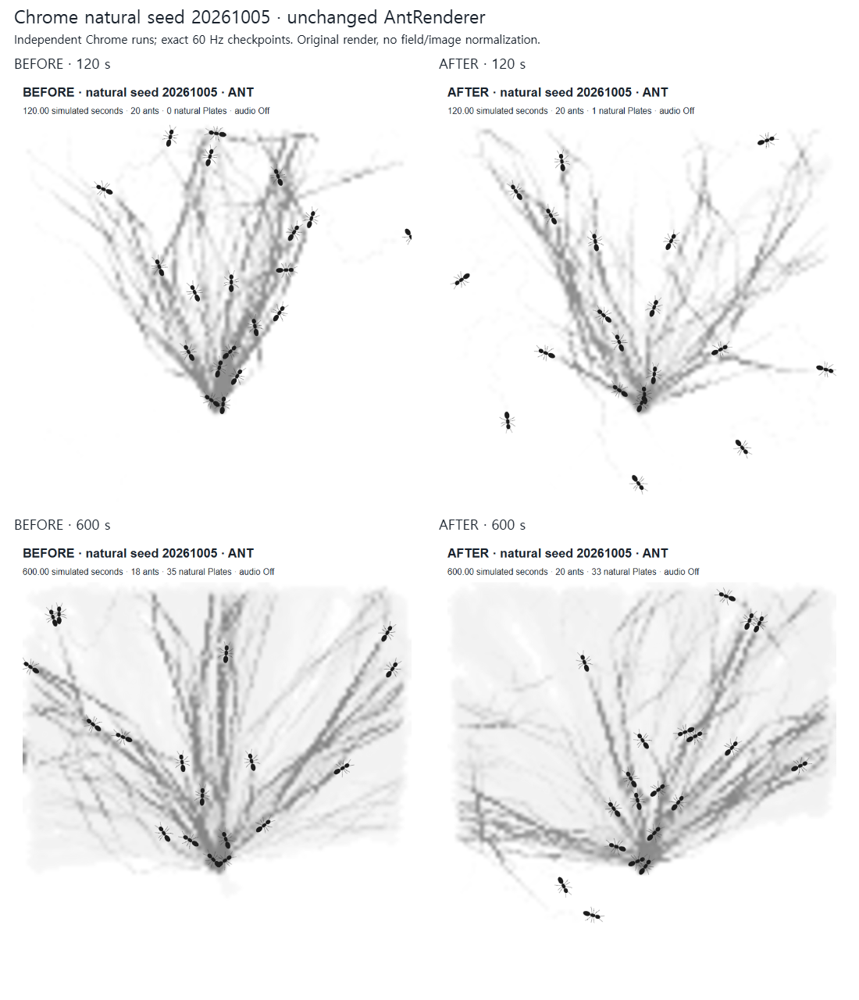
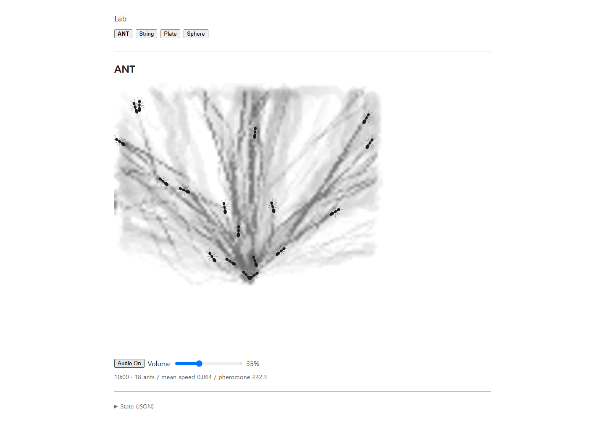
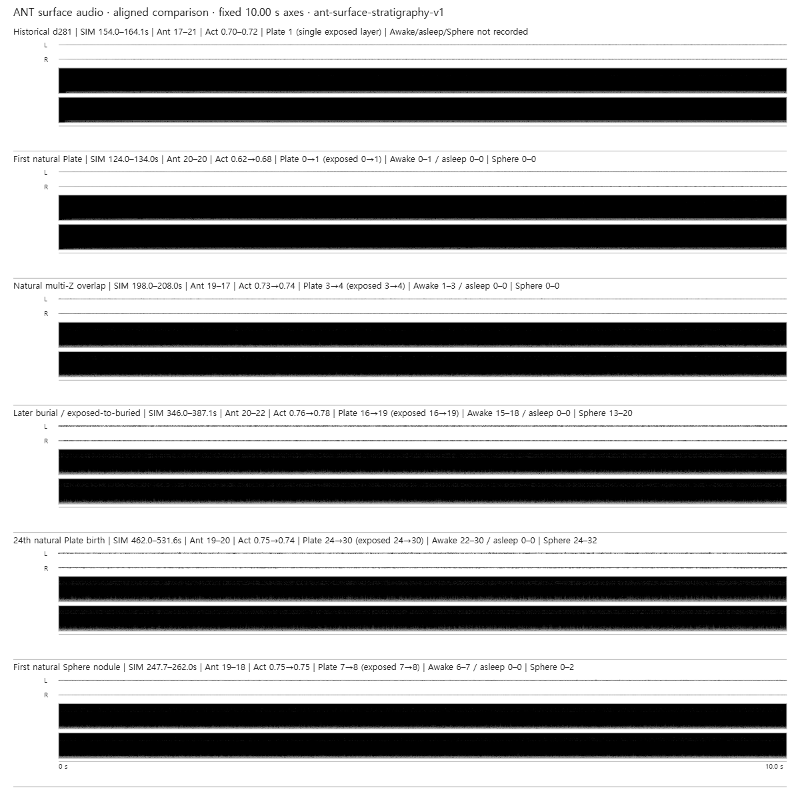
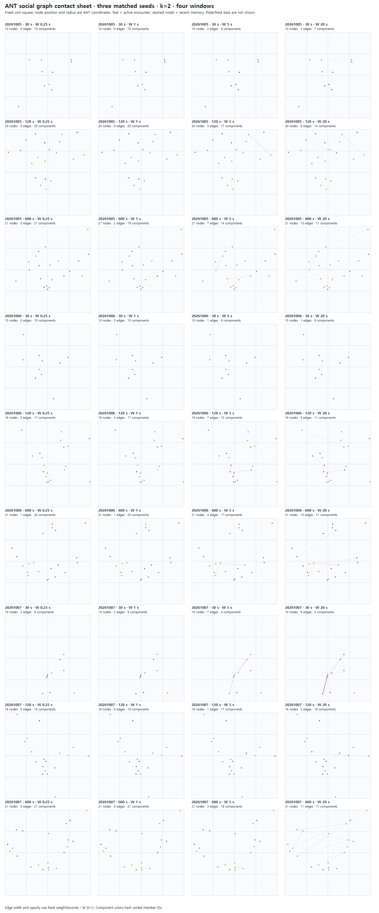

# Physical Audio Lab / ANT

물리 오디오 모델과 자율 ANT 시뮬레이션을 함께 다루는 vanilla Vite 프로젝트입니다. 현재 중심은 **ANT**입니다. 동등한 개체들이 이동하고, 화학적 흔적과 실제 발 접촉을 통해 환경에 기억을 남기며, 반복된 경로가 동결된 재질 구조와 물리 진동으로 이어집니다.

String, Circular Plate, Solid Sphere는 같은 라이브러리 안의 독립적인 물리 오디오 실험으로 유지됩니다.


*실제 ANT 실행 화면. 이 이미지는 social-graph overlay가 아니라 production renderer의 개체·pheromone·material 표현입니다.*

## Quick start

```bash
npm install
npm run dev
```

Node.js 20+가 필요합니다. AudioWorklet은 localhost 또는 HTTPS가 필요하며, ANT 오디오는 사용자 `Audio On` 동작 뒤 시작합니다.

검증:

```bash
npm test
npm run build
npm run test:browser
CHECK_PRODUCTION=1 npm run test:browser
```

## ANT의 핵심 구조

ANT는 결과 상태를 직접 코딩하기보다, 서로 다른 시간척도의 상호작용이 누적되도록 구성합니다.

장기 설계에서 ANT는 **목표를 수행하는 개체들의 시뮬레이션보다, 개체·기억·물질·진동이 서로의 다음 조건을 만드는 persistent world**를 지향합니다. 개미가 잠시 하나도 없어도 세계는 reset되지 않으며, 느린 환경 상태는 자기 시간척도대로 남거나 변할 수 있습니다. 이 설계는 아직 production 구현과 구분합니다.

```text
equal ants
  ↓ movement / local occupancy
pheromone
  ↓ shared chemical memory
FOOT_CONTACT
  ↓
SurfaceField
  ↓ slow mechanical memory
persistent route
  ↓
TrailPlateBirth
  ↓
MaterialStratigraphy
  ↓
Plate / Z coupling / buried Sphere
  ↓
physical vibration / audio
```

여기에 현재는 행동에 영향을 주지 않는 별도의 관찰층이 있습니다.

```text
current / recent ant proximity
  ↓
DynamicSocialGraph
  ↓
TemporalSocialTopology
```

- **social graph**: 빠르고 이동하며 일시적인 현재 관계의 관찰. S0–S2c 검증 뒤 현재는 행동에 연결하지 않는 parked diagnostic baseline으로 유지합니다.
- **material graph**: 느리고 공간적이며 과거 반복 행동이 환경에 고정된 역사. 현재 프로젝트의 생성적 중심은 이 material/history 축입니다.

자세한 현재 구조와 연구 경계는 [ANT documentation hub](docs/ant/README.md), 미래 세계 모델은 [persistent-world design contract](docs/ant/world-model.md)에 정리합니다.

## 주요 검증된 변화

### 1. 이동·trail·founder refinement

모든 ant는 동일한 `AntAgent` 모델을 사용하며 leader/caste/pioneer state를 두지 않습니다. Pheromone은 shared environmental memory이고, 경로 신호가 있을 때만 trail adherence가 강화됩니다.

2026-10-07 founder-effect pass에서는 **low-evidence 상태의 새 decision/commitment를 최대 20% 짧게 하고 새 baseline deposition을 0.5→0.375로 낮추는 최소 수정**만 채택했습니다. 세 matched seed에서 초기 pheromone 증폭은 줄었지만 600 s mature mass는 회복했고, Plate 형성도 유지되었습니다. 더 많은 branch를 직접 만들도록 튜닝하지 않았습니다.



*[Founder-effect refinement evidence](docs/ant/evidence/2026-10-07-founder-effect-refinement/README.md). 초기 lock-in 압력 감소를 보여주지만 individual founder causality를 증명하지는 않습니다.*

### 2. 실제 tripod gait와 환경 접촉

Gait는 애니메이션용 가짜 clock이 아니라 **실제 이동 거리**로 진행됩니다. 여섯 다리의 tripod touchdown이 `FOOT_CONTACT`를 만들고, 같은 이벤트가 SurfaceField와 material/audio excitation의 공통 입력이 됩니다.

Body pose와 gaster rear geometry도 같은 simulation state에서 파생되며 movement를 되먹임하지 않습니다.

관련 기록: [integrated refinement](docs/ant/evidence/2026-10-05-integrated-refinement/README.md), [gait evidence](docs/ant/evidence/2026-10-05-gait/README.md).

### 3. SurfaceField → frozen Plate → stratigraphy

반복된 chemical + mechanical route가 충분한 길이와 persistence를 가질 때만 frozen Plate가 태어납니다. 기존 Plate는 이후 pheromone을 따라 변형되지 않으며, 나중 재질이 실제로 겹친 위치에서만 매몰됩니다. **age와 depth는 같은 값이 아닙니다.**



*[Surface Plate evidence](docs/ant/evidence/2026-10-05-surface-plates/README.md). 회색 재질은 반복 행동이 환경에 동결된 history입니다.*

일반 foot contact는 현재 노출된 top Plate만 직접 타격하고, buried material은 Z/Sphere coupling으로만 에너지를 받습니다.

### 4. 물리 오디오

현재 production sonic baseline:

```text
3 ms finite direct-contact pulse
75 ms local mechanical recovery
×50 Plate damping
```

Plate의 존재는 오래 유지되지만 vibration memory는 짧게 분리했습니다. isolated Plate의 대략적인 decay는 T20≈1 s / T40≈2 s / T60≈3 s입니다.



*[Stratigraphy/audio evidence](docs/ant/evidence/2026-10-06-stratigraphy-runtime/README.md). 모든 waveform/spectrogram은 고정 척도입니다.*

단, mature 20–30 Plate에서 AudioWorklet render progression이 realtime을 따라가지 못하는 문제는 **해결되지 않은 known issue**이며 현재 보류 중입니다.

### 5. S0–S2c read-only social observation

2026-10-07에 `DynamicSocialGraph`와 `TemporalSocialTopology`를 별도 관찰 라이브러리로 추가했습니다.

조우 정의:

```text
q(A,B) = distance(A,B) / (radiusA + radiusB)
encounter iff q ≤ k
k = 1, 1.25, 1.5, 2
```

S0는 60 Hz에서 encounter start/end, duration, minimum distance와 stable ID를 기록합니다. S1은 20 Hz에서 0.25 / 1 / 5 / 20 s window의 components, merge/split, edge lifetime, persistent bridge/articulation/connector event를 읽습니다.

중요하게도 observer는 fixed tick 이후 복사한 `id/x/y/radius`만 읽으며 AntController, movement, RNG, pheromone, SurfaceField, FOOT_CONTACT, Plate birth에 feedback하지 않습니다. 세 seed × 600 s ON/OFF 검증에서 behavior/material hashes가 일치했습니다.



*3 seeds × 30/120/600 s × four windows. 실선 청록은 현재 근접, 점선 보라는 window 안에 남아 있는 최근 근접 기록입니다. Pheromone·SurfaceField·Plate는 겹치지 않은 diagnostic view입니다.*

자연 결과는 **희소하고 짧은 proximity connectivity**였습니다.

- k=2 / 250 ms에서 connector 11건
- duration 0.30–0.65 s
- 모두 recruitment origin에서 약 0.019 이내
- 1 s 이상 window에서는 persistent connector 0건

따라서 현재 결과는 pioneer/social role의 증거가 아닙니다. proximity, recruitment density, temporal-window memory 효과로 제한해서 해석합니다.

후속 S2a/S2b null 검증과 S2c leave-one-seed-out predictive-value check까지 진행했지만, 선택한 temporal graph summaries는 compact spatial/movement baseline 위에서 일관된 추가 예측력을 보이지 않았습니다. 현재 결정은 **spectral SKIP**이며 social graph는 read-only diagnostic layer로 parked 상태입니다.

이 baseline은 버리지 않습니다. 나중에 명시적인 relationship / partner memory / social mechanism을 추가하는 별도 가설이 생기면, 현재의 **no-relationship frozen baseline**을 대조군으로 다시 사용해 같은 관찰 정의와 matched conditions에서 비교합니다.

전체 정의·수치·raw data·재현 명령: [S0/S1 social graph evidence](docs/ant/evidence/2026-10-07-social-graph/README.md), [S2a](docs/ant/evidence/2026-10-08-s2a-null/README.md), [S2b](docs/ant/evidence/2026-10-08-s2b-null/README.md), [S2c](docs/ant/evidence/2026-10-08-s2c-incremental-value/README.md).

## 현재 상태

| 영역 | 상태 |
| --- | --- |
| ANT movement / gait / pheromone | frozen baseline |
| founder refinement | adopted |
| SurfaceField / Plate birth / stratigraphy | active, frozen qualification |
| sonic baseline | 3 ms / 75 ms / ×50 damping |
| mature AudioWorklet runtime | unresolved, deferred |
| S0–S2c social observation / validation | complete; parked diagnostic baseline |
| persistent pioneer-like organization | not demonstrated |
| spectral diagnostics | SKIP at current gate |
| current architecture pass | W1 shadow stopped at a directional character-attribution gap; [evidence](docs/ant/evidence/2026-10-08-w1-episodic-material-shadow/README.md) |
| next world-model decision | W1 causal character-attribution review; W2 remains gated |
| target sound concept | world itself as sounding body; Base Substrate calibration preserved but not conceptual default |
| social feedback / graph→Plate coupling | not justified; parked |

현재 검증된 production은 유지하면서, 미래 설계축은 **internal state → action → environmental memory → material/character → vibration/world sound → shared condition**의 persistent circulation으로 확장합니다. Social observation은 이 생성계의 독립 원인으로 취급하지 않고 옆에서 읽는 기준선으로 보존합니다.

향후 explicit relationship / partner memory / social rule을 도입하는 별도 연구를 열 경우, 현재 S0–S2c 상태를 frozen no-relationship control로 삼아 같은 seed/관찰 정의/검증 절차로 비교한 뒤에만 추가 social mechanism의 효과를 주장합니다.

## Documentation map

- [ANT current architecture / verified baseline / roadmap](docs/ant/README.md)
- [ANT persistent-world design contract](docs/ant/world-model.md)
- [ANT daily experiment/process logs](docs/ant/daily/README.md)
- [ANT evidence packages](docs/ant/evidence/)
- [Physical Audio Lab library, API and SvelteKit notes](docs/physical-audio-lab.md)
- [Repository guidance for coding agents](AGENTS.md)

## Repository shape

```text
src/lib/
  agents/ant/        ANT behavior, fields, material birth, social observers
  audio/             shared AudioEngine and ANT bridges
  models/            String / Plate / Sphere models
  renderers/         snapshot-only renderers
  lab/               model registry and lifecycle

static/worklets/      physical DSP processors
tests/                contracts / regression / invariance
scripts/              browser, evidence and replay harnesses
docs/ant/             ANT research / evidence / daily history
```

The reusable library remains framework-independent. p5 is used only by the ANT renderer, and Web Audio resources are created lazily after browser mount/user interaction.
