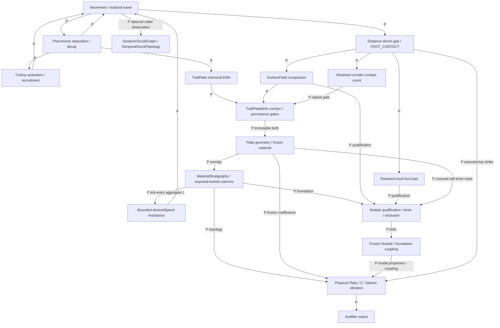
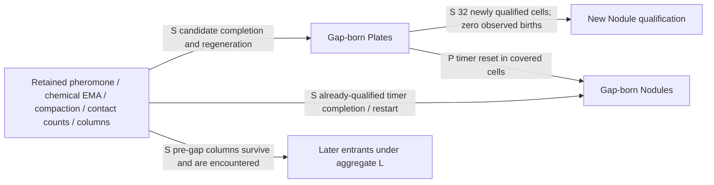
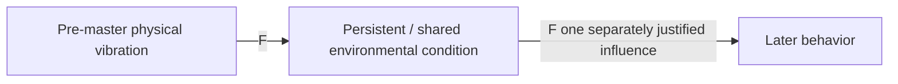

# ANT persistent-world reassessment — 2026-10-13

## Decision and scope

**현재 production은 이미 retained material이 이후 활동을 조건화하는 세계다. 새 organism/social/climate state의 필요성은 입증되지 않았다.** 최근 forced-zero evidence는 이 세계가 수동적인 기록 저장소에 그치지 않고, 보존된 입력으로 formation 후보를 다시 만들고 일부 slow timer를 완료함을 보인다. 자연적인 zero-population lifecycle이나 완전한 acoustic circulation은 별개다.

**Primary next investigation: 현재 자연 formation이 만든 frozen material character의 유효 변이와 physical-response 기여를 분리해서 검증한다.** 이는 기존 causal path의 attribution frontier다. 새 causal mechanism 채택을 권하지 않는다. 먼저 현재 descriptor/coefficient 변이가 실제로 존재하는지 판별한다. 존재하지 않으면 matched audio comparison도 실행하지 않는다. 충분한 근거가 생기기 전에는 새 character, vitality 또는 acoustic-climate law를 선택하지 않는다.

이 문서는 architecture/research synthesis다. 새 simulation, targeted extension, production tuning, parameter sweep 또는 audio mechanism을 실행하지 않았다. 기존 evidence를 재현한 것처럼 표현하지 않는다. `docs/ant/archive/**`의 내용은 조사 근거로 사용하지 않았다. 별도 [Git hygiene map](2026-10-13-repo-hygiene-map.md)은 삭제 없는 inventory다.

시작 시 clean working tree의 HEAD는 `75e53df2ec0d025b4337e360e48829f5c58809ab`, branch는 `research/ant-zero-ant-nodule-instrumentation-20261013`이었다. Fetch 후 local/remote main은 모두 `b14de91b91db5e818a8128090e7c442259ddd257`였다. `75e53df`의 유일한 parent가 `b14de91`임을 확인했고 변경은 research instrumentation/tests/evidence/daily뿐이었다. 사용자 지시에 따라 guarded ref fast-forward로 main을 `75e53df`까지 이동하고 push했다. Live `ls-remote`로 확인한 뒤 `codex/ant-persistent-world-reassessment-20261013`을 생성했다. Merge commit, rebase, cherry-pick, PR 또는 삭제는 수행하지 않았다.

## Claim types

구현 여부와 근거의 성격은 서로 다른 축이다. 구현된 authored law도 biological/physical truth는 아니다.

| 종류 | 현재 ANT에 해당하는 주장 | 경계 |
|---|---|---|
| IMPLEMENTED FACT | travel-driven pheromone, distance-driven gait/contact, fields, corridor selection, immutable Plate, mutable exposure/depth, Nodule timers, aggregate-L resistance, material/audio compilation | 실제 source path 존재 |
| EXPERIMENTALLY SUPPORTED PROPERTY | 고정 resistance A/B의 이동/후속 history 효과, complete-state causal tail, observer parity, cross-cohort occupancy, forced-zero candidate regeneration/timer completion | experiment unit/seed/horizon/intervention에 한정; production mechanism과 구분 |
| AUTHORED MODELING LAW | corridor-to-Plate thresholds/geometry, L speed multiplier, Nodule gates/reset/exclusion, birth aggregate에서 계산한 material coefficients, finite pulse/recovery/damping | 계산 규칙; 측정된 friction·광물 형성·ant biology로 주장하지 않음 |
| FUTURE / UNRESOLVED | episode/order-sensitive richer character, 독립 organism after-effect, explicit relationship, natural vacant lifecycle, vibration-derived shared feedback, indefinite material turnover | design possibility이며 필요성·mapping·효과 미검증 |

## Current verified causal world

Notation: **P** production mechanism; **E** experimentally supported causal/property evidence; **D** descriptive observation; **S** forced-shadow-only evidence; **F** future/unimplemented.

### Production causal map

Pheromone deposition과 FOOT_CONTACT은 movement의 **병렬** 출력이다. Pheromone이 gait로 직렬 전달되는 것은 아니다. Social observer는 복사된 proximity만 읽으며, 이 그림에는 behavior로 돌아가는 edge가 없다.

| Edge / property | 근거 | 허용되는 해석 |
|---|---|---|
| aggregate L → speed → later history | P + E: [A/B](evidence/2026-10-11-retained-material-locomotion-ab-final/README.md), [adoption](evidence/2026-10-12-retained-material-locomotion-adoption/README.md) | bounded authored resistance 채택됨. Travel/speed 감소, episode 연장, 후속 history 변화. Plate 수/coverage 방향은 seed마다 엇갈림 |
| material consequence → post-exit movement/environment | E: [causal tail](evidence/2026-10-12-material-causal-tail/README.md) | 관측한 5개 joint-L=0 사례에서 tail 확인. 4개는 retirement-censored. 기존 state로 충분하다는 제한적 판정 |
| material predating every live ant → later occupied column | D: [pre-cohort](evidence/2026-10-12-pre-cohort-retained-history/README.md) | active ant-time의 46.07%. m(L-P)는 산술 진단값이며 제거 intervention이 아님 |
| later ants encounter retained exposed material | D: [exposure](evidence/2026-10-11-retained-material-experience-shadow-final/README.md) | 조우 기회. 감지, friction 보정, 생성 주체 귀속의 근거는 아님 |
| frozen damping → isolated response difference | E: [Plate decay](evidence/2026-10-06-plate-decay/README.md) | synthetic damping endpoints에서 T60 차이가 이미 확인됨. 자연 형성 character 전체의 유효 범위와는 별개 |

### Forced-zero map, kept separate

S는 unchanged production logic에 외부에서 개체를 제거한 조건의 결과다. Natural arm은 “이 forced experiment에서 timer를 clear하지 않는 arm”을 뜻하며, 자연적으로 발생한 zero-ant interval을 의미하지 않는다. Gap 중 각 입력의 개별 필요성은 분리되지 않았다.

### Future path, not included in production

speaker/master output, playback volume, limiter, PA gain은 이 후보에 사용하지 않는다. Production world가 persistent하기 위해 이 edge가 필수라고 판단하지 않는다.

## What persistent world now means

| 특성 | 현재 근거 | 미확인 경계 |
|---|---|---|
| state survives current agents | P; natural D cross-cohort; forced S columns remain | 특정 ant의 기여 여부는 불명 |
| decaying state evolves without agents | P + S: pheromone 약 93.8% 감소, SurfaceField 약 2.3% 감소/60 s | 이 실험에는 audio bridge가 없어 vibration은 미측정 |
| existing formation process completes without agents | S: Plate candidate 4건 지속; Nodule pre-gap timer 11건 완료 | forced interval에서만 확인 |
| formation candidates regenerate without agents | S: pending Plate candidate를 clear한 뒤에도 7 births | retained input set의 효과. 각 carrier의 필요성은 미분리 |
| higher-order qualification continues without agents | S: gap Plates가 arm당 32개 cell을 새로 qualified 상태로 만듦 | qualified 상태와 birth는 다름 |
| new slow material completes without agents | S: natural arm에서 Nodule 총 14 births, 모든 birth cell은 gap-entry 시 already-qualified | 새로 Plate-enabled된 32 cells의 birth는 0. 이후 birth를 예측하지 않음 |
| later entrants encounter old world | natural D pre-cohort 46.07%; forced S post-gap 81.76% | aggregate multiplier의 산술 차이를 독립적인 causal effect라 부르지 않음 |
| production naturally reaches zero population | 미검증 | recruitment minimum target 8, 점진적 교체. 순간적인 zero가 불가능하다고 단정하지 않음 |

**해석 변경:** persistent를 “Plate가 사라지지 않는다”로 한정할 수 없다. Retained fields, 영구 contact counters, candidate clocks, formation rules의 조합은 현재 agent action이 없어도 조건에 따라 새 candidate/descriptor를 생성한다. 다만 이것은 새로운 energy/contact input이나 독립적인 physical accretion의 증거가 아니다.

자연 vacancy를 추가할 독립적인 이유는 현재 없다. 세계가 current cohort를 넘어 지속된다는 점은 자연 run에서 이미 뒷받침되며, 개체가 없는 동안의 clock continuity는 forced shadow에서 조사할 수 있다. 작품이 endogenous disappearance/reentry를 독립된 동작으로 요구한다면 별도의 lifecycle 책임과 비교 조건이 필요하다.

## Formation hierarchy and Nodule reinterpretation

TrailPlateBirth는 chemical EMA와 mechanical support를 source-to-boundary corridor로 압축하고, candidate similarity/persistence와 repeat gates를 거쳐 immutable birth를 만든다. MaterialStratigraphy는 기존 geometry를 시간순 overlap으로 쌓아 exposed/buried/depth를 갱신한다. Nodule은 해당 column, 현재 compaction, 영구 보존된 local foot load를 다시 평가해 후속 descriptor를 만든다.

Nodule의 production gates는 Plate 수>=4 / buried layers>=3, compaction>=0.55, radius 0.028 이내 foot load>=200, 30 s persistence, nearby exclusion, 최대 32개다. [Source](../../src/lib/agents/ant/MaterialStratigraphy.js#L1)의 최소 1 s 평가 간격과 2 s 초과 advance-call gap reset도 별도 조건이다. Controller는 gap 중에도 매 tick 호출되며 실제 평가는 약 1 s 간격이다. Qualification은 sampled 방식이며 continuous 여부는 이 production timer/evaluation 정의에 한정한다.

| 해석 후보 | 판정 |
|---|---|
| simple high-accumulation endpoint | 불충분. Accumulation만으로는 30 s 유지, reset, exclusion을 설명할 수 없음 |
| retained qualification + persistence gate | 구현 및 evidence와 가장 직접적으로 부합 |
| local structural stability detector | 제한적인 model interpretation. covered-cell Plate addition이 없는 qualification 구간을 측정한다. 전체 구조의 안정성, 응력 평형, 자연 재료의 안정성을 측정하지 않음 |
| continued Plate activity interrupts slow state | P + S. Plate 추가는 foundation을 늘리는 동시에 covered-cell timer를 reset할 수 있음 |
| spatial stabilization by nearby exclusion | P + S에서 실제 mature rejection 관측. 다만 greedy cell traversal/기존 Nodule 위치에 따른 authored 배제 과정이며 physical stability 원리는 아님 |

최신 [timer/blocker instrumentation](evidence/2026-10-13-nodule-gap-censoring-instrumentation/README.md)은 arm당 32개 대상 cell에서 birth가 없었던 이유를 모두 설명했다. 최종 actual evaluation은 459900 ms, clock endpoint는 460000 ms다.

| Natural arm exclusive final state | Cells |
|---|---:|
| RIGHT-CENSORED | 20 |
| PLATE-RESET CENSORED | 7 |
| QUALIFICATION LOST — COMPACTION | 5 |
| primary proximity / max-count block | 0 / 0 |
| Nodule birth / unresolved | 0 / 0 |

**27 window-censored vs 5 compaction-loss barriers — WINDOW CENSORING DOMINANT.** 이력에는 실제 Plate timer-reset event 13건 / 고유 cell 10개가 있다. 명목상 >=30 s 기회 17건 중 실제로 30 s 연속 유지된 것은 6건이었다. 6건 모두 mature nearby rejection이 있었고, 이후 timer가 다시 시작되어 최종 상태는 30 s 미만 censoring이었다. 이 6건을 최종 집계에 다시 더하지 않는다.

이는 “Plate가 많을수록 더 빨리 성숙한다”는 구조가 아니다. Plate는 필요한 foundation을 만들면서 settling window를 다시 열 수 있다. 느린 state의 출현은 단순 누적량이 아니라 qualification, 국소 변화, 공간적 배제 사이의 경쟁에 달려 있다. 이를 의도된 biology/physics로 소급 해석하지 않는다.

## Targeted extension priority

**Technically justified; architecture priority secondary / PARK.** 활성 timer 27개의 후속 ledger를 관측하면 이 fixed shadow에서 새로 Plate-enabled된 qualification이 실제 Nodule birth로 이어지는지 판별할 수 있다. Positive 결과라면 “gap 중 새로 qualification을 시작한 cell도 이후 완료되었다”는 S claim을 추가할 수 있다.

이미 already-qualified cells에서 Nodule 완료가 관측되었고 candidate 재생성도 뒷받침되었다. Extension은 persistent-world의 성립 조건을 바꾸지 않으며 vitality, social, character, acoustic feedback의 필요성을 보이지 않는다. Negative 결과도 기존 world를 부정하지 않고 reset/exclusion/compaction과의 경쟁만 제한한다. 475 s는 임의 cutoff이며 모든 timer의 완료를 보장하지 않는다. 이후 이 제한적 claim이 필요해지면 같은 gap을 이어서 event ledger를 보존하고 cutoff를 먼저 고정한다. 이번에는 실행하지 않는다.

## Follow-up note — natural 600 s Nodule opportunity census (2026-10-13)

A later three-seed default-On natural census found that all runs reached `maxNodules=32` while spatially unblocked qualified cells remained: pre-birth Q/A at cap were 765/21, 599/6, and 765/15. A remained at every post-cap census and at the separate 600 s clock-end census, while 93.2–93.4% of repeated Q-cell evaluation visits were spatially blocked. This adds a bounded **MIXED** cap interpretation: both spatial exclusion and the existing cap constrain these observed runs. It does not support cap removal or imply that a post-cap A cell would birth without the cap.

The fixed 400–460 s **WINDOW CENSORING DOMINANT** classification above remains unchanged. A separate source-and-saved-data recheck found all 27 active timers nearby at that cutoff, so those timers do not imply eventual births under a simple gap extension. The extension remains an optional measurement, not the current architecture priority. [Natural opportunity evidence](evidence/2026-10-13-natural-nodule-opportunity/README.md) includes the per-cell ledger and independent review.

## Actual state and timescale inventory

고정 연구 tick은 60 Hz다. Production tick은 전달된 dt를 사용한다. 시간 단계의 순서는 이름만으로 정해지지 않는다. Nodule 30 s gate는 SurfaceField 1800 s decay보다 짧고, gait는 distance-driven이며, Plate/foot-load에는 기한이 없고 audio는 별도 solver clock을 사용한다.

| State / source | Lifetime / decay | Reset / persistence condition | Downstream / agent dependence / verified feedback |
|---|---|---|---|
| position, velocity, heading, intent; [AntAgent](../../src/lib/agents/ant/AntAgent.js), [controller](../../src/lib/agents/ant/AntController.js) | inertia + short decisions; retirement까지 변경 가능 | spawn/reset/retirement; decision clocks 갱신 | next motion, occupancy/contact/chemical 입력. Live ant 필요. P; E causal-tail |
| gait / contact; [GaitController](../../src/lib/agents/ant/GaitController.js#L1) | stride 0.036 world units ±8%; alternating half-cycle touchdown. 고정 Hz가 아님 | travelled distance가 0이면 새 contact 없음; retired ID 정리 | shared render/audio/event state. P, observer parity. Contact는 signal이 아니라 event |
| pheromone; [PheromoneField](../../src/lib/agents/ant/PheromoneField.js#L1) | 기본 half-life 15 s | deposits 및 decay; explicit clear | movement + recruitment + formation. 새 deposit에는 ant가 필요하지만 decay에는 필요 없음. P + S |
| activation / recruitment; [ColonyActivation](../../src/lib/agents/ant/ColonyActivation.js#L1) | entry pheromone response 45 s; spawn 400–900 ms, placement retry 120 ms | reset; minimum target 8 | population→later activity. 개체가 없어도 state 갱신 가능; forced scheduling suppression은 harness에서만 가능 |
| trail adherence / decision clocks; [controller](../../src/lib/agents/ant/AntController.js#L28) | adherence rise 0.25 s / fade 1.8 s time constants; decisions vary | sensing/commitment/hesitation; retirement | 기존 organism state이며 explicit vitality와 구분. P |
| SurfaceField; [source](../../src/lib/agents/ant/SurfaceField.js#L1) | half-life 1800 s; bounded saturating contact compaction | relaxation 또는 reset; age→depth 없음 | Plate/Nodule qualification. Live contact가 입력되며 agent-free relaxation 가능. P + S |
| TrailPlate chemical EMA; [source](../../src/lib/agents/ant/TrailPlateBirth.js#L190) | 제한된 pheromone sample에 대한 20 s response time constant; 20 s half-life가 아님 | field response; reset | candidate selector / meanChemical / frozen material. Retained 입력으로 gap 중 갱신. P + S |
| Plate candidate / repeat clock; [source](../../src/lib/agents/ant/TrailPlateBirth.js#L1) | candidate persistence 20 s; global birth gap 10 s; repeat refractory 90 s + 30 new contacts | candidate 부재/similarity<0.6에서 변경/reset; 첫 fresh corridor에는 repeat gate 미적용 | immutable birth. Repeat fresh contact rule과 첫 gap formation을 혼동하지 않음. P + S lineage |
| corridor contacts + stratigraphic local foot load | integer retained counters; decay 없음 (uint32 saturation guard) | explicit reset; 유효한 실제 발만 반영 | repeat gating / Nodule local load. Ant-free gap 중 불변. P + S |
| frozen Plate geometry/character | no time decay; max256 safety ceiling | explicit reset; postbirth unchanged | topology, acoustic coefficients; columns→L→behavior. P + E adopted loop |
| column exposure/depth / L; [stratigraphy](../../src/lib/agents/ant/MaterialStratigraphy.js#L39) | burial/depth는 이후 overlap으로만 결정; age만으로 depth가 생기지 않음 | birth 시 topology rebuild | tick-entry m(L), exposed-top strike routing / coupling. Agent-free Plate birth로 변경 가능. P + S |
| Nodule candidate timer; [source](../../src/lib/agents/ant/MaterialStratigraphy.js#L91) | 30 s persistence; evaluation>=1 s | qualification 실패, covered-cell Plate, mature proximity rejection; advance gap>2 s; cap | Nodule birth. Fresh contact 없이도 qualification을 유지하면 완료 가능. P + S |
| frozen Nodule/material/radius/coupling; [source](../../src/lib/agents/ant/MaterialStratigraphy.js#L263) | decay 없음; max32 | explicit reset | buried Sphere audio state. Nodule count/character 자체는 locomotion L 입력이 아님. P + S births |
| social graph / temporal topology | 60 Hz raw /20 Hz analysis; 0.25/1/5/20 s windows | episode/window/lifecycle | read-only proxy; no RNG/behavior feedback. P observer, D/E-null limitations |
| physical vibration; [worklet](../../static/worklets/surface-plate.worklet.js) | solver 6 kHz; direct pulse 3 ms=18 steps; local recovery 75 ms; Plate damping×50; quiet sleep threshold 2 s | stop/destroy는 transient solver를 clear; geometry가 바뀌지 않은 topology sync는 state를 유지할 수 있음 | audible output만 해당. 75 ms는 contact recovery이지 vibration lifetime이 아님. E: isolated T60~3 s 사례; gap continuity는 미측정 |

Audio가 disabled일 때 contact를 나중에 replay할 hidden vibration history를 쌓지 않는다. Enable 시 현재 material을 sync한다. Durable material history와 transient solver history는 별개다. Optional base substrate는 default Off다. Mature 20–30 Plates realtime collapse는 알려진 deferred issue이며 world 분석과 섞어 runtime을 수정하지 않는다.

## Structural gaps and sufficient existing responsibilities

1. **Richer history distinctions have no demonstrated additional output responsibility.** 같은 L은 같은 locomotion multiplier를 만들지만 world 전체는 geometry, layer identity/order, frozen coefficients, Nodule descriptors를 보존한다. L 압축은 locomotion 입력에만 적용된다. 서로 다른 history를 어떤 출력에서 구분해야 하는지는 아직 특정되지 않았다.
2. **Material character attribution is incomplete, not absent.** Plate는 meanChemical→stiffness/damping, meanSupport→density를 사용한다. Nodule은 compaction/layer count/retained load→consolidation/material/radius, foundation stiffness→coupling을 사용한다. [Compiler](../../src/lib/audio/compileSurfaceTopology.js#L183)는 이를 실제 solver coefficients로 전달한다. Synthetic damping-range E는 있지만 현재 채택 world의 natural range와 fixed-topology response 기여는 아직 분리되지 않았다.
3. **No vibration → shared environmental condition → behavior edge.** Current sound는 현재 world의 물리 응답을 출력하는 역할을 이미 한다. Slow acoustic carrier가 기존 chemical/mechanical/material state에 더하는 역할은 정해지지 않았다. 이는 미구현 design edge이며 가장 큰 missing loop로 볼 필요성은 입증되지 않았다.
4. **No demonstrated endogenous vacancy/reentry process.** Natural zero-population interval을 스스로 만드는 lifecycle law는 채택되지 않았다. 필요하다면 독립적인 world phase 책임이지만 retained world의 성립에 필수는 아니다.
5. **Indefinite formation/turnover is unestablished.** Immutable material/counters는 누적되고 m(L)은 최대 10%까지 포화된다. A/B 6개 run 모두 Nodule 32 cap에 도달해 late Nodule 차이는 censored되었다. Safety ceiling을 자연 plateau/erosion/turnover로 해석할 수 없다. 600 s 동안 locomotion collapse가 없었다고 indefinite openness가 입증되는 것도 아니다.

현재 가장 중요한 부족은 새로운 시간 state가 아니라 **보존된 formation 정보가 어떤 기존 출력을 유효하게 조건화하는지에 대한 attribution**이다. Clock bridge가 없다는 진단은 source와 맞지 않는다.

## Frontier comparison and PARK decisions

| Candidate | Limitation / existing null | New responsibility / type | Smallest falsifiable pass, negative preservation | Priority |
|---|---|---|---|---|
| existing natural character → physical response attribution | source path와 synthetic damping E 존재; natural 유효 범위와 topology confound 미분리 | 기존 causality 검증이며 new law 불필요 | descriptor/coefficient variation inventory, 이후 단일 요인 matched offline contrast. Negative면 현재 production 유지, 확장은 PARK | **Primary discriminating investigation** |
| vitality / temporary organism after-effect | 기존 complete state가 tail을 설명, restore 5/5 exact | prior exposure가 전달하는 독립 정보가 필요하면 new causal state | identical current state/environment/RNG null과 차이가 필요한 observable을 먼저 정의. 현재 trajectory 차이 재측정은 중복 | **PARK** |
| social relationship / partner memory | S2c에서 held-out gain이 일관되지 않음, topology는 movement-derived | 분리 뒤 partner-specific consequence가 필요하다면 new causal law | 명시된 future 책임이 있을 때만 frozen S0–S2c matched comparator 사용. Negative여도 observer 보존 | **PARK** |
| natural zero-ant lifecycle | cohort persistence + forced vacancy로 현재 질문을 이미 검증 | 스스로 vacant phase/reentry를 만드는 별도 model 책임 | natural lifecycle 기회를 먼저 관측; vacancy를 만들기 위한 retuning은 하지 않음 | **PARK** |
| alternative formation / episodic crystallization / C2 retained relation | current law가 이미 형성/regeneration/history feedback을 수행; 현재 결함 지정 없음 | order/transition-specific formation이 필요하면 new law | 명시된 output에서 현재 baseline의 부족을 먼저 측정. Morphology variety만 원한다면 artistic extension | **PARK** |
| richer history-derived character | bounded aggregate-derived character는 이미 P; richer history encoding의 필요성은 불명 | 같은 summaries에서도 다른 response를 요구한다면 new responsibility | 먼저 primary attribution 및 same-summary contrast 책임을 명시 | **PARK pending discriminator** |
| Nodule targeted extension | 새 32 cells 중 최종 27 active/5 lost; already-qualified births 14건 관측 | 제한적인 S completeness claim이며 new mechanism은 아님 | 같은 forced gap을 사전 지정 cutoff까지 이어가며 전체 event ledger 기록. Negative여도 world는 유지 | **Secondary / PARK** |
| acoustic climate / vibration carrier | sound output은 P; chemical/mechanical/material bridges는 기존 | stored energy/shared condition이 구체적 결과를 낸다면 new causal link | pre-master physical tail 기회, existing-state redundancy, gain invariance부터 확인; positive signal만으로 feedback을 채택하지 않음 | **PARK** |
| material turnover / erosion / indefinite openness | cap/immutable history; 무기한 contract는 시험되지 않음 | 작품이 finite-resource renewal을 요구한다면 new law | 기존 법칙의 cap/openness 진단부터 수행; 제한된 horizon, sweep 불필요 | **Reference risk; no active law** |

S0–S2c의 negative 결과는 “모든 social ontology가 없다”는 증명이 아니다. 기존 features/model이 일관된 추가 가치를 보이지 못했다는 판단 기준이다. Persistent material의 진전만으로 social feedback을 재개할 근거는 없다.

## Primary next pass, conditional and bounded

**Question:** 현재 채택된 world가 자연적으로 만드는 Plate character는 geometry/contact/pickup을 고정한 physical-response 비교에서 식별 가능한 범위를 갖는가?

이 주제를 고른 이유는 새 state가 아니다. Source에는 existing history→material→solver path가 있으며 canonical wording이 그 경로를 과소 설명했다. L은 locomotion의 sufficient summary지만 audio의 요약값은 아니다. 기존 응답의 유효 범위를 먼저 확인하면 richer character나 acoustic carrier를 추가할 이유가 있는지 좁힐 수 있다.

**강한 null:** native descriptor의 character가 좁은 범위/포화 구간에 몰려 current ×50 damping, geometry, pickup 위치, coupling에 작은 효과만 낼 수 있다. 기존 damping-range check는 synthetic endpoints 0.25/0.45에서 동일한 첫 Plate의 T60 약 2.71–3.52 s 차이를 보였다. 따라서 “값을 바꾸면 PCM이 바뀐다”만 확인하는 재시험은 중복이며 primary가 아니다.

최소 pass는 두 단계 gate로 구성되며 광범위한 campaign을 뜻하지 않는다.

1. 저장된 **현재 default-On production과 일치하는** birth descriptors를 사용해 native `meanChemical/meanSupport/material` 및 compiled coefficients의 distribution, clamps, effective float equality를 read-only로 정리한다. 이번에 확인한 A/B Treatment summary와 runner의 저장 코드는 birth id/time/repeat metadata 및 state hashes만 남기므로 이 파일들만으로 character distribution을 복구할 수 없다. 다른 current snapshot의 가용성을 먼저 확인하고 자료가 부족하면 그 경계를 기록한다. 필요한 경우에만 기존 3 seed/600 s 계약에 맞춘 exact natural replay로 birth snapshots를 회수하는 방안을 별도로 제안하며, 지금 실행하지 않는다. 오래된 frozen first-Plate material을 current-world cohort의 대용으로 쓰지 않는다.
2. Natural character에서 유효 contrast가 있을 때만 native Plate geometry 하나, 고정 contact, 고정 pickups/topology, 동일한 fresh solver state를 사용한다. 결과를 보기 전에 고른 character coefficient 하나를 관측된 다른 native 값으로 바꾼 shadow와 한 쌍만 비교한다. 기존 [material-range harness](../../scripts/ant-plate-decay-material-range.js)의 instantiate/compile/strike 측정 방식을 재사용하되 hard-coded committed-output path는 그대로 실행하지 않는다. Current worklet에서 새 미사용 output 경로를 사용한다. Nodule/geometry/coupling 요인을 같은 pass에 추가하지 않는다.

Input accepted counts/route/contact transfer를 대조하고 no-op 동일성 control에서 PCM이 일치하는지 확인한다. 주요 측정은 limiter 이전 physical state와 동일 gain에서의 PCM/absolute envelope, 명시한 threshold와 window의 decay다. PCM sample 차이가 0이 아니라는 사실만으로 salience나 독립 condition을 입증하지 않는다. 고정 scale, nonfinite/clip/sleep-truncation checks를 유지한다. Sample clock mapping이 필요하면 기존 harness 계약을 먼저 고정하고 realtime benchmark를 섞지 않는다.

| Result | 의미 / 다음 경계 |
|---|---|
| SUPPORTED | native variation과 controlled response 차이가 지정 측정에서 재현됨. 기존 history→sound 책임을 E로 강화. Richer character, behavior feedback, biological truth는 채택하지 않음 |
| MIXED | native contrasts가 제한적이거나 metric/condition별 효과가 일치하지 않음. 단순 attribution에 한정하고 두 번째 요인을 자동 추가하지 않음 |
| NEGATIVE | native 유효 variation이 없거나 고정 비교에서 지정한 response 차이가 없음. Current production을 유지하고 character 확장 우선순위를 낮춤. 모든 geometry/Nodule response가 없다고 주장하지 않음 |
| INCONCLUSIVE | descriptor 부족, route/transfer 불일치, floor/sleep/clock confound, no-op 실패. 부족한 측정을 특정하고 state 추가로 보완하지 않음 |

이는 frontier **proposal**이며 이번 실험 결과가 아니다. 새 production causal link를 선택할 근거는 현재 부족하다.

## Independent challenge and validation

Production/zero-ant/audio/complete-state source audits를 Luna High/Max에 나누어 맡겼다. 이는 최종 acceptance review와 별개다. 최종 fresh Luna Max reviewer에게 현재 source, saved evidence, synthesis, diff, 제약을 제공하고 forced-shadow 승격, trajectory-memory 오인, old roadmap 복원, 책임 중복, artistic/scientific 혼동, extension 우선순위, state 선행, 기존 material-range 검증과의 중복을 비판적으로 검토하게 했다.

**Final review: PASS, no blocking findings.** Reviewer는 이 후보를 조건부 attribution 조사로 수용했고 새 state의 필요성이나 작품적 중요성을 입증하는 것으로 해석하지 않았다. W1 current-pause 과장과 clean-start/in-progress inventory 문구는 수정 후 재확인됐다. 후속 contrast 선택 및 measurement threshold/window를 결과 전에 고정하라는 비차단 권고를 남겼다. 상세 결과는 [daily record](daily/2026-10-13-persistent-world-reassessment.md)에 있다. 이번 validation은 source/evidence inspection, saved JSON 재집계, Git inventory, 54 local links/table 확인, `git diff --check`, production diff-empty check이며 저장된 experiment를 새로 rerun하지 않았다.

## Current evidence and chronology consulted

아래는 current canonical sources이며, 실험 결과와 synthesis의 추론을 혼동하지 않는다.

- [Retained exposure](evidence/2026-10-11-retained-material-experience-shadow-final/README.md) · [daily](daily/2026-10-11-retained-material-experience-shadow.md)
- [Locomotion causal A/B](evidence/2026-10-11-retained-material-locomotion-ab-final/README.md) · [daily](daily/2026-10-11-retained-material-locomotion-ab.md)
- [Production adoption](evidence/2026-10-12-retained-material-locomotion-adoption/README.md) · [daily](daily/2026-10-12-retained-material-locomotion-adoption.md)
- [Material causal tail](evidence/2026-10-12-material-causal-tail/README.md) · [daily](daily/2026-10-12-material-causal-tail.md)
- [Pre-cohort history](evidence/2026-10-12-pre-cohort-retained-history/README.md) · [daily](daily/2026-10-12-pre-cohort-retained-history.md)
- [Zero-ant continuity](evidence/2026-10-12-zero-ant-continuity/README.md) · [daily](daily/2026-10-12-zero-ant-continuity.md)
- [TrailPlate zero-gap lineage](evidence/2026-10-13-trail-plate-zero-gap-lineage/README.md) · [daily](daily/2026-10-13-trail-plate-zero-gap-lineage.md)
- [Nodule zero-gap lineage](evidence/2026-10-13-nodule-zero-gap-lineage/README.md) · [daily](daily/2026-10-13-nodule-zero-gap-lineage.md)
- [Nodule censoring audit](evidence/2026-10-13-nodule-lineage-censoring/README.md) · [daily](daily/2026-10-13-nodule-lineage-censoring-audit.md)
- [Nodule timer/blocker instrumentation](evidence/2026-10-13-nodule-gap-censoring-instrumentation/README.md) · [daily](daily/2026-10-13-nodule-gap-censoring-instrumentation.md)
- [Plate decay / synthetic material-range evidence](evidence/2026-10-06-plate-decay/README.md), [S2c](evidence/2026-10-08-s2c-incremental-value/README.md), [current hub](README.md), [design contract](world-model.md), [repository guidance](../../AGENTS.md), [shared audio guide](../physical-audio-lab.md)

## Limits

세 개의 deterministic seeds /600 s와 하나의 forced 400–460 s gap이 주요 evidence다. Generalized uncertainty, 자연 vacancy, 460 s 이후 새 32 cells의 birth, indefinite openness, zero-gap audio continuity, perceptual salience는 확립되지 않았다. Counterfactual history는 current complete state/RNG로 설명하며 hidden organism memory라 부르지 않는다. Plate/Nodule의 authored 물성을 실제로 보정된 mechanics로 해석하지 않는다. Branch-only rejected/paused research를 current architecture의 근거로 사용하지 않는다.
