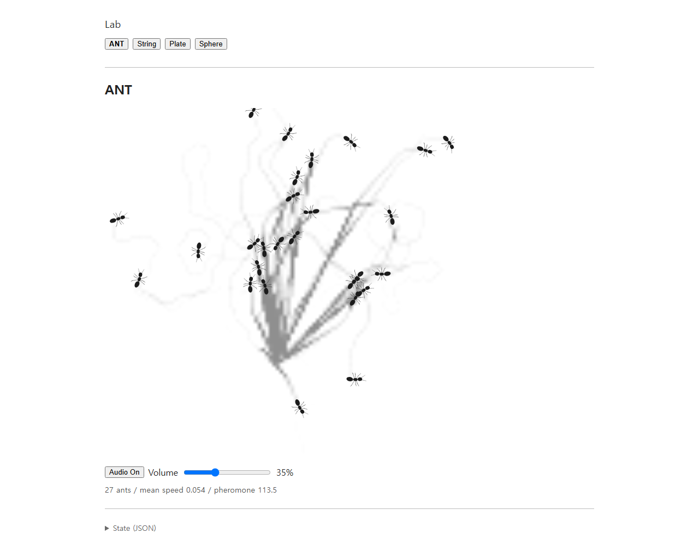
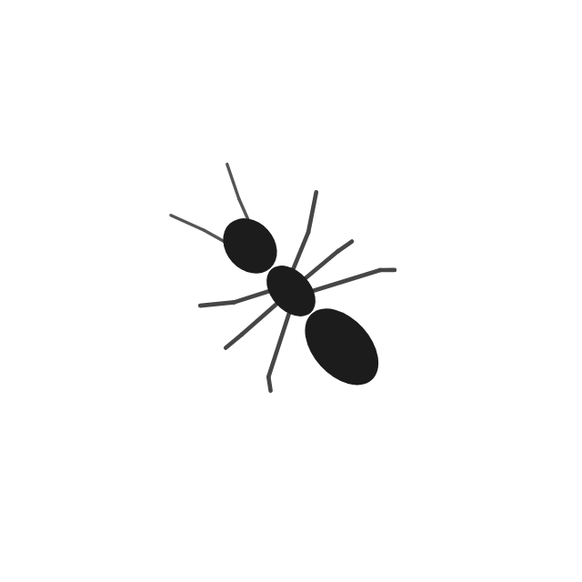
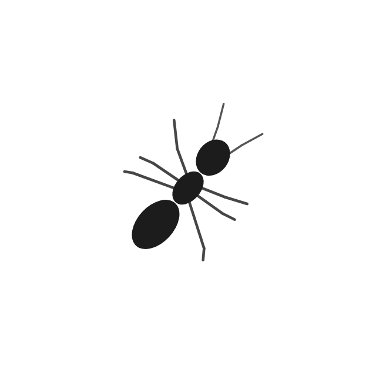
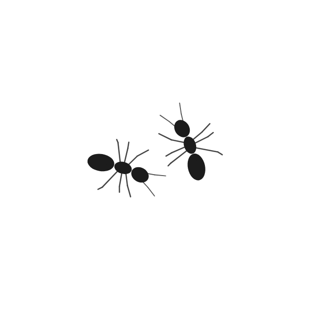
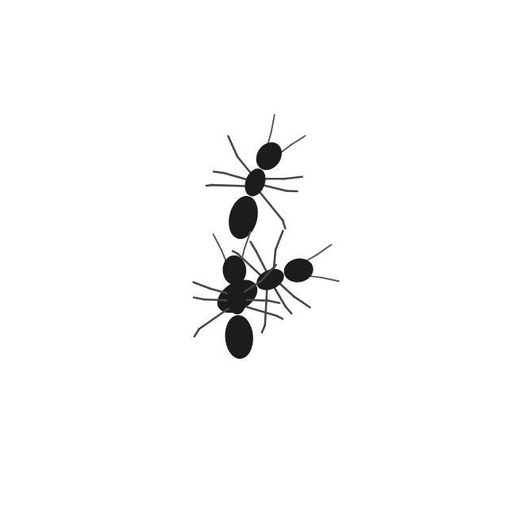

# ANT body articulation and leg readability

This pass adds render-only head lead and gaster lag, and makes the existing knee bends easier to read. The actual ANT renderer and model were sampled in the dev browser after 20.0 additional simulated seconds. The full-page capture is at 22.6 total simulated seconds. These focused views are zoomed renderings of snapshots taken from that natural run; they do not represent a second simulation.

The focused snapshots below show the same renderer at straight, gentle-turn, and sharp-turn states. The model also produced a close opposing-heading approach and a dense spawn-area sample.

| State | Evidence |
| --- | --- |
| Straight walk |  |
| Gentle turn |  |
| Sharp turn |  |
| Opposing approach |  |
| Dense spawn area |  |

The sample record is in [`turn-samples.json`](turn-samples.json). It records 2,028 straight, 608 gentle-turn, and 14,696 sharp-turn observations. The captured opposing-heading pair was 0.0502 normalized units apart while closing at 0.0281 units per second. The spawn area reached four ants at once; the saved view shows three at the sampled instant. At the live screenshot, 27 ants were active and the minimum center-to-center separation was 0.0134, slightly greater than the unchanged 0.012 body diameter.

## Exact values

Before editing, the checked-in working tree had max turn rate `4.5 rad/s`, acceleration response `32`, brake response `37`, max speed `preferredSpeed × 1.35`, and trail-steering angular-velocity clamp `±2.2`. Those movement values remain unchanged. `AntAgent` now includes its already-computed `angularVelocity` in the read-only snapshot and exports the existing `4.5` turn-rate limit for the renderer to normalize against; no movement computation changed.

The body geometry was retained: gaster center `−1.35r`, size `1.60r × 1.02r`; petiole center `−0.90r`, size `0.28r × 0.22r`; thorax center `0`, size `1.05r × 0.70r`; and head center `+1.09r`, size `1.08r × 0.86r`.

Head yaw is `clamp(angularVelocity / 4.5, −1, 1) × 0.23 rad`, about a `+0.54r` thorax-front pivot. The antennae share the head-local transform. Gaster yaw is the opposite signal times `0.12 rad`, pivoting at the petiole near `−0.90r`. Both relative rotations are zero at zero angular velocity and clamp symmetrically.

The manually tuned leg lengths and stance values remain: roots `[0.45, 0, −0.45]r`, front-to-rear foot offsets `[1.95, 0, −2.00]r`, lateral reaches `[3.05, 3.10, 3.25]r`, stride amplitude `0.52r`, stance fraction `0.62`, and stride cycle `0.036` with its existing per-ant variation. To address the visibly straight knees in the first capture, only the knee placement arrays changed from `along [0.42, 0.50, 0.58]`, outward `[0.44, 0.48, 0.48]r`, and fore-aft bias `[0.10, 0, −0.10]r` to `along [0.34, 0.50, 0.66]`, outward `[0.56, 0.60, 0.58]r`, and bias `[0.16, 0, −0.16]r`. Root and foot positions, gait phase, tripod timing, contact filtering, and the `FOOT_CONTACT` schema did not change.

## Verification

- `npm run test:browser` passed against Vite dev. It observed finite gait phases and all six legs per active ant, both tripod groups, in-domain contacts, natural straight/gentle/sharp turns, the opposing-heading approach, and the spawn-area crowd. Audio was restored to its prior test state after silent simulation sampling.
- Focused renderer and gait suites passed: 7 renderer tests and 8 gait tests.
- `npm run build` passed.
- `npm test` ran 127 tests; 123 passed and 4 existing movement/trail-following assertions failed (`isolated ant has repeated near-stops`, `approaching bodies brake smoothly`, `agents retain independent inertia`, and `narrow straight trail`). The failing assertions exercise current locomotion behavior; this pass changes only the read-only angular-velocity snapshot field and knee placement, so they were left outside scope.

No occupancy, pheromone, gait timing, foot location, population, spawn, audio, chemical, mortality, or UI behavior was changed.
