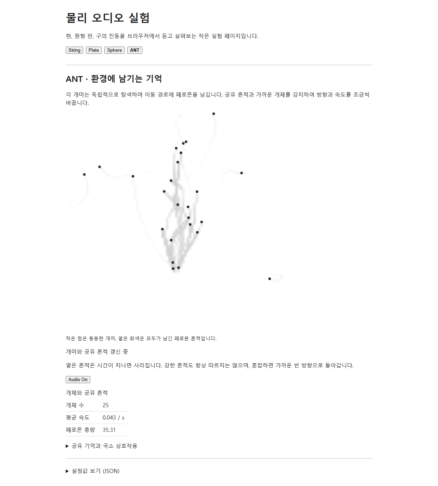

# ANT AUDIO v0 검증 — 2026-10-05

거리 기반 STEP을 기존 Plate에 연결한 첫 오디오 실험의 선별 화면과 측정 기록입니다. [Audio On 화면](./ant-audio-on.png)은 production 브라우저 실행을 약 20초 진행한 뒤 캡처했습니다. 개미를 수동 배치하거나 경로를 미리 만들지 않았으며, 이 실행의 난수 시드는 고정하지 않았습니다. 시각적 행렬의 지속성을 입증하는 자료로 사용하지 않습니다.

연결은 `AntController → StepEventGenerator → AntAudioBridge → PlateModel → 기존 AudioEngine / plate.worklet.js`입니다. 실제 접촉 제약 뒤의 이동 거리만 STEP 빈도에 반영합니다. 기본 stepLength 0.018과 strikeStrength 0.035에 개체별 고정 ±4% 편차를 적용하며 이동 난수는 사용하지 않습니다. 좌표는 `(2x−1, 2y−1) × 0.92/√2`로 기존 원형 Plate의 타격 지점에 전달합니다.

새 보호 한도는 기본 개체당 `advance()`당 최대 4 STEP과 타격 강도 0.05입니다. 기존 Plate 타격 큐의 24개 제한과 출력의 soft limiter·gain 0.7은 유지했습니다. 24개를 넘는 동시 타격은 기존 Worklet에서 버려질 수 있습니다. 오디오 신호나 자원 상태가 개미 행동으로 돌아가는 경로는 없습니다.

- 전체 Node 테스트: 100/100 통과. 거리 잔여분, 정지·주저·정체와 재개, 동시 STEP의 서로 다른 위치, On/Off 초기화 경합, 늦은 타격 취소, Plate 동시 타격의 유한 출력과 기존 제한을 확인했습니다.
- 빌드와 개발·production 브라우저 검증: 통과. 기본 Off에서 자원을 만들지 않고, 사용자 On에서 기존 Plate를 준비하며, Off/재활성화/모델 전환/앱 파괴 시 수명을 확인했습니다.
- [production 브라우저 측정](./browser-metrics.json): 공유 AudioContext 하나, Plate 모듈 하나, processor 오류 0. 진행된 화면을 캡처한 시점에 재활성화한 Plate에 582개 타격이 전달됐고, 전환 뒤 모든 Plate port가 닫혔습니다. 닫힌 port로의 메시지와 이후 타격은 없었습니다. PCM RMS는 Worklet 출력에서 측정한 값으로, 출력 gain 전의 값입니다. 이는 출력과 수명 검증이며 별도 청감 평가 결과는 아닙니다.
- [변경 전 모델과의 비교](./behavior-comparison.json): 기준 커밋 `bf1da87e070fe52ba06e4008a14e8de7c48242d9`의 controller와 세 시드 27/61/193을 각각 120초 실행했습니다. 각 실행의 241개 스냅샷(총 723개), 스폰 시각, 모든 이동 난수 호출 수가 정확히 일치했습니다. 이 비교는 기록용 오디오 transport를 사용했고 실제 Plate 출력은 브라우저에서 별도로 검사했습니다.

이미지는 원본 `test-results/ant-production.png`와 byte 단위로 동일합니다. SHA-256: `8275678d835d34d8cde11537746c99be6117dd3f11a8b72940652be7b61c4a07`.

