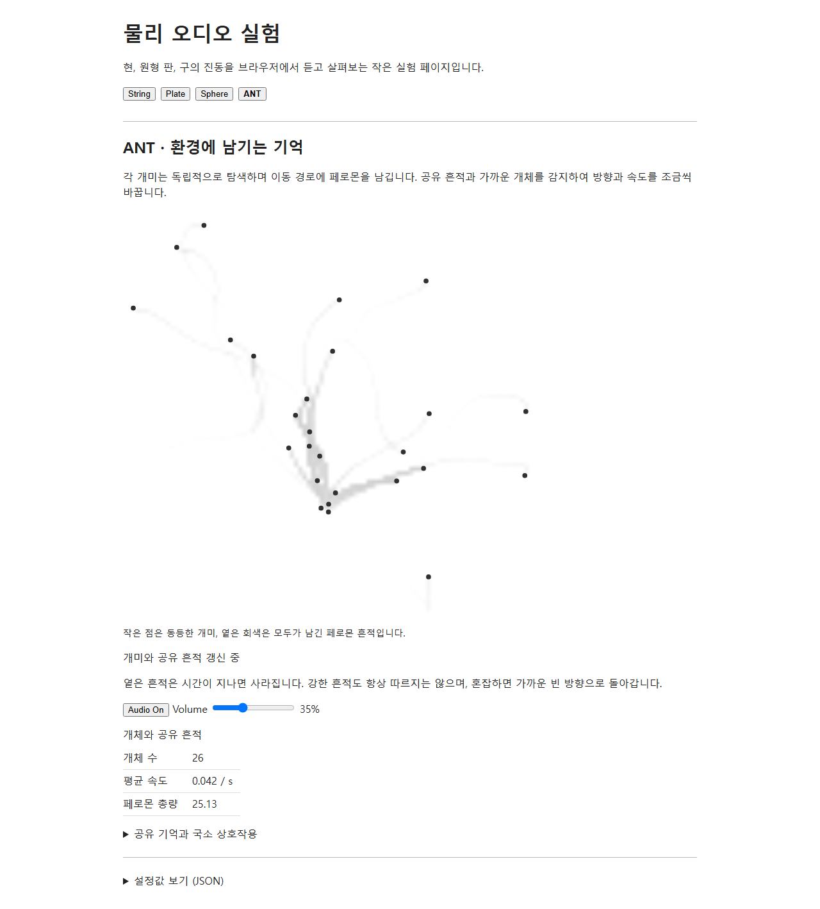

# ANT 볼륨 UI 검증 — 2026-10-05

Audio On/Off 옆에 기본 HTML range와 현재 백분율을 추가했습니다. 0–100%이며 기본 100%는 기존 Plate gain 0.7입니다. ANT 브리지가 기존 출력 GainNode를 20 ms ramp로 조절하며 STEP 강도·좌표·타이밍과 ANT 행동은 바꾸지 않습니다.

위 화면은 production preview의 자연 실행에서 Audio On/Off와 볼륨을 검증한 뒤 15초를 더 진행해 캡처했습니다. Audio On과 Volume 35%가 같은 줄에 보이며, 개미와 공유 흔적도 계속 갱신됩니다. 이 스크린샷은 볼륨 UI의 배치 기록입니다.

검증 결과:

- `npm test`: 102개 모두 통과.
- `npm run build`: 통과. 최종 production 브라우저 검사도 최신 소스로 다시 빌드했습니다.
- `npm run test:browser`: 개발 서버 검사 통과.
- `npm run test:browser -- --production`: production 검사 통과.
- 기본 100%, Off에서 변경해도 AudioContext·Worklet 미생성, On의 65%·0%·35% 실제 GainNode 값, Off/On 후 35% 유지 확인.
- 모델 전환 뒤 ANT Plate port가 모두 닫히고 이후 타격이 생기지 않는 기존 수명 검사도 통과.

[browser-metrics.json](browser-metrics.json)은 화면 시점의 35%와 출력 gain 목표 0.245, 공유 context·Plate module·타격·정리 기록을 담습니다. PCM RMS는 출력 gain 앞의 Worklet 신호 측정이며 최종 출력 음량이나 청감 평가를 뜻하지 않습니다.

이전 AUDIO v0와 페로몬 검증 화면은 기존 evidence 폴더에 보존했습니다.
