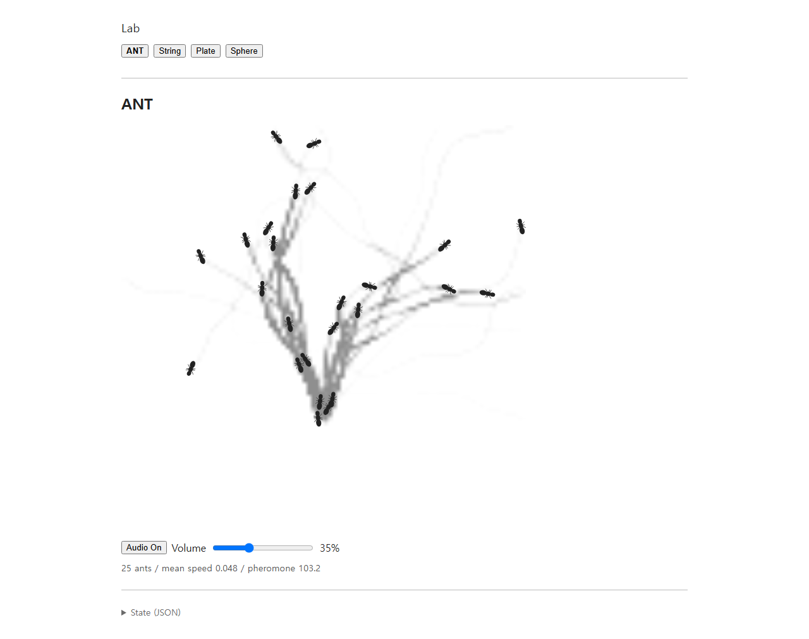
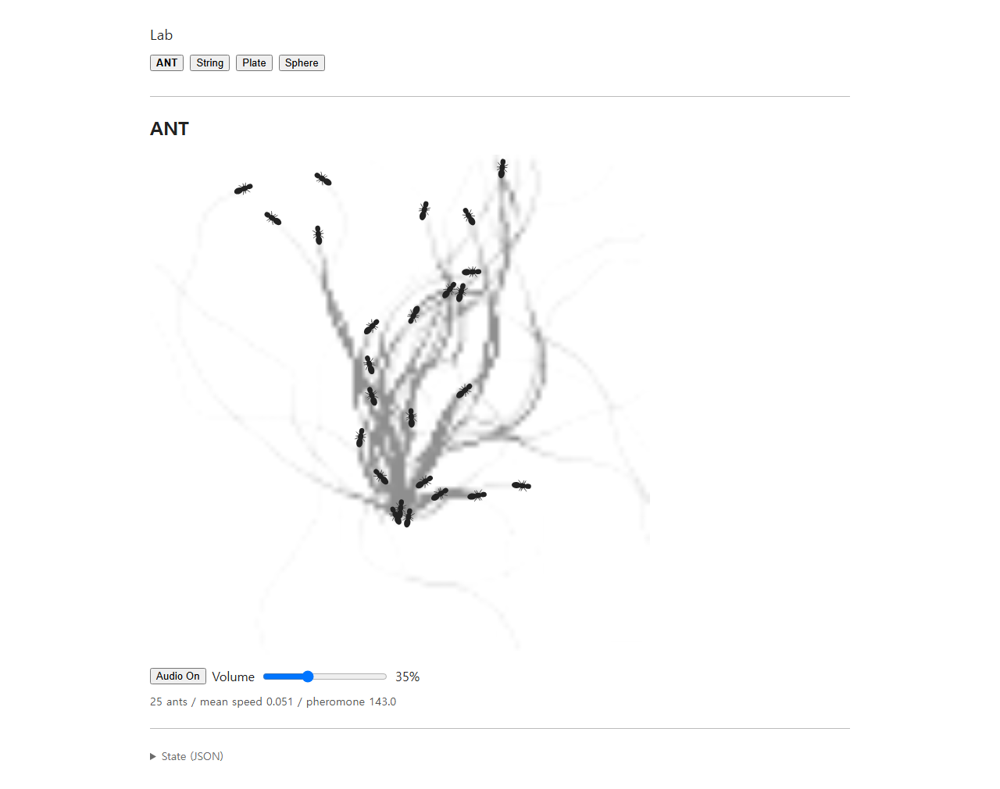

# ANT gait, FOOT_CONTACT, and render evidence — 2026-10-05

이 실행은 `dc89f9265f0cb1f16453be5a5073ffe57f6ba3d5` 이후의 작업 트리에서 **시각 gait, 발 접촉 오디오, 페로몬 표시 transfer만** 적용한 기록입니다. ANT 이동/의사결정, LocalOccupancy, 흔적 감지/adherence, 침적·감쇠, population/spawn, encounter/quorum/raid, UI layout, shared Plate DSP 설정은 조정하지 않았습니다.

## Screenshots

개발 화면은 20초 simulated time을 진행한 후 Audio On, Volume 35%에서 캡처했습니다. 여기에는 25마리, simulation clock 22.77초, 평균 속도 0.0483, pheromone mass 103.0이 기록되어 있습니다.

빌드된 production 화면은 추가 약 30초 wall-clock 실행 뒤 캡처했습니다. 저장한 별도 production telemetry는 같은 검사 과정에서 읽은 앱 진단 문자열과 Web Audio/Plate 관측값입니다. production screenshot은 natural-run 시각 기록이며 한 장면만으로 개체 행렬 성공을 판정하지 않습니다.

## Measured behavior

`dev-live-metrics.json`은 개발 앱의 실제 controller를 계측했습니다. 20초 동안 983개의 touchdown 그룹이 만들어졌고 A 493회, B 490회였습니다. 접촉을 낸 고유 ant ID는 34개였으며 시점에 따라 일부 개체는 이미 교체됐습니다. 25개 snapshot 모두 여섯 leg geometry와 유한한 phase를 가졌습니다. 영역 밖 접촉은 0건이고 최소 중심 간격은 0.02034였습니다(충돌 반경은 개체당 0.006). 해당 접촉으로 기존 한 Plate processor의 2개 출력 채널이 활성화되었습니다. ANT UI에서 재생되는 소리를 직접 청취한 평가는 포함하지 않습니다.

`production-audio-stereo-lifecycle.json`은 production 검증에서 한 기존 Plate Worklet/공유 AudioContext, 두 physical pickup, 공통 output gain, 1,684 strike messages, PCM 관측값, ANT에서 전환 후 port 정리를 기록합니다. measured RMS는 Worklet 출력을 도청한 검사값이며 기기 최종 음량을 뜻하지 않습니다.

`long-run-checks.json`은 기본 설정·seed 61의 600초(36,000 tick) 실행입니다. 위치/속도는 매 tick 유한했고 속도는 모든 개체의 기존 `preferredSpeed × 1.35` cap 안에 있었습니다. 기록된 최대 속도는 0.10334입니다. 매 tick의 충돌 검사에서 허용 표면 간격 오차 `1e-7`보다 큰 겹침은 없었습니다. 최소 측정 간격은 `−3.10e-8`로, 이 검사 허용치 안의 부동소수점 오차입니다. 최대 활성 수는 기본 목표 28 이하였고 794개의 고유 ID 중 769개가 퇴장한 뒤 개체군은 25였습니다.

## Verification

- `npm test`: 125 tests passed.
- `npm run build`: passed. Vite printed existing dependency comment annotations and bundle-size advisories.
- `npm run test:browser`: passed against Vite dev.
- `npm run test:browser -- --production`: passed against a production preview; stereo channels produced finite nonzero PCM and model switch closed all ANT Plate ports without late strikes or processor errors.
- Turnover evidence: `node scripts/ant-turnover-evidence.js`, 600 seconds, finite movement, within existing speed caps, body-contact constraint, gradual population, and shared field continuity.

The screenshots show stronger grayscale trail visibility and the articulated body/leg rendering. Trails still branch in these short natural-run captures; they are saved as implementation evidence, not proof that a stable procession emerged.

## Files changed in this pass

- `src/lib/agents/ant/GaitController.js`
- `src/lib/agents/ant/AntController.js`
- `src/lib/audio/AntAudioBridge.js`
- `src/lib/index.js`
- `src/lib/renderers/AntRenderer.js`
- `scripts/ant-turnover-evidence.js`
- `scripts/browser-check.js`
- `tests/ant-gait.test.js`
- `tests/ant-audio-bridge.test.js`
- `tests/ant-audio-integration.test.js`
- `tests/ant-renderer.test.js`
- `tests/ant-turnover.test.js`
- `README.md`
