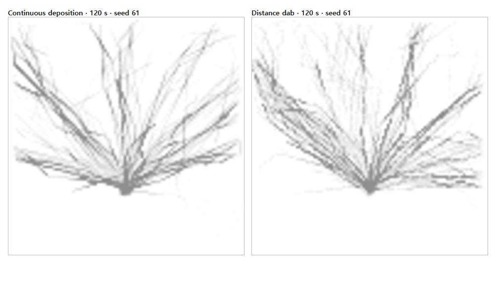
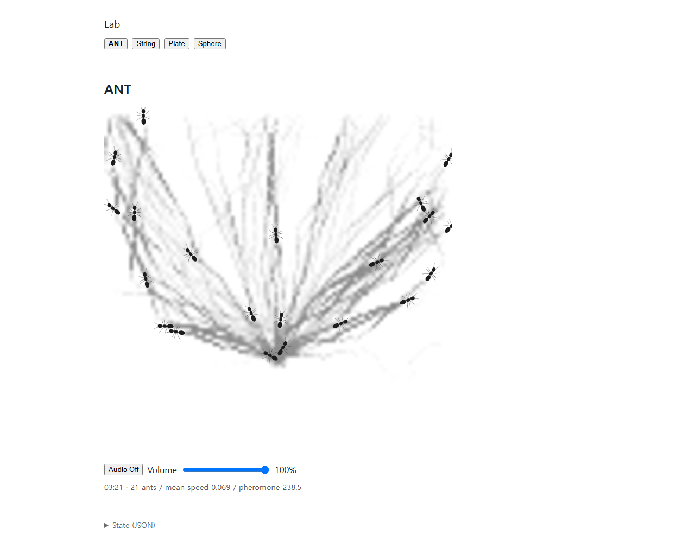
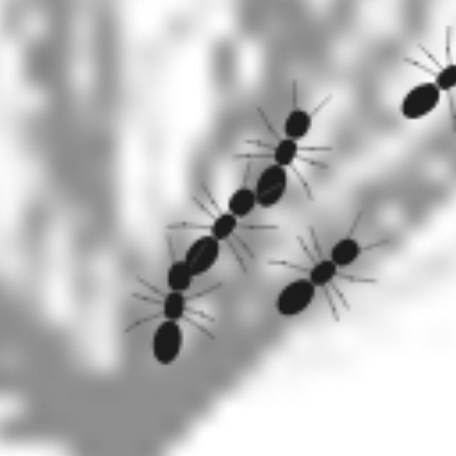

# ANT integrated refinement — 2026-10-05

## 기준 상태와 검증 범위

시작 HEAD는 `e45a99e9c232580e3806b540b5cdb9ff2fd2978b` (`Add render-only ANT body articulation`)입니다. 시작 시 main working tree와 diff는 비어 있었습니다. 현재 소스·README·AGENTS·이전 articulation evidence를 먼저 확인했습니다. [최초 테스트 기록](baseline-tests.txt)은 127개 중 123 pass / 4 fail입니다.

네 실패는 승인된 이동 tuning과 충돌하는 이전 assertion이었습니다. 세 개는 현재 이동이 사용하지 않는 `personality.acceleration / dt` 계열의 프레임별 속도 변화 상한을, 하나는 60 Hz tick에서 heading 변화가 0.04 rad 미만이어야 한다고 검사했습니다. 현재 지수 응답과 4.5 rad/s의 0.075 rad/tick 상한에 맞추어 검사하고, 주저·전진·경로 중심·접근 중 미리 제동·속도 상한·swept contact 검사는 유지했습니다.

다음 값과 행동은 유지했습니다.

| 항목 | 값 / 상태 |
|---|---|
| max turn rate | 4.5 rad/s |
| acceleration / braking response | 32 / 37 |
| max speed | preferredSpeed × 1.35 |
| trail angular-velocity clamp | ±2.2 |
| field / cap | 96×96 / 8 |
| half-life / distance amount / radius | 15 s / 4.5 / 0.0045 |
| reinforcement | 0.5 + 5 × trailAdherence² |
| spawn geometry / cadence | (0.5, 0.72), radius 0.018; 400–900 ms, blocked retry 120 ms |
| locomotion / local traffic / LCR / adherence / personality / hesitation | implementation unchanged |
| FOOT_CONTACT timing, phase, schema, individual foot positions | unchanged |
| AudioEngine / AntAudioBridge / PlateModel / Worklet DSP | unchanged |

SurfaceField, material wear, food, hormones, encounter/quorum/raid states를 추가하지 않았습니다. 새 colony signal도 이름 붙인 행동 상태가 아닙니다.

## Body pose와 silhouette

이전 구현은 순간 angularVelocity를 head ±0.23 / gaster ±0.12에 바로 대응시켰습니다. 빠른 ±4.5 부호 전환이 거의 최대 관절 회전으로 나타난 것이 twitch의 원인이었습니다.

`BodyPoseController`는 raw turn을 ±4.5로 정규화하고 0.04의 연속 dead zone을 적용합니다. `value += (target - value) × -expm1(-dt / tau)`를 사용해 turn을 0.30 s, head를 0.12 s, gaster를 0.45 s로 평활화합니다. Head target은 turn ×0.12 rad, gaster target은 turn ×−0.08 rad입니다. 새 난수나 turning state 없이 simulation time으로 진행합니다. Pose는 renderer와 gaster secretion geometry에만 전달합니다.

다리 root 앞뒤 `[0.45, 0, -0.45]`, foot 앞뒤 `[1.95, 0, -2.00]`, lateral reaches `[3.05, 3.10, 3.25]`, fore-aft amplitude 0.52는 유지했습니다. Root lateral은 `[0.30, 0.34, 0.32]`, knee along은 `[0.32, 0.44, 0.54]`, knee outward는 `[0.50, 0.56, 0.52]`, bias는 `[0.14, 0, -0.14]`로 변경했습니다. 회색 65, stroke `max(0.45, r × 0.06)`로 그리는 두 leg segment 위에 body fill 28을 그립니다. Root는 thorax 아래로 가려집니다. 새로운 관절이나 gait/contact 변경은 없습니다.

기존 L/C/R sensing의 같은 결과를 `bodyPose.localPheromone`에 복사합니다. L/R 각각 `v/(v+0.018)`로 포화한 뒤 좌우 차이에 dead zone 0.04를 적용합니다. 공통 engagement는 양측 신호의 최소값 ×0.35, 우세 측은 차이 bias ×0.65를 더하며, 0.40 s로 평활화합니다. 안테나 tip은 같은 head transform 안에서 약간 늘어나고 벌어집니다. 추가 field sampling과 antenna-tip sensing은 없습니다.

[Body motion video](body-pose-motion.webm), [temporal measurements](body-motion-metrics.json), [silhouette / turn sequence](articulation-and-leg-sequence.png)를 함께 보존합니다. Synthetic sustained turn은 head 약 0.12 / gaster −0.08로 천천히 수렴했습니다. 매 tick ±4.5를 교대하는 input에서는 마지막 head 약 0.000231 / gaster −0.0000446 rad로 강하게 억제됐습니다. Synthetic 구간은 simulation locomotion을 멈추고 body pose만 고정 dt로 진행하는 별도 QA이며 자연 행동 증거로 사용하지 않습니다.

## Gaster secretion과 dab

공유 geometry의 렌더 단위는 `r = 2 × bodyRadius`입니다. Petiole/gaster pivot은 thorax-local `(-0.90r, 0)`, gaster center는 pivot-local `(-0.45r, 0)`, 반길이는 0.80r입니다. Local rear tip `(-1.25r, 0)`를 smoothed gasterYaw로 회전한 뒤 pivot에 더하고, thorax heading과 위치로 world 변환합니다. 직진 시 thorax 뒤 2.15r = 기본 0.0258입니다. Renderer와 deposition이 같은 pose와 상수를 사용합니다.

Dose는 collision 뒤 실제 관측 thorax 이동 거리 × 기존 강화된 amount로 정합니다. Rear의 회전이 경로 길이를 바꿔도 dose 자체는 늘리지 않습니다. Continuous mode는 그 dose를 rear segment 길이로 나누어 기존 segment brush에 전달합니다.

기본 `pheromone.depositionMode: 'dab'`은 실제 이동 0.006마다 누적 dose를 point brush로 전달합니다. 이는 기본 stride 0.036의 1/6입니다. Threshold 지점은 현재 rear segment에서 보간하고 여러 threshold를 모두 소비합니다. 남은 거리와 가중 dose는 다음 tick으로 보존하고 retirement / mode change / 명시적 ceiling 감소 시 최종 rear에 flush합니다. 순수 회전·정지는 새 dose를 쌓지 않습니다. 영역 밖 secretion point는 field에서 제외하며 가장자리로 clamp하지 않습니다.

비정상 큰 입력만 256개의 spaced dab 뒤 나머지 dose를 endpoint dab 하나로 합칩니다. 이 보호는 총량을 버리지 않으며 정상 fixed tick에서는 도달하지 않습니다. `'continuous'` 설정은 비교 실험으로 유지합니다.

[동일 경로 dose와 3-seed 자연 비교](deposition-comparison.json): 동일 0.036 이동과 변화하는 강화량의 예상 dose 0.3807에 대해 continuous 0.380700005218 / dab 0.380699999630, 상대 차이 약 1.47×10⁻⁸입니다. 자연 실행에서 총량 차이는 경로·adherence가 달라진 결과이며 같은 경로 dose 보존 검증과 구분합니다.



120 s / seed 61 / feedback off의 실제 controller field를 실제 AntRenderer의 480×480 canvas에서 비교했습니다. 두 field는 별도의 자연 실행이라 경로가 완전히 같지는 않습니다. Dab은 겹친 경로에서 조금 더 granular하지만 정상 크기에서 분리된 점선으로 끊기는 현상은 보이지 않았습니다. Mean dose 보존과 600 s 연속 모드 비교에서 harmful macro regression이 확인되지 않아 dab을 기본으로 채택했습니다.

## 표시와 시간

96×96 field image 확대에 canvas `imageSmoothingEnabled = true`, `imageSmoothingQuality = 'high'`와 p5 smoothing을 적용합니다. 기존 two-scale 고정 alpha mapping `min(112, round(base×22 + route×90))`은 유지합니다. Frame maximum 기반 contrast normalization이나 model field 변경은 없습니다. [비교 provenance](continuous-vs-dab-render.json)를 보존합니다.

Diagnostics는 `simulationTimeMs`에서 `mm:ss · N ants / mean speed … / pheromone …`를 표시합니다. 1시간부터 `hh:mm:ss`로 전환합니다. 벽시계와 연결하지 않았고 UI layout이나 추가 dashboard는 만들지 않았습니다.

## Local colony activation

Spawn 중심을 직접 읽지 않고 반경 0.06 / 0.09 / 0.12의 고리에서 16방향, 총 48개 bilinear field 값을 읽습니다. 각 농도를 `v/(v+0.04)`로 포화한 뒤 각 방향에서 반경 3개의 평균을 구합니다. 가장 강한 4방향 평균이 local evidence입니다. 입구 밖으로 뻗는 여러 지점의 경로 증거를 사용하며 global mass는 모집 입력이 아닙니다.

`activation += (evidence - activation) × (1 - exp(-dt/45))`

`desiredPopulation = 8 + (population.count - 8) × activation`

`recruitmentLimit = floor(desiredPopulation + 1e-9)`

Activation은 bounded continuous 값이고 45 s time constant입니다. 기본 floor 8 / ceiling 28이며 기존 ceiling 설정 범위 8–100을 유지합니다. Floor는 즉시 보충하는 강제 active count가 아닙니다. 시작은 여전히 한 마리입니다. 매 tick의 모집 압력이 한도 아래의 entry만 예약하고, 한도 이상에서는 pending entry를 취소합니다. 낮은 activation은 살아 있는 ants를 제거하지 않습니다. 자연 boundary exit와 recruitment는 분리됐습니다. 여러 exit에도 최대 한 마리씩 기존 simulation-clock cadence로 들어옵니다.

`population.activationFeedback: false`로 기존 고정 상한 모집을 비교할 수 있습니다. 이때 colony field sampling을 하지 않으며 실제 desired/limit은 configured count입니다. 공유 field와 개체 성향·ID·pose·gait는 지속됩니다. 기존 명시적 설정으로 ceiling을 줄이는 `configure()`의 truncation만 유지합니다; 이는 activation-driven culling과 별개입니다.

## 검증 결과와 한계

- [Final native tests](final-tests.txt): **155 / 155 pass**, failure 0. Pose symmetry/alternation/relaxation, rear geometry, distance dose, no rotation accumulation, LCR reuse, field render non-mutation, time formatting, controller recruitment/cadence/no-cull/no exit replacement, original gait/audio/traffic/contracts를 검사합니다.
- [Production build](final-build.txt): pass. 기존 큰 p5 bundle 경고와 dependency PURE annotation 경고가 남습니다.
- Chrome Vite full browser check + `--record-ant-evidence`: pass. Normal Audio On, Off/On race/volume, context/Worklet cleanup, model switching, ANT snapshots/poses, elapsed UI, layouts와 기존 String/Plate/Sphere regression을 검사했습니다.
- [Chrome production preview full browser check](production-browser.txt): pass.
- [600 s default dab / feedback baseline](long-run-dab.json), [600 s continuous comparison](long-run-continuous.json): seeds 61 / 20261005 / 193. On runs는 각각 36,000 fixed ticks, Off seed 61도 같은 기간입니다. Agents/poses/activation/map IDs/spawning과 모든 pair의 swept closest approach를 매 tick 검사하며, field 전체 finite 여부는 8개 checkpoint에서 검사합니다. 모든 FOOT_CONTACT의 centroid와 개별 foot position을 검사합니다.

| Default dab, 600 s | seed 61 | seed 20261005 | seed 193 |
|---|---:|---:|---:|
| Active count at 600 s | 20 | 20 | 19 |
| Activation | 0.7642 | 0.7806 | 0.7608 |
| Recruitment limit at 600 s | 23 | 23 | 23 |
| Total spawned / retired | 803 / 783 | 784 / 764 | 788 / 769 |
| Observed active maximum | 23 | 23 | 23 |
| 10 s bins with rise / fall | 30 / 22 | 32 / 19 | 27 / 20 |
| Valid FOOT_CONTACT groups | 35,327 | 35,067 | 34,991 |
| Raw minimum swept surface gap | −4.02e−9 | −2.51e−9 | −8.00e−9 |

Seed 61의 active 수는 0/15/30/60/120/180/300/600 s에서 1/8/10/15/19/19/19/20입니다. 자연 실행에서 큰 주기적 breathing은 확인되지 않았고 작은 증감과 느린 recruitment 변화가 나타났습니다. 이를 특정 macro rhythm의 성공으로 해석하지 않습니다. 상한을 넘거나 순간적인 trail dip으로 소멸하지 않았고 activation의 최대 tick 변화는 약 0.000188이었습니다.

모든 run에서 최대 속도는 0.11946 이하이며 실제 preferredSpeed×1.35 초과 측정값은 0입니다. 원래 solver의 접촉 tolerance가 여러 tick 누적되며 약 10⁻⁸ 수준의 음수 surface gap이 있었습니다. 따라서 **엄밀한 0-penetration이라고 주장하지 않습니다**. Raw grazing samples를 삭제하지 않고 JSON에 남겼습니다. Evidence의 material penetration 분류 기준은 −1e−6이며 그 이하 0건, center pass-through와 pair relative-direction flip도 0건입니다. Continuous runs의 raw 최소값도 약 −6.45e−9 / −1.09e−8 / −8.67e−9이므로 dab 특유의 현상이 아닙니다. `LocalOccupancy`는 이 pass에서 변경하지 않았습니다.

### 실제 자연 이동



[Natural motion video](natural-run-motion.webm)와 [측정/provenance](natural-motion-metrics.json)는 자연 fixed-step 실행으로 180 s까지 진행한 뒤 app의 실제 RAF를 복원하여 20 wall seconds를 관찰한 것입니다. Agents/path를 수동 배치하지 않았습니다. 40개 표본에서 simulation time이 약 19.85 s 진행했고, 같은 ant-145는 약 0.533 이동했습니다. [Live pose crop sequence](live-pose-sequence.png)를 함께 보존합니다. Frame sequence와 실제 motion video에서 colony-wide abrupt yaw snapping은 보이지 않았지만, 500 ms 표본의 시각 검사는 모든 60 Hz frame의 jitter 부재를 증명하지 않습니다. Fixed-step pose tests가 빠른 alternating input을 별도로 검사합니다.

[Initial ant](initial-single.png), [60 s growth](growth-01m00.png), [2 s head-on approach](head-on-02s.png)도 보존합니다. 기존 opposing/crossing avoidance와 swept separation regression test는 통과했습니다.



159.57–160.57 s에 ant-163 → ant-162 → ant-160이 같은 강화 경로에서 순서를 유지했습니다. 최소 projected headway 약 0.0385 / 최대 lateral offset 약 0.0149입니다. 양 endpoint에서 adherence ≥0.26과 local field 0.055–0.221을 기록했습니다. 이는 **약 1초의 자연 행렬**이며 지속적인 colony-wide procession이 확립됐다는 증거는 아닙니다. 이후 해체/분기도 계속 발생합니다.

### 현재 Plate audio evidence

[Natural audio WebM](natural-run-audio.webm), [PCM/event/graph metadata](natural-run-audio.json), [녹음 이후 화면](audio-run-final.png)을 보존합니다. Real Chrome에서 기존 Audio On을 클릭한 뒤 autonomous RAF를 녹음했습니다. 기존 final GainNode → AudioContext.destination 연결을 유지하고 같은 GainNode에 MediaStreamAudioDestination을 병렬 연결했습니다. DSP / strike strength / Plate parameters / contact timing은 바꾸지 않았습니다.

- 실제 clip 19.98 s; simulation time 22.85–42.85 s; active population 9–13.
- AudioContext running / 48 kHz / stereo. 기존 volume lifecycle 검사에서 선택한 Volume 35%, effective final gain 0.245를 녹음 동안 유지했습니다.
- 737 Plate strike messages; 734 interval FOOT_CONTACT groups; 21 unique ants; 2,187 individual foot positions. Interval endpoint와 asynchronous message delivery 때문에 strike와 event 수가 정확히 같지는 않습니다.
- RMS L 0.11353 / R 0.11276, peak 약 L 0.220 / R 0.217.
- Decoded PCM에서 non-finite 0 / clipped 0 / sample discontinuity >0.8 0; 전체 silence false.

오디오 helper로 직접 청취를 시도했으나 이 세션의 모델은 audio input을 지원하지 않았습니다. 위 결과는 수치 검증입니다. 작은 click, 청감상 dropout, impact density의 적절함, stereo의 미학적 균형은 **청취 완료로 판정하지 않았습니다**. 녹음은 후속 인간 청취용 원본 증거입니다.

## 재실행

```powershell
npm test
npm run build
$env:BROWSER_EXECUTABLE_PATH = 'C:\Program Files\Google\Chrome\Application\chrome.exe'
npm run test:browser -- --record-ant-evidence
npm run test:browser -- --production
node scripts/ant-motion-evidence.js
node scripts/ant-deposition-evidence.js --seconds=120 --samples=30,60,120
node scripts/ant-long-run-evidence.js --feedback=both
node scripts/ant-long-run-evidence.js --deposition=continuous --output=test-results/ant-long-run-continuous.json
```

Generated `test-results/`는 ignored입니다. 이 폴더에는 중요한 evidence만 이름을 정리하여 복사했습니다. JSON의 원래 cache absolute path는 원본 provenance이고 이 README의 relative link가 Git 보존 파일입니다.

## 변경 파일과 커밋

| 책임 | 정확한 파일 |
|---|---|
| Model / scheduling | `src/lib/agents/ant/AntController.js` |
| Body pose / geometry | `src/lib/agents/ant/BodyPoseController.js` |
| Render leg roots / knees | `src/lib/agents/ant/GaitController.js` |
| Deposition descriptors / accumulators | `src/lib/agents/ant/GasterDeposition.js` |
| Point brush API only | `src/lib/agents/ant/PheromoneField.js` |
| Local activation signal | `src/lib/agents/ant/ColonyActivation.js` |
| Public exports | `src/lib/index.js` |
| Pose drawing / display interpolation | `src/lib/renderers/AntRenderer.js` |
| Time formatting / existing diagnostics | `src/lib/utils/simulationTime.js`, `src/main.js` |
| Evidence harnesses | `scripts/ant-motion-evidence.js`, `scripts/ant-deposition-evidence.js`, `scripts/ant-long-run-evidence.js`, `scripts/browser-check.js` |
| New focused tests | `tests/ant-body-pose.test.js`, `tests/ant-gaster-deposition.test.js`, `tests/ant-gaster-integration.test.js`, `tests/ant-colony-activation.test.js`, `tests/ant-population-feedback.test.js`, `tests/simulation-time.test.js` |
| Updated existing tests | `tests/ant-controller.test.js`, `tests/ant-trail-following.test.js`, `tests/ant-renderer.test.js`, `tests/ant-turnover.test.js`, `tests/pheromone-field.test.js`, `tests/ant-audio-integration.test.js`, `tests/ant-traffic.test.js` |
| Documentation / selected outputs | root `README.md`, this evidence directory |

Reversible implementation commits:

1. `da173f2` — Stabilize ANT body kinematics and leg readability
2. `57f6509` — Connect ANT sensing visuals and distance-based gaster deposition
3. `05737be` — Smooth ANT pheromone display and show simulation time
4. `6f9b54a` — Add slow local colony activation and gradual ANT recruitment

Evidence / harness / documentation은 후속 독립 commit에 저장합니다. 최종 push HEAD는 작업 완료 보고와 Git history에 표시합니다.
