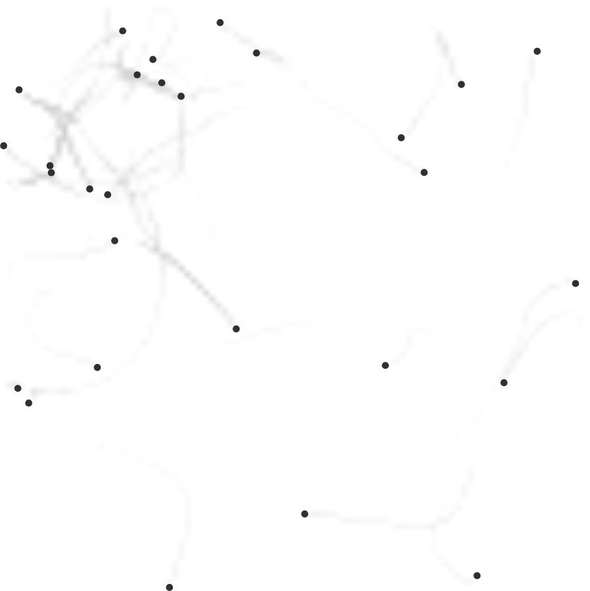
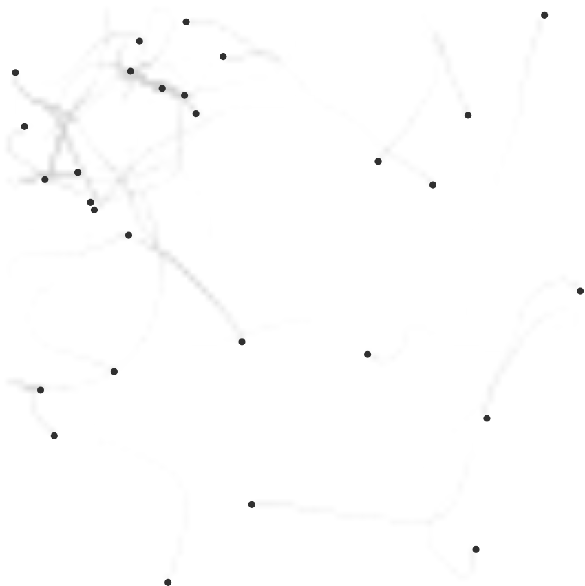
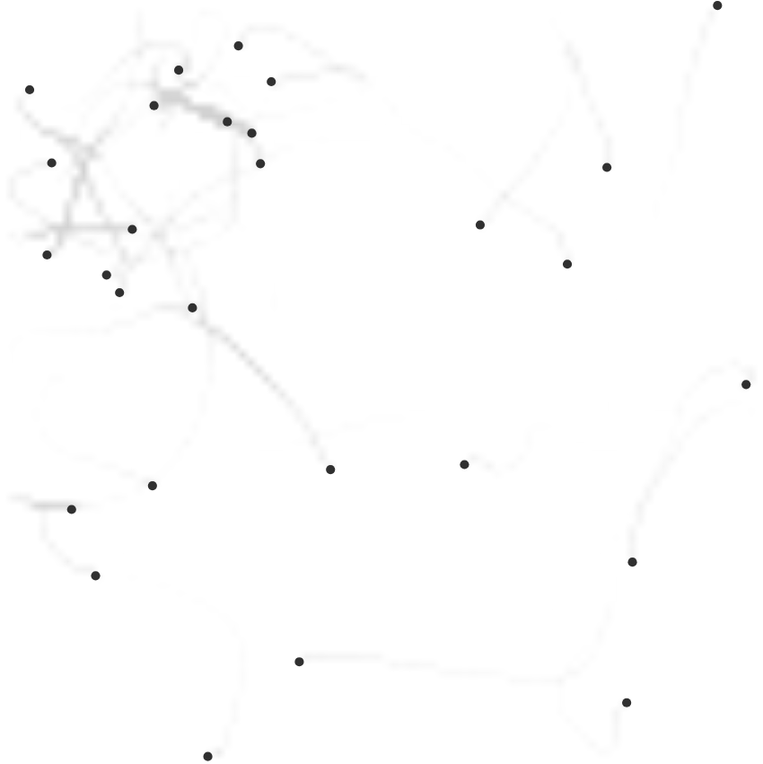
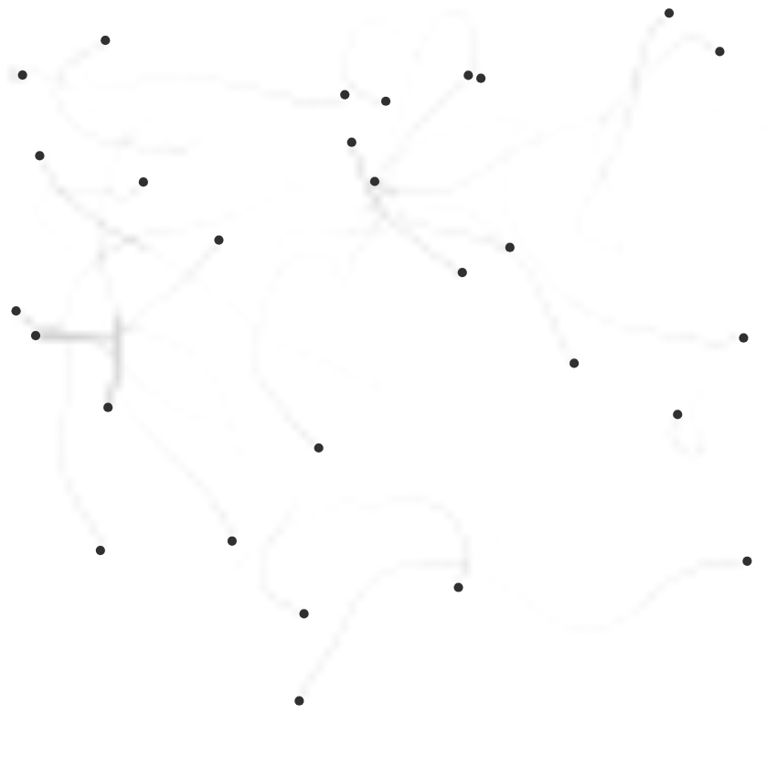

# ANT 페로몬 강화 시각 검증 — 2026-10-05

`f33fe3173cc063027f778cc541860f44e649d545`의 페로몬 강화 규칙과 그 앞 커밋 `8d209a27a7c3c3aa3ce65a147e5bad63ce211a55`의 방향 인지형 교통 동작을 검증하면서 선별한 화면입니다. 원본 PNG를 수정 없이 복사했으며, [evidence.json](./evidence.json)에 실행 조건, 개체별 측정값, 이미지 크기와 SHA-256을 함께 보존했습니다.

네 장 모두 개미를 수동 배치하거나 미리 경로를 침적하지 않은 기본 모델 실행 결과입니다. 시드는 난수의 재현성을 위한 값이며, 개체 수·스폰·센싱 등의 동작 설정은 기본값입니다. 시간 표기는 시뮬레이션 시간입니다. 기존 `AntRenderer`가 네이티브 모델 스냅샷을 그린 캔버스를 Vite와 headless Chromium에서 캡처했습니다.

- 침적 배율: `0.5 + 5 × trailAdherence²`
- 목표 개체 수: 28, 반감기: 3초, 격자: 96×96
- 이동 거리당 기준 침적량: 4.5, 침적 반경: 0.0045, 몸체 반지름: 0.006
- 시뮬레이션 간격: 1/60초, 실행 길이: 각 120초
- 난수: 32비트 LCG, `state = (1664525 × state + 1013904223) mod 2³²`, `random = state / 2³²`

| 이미지 | 시드 / 시뮬레이션 시간 | 관찰 |
| --- | --- | --- |
| [seed193-041s.png](./seed193-041s.png) | 193 / 41초 | 왼쪽 위 대각선 경로에 선두부터 `ant-15 → ant-11 → ant-13`이 이어집니다. 중심 간격은 약 0.040 / 0.044입니다. |
| [seed193-042s.png](./seed193-042s.png) | 193 / 42초 | 같은 세 개체가 순서를 유지하며 이동합니다. 중심 간격은 약 0.037 / 0.040입니다. |
| [seed193-042p5s.png](./seed193-042p5s.png) | 193 / 42.5초 | 선두가 방향을 바꾸면서 앞쪽 연결이 풀리고, 뒤의 두 개체 사이 연결은 남습니다. |
| [seed61-120s.png](./seed61-120s.png) | 61 / 120초 | 일부 강한 경로가 보이지만 개체들은 전반적으로 분산돼 있습니다. 장시간 결과의 한계를 함께 기록합니다. |

41·41.5·42초에 같은 두 이웃 관계가 반복된 것을 위치·속도로 확인한 뒤 실제 이미지를 검사했습니다. 이 구간의 중심 간격은 몸체 반지름 합 0.012보다 큽니다. 42.5초에는 앞쪽 관계가 탐지 기준을 벗어납니다. 다른 시드 27에서는 30초 이후 1초간 유지되는 세 개체 연결이 같은 탐지 조건으로 포착되지 않았습니다.

따라서 이 기록은 기본 실행에서 나타난 약 1초의 국소 행렬과 그 해체를 보여줍니다. 지속적인 전체 개체 행렬이나 행렬 발생 빈도의 증가를 입증하지는 않습니다. 초기에 스폰 경로를 따라 이어진 장면이나 수동 배치한 교통 테스트 장면은 이 선별본에 포함하지 않았습니다.

41초:

42초:

42.5초:

120초:

