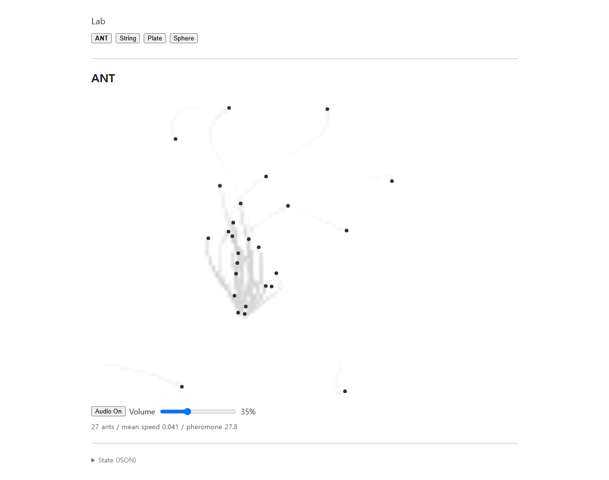

# ANT UI 정리와 공유 Plate 스테레오 — 2026-10-05

기준 커밋은 `dc8d3c4c2a4c75137c50cdfeaeddc1d0bc7540a6`입니다. 이번 변경은 표시 계층 정리와 두 물리 픽업의 스테레오 관측으로 나누었습니다.

## UI

첫 화면은 ANT이며 내비게이션은 ANT, String, Plate, Sphere입니다. 상단에는 작은 `Lab`만 남기고, ANT의 description·figure caption·interaction hint·설명 details·정상 실행 상태 문구를 제거했습니다. Audio On/Off와 Volume, 기존 분석 값 세 개의 진단 줄은 유지합니다. JSON은 하단의 접힌 `State (JSON)`입니다. `Loading…`·`Loading audio…`와 오류는 접근 가능한 status/alert 영역에 표시하며 canvas aria-label은 검은 개미 점과 옅은 공유 흔적의 의미를 유지합니다. 다른 모델의 기능 컨트롤·inspector·개별 설명은 유지합니다.

위 production 화면은 오디오와 볼륨 검증 뒤 15초를 더 진행해 캡처했습니다. 새 UI와 자연 실행 상태의 기록이며, 기존 교통이나 페로몬 규칙을 바꿔 만든 장면이 아닙니다.

## 스테레오

`ANT → 기존 거리 기반 STEP → AntAudioBridge → PlateModel 하나 → Plate field 하나 → 두 픽업 → 두 채널 → 기존 GainNode 하나`입니다. 좌 픽업은 `(-0.32, -0.18)`, 우 픽업은 `(+0.32, -0.18)`이며 동일 field의 가까운 격자 지점에서 읽습니다. 타격 큐와 current/previous 공명 이력도 하나이고, sample마다 DSP 계산을 한 번 수행한 뒤 두 관측값에 같은 soft limiter를 적용합니다. 개미 위치를 pan으로 바꾸거나 Plate를 채널별로 복제하지 않습니다.

`AudioEngine`에는 선택적 `output.channels` 1/2 지원만 추가했습니다. 기본값 1을 유지하고 `WorkletModel`은 수정하지 않았습니다. ANT의 Plate만 생성 옵션 `stereoPickups`로 두 채널을 요청합니다. 일반 Plate/Sphere는 모노, String은 기존 AudioBuffer 경로를 유지합니다. Volume은 하나의 공유 출력 gain을 조절하며 STEP 강도·타이밍은 그대로입니다.

## 검증

- `npm test`: 109/109 통과.
- `npm run build`: 통과. 마지막 UI 수정 뒤 production 브라우저 검사도 최신 소스로 다시 빌드했습니다.
- `npm run test:browser`: 개발 검사 통과. 최초 ANT, 진단 값 갱신, 정상 상태 공백 복원, loading/error의 accessible status, 다른 모델 컨트롤을 확인했습니다. 오류 표시 검사는 개발 페이지의 브리지 상태를 주입해 확인했고 이후 상태를 복원했습니다.
- `npm run test:browser -- --production`: 최종 UI와 실제 두 채널 출력·Volume·Off/On·전환 정리 검사 통과.
- DSP: 중앙 타격 균형, 비대칭 타격의 L/R 차이, 두 mono 참조 실행과 일치하는 채널 및 current/previous 이력, 타격 한 번 소비, 픽업을 유지하는 해상도 변경, 양 채널 stop 확인.
- DSP: 44.1/48/96 kHz × low/normal/high의 9개 조합에서 동시 타격의 양 채널 유한·nonzero·limiter 범위 출력 확인.
- 기존 Plate/Sphere 원본 fixture와 일치하는 mono DSP 회귀 검사 통과.
- ANT 모델·STEP 생성기·렌더러와 String/Sphere 구현의 Git diff가 없고, 기존 Audio On/Off 동작·페로몬·스폰·난수 일치 테스트도 통과했습니다.

48 kHz, 4096 samples, 고정된 테스트 난수로 확인한 중앙 타격 RMS는 L/R 모두 약 `0.2924590`입니다. 비대칭 타격의 RMS는 약 `0.3023846 / 0.2988108`, `RMS(L-R) / max(RMS(L), RMS(R))`는 약 `0.9717`입니다. 이 검사는 물리 픽업의 관측 차이를 분리하기 위한 DSP fixture이며 실시간 개미의 경로·난수를 바꾸지 않습니다.

[browser-metrics.json](browser-metrics.json)은 production의 두 채널, 두 픽업, 공통 gain 하나, Volume 35%의 gain 목표 0.245, 자원 정리 기록을 보존합니다. 이 실행의 gain 앞 L/R 최대 RMS는 약 `0.732652 / 0.733402`이고 같은 창의 최대 RMS 차이는 약 `0.048683`입니다. 전환 뒤 모든 ANT Plate port가 닫혔고 이후 타격과 processor error는 없었습니다. 각 채널의 최대 RMS는 서로 다른 시간일 수 있으며 최종 출력 음량이나 청감 평가를 뜻하지 않습니다. production 실행 시간은 JSON에서 명시한 추정값이며 직접 측정한 simulation clock 값이 아닙니다.

이전 페로몬·AUDIO v0·Volume 화면과 측정 파일은 기존 폴더에 보존했습니다.
