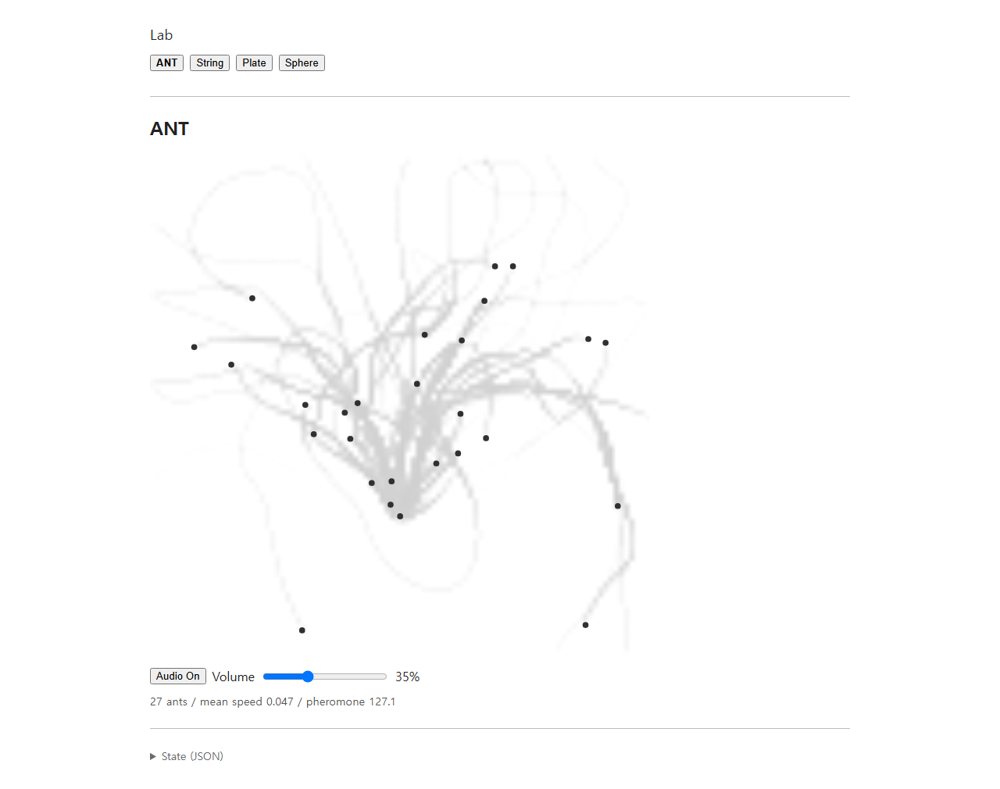
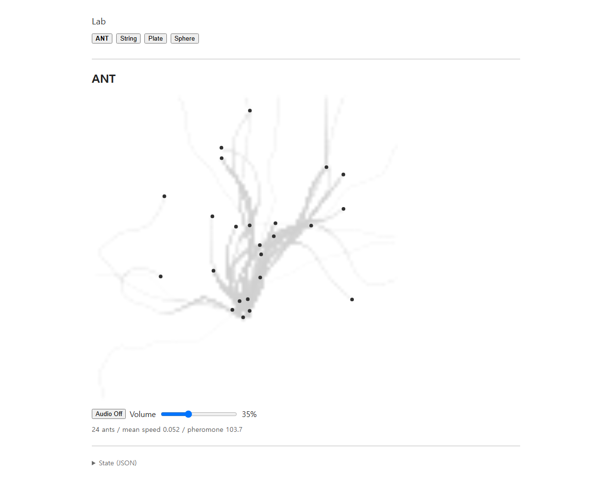

# ANT: individual turnover, persistent environmental memory

기준 main: `476e8b8d0d0bc5f3ea5b182093161c55cdd0cb11`. 이번 실험은 기본 반감기 3 → 15초와 열린 관측 경계·개체 교체만 변경합니다. 강화 계수 5, 침적량·반경, 센서 및 조향 계수, adherence·성향·머뭇거림·traffic, 목표 28개, 입구·생성 간격, STEP 규칙, 공유 스테레오 Plate와 UI는 유지했습니다.

## Boundary and replacement rules

정규화 `[0, 1]²`를 벽 대신 관측 영역으로 사용합니다. 경계만으로 생기던 안쪽 조향·감속·이동 제약·최종 몸체 반경 clamp를 제거했습니다. 기존 개체 간 접촉 제약을 전체 이동에 먼저 적용하고, 그 결과 위치가 영역 밖이면 개체를 퇴장시킵니다. 정확히 경계에 있는 개체는 다음 이동이 밖으로 나갈 때까지 활성입니다. 반사·wrap·teleport·귀환 행동은 없습니다.

마지막 선분의 최초 경계 교차점까지만 거리·침적·STEP 좌표에 사용합니다. 이는 관측 자료의 유효 범위를 정하는 것으로, 개체의 최종 이동 위치를 안쪽에 고정하지 않습니다. 네 변과 대각선 모서리 교차를 테스트했습니다. 바깥 센서는 0을 읽으며, 필드에 직접 전달한 침적 선분도 실제로 영역과 겹친 구간만 사용합니다. 완전히 바깥인 선분은 가장자리 흔적을 만들지 않습니다.

퇴장한 개체와 그 STEP Map 항목을 제거합니다. 새 개체는 고유 증가 ID와 새 성향·adherence·행동 시계·STEP 거리 잔여분 및 ID 기반 편차로 시작합니다. 페로몬장의 객체와 기존 흔적은 유지하고 기존 지수 감쇠·침적만 계속 적용합니다. 기본 15초 반감기는 재사용되지 않은 흔적을 60초 후 약 6.25%로 줄입니다.

퇴장 후 활성 수가 목표보다 적고 예정된 생성이 없으면 기존 400–900 ms 간격으로 다음 생성을 예약합니다. 이미 예정된 시각은 유지합니다. 한 due tick에 최대 한 개체만 같은 입구에서 생성하며, 입구가 막히면 기존 120 ms 재시도 규칙을 사용합니다. 따라서 활성 수는 항상 28을 넘지 않으며, 연달아 퇴장할 때는 보충 간격 때문에 한동안 목표보다 적을 수 있습니다. 새 snapshot 진단은 `totalSpawned`, `totalRetired`이며, 기존 `population`과 함께 화면 밖 검증에 사용합니다. 설정으로 목표를 낮춰 제거한 개체도 `totalRetired`에 포함합니다. 아래 기본 실행의 제거는 모두 자연 퇴장입니다.

## Deterministic 600-second run

재현 명령:

```sh
node scripts/ant-turnover-evidence.js
```

기본 설정, seed 61, 32-bit LCG, `tick(1 / 60)`로 600초를 진행했습니다. 강제 퇴장·배치·경로·오디오 브리지를 넣지 않았습니다. 기록 원본은 [ant-turnover-seed61-600s.json](ant-turnover-seed61-600s.json)이며, 각 퇴장 tick의 ID와 전후 필드 총량도 포함합니다.

| Simulation seconds | Active | Total spawned | Total retired | Pheromone mass | Mean adherence |
| ---: | ---: | ---: | ---: | ---: | ---: |
| 0 | 1 | 1 | 0 | 0.00 | 0.000 |
| 15 | 20 | 21 | 1 | 34.44 | 0.377 |
| 30 | 27 | 38 | 11 | 99.00 | 0.308 |
| 60 | 24 | 76 | 52 | 179.28 | 0.359 |
| 120 | 25 | 155 | 130 | 199.48 | 0.427 |
| 180 | 26 | 236 | 210 | 197.04 | 0.417 |
| 300 | 27 | 384 | 357 | 210.96 | 0.507 |
| 420 | 23 | 548 | 525 | 202.90 | 0.476 |
| 480 | 27 | 633 | 606 | 230.97 | 0.556 |
| 540 | 28 | 713 | 685 | 214.04 | 0.470 |
| 600 | 25 | 794 | 769 | 208.18 | 0.431 |

관측된 고유 ID는 794개이고 최대 활성 수는 28입니다. 첫 퇴장은 약 7.667초이며, 그 tick의 필드 총량은 8.1533 → 8.2146, 1초 뒤에는 11.6225였습니다. 실행 전체에서 같은 필드 객체를 유지했고 `clear()` 호출은 0회입니다. `spawned − retired = active`가 일치하며, 매 tick에서 활성 ID만 STEP 상태에 남는 것을 확인했습니다.

모든 활성 좌표·속도가 유한하고 영역 안에 있었습니다. 매 tick 몸체 분리를 확인했으며 최소 표면 간격은 `−3.10 × 10⁻⁸`로, 검증의 `1 × 10⁻⁷` 부동소수점 접촉 허용 오차 안입니다. 통과·실질적인 몸체 중첩이나 비정상 속도는 기존 collision/velocity 테스트에서도 발견되지 않았습니다. 자동 검증은 교체와 환경 기억의 연속성을 보여주며 안정된 자연 행렬의 시각적 증거로 사용하지 않습니다.

## Browser captures

Production의 기본 자연 실행을 시작한 뒤 추가로 30초 wall-clock RAF 진행을 기다려 캡처했습니다. 정확한 시뮬레이션 시간이나 고정 시드 실행으로 표기하지 않습니다. 캡처 직전 [browser-production-capture.json](browser-production-capture.json)은 27개, 평균 속도 0.046, 페로몬 총량 127.0을 기록했습니다. 캡처 사이에도 RAF가 진행해 이미지에는 0.047/127.1이 표시됩니다. Audio On, Volume 35%는 기존 오디오 QA에서 선택한 상태입니다.



화면에서는 입구에서 뻗은 여러 흔적과 그 위에 흩어진 개체가 보입니다. 이 정지 화면으로 안정된 procession이 생겼다고 판단하지 않습니다.

Dev 캡처는 기존 live controller를 추가 20초 진행한 결과이며, [browser-dev-capture.json](browser-dev-capture.json)의 정확한 시뮬레이션 시간은 23.25초입니다. 활성 24개, 생성 35개, 퇴장 11개, 총량 103.54입니다. 이 화면은 위 production 및 seed 61 실행과 별개의 자연 실행입니다.



별도의 [browser-dev-turnover.json](browser-dev-turnover.json)은 브라우저 안의 기본 controller를 seed `0x20261005`로 120초 진행한 기록입니다. 생성 152개, 퇴장 127개, 활성 25개이며, 단계별 생성·퇴장·총량과 STEP 영역 유효성·고유 ID·한 tick 한 개 보충·퇴장 상태 정리를 검사했습니다.

## Validation

- `npm test`: 114/114 통과. 경계 네 변·첫 모서리 교차, 경계에 의한 조향/감속 없음, 마지막 실제 관측 거리와 STEP 좌표, 필드 유지, 개인 상태 정리, 동시 퇴장 시 기존 예약 유지·점진 보충, 새 ID/상태, 오디오 On/Off 교체 일치를 포함합니다. 기존 same-direction/headway, opposing/crossing avoidance, swept collision, trail steering 및 원본 mono/stereo DSP 회귀도 통과했습니다.
- `npm run build`: 통과. 기존 dependency annotation 및 큰 bundle 경고는 남아 있습니다.
- `npm run test:browser`: dev 통과.
- `npm run test:browser -- --production`: production preview 통과. 새 UI나 controls 없이 기존 모델 전환·반응형 구조·오디오 lifecycle을 검사했습니다.
- [browser-stereo-lifecycle.json](browser-stereo-lifecycle.json): 하나의 AudioContext, 하나의 공통 출력 GainNode, 두 채널, 기존 픽업 `(-0.32, -0.18)` / `(+0.32, -0.18)`, Plate Worklet module 하나, processor 오류 0. ANT 전환 후 모든 Plate port가 닫히고 뒤따르는 strike가 없었습니다. 청감 평가를 대신하지 않습니다.

이번 패스의 런타임 수정은 `AntController.js`와 `PheromoneField.js`에 한정합니다. `AntAgent`, `LocalOccupancy`, `StepEventGenerator`, renderer, audio bridge/engine, Plate 및 Worklet, UI source는 변경하지 않았습니다.
