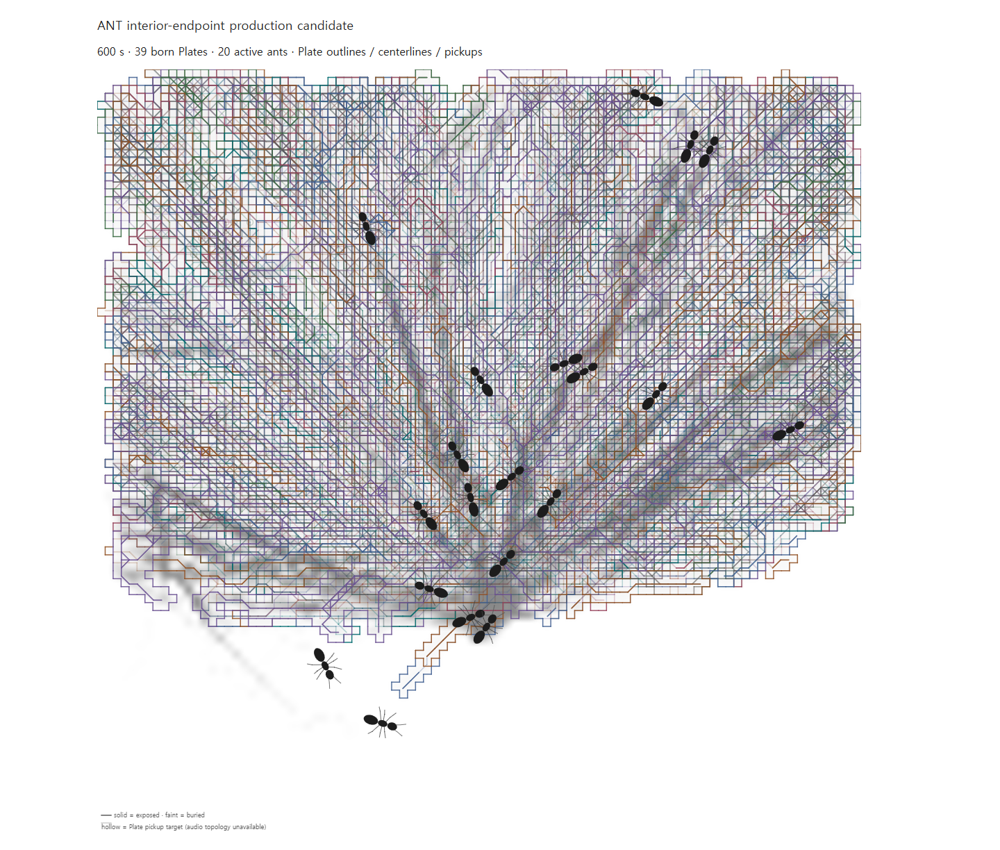

# Interior endpoint production candidate — 2026-10-08

## Decision

**Do not adopt this selector as the current production default.** The intervention creates richer branches inside each actual Plate and increases cumulative coverage in all three seeds, but the new material is more overlapped with earlier Plates. Median new area per birth falls by about half, and final union growth is only 2.5–5.1 percentage points after 600 s. The Chrome overlay also shows a dense, increasingly entangled Plate history. This is an evidence-based rejection for the current material-history goal, not a numeric threshold or an artistic rule for future work.

The implementation remains on `ant-interior-endpoint-production-candidate` for review and reproducibility. No merge or PR was created. The production/tooling commit is `b52bb1f`; the evidence and chronology are a separate commit.

## Intervention and frozen rules

Starting main merge: `30fe4bd8980ffd6dd13aa30a7a9f2a2676faf018`.

The selector still chooses the same source and farthest boundary target using the existing weighted Dijkstra, parent reconstruction, tie-breaking and `0.30` minimum geodesic length. It now retains the union of the existing qualifying boundary paths and paths to eligible interior skeleton endpoints. An interior endpoint must have eight-neighbor skeleton degree one, lie outside the existing boundary zone, be reachable from that same source, and meet the existing `0.30` floor. No random endpoint selection was added. Components without a qualifying boundary target still cannot produce a candidate, preserving the principal farthest-boundary route requirement.

Movement, steering, recruitment, chemical and mechanical fields, contacts, source annulus, thresholds, persistence, corridor similarity, refractory and contact gates, global birth gap, widths, material mapping, descriptor freezing, stratigraphy, pickups, audio, substrate and social observers stayed frozen.

## Matched 600 s natural runs

All values compare the committed main archive against the candidate at the same seed. Birth counts include actual Plate births only.

| Seed | Actual Plate births | First birth (s) | Median cadence (s) | Final Plate union area | Median Plate footprint | Median retained centerline cells |
|---|---:|---:|---:|---:|---:|---:|
| 20261005 | 32 → 40 | 103.02 → 100.02 | 12.00 → 11.00 | 0.681 → 0.718 | 0.181 → 0.255 | 519.5 → 763 |
| 20261006 | 28 → 44 | 220.02 → 127.02 | 11.00 → 10.17 | 0.677 → 0.729 | 0.183 → 0.262 | 527.5 → 790.5 |
| 20261007 | 31 → 41 | 145.02 → 135.02 | 11.00 → 11.00 | 0.716 → 0.740 | 0.178 → 0.265 | 528 → 805 |

The branch-size increase survives actual births. Median endpoint proxies rise from 10–13 to 39.5–42, and median junction-node proxies from 115–135 to 211–241. The principal route remains similar: median geodesic lengths are 0.908 → 0.905, 0.933 → 0.932 and 0.922 → 0.919; median tortuosity is 1.182 → 1.186, 1.157 → 1.155 and 1.184 → 1.179.

However, the candidate's median overlap with the earlier Plate union rises in every seed, while median newly occupied area per birth falls:

| Seed | Median prior-union overlap | Median new area per birth |
|---|---:|---:|
| 20261005 | 0.948 → 0.976 | 0.01130 → 0.00637 |
| 20261006 | 0.904 → 0.968 | 0.01540 → 0.00814 |
| 20261007 | 0.912 → 0.969 | 0.01717 → 0.00920 |

The final footprint gain is consistent but modest relative to the extra branch material: +3.65, +5.14 and +2.45 percentage points of normalized arena area. At 300 s the union gaps are larger (+13.4, +18.7 and +12.1 points), then narrow by 600 s as the main runs accumulate material too. New branches therefore change early coverage and later layering more than they expand the final occupied territory.

Repeated-corridor births changed 2 → 4, 2 → 1 and 1 → 5; this is not a consistent directional effect. Candidate presence remained 519/519, 492/492 and 491/491 qualification analyses in both main and candidate. Persistence-qualified observations increased from 352/519, 279/492 and 322/491 to 499/519, 472/492 and 464/491. See `data/analysis.json` for complete scheduling-gate counts.

## Environmental representation and stratigraphy

The environmental comparison uses the nearest captured qualification snapshot to each milestone and cumulative frozen Plate masks. At 300 s, the fraction of chemical-memory cells also meeting support and represented by Plate masks is:

| Seed | Main → candidate at 300 s | Main → candidate at 600 s |
|---|---:|---:|
| 20261005 | 84.0% → 96.3% | 95.3% → 99.2% |
| 20261006 | 74.0% → 97.8% | 98.0% → 99.9% |
| 20261007 | 79.0% → 96.5% | 98.8% → 99.8% |

Foot-contact-cell representation at 600 s moves from 77.2% → 81.2%, 73.1% → 78.7% and 77.6% → 80.2%. The candidate covers more environmental history, especially earlier in the run, but both histories approach full chemical/support coverage by 600 s.

Stratigraphy accepts every descriptor. At 600 s the candidate increases buried Plate counts from 31/27/30 to 39/43/40, buried layer-cell counts from 44,177/39,569/42,276 to 84,047/94,152/90,236, and 90th-percentile depth from 0.0218/0.0200/0.0185 m to 0.0333/0.0383/0.0350 m. This is measured extra layering, not evidence that the denser history is artistically preferable.

Widths remain governed by the frozen mapping. Median half-width stays at the lower clamp, `0.012`, in every seed; the lower-clamp fraction rises from 78–80% to 83–84%. Density stays at 1.2. Stiffness and damping distributions vary slightly with geometry-derived inputs; there was no material-map change.

## Topology and browser inspection

Compiled topology was compared at equal early Plate counts. At 12 Plates:

| Seed | Solver nodes | Compiled links | Topology-array bytes | Summed Plate network cells |
|---|---:|---:|---:|---:|
| 20261005 | 3,269 → 4,359 | 3,365 → 5,087 | 235,834 → 294,852 | 5,703 → 7,839 |
| 20261006 | 3,452 → 4,082 | 3,804 → 4,656 | 247,174 → 280,370 | 5,937 → 7,300 |
| 20261007 | 3,145 → 4,723 | 3,214 → 5,600 | 229,138 → 314,128 | 5,302 → 8,498 |

Every compiled array value is finite, solver neighbors remain within their Plate layer, every layer remains connected, and pickup node indices are valid. These are real but still small early-history arrays. Both the Vite development and production-preview Chrome smoke tests passed. Those general browser checks found no processor or page errors; they did not stress a mature candidate with 20–30 active audio Plates. The known mature realtime collapse remains outside this experiment.

The separate Google Chrome visual harness rendered the natural controller through the existing `AntRenderer`, with Plate outlines, centerlines and pickups enabled, at fixed 120/300/600 s milestones. Its 600 s capture shows high cumulative overlap. The visual-only Chrome run ended with 39 Plates; the matched Node replay had 40. Browser rendering is a visual check, not the source of matched numerical results.



Fixed-scale 0–1 world-coordinate plots compare actual births and cumulative masks:


- [Birth scheduling timeline — seed 20261005](plots/births-seed20261005.svg)
- [Representative actual Plate births nearest 300 s — seed 20261005](plots/birth-comparison-seed20261005.svg)
- [Google Chrome captures at 120 s, 300 s and 600 s](visual/)

## Parity and regression checks

Each seed ran 36,001 ticks including initialization. Plain and diagnostic candidate runs matched at every tick. Candidate hashes for agents, RNG, chemical field, SurfaceField, chemical memory, contact counts, contacts and lifecycle also match the frozen main hash chains; population, spawning, retirement and contact checkpoints match at 30/60/120/300/600 s. Complete trajectory streams and ordered `FOOT_CONTACT` groups match the committed natural archives. Birth descriptor differences are expected from the changed selector.

The existing birth tests cover descriptor immutability, masks, paths, connectivity and pickups. The candidate run remained below the existing birth capacity. Historical shadow evidence files were not modified; only its now-obsolete unit-test expectation changed so it verifies production/shadow selector parity.

Validation logs are in `validation/`:

- Focused selector/replay tests: 14/14; shadow regression: 3/3
- Full `npm test`: 294/294
- `npm run build`: passed; existing dependency-annotation and >500 kB chunk warnings remain
- Google Chrome Vite dev smoke: passed
- Google Chrome production-preview smoke: passed
- Natural Plate visual capture: passed at 120/300/600 s

## Reproduction and files

From the repository root:

```powershell
node scripts/ant-morphology-replay.js --production-candidate --seeds=20261005,20261006,20261007 --seconds=600 --output=test-results/ant-interior-endpoint-production
node scripts/ant-interior-endpoint-production-browser.js
node scripts/ant-interior-endpoint-production-analysis.js
npm test
npm run build
$env:BROWSER_EXECUTABLE_PATH = 'C:\Program Files\Google\Chrome\Application\chrome.exe'
npm run test:browser
node scripts/browser-check.js --production
```

`data/seed*-candidate-births.json.gz` preserves all candidate birth descriptors. `data/replay-manifest.json` records the candidate source revision, main source hashes, runner hashes and snapshot byte sizes. Exact compressed field snapshots are omitted from Git (about 42–44 MB per seed); their SHA-256 values are in `data/analysis.json`. Main raw birth events and frozen summaries remain in their existing evidence packages. `data/generated-artifact-sha256.json` hashes analysis, plots, visual captures, replay manifest and candidate descriptors; `checksums.json` covers every other evidence-package file.

Limitations: three deterministic seeds and a 600 s horizon; repeated one-second qualification records are correlated; environmental coverage is a spatial proxy, not causal attribution; raster endpoint/junction counts are proxies; Chrome's visual run is not used for numerical parity; no artistic acceptance or mature many-Plate realtime audio test was performed.
