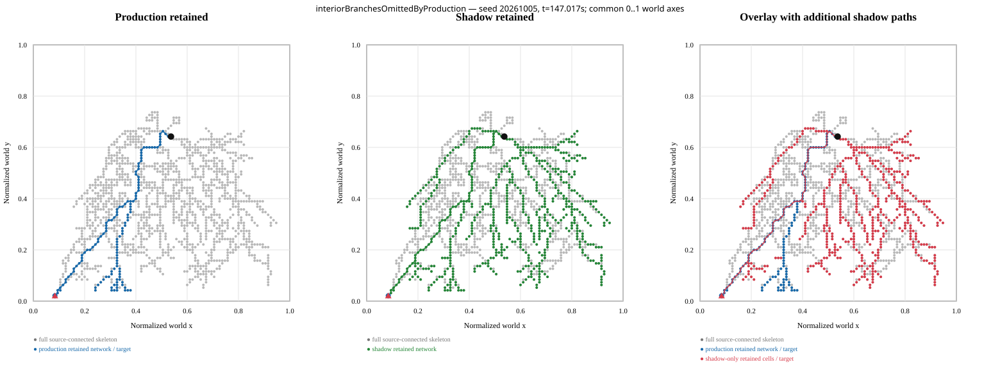

# ANT interior-endpoint shadow selector — 2026-10-08

Shadow-selector diagnosis only. Production movement, fields, selector, Plate births, material, stratigraphy, and audio stayed unchanged. Shadow candidates ran through separate diagnostic temporal state; they created no Plates.

## Result

Admitting source-connected interior skeleton endpoints produced materially larger retained networks and footprints in all three frozen seeds. Among analyses where both selectors chose a candidate, every shadow geometry differed from production under the exact comparison below. The paired median footprint increase was 0.086–0.093 normalized area, and the paired median retained network increase was 278–294 cells.

Principal-path medians stayed similar: the paired median change in geodesic length and tortuosity was zero in every seed. The gain is clearest in retained branches, endpoint/junction proxies, and covered area. This supports the narrow conclusion that the source-to-boundary selector suppresses some distinct source-connected history. It does not show that the shadow rule is better for the artwork or ready for production.

| Seed | Analyses | Boundary-eligible components | Components with qualifying interior endpoints | Interior-only components | Production candidates | Shadow candidates | Shadow-only | Persistence-qualified | Scheduler-ready virtual births |
|---|---:|---:|---:|---:|---:|---:|---:|---:|---:|
| 20261005 | 599 | 519 | 559 | 40 | 519 | 559 | 40 | 519 | 44 |
| 20261006 | 599 | 492 | 544 | 52 | 492 | 544 | 52 | 524 | 48 |
| 20261007 | 599 | 491 | 552 | 61 | 491 | 552 | 61 | 522 | 44 |

Component counts are repeated observations at each one-second qualification analysis, not unique spatial components. The shadow selected a candidate in 40, 52, and 61 analyses where production selected none. Of the paired candidates, geometry differed in 519/519, 492/492, and 491/491 analyses. The production source cell stayed identical in every paired case.

## Selector and temporal definitions

The live `TrailPlateBirth` selector remains unchanged. At every qualification analysis, the replay checks its chosen candidate against a source-instrumented copy of the production selector. The shadow copy receives the same supported mask, support values, and chemical-memory array.

The shadow adds only actual eight-neighbor skeleton graph endpoints of degree one that lie outside the existing 0.05 boundary zone, are source-connected, have a valid path under the existing weighted Dijkstra and deterministic tie-breaking, and meet the frozen 0.30 geodesic floor. Existing boundary targets remain available. Source annulus, source-seed selection, Dijkstra, path reconstruction, candidate ranking, width derivation, and all other qualification rules stay as implemented. Where production and shadow both select a candidate, the selected source index matches in every recorded analysis. Interior-only components have no production candidate source to compare.

The temporal shadow has independent persistence, corridor-similarity, global-gap, same-corridor refractory, new-contact, and birth-cap state. It reads the production contact-count array without changing it. The gate table below gives the first failed gate per analysis; `ready` means one isolated virtual shadow birth was scheduled at that observation. It is not an actual Plate count.

| Seed | No candidate | Persistence | Global gap | Refractory | New contacts | Birth cap | Ready |
|---|---:|---:|---:|---:|---:|---:|---:|
| 20261005 | 40 | 40 | 401 | 74 | 0 | 0 | 44 |
| 20261006 | 55 | 20 | 439 | 37 | 0 | 0 | 48 |
| 20261007 | 47 | 30 | 402 | 76 | 0 | 0 | 44 |

Persistence retained 519/559, 524/544, and 522/552 shadow candidate observations. Scheduling then admitted 44, 48, and 44 observations. Repeated one-second observations are correlated and must not be read as independent births. No shadow state reaches production birth, stratigraphy, material, or audio systems.

## Paired morphology medians

Cells below show `production → shadow`; values are per-analysis medians over each selector's selected candidates. The exact paired-delta distributions and all per-analysis records are in [`data/analysis.json`](data/analysis.json). Network endpoint and junction counts are raster graph proxies, not biological or physical branch counts.

| Measure | 20261005 | 20261006 | 20261007 |
|---|---:|---:|---:|
| Principal geodesic length | 0.902 → 0.905 | 0.925 → 0.924 | 0.911 → 0.907 |
| Principal-path tortuosity | 1.168 → 1.175 | 1.159 → 1.177 | 1.162 → 1.175 |
| Footprint area (cells / 95²) | 0.170 → 0.252 | 0.173 → 0.251 | 0.173 → 0.261 |
| Retained centerline cells | 492 → 756 | 503 → 759 | 505 → 784 |
| Endpoint proxy | 10 → 39 | 10 → 38 | 10 → 41 |
| Junction-node / junction-cluster proxies | 110 / 20 → 208 / 41 | 126 / 19 → 230 / 39 | 126 / 20 → 227 / 42 |
| Median half-width (world units) | 0.012 → 0.012 | 0.012 → 0.012 | 0.012 → 0.012 |
| Lower-width-clamp samples | 78.6% → 83.6% | 79.0% → 83.5% | 79.3% → 83.3% |
| Overlap with accumulated production Plate union | 0.958 → 0.891 | 0.921 → 0.804 | 0.949 → 0.857 |
| New area outside production Plate union | 0.008 → 0.029 | 0.013 → 0.047 | 0.009 → 0.035 |
| Source-to-target straight displacement | 0.768 → 0.764 | 0.775 → 0.763 | 0.786 → 0.768 |
| Target distance from arena boundary | 0.021 → 0.032 | 0.021 → 0.032 | 0.021 → 0.032 |
| Retained fraction of source-connected skeleton | 0.298 → 0.472 | 0.299 → 0.465 | 0.301 → 0.476 |

Additional network / raster-ribbon cells among paired candidates had median increases of 278 / 773, 287 / 815, and 294 / 839. Paired median new-area increase was 0.019, 0.033, and 0.022. The lower width clamp remains active for most samples; the extra network is therefore not evidence of a wider material form. Median curvature at 0.03 / 0.10 world-unit resampling changed from 10.522 / 2.632 to 10.844 / 2.738 (seed 05), 10.674 / 2.625 to 11.065 / 2.712 (06), and 10.942 / 2.682 to 11.045 / 2.734 (07). These are raster-sensitive geometry descriptors, not acoustic measurements.

## Fixed-scale examples

All panels use the same normalized 0–1 world axes and equal aspect. Gray is the full source-connected supported skeleton; blue is production-retained network; green is shadow-retained network; red marks additional shadow-retained cells and the shadow target. Plots use actual same-input analyses.



- [Maximum measured 0.10-scale curvature example](plots/maximumMeasuredCurvature-seed20261007-tick23821.svg)
- [Minimum observed shadow footprint among changed paired candidates](plots/minimumFootprintAmongChanged-seed20261005-tick5041.svg)
- [Plot selection metadata](plots/manifest.json)

The no-difference candidate plot was omitted: no paired candidate had exactly unchanged geometry. Analyses with no candidate from either selector contain no geometry to plot. The maximum-curvature and minimum-footprint examples are labels for observed extrema in these runs, not manufactured morphology classes or claims of a preferred artistic form.

## Integrity and reproduction

The branch started from fetched `origin/main` at `746af8fb72f1bc835115d6886bdab001b2a638d7`. Tooling commit: `b9e08961a5e47e4ce7531bce87902fc81b9a8dd8`. [`data/full-replay-manifest.json`](data/full-replay-manifest.json) records replay source and tool hashes. [`data/replay-verification.json`](data/replay-verification.json) records every per-tick field hash, archive result, and SHA-256/size for the full run outputs and packaged summaries.

Each 600 s run compared 36,001 tick rows including initialization. All agent, RNG, chemical, SurfaceField, chemical-memory, candidate/birth state, FOOT_CONTACT count, contact, birth, and lifecycle hashes matched between the plain and instrumented runs. All three complete trajectory streams, ordered FOOT_CONTACT groups, and birth descriptors also matched the committed archive exactly: seed 05 had 35,751 contact groups / 64 births, seed 06 had 35,377 / 60, and seed 07 had 35,448 / 63.

Reproduce from the repository root:

```powershell
node scripts/ant-morphology-replay.js --seeds=20261005,20261006,20261007 --seconds=600 --output=test-results/ant-interior-endpoint-shadow
node scripts/ant-morphology-shadow-analysis.js --input=test-results/ant-interior-endpoint-shadow
node scripts/ant-morphology-shadow-plots.js --input=test-results/ant-interior-endpoint-shadow
npm test
npm run build
```

The committed package includes the full per-analysis summaries in gzip form, aggregate analysis, manifests, plots, and full validation logs. Full 42–44 MB field-snapshot streams are omitted from Git to keep the evidence compact; their byte counts and SHA-256 values are recorded in `replay-verification.json` and the deterministic command regenerates them. [`checksums.json`](checksums.json) covers every other file in this package. [`validation/npm-test.txt`](validation/npm-test.txt) records 292/292 passing tests. [`validation/npm-build.txt`](validation/npm-build.txt) records a successful build with existing dependency-annotation and large-chunk warnings.

## Decision and limits

The shadow materially expands retained skeleton networks and spatial footprint in these measured runs, while principal-path median length and tortuosity remain similar. Most shadow candidates survive the persistence gate, but the separate global-gap and refractory gates admit only 44–48 scheduler-ready observations per seed. Keep the result as a frozen diagnostic baseline; do not substitute the shadow selector in production from this evidence alone. A next decision should review the plotted footprint and branch growth against the intended material scale before authorizing any separate production experiment.

Limits: three deterministic seeds and one 600 s horizon; repeated analysis rows are not independent samples; the temporal births are virtual and never create material; geometry proxies are raster-sensitive; no audiovisual or perceptual test was run. No significance threshold was imposed.
