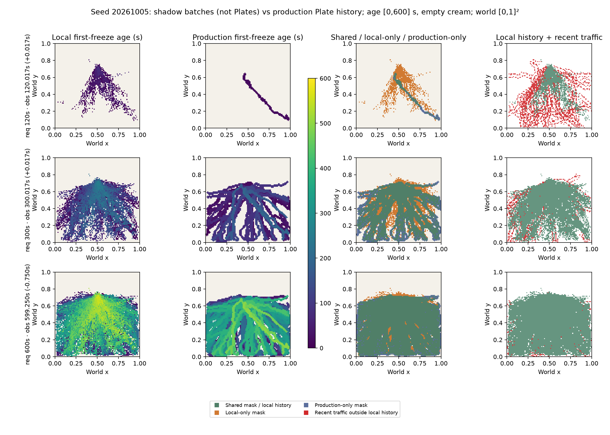

# Local-accretion shadow — one frozen-input morphology family

Local accretion broadens **early raster connectivity and local coverage**, and reduces repeated cell freezing relative to the existing production history. It does **not yet demonstrate a durable, broad morphology vocabulary**: by the final observation all three seeds converge to a dense fan-shaped mass; remaining separate patches and most holes are very small. This is a mixed viability result, with late blob formation the principal artistic limitation. Stop after this family; no production adoption or second experiment.

## Scope and provenance

Branch `ant-local-accretion-shadow` began at `562919b8b761ef9dd2653a0825e52db5c7c29984`, from main `cf8ee79423c7298625fa43ebb13c3eba5ef0f871`. The founder-refined movement/material baseline remains frozen. All production source, dependencies, design note and previous evidence remain unchanged. The experiment instantiated no ANT controller and produced no new natural run, artificial Plate birth, renderer, stratigraphy or audio output. Required repository tests exercise their existing fixtures separately.

The natural histories are the existing 600 s seeds **20261005 / 20261006 / 20261007**. Each supplies 599 field observations, ending at **599.2500000000696 s**. Matched requested 120 / 300 / 600 s milestones are sampled at **120.0166666666787 / 300.01666666664977 / 599.2500000000696 s**, respectively. The final observation is 0.75 s before the nominal horizon; no missing milestone is fabricated.

Committed selected-component summaries omit exactly four supported cells on 25 timestamps: **5 / 9 / 11 rows** by seed. All other rows match the complete supported mask; there are no extra cells. After explicit user authorization, saved full snapshots already matching hashes in the prior committed [replay verification](../2026-10-08-interior-endpoint-shadow/data/replay-verification.json) were decoded to close this analysis-input gap. This is an **expansion of the frozen analysis input package**, not a change to the original natural run or its committed evidence.

[INPUT-PROVENANCE](inputs/INPUT-PROVENANCE.md) lists all 25 exact timestamps, ticks, omitted indices, source files/arrays, prior hashes, and hashes for all 11 new frozen-input files. [input-gap.json](inputs/input-gap.json) preserves complete counts and raw/compressed hashes. The saved snapshots are not copied over any historical artifact. The packet retains all 599 exact threshold decisions plus exact Float32 field arrays at three milestones; it does not duplicate the full continuous-amplitude field stream.

Existing committed [raw contact and birth archives](../2026-10-07-social-graph/checksums.json) supply actual FOOT_CONTACT and production Plate masks. The raw contact hashes, descriptor offsets, original field/source hashes and archive counts are in the three input metadata files. Contact raster counts match the saved `contactCounts` at **599/599 frames per seed**. Per-cell repeated-contact evidence uses actual individual feet, with out-of-domain foot positions skipped just as in production, and a stable timestamp ordering of a copied event list.

## Exact mechanism

The isolated script [`AntLocalAccretion`](../../../../scripts/ant-local-accretion.js) imports only existing qualification constants from unchanged `TrailPlateBirth`. It maintains one scalar `p[i]` for each of 96×96 cells:

```text
eligible[i,t] = chemicalMemory[i,t] >= .30
             AND conditional mechanical support[i,t] >= .015
             AND at least 2 distinct actual FOOT_CONTACT timestamps
                 mapped directly into cell i through t

if ineligible:               p[i] = -1
if newly eligible:           p[i] = 0
if continuously sampled eligible:
                            p[i] = min(20, p[i] + elapsed recorded seconds)
on first crossing to 20:     freeze exact cell i
```

All cells crossing at one observation form one immutable **maturation batch**. A batch may contain disconnected cells; it is not an acoustic object or a production Plate. A mature cell remains at 20 while eligible and does not periodically freeze again. If it becomes ineligible, it resets; later 20 s requalification may freeze it again, including previously occupied territory. Frozen geometry is the exact mature-cell set; cumulative material is the union of these immutable batches. No interpolation, dilation, minimum-size filter, source-annulus connectivity, boundary target, path preference, skeleton or tree enters generation.

The `.30` chemical threshold, `.015` support threshold and `20 s` duration reuse the frozen production semantics rather than fitting outcomes. The two-distinct-time contact guard is the sole additional eligibility choice: it excludes one transient contact and duplicate same-time legs without requiring another ant. It is **cumulative**, not a requirement for two contacts during the current 20 s qualification interval. Mechanical support is the existing archived conditional support, including its existing spatial footprint; no new support spread is introduced. Thus a supported historical patch can materialize away from source and boundary.

The rule integrates **sampled duration**, not field amplitude. Boolean flags substitute 0/1 for chemical/support solely to reproduce the fixed threshold predicates exactly; no continuous-amplitude claim follows. Failure at any sampled observation clears duration. Unobserved subsecond qualification changes are unavailable. The input-integrity guard rejects a gap exceeding one recorded second plus one 60 Hz tick and numerical tolerance; it is not a morphology parameter.

## Measurement definitions

- Area is occupied cells / **9216**, a raster fraction. Older evidence sometimes used cells / 95²; those area proxies must not be compared directly with this percentage.
- New area is cells not in the prior cumulative union. Prior overlap is `(batch cells - new cells) / batch cells`; cell-weighted re-inscription is repeated freezing / all frozen-cell events. Production uses actual archived Plate masks and exact birth times. Maturation batches and Plate births have different event sizes/cadences, so their event counts and median new area are not interchangeable.
- Foreground components use **8-connectivity**. Areas, min/p50/p90/max and component bounds are retained. Quantiles use ascending index `floor((n-1)*p)`.
- Primary topology is **β₁**, the count of **4-connected empty components not touching the raster boundary**. This measures real holes under the documented complementary digital convention. It is not a claim of intentional ant circling or physical acoustic loops.
- Secondary skeleton analysis uses deterministic sequential thinning with 8/4 simple-point guards. Orthogonal edges are retained; a diagonal edge is added only when neither intervening orthogonal pixel is occupied. `μ = E - V + C`; degree-1 endpoints and degree≥3 junction nodes are raster proxies, not physical branch counts. Small plateau graph cycles can make μ slightly exceed β₁. Skeletonization is analysis only and never changes frozen geometry.
- “Isolated” means a component touches neither the outermost grid boundary nor the fixed source annulus, with Chebyshev-distance-1 adjacency to the annulus counted as touching. Annulus center is `(0.5,0.72)`, radii `.055–.115`. This classification is measured after freezing; it is not a generation requirement or evidence that a patch was abandoned.
- Current traffic is actual in-domain feet in `(t-20 s,t]`, mapped by `round(position*95)`. Jaccard compares that binary mask with frozen union. Frozen-only and traffic-unrepresented fractions use frozen and traffic cells respectively as denominators. Mismatch is observational history/current-traffic separation, not proof of causation or a failure by itself.
- Bounding-box fill and area / skeleton-cell count describe blobness/width. Neither is a physical width or convex-hull solidity measurement. The ≥80% arena flag and ≤4-cell speckle label are descriptive diagnostics, not acceptance criteria or mechanism thresholds.

All underlying masks, first-freeze times, batch cell indices, production Plate masks, sampled scalar states and field arrays are in [analysis.json.gz](data/analysis.json.gz). [milestone-metrics.csv](data/milestone-metrics.csv) is a convenience projection of that authoritative analysis; [seed-summary.json](data/seed-summary.json) contains final event/failure summaries.

## Seed comparisons

Area and newly occupied cells, using matched observations. New cells refer to the interval since the preceding listed milestone (zero at start).

| Seed | Requested time | Local cells / area | Production cells / area | Local new cells | Production new cells |
|---|---:|---:|---:|---:|---:|
| 20261005 | 120 | 1014 / 11.00% | 231 / 2.51% | 1014 | 231 |
| 20261005 | 300 | 4326 / 46.94% | 4377 / 47.49% | 3312 | 4146 |
| 20261005 | 600 | 6002 / 65.13% | 6149 / 66.72% | 1676 | 1772 |
| 20261006 | 120 | 723 / 7.85% | 0 / 0% | 723 | 0 |
| 20261006 | 300 | 3959 / 42.96% | 3333 / 36.17% | 3236 | 3333 |
| 20261006 | 600 | 5915 / 64.18% | 6114 / 66.34% | 1956 | 2781 |
| 20261007 | 120 | 847 / 9.19% | 0 / 0% | 847 | 0 |
| 20261007 | 300 | 4033 / 43.76% | 4072 / 44.18% | 3186 | 4072 |
| 20261007 | 600 | 5993 / 65.03% | 6458 / 70.07% | 1960 | 2386 |

Topology at each milestone. Paired entries are **local / production**; E/J are skeleton endpoint/junction-node proxies.

| Seed | Time | Components | Isolated components | β₁ holes | Skeleton μ | E/J local | E/J production |
|---|---:|---:|---:|---:|---:|---:|---:|
| 20261005 | 120 | 64 / 1 | 62 / 0 | 87 / 0 | 88 / 0 | 67 / 191 | 3 / 1 |
| 20261005 | 300 | 27 / 1 | 24 / 0 | 274 / 69 | 276 / 69 | 59 / 570 | 8 / 143 |
| 20261005 | 600 | 13 / 1 | 10 / 0 | 138 / 38 | 138 / 38 | 31 / 287 | 4 / 77 |
| 20261006 | 120 | 50 / 0 | 44 / 0 | 52 / 0 | 52 / 0 | 60 / 121 | 0 / 0 |
| 20261006 | 300 | 43 / 1 | 38 / 0 | 254 / 42 | 254 / 42 | 70 / 528 | 5 / 86 |
| 20261006 | 600 | 24 / 1 | 20 / 0 | 144 / 26 | 145 / 26 | 43 / 301 | 8 / 57 |
| 20261007 | 120 | 51 / 0 | 47 / 0 | 72 / 0 | 72 / 0 | 61 / 165 | 0 / 0 |
| 20261007 | 300 | 30 / 1 | 26 / 0 | 262 / 63 | 263 / 63 | 53 / 541 | 7 / 128 |
| 20261007 | 600 | 22 / 1 | 17 / 0 | 161 / 26 | 161 / 26 | 31 / 324 | 5 / 55 |

Final history metrics:

| Seed | Local batches / actual Plates | Cell-weighted re-inscription local / production | Median prior overlap local / production | Median new cells per event local / production | Largest local component | Final local hole p50 / p90 / max cells |
|---|---:|---:|---:|---:|---:|---:|
| 20261005 | 560 / 32 | 55.43% / 87.78% | 57.79% / 94.77% | 9 / 102 | 5985 (99.72%) | 1 / 2 / 4 |
| 20261006 | 560 / 28 | 54.73% / 86.62% | 54.69% / 90.43% | 9 / 139 | 5881 (99.43%) | 1 / 3 / 28 |
| 20261007 | 558 / 31 | 53.60% / 86.75% | 57.42% / 91.19% | 9 / 155 | 5962 (99.48%) | 1 / 3 / 21 |

Thus cell novelty improves, but **more than half of local frozen-cell events still repeat occupied territory**. Small per-second batches explain the lower median new cells/event; that figure does not establish an improvement in Plate-scale novelty. Final occupied union is lower than production in every seed. Isolated components exist without a universal source/boundary connection, but final nonlargest components are only **17 / 34 / 31 cells total**; their median component size is one cell. These are mostly speckles, not substantial isolated material forms.

Current traffic versus frozen history:

| Seed | Final Jaccard local / production | Final frozen-only local / production | Final traffic-unrepresented local / production |
|---|---:|---:|---:|
| 20261005 | .347 / .341 | 64.66% / 65.33% | 5.27% / 4.78% |
| 20261006 | .279 / .276 | 71.50% / 72.00% | 6.80% / 5.36% |
| 20261007 | .297 / .288 | 69.33% / 70.61% | 9.81% / 6.87% |

There is no substantial final alignment advantage. Earlier local masks cover recorded supported areas before production first births, but material remains substantially different from current traffic in both representations. This does not assign persistent regions to individual ants.

## Fixed-scale visual evidence and failure modes

All plots use world `[0,1]²` with equal aspect, shared field `[0,1]`, scalar `[-1,20]`, first-freeze age `[0,600] s`, and time `[0,600] s`. Empty age cells are cream, distinct from newly frozen cells. [Plot metadata](plots/plot-metadata.json) records input/source hashes, scales and actual sample times. These are direct archive plots, not browser/runtime validation.



[Seed 20261006](plots/material-history-seed20261006.png) · [Seed 20261007](plots/material-history-seed20261007.png) · [Growth/new area](plots/growth-novelty-timecurves.png) · [Field/scalar seed 05](plots/field-state-seed20261005.png) · [seed 06](plots/field-state-seed20261006.png) · [seed 07](plots/field-state-seed20261007.png).

| Failure mode | Observation and interpretation |
|---|---|
| Arena saturation | No seed reaches the descriptive 80% full-grid flag by 599.25 s. Nevertheless 64–65% of the entire raster is material, and global bounding-box fill is 75.10–80.15%; absence of this flag does not resolve artistic saturation or later growth. |
| Blob formation | Principal late limitation. Largest components contain 99.43–99.72% of local material. Width proxies grow from 1.43–1.46 cells at 120 s to 3.69–3.92 at the final sample, with most corridor voids filling in. Production unions are still thicker (6.10–6.64) but that does not make the local result a diverse vocabulary. |
| Speckle/noise | Many early disconnected components are tiny. At final time, ≤4-cell components number 12 / 22 / 21, containing only 0.28% / 0.49% / 0.52% of local material. They inflate component counts without providing substantial islands. |
| Redundant re-inscription | Reduced relative to production, but still 53.60–55.43% cell-weighted. Continuous eligibility does not periodically emit the same cell; repeated events arise after failed eligibility and later rematuration. No novelty veto hides this outcome. |
| Hidden tree bias | Absent from generation. The exact masks have real digital holes; skeletons are downstream measurement only. Production cumulative unions also have holes, so the comparison is not “cycles versus no cycles.” |

Real closed digital holes occur. At 300 s, local maximum hole areas are **55 / 100 / 97 cells**, versus **101 / 224 / 192** in production; local hole medians are one cell. By the final sample even the largest local holes shrink to 4 / 28 / 21 cells. High β₁ primarily measures perforation and small pores; it does not prove broad loop-like route forms. Cycles that exist in a cumulative union are not proof that a single maturation batch or ant traveled a closed route.

## Research interpretation

Verified implementation facts: one local duration scalar, exact archived predicates, no source/boundary/path requirement, arbitrary raster connectivity, immutable batches, no production/behavior/audio feedback, no RNG use.

Measured observations: earlier local materialization; more components and holes; lower repeated-cell fraction; final masks dominated by one dense component with small satellites; final area and traffic mismatch close across seeds. These statements apply to three frozen inputs and this rule, not a statistical population or biological construction behavior.

The allowed bounded research claim is that **local accumulated chemical/mechanical history can retain broader deterministic raster topology than the current cumulative selected-path material representation, especially early**, while this particular permanence/persistence rule loses much of that distinction as material accumulates. It has not established a useful inventory of substantial isolated patches, large durable cycles or diverse late episode shapes.

Plausible mechanisms, not isolated causal findings: resetting/rematuration lowers repeated inscription compared with whole-network Plate births; retaining all mature cells preserves fine field perforation; a permanent union integrates changing supported corridors into a broad mass. Thresholding inherited smoothed support can favor a fan-shaped common footprint. No counterfactual family was run to separate these influences.

## Artistic/modeling interpretation and decision

At 120 s seeds differ in extent and footprint: a wider fragmented fan in seed 05, a narrower descending form in 06, and a two-arm form in 07. By 300 s they are irregular, perforated fans. “Fan,” “reconnecting,” and “palimpsest” are useful descriptive readings of the geometry/first-freeze ages, not generation targets or numerical acceptance criteria. Partial reoccupation is measured, but distinct braid/artery/fossil categories are not established by the counts. No large isolated fossil-like patch category is claimed. No intentional circling, ant roles, biological material construction or sonic potential is inferred.

The first-freeze-age maps express accumulated material history more continuously than discrete corridor births, but broad late filling makes that history less legible as separate shapes. **Topology viability is partly supported; the full artistic goal remains unmet.** Preserve this result as a shadow comparison and stop.

The next decision is a review of the late filling versus the early topology/novelty gain. No further formation rule is selected in this pass. Any new experiment requires separate user authorization; preserve the present rule and inputs as the comparison baseline.

## Validation and reproduction

- Focused tests: **30/30** across scalar persistence, contact guards, XOR/flag provenance, input-gap fixtures, finite/bounded trust inputs, immutable episodes, no mutation on invalid indices, novelty denominators, straight/T/diagonal/ring/filled-blob/thick-ring topology and boundary-open fixtures.
- Full `npm test`: **322/322**, zero failures/skips; [log](validation/npm-test.txt). `npm run build`: passed; [log](validation/npm-build.txt), retaining existing Rollup annotation/large-chunk warnings.
- All 11 frozen-input files reproduced byte-for-byte on a separate preparation run; [input byte parity](validation/input-byte-parity.json). Six binary packets verify compressed and decoded sizes/SHA before analysis. Two analyses per seed compare complete JSON bytes; a separate CLI rerun also matches the complete analysis and determinism output byte-for-byte. [determinism](data/determinism.json) · [CLI byte parity](validation/analysis-byte-parity.json).
- Input and scalar state validation rejects nonfinite/out-of-range values and impossible indices. Final states are finite and bounded. No behavior RNG/controller is instantiated; `Math.random` throws throughout the analysis as an additional guard.
- [Protected source ledger](validation/protected-source.json) records working-byte SHA-256 and canonical Git identities separately because checkout line endings can differ. Final preservation and staged-byte checks are recorded with the package checksums. Original source/contact/summary hashes remain matched; previous evidence is not edited.

From the repository root, reproduce using the **new committed inputs**, without saved-cache access and without ANT replay:

```powershell
node --experimental-test-isolation=none --test tests/ant-local-accretion.test.js tests/ant-local-accretion-inputs.test.js tests/ant-local-accretion-metrics.test.js tests/ant-local-accretion-analysis.test.js
node scripts/ant-local-accretion-analysis.js --input=docs/ant/evidence/2026-10-08-local-accretion-shadow/inputs --output=test-results/ant-local-accretion-reproduce
uv run --no-project --with matplotlib==3.11.2 --with numpy==2.3.5 python scripts/ant-local-accretion-plots.py --input test-results/ant-local-accretion-reproduce/analysis.json.gz --output test-results/ant-local-accretion-reproduce/plots
npm test
npm run build
```

Optional reconstruction of the input expansion requires the already saved, hash-matching full summaries/streams; this command decodes them, reads committed contacts/summaries, and writes only the new derived analysis inputs under `test-results`:

```powershell
node scripts/ant-local-accretion-inputs.js --input=test-results/ant-interior-endpoint-shadow --output=test-results/ant-local-accretion-inputs
```

Node v22 and gzip serialization are the recorded analysis environment; compressed byte identity is established here, while raw hashes remain available for other compatible runtimes. PNG rendering depends on the pinned libraries; plot metadata includes variable runtime/path fields and is not a byte-determinism claim for figures. The numerical JSON and frozen input arrays are the deterministic evidence. Browser/Chrome/audio/PCM work was unnecessary for this detached geometry pass.

Tooling commit: **`99e6cece0d39d4c2d8405f391d14d228bd9b77aa`**. This package and its daily chronology form a separate evidence commit; its hash and verified remote HEAD are reported after push. No merge, PR, production adoption or second local-accretion family follows this pass.
