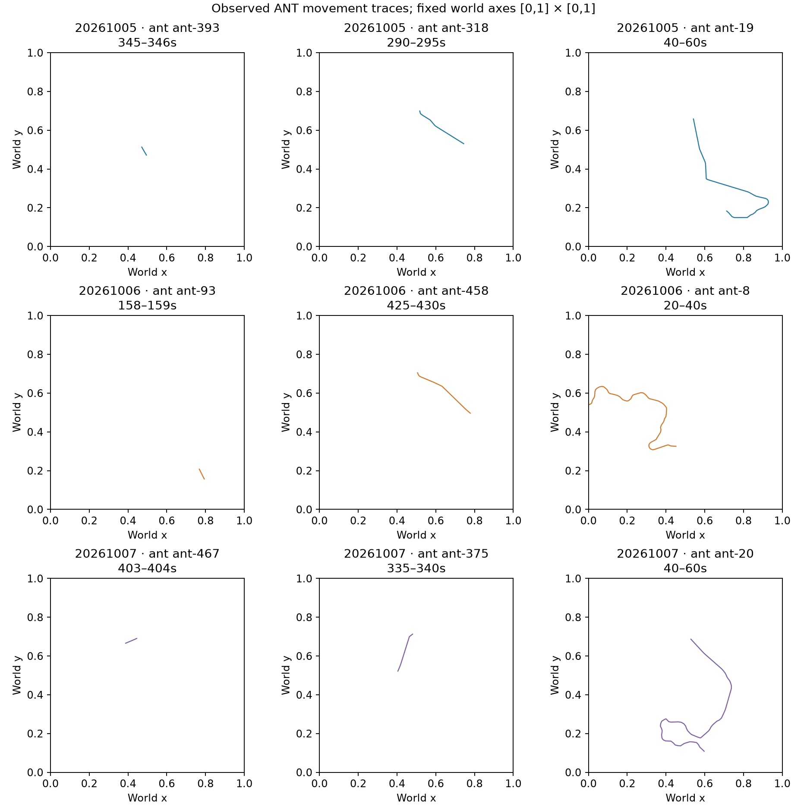
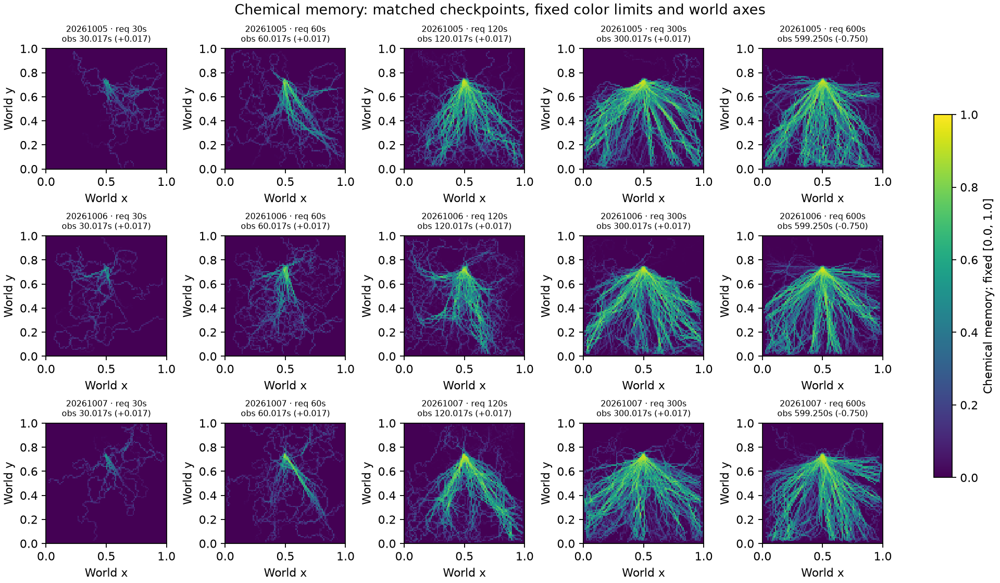
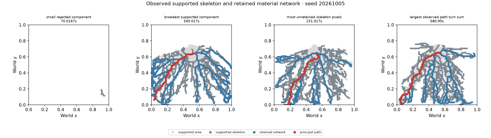
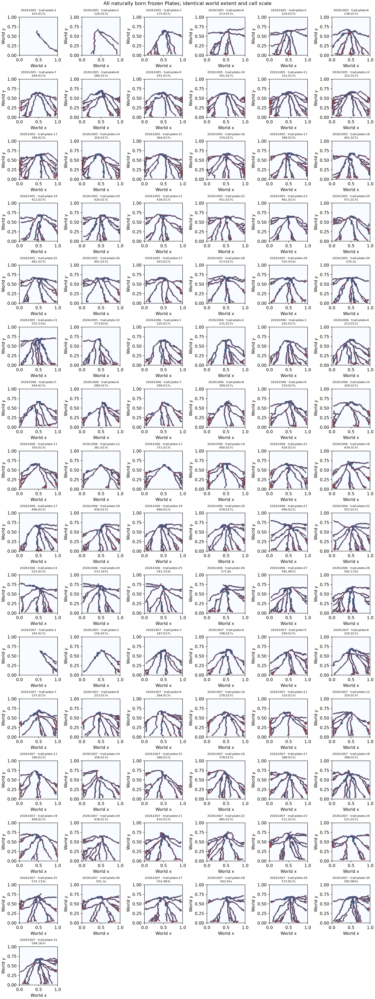

# ANT movement / material morphology diagnosis — 2026-10-08

Diagnosis only. Production movement, pheromone, recruitment, gait/contact, SurfaceField, Plate qualification, material, stratigraphy and audio DSP were not changed. No morphology intervention was run.

The most directly observed restriction is **C: the source-to-boundary network family and pruning inside Plate selection**. **B also filters spatial history:** isolated local-return examples can leave mechanical traces without reaching chemical qualification. **A is a partial artistic limitation, not a general absence of spatial diversity:** short windows are nearly straight, while long surviving trajectories cover much larger scales and have higher tortuosity. These mechanisms coexist; this pass does not estimate their independent causal contributions.

## Baseline, sources and integrity

- Branch: `ant-movement-material-morphology-audit`, created from fetched `origin/main` at `eb84b7cc7a1727a1d6291941cbaf2b50609675d8`.
- Diagnostic tooling commit: `be1b314555909102b7acc51582181b6caab1c960`; [scope and validation integrity](validation/integrity.json).
- Frozen founder-refined behavior: `e38450ce11f99e63f5ab0cb6e8e8ee4281fcadd9`.
- The archived manifest records `a6801d609b82f1f1a0b5030b7c6e4b9b5d2ebe72`; its `src/` changes from the founder commit add observer modules and exports. Replay production source is `eb84b7c`, with its own source hashes and exact archived trajectory/contact/birth parity.
- Primary natural evidence: [three committed social archives](../2026-10-07-social-graph/data/), seeds `20261005`, `20261006`, `20261007`, each 600 simulated seconds at 60 Hz. Movement uses the exact 2D trajectory movie; Plate metrics use the actual frozen birth descriptors. All FOOT_CONTACT groups and individual feet are available.
- [Founder refinement](../2026-10-07-founder-effect-refinement/README.md), [movement refinement](../2026-10-05-integrated-refinement/README.md), [Surface/Plate evidence](../2026-10-05-surface-plates/README.md), and recent daily logs supply implementation/history context. Their older checkpoints and the original 12-Plate ceiling are not substituted for the current runs or current 256-birth ceiling.
- [Archive input ledger](validation/archive-inputs.json) verifies 13 primary files against their exact committed Git blob bytes and records SHA-256. [Final tool/source/artifact hashes](validation/tool-source-artifact-hashes.json) cover the measurement generators, reused helpers, production source and packaged data.

The original archives lack field grids and rejected skeleton components at qualification times. The new replay runs an equivalent plain controller and a controller with external diagnostic readers. It uses the same natural defaults and injected LCG as the archive, Audio Off, no audio bridge, and no social feedback. The production selector still supplies every actual candidate and birth. A source-hashed in-memory copy adds diagnostic writes to the selector; its complete chosen geometry is compared with the production candidate. No production module is modified or replaced.

Each seed compares **36,001 tick rows including initialization**, across agent state, RNG state/calls, chemical field, SurfaceField, persistent chemical memory, candidate state, contact counts, ordered contacts, births and lifecycle. The runner asserts equality at every tick and retains paired rolling SHA-256 for each field. All three complete trajectory byte streams, all contact records and all birth records also match the old committed archives exactly. This is stronger than a final-state-only comparison. [Final full replay log](validation/replay-final.txt) · [Final replay provenance](data/full-replay-manifest.json).

Independent review corrected the diagnostic event classifier so sphere births cannot mark a Plate-funnel birth. A second full paired replay with the final runner confirms all 1,797 morphology records and the complete lossless field streams are unchanged; there were zero sphere-only false markers in these three runs. The compact data retain their original bytes and initial run timing metadata. [Final-versus-initial identity proof](validation/replay-final-comparison.json) · [Initial manifest](validation/replay-initial-manifest.json).

There are **599 actual qualification analyses per seed**, beginning at 0.016667 s and ending at 599.250000 s. Floating-point simulation cadence is preserved. Requested plot checkpoints at 30/60/120/300/600 s use the nearest captured analysis within one second; titles and metadata state the actual time and signed offset. At 600 s that is 599.25 s, offset −0.75 s. No missing integer-time sample is fabricated.

## Measurement definitions

All lengths and areas use normalized model coordinates, not meters. Full machine-readable definitions accompany [movement](data/movement.json.gz), [Plate](data/plates.json.gz) and [retention/funnel](data/retention.json.gz) packets.

**Movement:** globally anchored, nonoverlapping complete per-ant 1/5/20 s windows, with both endpoints sampled at 60 Hz. Partial lifecycle windows are excluded and counted. Path length sums adjacent displacement; net displacement is endpoint distance; tortuosity is path/net, null near zero net displacement. Body-heading and actual path-tangent turns are separate, with signed/absolute sums, turn histograms, sign-run duration and turning per traveled length. Zero displacement does not contribute traveled curvature. Excursion is maximum distance from the first point; radius of gyration measures spread around the window mean. Residence is a consecutive stay in a 0.03 grid cell; revisitation requires leaving and returning. Approximate returns additionally require one second since the prior visit ended. Neither cell recurrence nor winding establishes a closed loop or intention.

The labels `straight-gentle`, `broad-sustained-turn`, `confined-local-return`, and `unclassified-remainder` use explicit arbitrary diagnostic cutoffs. They are not behavioral states. Raw accumulated turn grows with observation horizon. A remainder label does not establish high curvature; zero strict broad-turn labels does not establish absence of broad bends. Median and maximum-tortuosity traces accompany the continuous measurements. Metrics use full 60 Hz samples; representative coordinates are downsampled to roughly 120 points with endpoints retained. Plotted polylines and retention tubes therefore approximate the fine trajectory between those recorded points.

**Environmental retention:** 0.03-radius tubes around actual sampled movement traces compare raw chemical, exact 20 s chemical memory, raw compaction, joint chemical/support inputs and cumulative contact counts at start, end and end+20 s. Tubes cover foot/gaster offsets but pool any colony traffic in that region. No individual-cause attribution follows. Contact recurrence and binary field/contact overlap are compared at 0.03/0.10/0.25 cell scales, using both cumulative and matched recent-20 s contacts. A coarse cell is positive if any mapped field cell passes the stated threshold. Raw SurfaceField ≥0.015 is a compaction proxy, not the birth support query. The captured `supports` array is evaluated only where chemical memory qualifies; zero there does not demonstrate mechanical absence.

**Plate morphology:** actual frozen principal path and full centerline graph, geodesic/network length, graph endpoints and clustered high-degree pixels, half-width distribution/clamp counts, mask area, earlier-union overlap/new area and individual earlier-mask IoU. Area proxy is mask cell count / 95². Eight-neighbor staircases inflate graph degrees; junction clusters are raster proxies, not physical branch counts. Raw vertex turning is likewise raster-sensitive. Curvature is also measured after diagnostic arc-length resampling at 0.03 and 0.10, preserving every stored descriptor. Geometry, material values, compiled 32-grid node counts and pickup separation describe sonic potential, not measured spectra or audibility.

## Stage A — movement scales

| Seed | Complete windows 1 / 5 / 20 s | Median tortuosity 1 / 5 / 20 s | Median excursion 1 / 5 / 20 s | Mean approximate returns per 20 s window |
| --- | --- | --- | --- | --- |
| 20261005 | 10,308 / 1,451 / 49 | 1.0002 / 1.0162 / 1.8388 | 0.0592 / 0.2679 / 0.5791 | 0.8980 |
| 20261006 | 10,333 / 1,504 / 70 | 1.0004 / 1.0189 / 1.8738 | 0.0583 / 0.2609 / 0.5754 | 1.2143 |
| 20261007 | 10,316 / 1,490 / 66 | 1.0002 / 1.0159 / 2.1596 | 0.0587 / 0.2604 / 0.5466 | 0.8939 |

Distinct excursion scales exist. The distributions are similar across these three seeds, with seed 07's long-window median tortuosity higher. About 87–90% of one-second windows meet the straight/gentle cutoff. Five-second confined-return windows occur 1/9/7 times; strict broad-sustained labels occur zero times. Longer windows mostly fall outside those strict labels. The continuous measures, rather than the residual category, establish the scale-dependent geometry.

Twenty-second windows strongly select long-lived ants: only 49/70/66 qualify, versus over 10,000 one-second windows per seed. Excluded partial-lifetime windows include observed exits as well as recording edges; they are not survival-inference censoring. This window selection prevents a population-wide estimate of long-route behavior. There is no intentional-circling, pioneer, role or social-memory claim.



[Maximum-tortuosity actual windows](plots/movement-maximum-tortuosity.png) · [Actual confined-return examples](plots/movement-confined-local-return.png)

## Stage B — what survives in the environment

Implementation has several distinct spatial/time operations:

- Pheromone uses a Gaussian deposition brush and bilinear sampling, with 15 s half-life. It has no neighbor diffusion beyond deposition/sampling.
- SurfaceField deposits around individual valid feet and relaxes with 1800 s half-life. Birth support queries a center-weighted disk of radius 0.025; that is query smoothing, not diffusion of the stored field.
- Plate chemical memory bounds concentration as `v/(v+0.04)`, then integrates with a 20 s time constant and requires ≥0.30. Current adherence-dependent deposition reinforces traversed corridors, as documented by the frozen founder implementation.

At the latest captured analysis, chemical-qualified cells almost exactly equal jointly supported cells. Across all 599 analyses, mean chemical-qualified versus supported cell counts are 2328.324 vs 2328.309 (seed 05), 2257.112 vs 2257.109 (06), and 2276.703 vs 2276.703 (07). Thus the mechanical threshold removes almost no chemically eligible cells in these natural runs. This does not mean every mechanically marked region is chemically eligible.

On the 0.03 comparison grid, cumulative contact coverage versus chemical-memory qualification at the final checkpoint has Jaccard 0.540 / 0.513 / 0.531. Contact versus raw compaction-proxy Jaccard is about 0.986–0.990. Cumulative contacts occupy 1116/1134/1136 of 1156 coarse cells; chemical eligibility occupies 603/582/603. Coarser 0.10/0.25 cumulative grids largely saturate, so their apparent connectedness cannot establish a specific retained route shape. Recent-20 s comparisons remain in the packet.

The actual five-second local-return examples demonstrate selective retention, not erasure of all local history:

| Seed / actual ant window | Mean chemical memory at end+20 s | Mean raw compaction at end+20 s | Jointly qualified fraction of trace tube |
| --- | --- | --- | --- |
| 05, ant-54, 100–105 s | 0.0341 | 0.0399 | 0 |
| 06, ant-19, 60–65 s | 0.0482 | 0.0312 | 0 |
| 07, ant-628, 525–530 s | 0.1185 | 0.3562 | 0.0977 |

These trace tubes contain detectable mechanical/chemical values later. The first two never qualify chemically at the observed start/end/+20 s samples. The third partly overlaps already eligible material. Existing traffic, prior field values and later deposits prevent attributing a persistent region or birth to that individual trace. A reconstructed closed-loop topology and isolated-loop causal retention are **not established**. Irregular/high-tortuosity trace examples likewise show mixed retained chemical/support coverage, rather than a universal disappearance.



## Stage C — eligibility, pruning and scheduling

Verified implementation: one source cell nearest annulus midpoint radius 0.085 is selected within the fixed annulus [0.055,0.115] around (0.5,0.72). A skeleton component must reach an observation boundary within 0.05 and have geodesic length ≥0.30. Weighted Dijkstra chooses the farthest boundary target for the principal path. The retained network is the union of canonical-source paths to sufficiently distant boundary targets. Interior/dead-end/subthreshold branches can remain in the supported field but are omitted from that network. Width derives from the original supported component, then clamps half-width to [0.012,0.030]. The descriptor freezes the resulting candidate geometry. A separate [birth-time identity check](validation/candidate-descriptor-identity.json) confirms all 91 born masks, principal paths and network cells equal their actual candidate geometry; descriptor construction adds no further loss in those representations.

| Repeated component observations | 20261005 | 20261006 | 20261007 |
| --- | ---: | ---: | ---: |
| All skeleton components | 19,394 | 19,208 | 18,990 |
| Missing annular source | 18,502 | 18,144 | 17,964 |
| Has source, missing boundary target | 373 | 572 | 535 |
| Has both, below minimum geodesic | 0 | 0 | 0 |
| Eligible component / selected candidate | 519 | 492 | 491 |
| Eligible losing candidate | 0 | 0 | 0 |
| Mean unretained skeleton fraction within eligible component | 72.0% | 73.0% | 71.3% |

Counts repeat a region at successive analyses; they are not unique rejected shapes. Most rejected components are tiny. A parent cross-check with arbitrary descriptive size cutoffs finds 413/452/339 rejected component observations with ≥10 skeleton pixels, including 131/221/150 with bounding-box diagonal ≤0.12. Larger source-containing but boundary-incomplete components reach 518/605/793 skeleton pixels. Thus rejected material support is not exclusively isolated one-pixel noise. [Size/count cross-check](validation/parent-component-crosscheck.json).

The minimum-geodesic rule and **competition between eligible components were not active rejection mechanisms in these runs**. Longest-candidate preference is implemented, but there were no eligible losers. Farthest-boundary principal-path selection inside the single eligible component remains active. The measured pruning fraction is omitted skeleton pixels, not a count of discarded physical branches or proof that each would make a useful Plate.

Scheduling is a different funnel after spatial selection:

| First observed outcome per analysis | 20261005 | 20261006 | 20261007 |
| --- | ---: | ---: | ---: |
| No spatial candidate | 80 | 107 | 108 |
| Persistence not reached | 167 | 213 | 169 |
| Global 10 s gap | 258 | 231 | 268 |
| Same-corridor 90 s refractory | 62 | 20 | 23 |
| New-contact requirement / capacity as first failure | 0 / 0 | 0 / 0 | 0 / 0 |
| Actual Plate birth | 32 | 28 | 31 |

These disjoint counts use the production gate order and prioritize a birth on its actual tick. They do not count all simultaneous failed gates or estimate independent causal effects. Persistence uses 20 s plus similarity ≥0.6, where similarity is max(ribbon-mask IoU, tolerant principal-path overlap). A matching latest prior birth also requires ≥30 new actual feet and 90 s; a global gap is 10 s. No criterion was relaxed.

The candidate panels use actual supported components, skeletons and retained geometry, with metric-based selectors. Small/local rejected structures, broad supported components, highly turning paths and pruning examples appear only when the source contains them. None is a fabricated Plate or an inferred biological morphology class.



## Actual frozen Plates and sonic potential

| Born-Plate measure | 20261005 | 20261006 | 20261007 |
| --- | --- | --- | --- |
| Births | 32 | 28 | 31 |
| Geodesic length min / median / max | 0.824 / 0.908 / 0.987 | 0.818 / 0.933 / 1.083 | 0.797 / 0.922 / 1.093 |
| Median principal tortuosity | 1.182 | 1.157 | 1.184 |
| Centerline pixels min / median / max | 69 / 519.5 / 698 | 373 / 527.5 / 654 | 142 / 528 / 633 |
| Median mask-area proxy | 0.1806 | 0.1829 | 0.1784 |
| Minimum half-width clamp samples / all samples | 12,739 / 16,241 | 11,723 / 14,747 | 12,339 / 15,621 |
| Median overlap with earlier union | 94.77% | 90.43% | 91.19% |
| Median newly occupied cells per birth | 102 | 139 | 155 |
| Exact earlier-mask duplicates | 0 | 0 | 0 |
| Median compiled solver nodes | 308 | 310 | 305 |

Overall principal scale is narrow, but network size and early footprint vary substantially. These are not identical copies: maximum earlier-mask IoU stays below 0.60, while overlap with the **union** of previous births is high. The two statements concern different comparisons. Repeated occupation of an established spatial history is clear; distinct binary masks do not imply independent corridors or novel sonic identities. Production repeat similarity can match via tolerant principal-path overlap even when mask IoU is lower.

About 78–80% of widths hit the lower clamp; only 3–4% hit the upper clamp. Frozen density is exactly 1.2 for all 91 Plates. Stiffness spans roughly 0.904–0.922, damping 0.351–0.359, and median pickup separation is about 0.41. Saturated density and narrow chemical-derived material values provide an additional implemented compression of material variation. Node count, coupling topology and pickup position still differ. There is no PCM, modal-spectrum, audibility or perceptual-diversity result here.

Raw raster turn sums have median about 28–32 radians; 0.10 arc-spaced samples give about 2.23–2.31 radians. That scale dependence warns against calling a staircase “irregular” from raw vertex curvature. All frozen descriptor data remain unchanged.



## Assessment and smallest next experiment

| Bottleneck | Evidence-based assessment |
| --- | --- |
| A — movement | Several spatial scales and extended/high-tortuosity trajectories exist. Rare confined returns and similar seed distributions may limit the desired ecology, but a general absence of movement diversity is contradicted by the continuous measurements. Strict labels are not absence proofs. |
| B — retention | Mechanical history is broad and persistent. Chemical eligibility retains a narrower subset; observed local-return tubes can remain mechanically marked while failing chemical qualification. Decay, deposition reinforcement and memory/threshold operations are plausible contributors. Their individual causal effects and closed-loop preservation are unresolved. |
| C — selection | Directly measured: many supported components lack the source/boundary geometry, and about 71–73% of an eligible component's skeleton is omitted. Born principal paths are long source-to-boundary routes. The longest competing-component preference and minimum-length rejection did not add natural filtering here. |

**Recommended next intervention, not executed:** one diagnostic shadow-selector comparison that admits **source-connected interior endpoints** alongside existing boundary targets, while preserving supported fields, width construction, the 0.30 length floor, persistence and scheduling. Compare matched captured inputs and report which additional persistent shapes become eligible. Keep it outside production and create no actual births until the evidence is reviewed. This isolates boundary endpoint eligibility before changing movement, reinforcement, material balance or multiple rules. Compact structures below the unchanged length floor could still fail; the comparison must report that rather than bundle a threshold change.

The artistic goal remains compact, extended, smooth, highly curved, irregular and branching material forms. It is a future design goal, not a condition this diagnostic must manufacture or a biological claim.

## Package, reproduction and limits

The compact package retains all 599 candidate/funnel records per seed and only exact field snapshots used by the trace/checkpoint comparisons. Selected rows are decoded and byte-compared against the full replay before re-encoding. Full streams remain in ignored `test-results/ant-morphology-replay`; their sizes and SHA-256, selected rows/hashes and paired parity proofs remain in the compact provenance. `full-replay-manifest.json` describes the full generation, not the selected file sizes. [Plot metadata](plots/plot-metadata.json) records input hashes, fixed scales and actual selectors.

From repository root, reproduce the measurements:

```powershell
node scripts/ant-morphology-movement.js test-results/morphology-movement
node scripts/ant-morphology-plates.js test-results/morphology-plates
node scripts/ant-morphology-replay.js --output=test-results/ant-morphology-replay
node scripts/ant-morphology-retention.js --output=test-results/morphology-retention
npm test
npm run build
```

For plots, gzip the three `summary.json` files as `movement.json.gz`, `plates.json.gz`, `retention.json.gz` in an input directory and copy the retention output's selected `seed*-summary.json.gz` / `seed*-snapshots.bin.gz` alongside them. The committed `data/` directory already has that layout. Plot generation uses temporary pinned Python tooling without changing Node/project dependencies:

```powershell
$env:UV_CACHE_DIR = Join-Path $env:TEMP 'ant-morphology-uv-cache'
uv run --with matplotlib==3.11.2 --with numpy==2.3.5 python scripts/ant-morphology-plots.py --input docs/ant/evidence/2026-10-08-movement-material-morphology/data --output test-results/morphology-plots
```

Fixed world axes are [0,1] with equal aspect. Raw pheromone plots use a fixed [0,0.8] display range across every seed/time; the production concentration cap remains 8. Chemical memory, raw compaction and conditional support use [0,1]. Contact-count field plots share a recorded common range. Contact time-series panels share axes across seeds within each metric panel. No per-image maximum normalization, geometry scaling, recoloring of old evidence or artificial examples are used.

Limits: three seeds at one horizon; long windows exclude most short-lived ants; representative route tubes rather than population field-attribution analysis; no isolated counterfactual for decay/reinforcement/threshold effects; coarse occupancy can saturate; no established individual closed-loop retention; raster graph/curvature proxies; scheduling counts are first failures, not causal effects; no acoustic/perceptual validation. Browser smoke was unnecessary because no runtime/UI code changed. Production-source and old-evidence diff checks, archive/blob hashes, replay parity, focused tests, full tests and build are recorded in `validation/`. Final full suite: **289/289 pass**, build pass. Existing build annotation/chunk warnings remain.

[Independent review](validation/independent-review.md) accepted the final diagnosis with no blocking findings. [Package SHA-256 inventory](validation/package-sha256.json) covers every other package file.

**Stop: diagnosis complete. No production intervention, merge or PR.**
