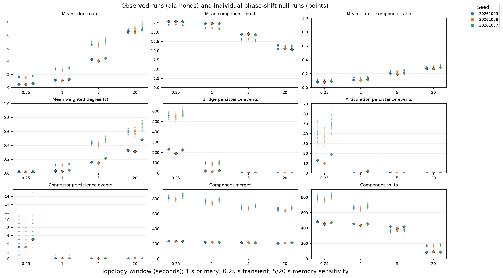

# S2a — First trajectory synchrony null, 2026-10-08

**Result:** the original 1 s encounter topology is consistently sparser than this phase-shift ensemble. The comparator also exposes large recruitment-phase and circular-seam effects. This is a useful first synchrony test, **not completed movement-constrained null validation and not evidence of social organization**.

## Question and scope

How much of the observed temporal encounter topology depends on the original cross-ant temporal alignment of otherwise recorded individual movement trajectories?

Started from fetched `origin/main` (`66c61e1`) on `ant-s2a-synchrony-null`. Only the committed [S0/S1 archives](../2026-10-07-social-graph/README.md) were replayed: seeds `20261005`, `20261006`, `20261007`, each 600 s. No natural ANT recapture, behavior change, new graph definition, audio/runtime work, substrate-timbre work, spectral analysis or coupling was performed.

## Method

- Each archive has 36,001 exact 60 Hz frames including t=0. Each stable ID occupies its original contiguous active interval, including recording-truncated lifetimes.
- For ant `a` with `n` samples, null sample `i` is original sample `(i + offset[a]) mod n`. The entire Float64 tuple `(x,y,vx,vy,heading,radius)` moves together. ID, timestamp, per-frame ID ordering and active window stay fixed. No interpolation or independent field shuffle occurs.
- 32 replicates per source seed; 96 total. Dedicated null seed: `ANT-S2a-2026-10-08-phase-v1`. Replicate indices are 0–31.
- Offset is `1 + uint64LE(SHA256(JSON.stringify([nullSeed, sourceSeed, replicate, stableAntId]))[0:8]) mod (n-1)`. This deterministic hash-to-offset map always excludes zero. It is not a claim of exact uniform sampling over all phase vectors. All 32 offset vectors within each source seed are distinct.
- No behavior RNG is imported, created or consumed. A fixture fails if `Math.random` is used during null generation.
- Reuse the exact recorded `DynamicSocialGraph` and `TemporalSocialTopology` sources: S0 at 60 Hz, S1 every third frame at 20 Hz; `k=2`; windows 0.25/1/5/20 s. The existing formation, fresh-support, persistence, component-transition and finish/right-censor semantics are unchanged.
- 1 s is the primary recent-proximity comparison; 0.25 s is the transient/connector comparison. 5 and 20 s are accumulated-memory sensitivity cases, not biological timescales.

The null preserves the individual sample sequence up to circular rotation, lifespan/sample count, active population at every frame, stable ID windows, radii, sampling cadence and each trajectory's sampled arena/path occupancy. It does **not** preserve instantaneous colony spatial density, pairwise collision exclusion, spatial birth/exit placement or physically continuous motion at the circular seam.

## Reporting definitions

Each seed-run is the comparison unit. The 12,001 topology samples are summarized within a run; correlated frames are not additional research replicates. Weighted degree includes zeros for active isolates and uses pooled active node-time samples. Timeline plots use 1 Hz display samples; numerical run summaries use every 20 Hz analysis sample including t=0.

[comparisons.csv](data/comparisons.csv) and [summary.json](data/summary.json) give every requested observable for each window/seed, null mean/SD/min/p10/median/p90/max, observed-minus-null-mean, observed/null-mean ratio, standardized descriptive difference and tie-aware empirical midrank. Midrank is `100*(below + equal/2)/available replicates`. Zero SD gives a missing standardized difference; zero null mean gives a missing ratio. A percentile is descriptive, not a p-value or binary emergence threshold.

The [seed packets](data/) retain each replicate's offsets, virtual binary trajectory hash, complete validation result, metric distributions, 1 Hz timelines, event counts, completed-lifetime histograms and individual connector events. Raw encounter and rolling temporal-edge lifetimes remain distinct. Duration quantiles use Type 7 linear interpolation over completed intervals; censored counts and elapsed duration are retained separately. Bridge/articulation persistence durations include onset through termination for episodes that reached the existing persistence qualification; pending or merely confirmed episodes are not relabeled persistent. Connector durations follow the existing retrospective definition. Raw metrics repeat across window rows in the CSV for convenience; they are one raw stream per run.

## Primary 1 s results

Entries are observed / null mean [null p10–p90]. All quantities are run summaries.

| Seed | Mean edges | Mean components | Mean largest-component ratio | Mean weighted degree, s |
| --- | --- | --- | --- | --- |
| 20261005 | 1.1346 / 2.8257 [2.7355–2.9170] | 17.3249 / 16.0834 [16.0217–16.1503] | 0.1101 / 0.1448 [0.1420–0.1476] | 0.0331 / 0.1212 [0.1169–0.1264] |
| 20261006 | 1.0703 / 2.6887 [2.5703–2.7900] | 17.3591 / 16.1516 [16.0920–16.2381] | 0.1059 / 0.1399 [0.1377–0.1427] | 0.0306 / 0.1141 [0.1079–0.1196] |
| 20261007 | 1.2396 / 3.0164 [2.8888–3.1541] | 17.2597 / 15.9652 [15.8621–16.0583] | 0.1189 / 0.1518 [0.1494–0.1547] | 0.0435 / 0.1333 [0.1260–0.1401] |

For all three seeds, observed mean edges, largest-component ratio and weighted degree fall below all 32 null values; mean components exceed all 32. Edge-count differences are −1.6911, −1.6184 and −1.7768; observed/null mean ratios are approximately 0.402, 0.398 and 0.411. Thus the original alignment is associated with **less**, rather than extra, recent proximity under this comparator. This does not identify the mechanism or establish social avoidance/preference.

| Seed | Raw episodes, observed / null mean | Raw pair exposure, s | Completed raw mean lifetime, s | 1 s bridge PERSIST | 1 s merge / split counts |
| --- | --- | --- | --- | --- | --- |
| 20261005 | 511 / 1227.03 | 184.88 / 727.75 | 0.3618 / 0.5963 | 22 / 98.72 | 222 / 764.78; 456 / 666.91 |
| 20261006 | 483 / 1162.31 | 169.22 / 679.86 | 0.3510 / 0.5882 | 14 / 91.72 | 223 / 742.97; 437 / 651.28 |
| 20261007 | 518 / 1274.09 | 240.55 / 796.39 | 0.4644 / 0.6271 | 24 / 101.81 | 222 / 786.19; 456 / 686.06 |

Observed raw right-censored counts are 0/1/0. Null censoring is recorded per replicate, rather than treated as completed duration. At 1 s, articulation PERSIST counts are observed 0/0/2 versus null means 0.2813/0.3438/1.1250; this small count does not have a consistent excess across seeds. Connector PERSIST is observed 0/0/0; the 96 null runs contain only three 1 s connector events in total.

## Transients and memory sensitivity

| Seed | 0.25 s connector PERSIST observed | Null mean [p10–p90], min–max | Observed midrank percentile |
| --- | --- | --- | --- |
| 20261005 | 3 | 5.875 [2.1–9.0], 1–11 | 15.625 |
| 20261006 | 3 | 6.0625 [3.0–8.9], 2–12 | 12.500 |
| 20261007 | 5 | 7.9688 [5.0–10.9], 3–17 | 14.0625 |

The original 11 connector events remain 0.30–0.65 s long and recruitment-origin-local, within 0.019 of `(0.5,0.72)` at confirmation. They are confirmed at ages about 0.267–0.300 s. Their counts overlap this null ensemble, and the null does not preserve their original birth-phase/recruitment-origin alignment. This comparison cannot establish roles, partner preference, persistent pioneers or emergent social organization.

| Window | Mean edge count observed / null mean: seed 05; 06; 07 |
| --- | --- |
| 0.25 s | 0.5120 / 1.6393; 0.4741 / 1.5418; 0.6050 / 1.7733 |
| 1 s | 1.1346 / 2.8257; 1.0703 / 2.6887; 1.2396 / 3.0164 |
| 5 s | 4.2854 / 6.6864; 4.0729 / 6.5129; 4.4682 / 7.0901 |
| 20 s | 8.5449 / 8.5695; 8.3461 / 8.7614; 8.7925 / 9.1890 |

The 20 s edge-count midranks are 53.125/3.125/15.625, showing weaker seed consistency than 1 s. Component-count direction reverses at 20 s: observed has fewer components than the null, while 0.25/1/5 s has more. At 5 s, observed split counts exceed every null replicate; at 1 and 20 s they are lower. These window effects are retained-history/turnover sensitivity, not distinct biological timescales. At 5/20 s, observed connector persistence is zero and all null connector persistence is also zero. Detailed temporal-edge lifetime and persistence distributions are in the packets/CSV.

## Null limitations and seam diagnostics

| Seed | Mean first-sample distance to origin, observed / null | Mean circular seam jump | Mean fraction of null raw episodes flagged at seam | Raw episodes after seam flag exclusion, observed / null mean |
| --- | --- | --- | --- | --- |
| 20261005 | 0.0130 / 0.3435 | 0.6896 | 57.23% | 511 / 524.88 |
| 20261006 | 0.0127 / 0.3440 | 0.6859 | 54.42% | 483 / 529.91 |
| 20261007 | 0.0128 / 0.3383 | 0.6847 | 56.10% | 518 / 559.44 |

Distances use normalized arena coordinates. Each ant contributes one internal end-to-start seam. It preserves the tuple but inserts a position discontinuity; the saved velocity is not a finite-difference velocity across that seam. An episode is flagged if it overlaps either endpoint's seam ± one 60 Hz sample. The seam-excluded raw-count midranks are 23.4375/0/3.125, much less uniform than the full raw-count separation. Completed raw mean lifetimes after this exclusion remain approximately 0.6803/0.6596/0.7063 s, above the original 0.3618/0.3510/0.4644 s. Pair exposure after exclusion is 356.63/349.54/394.82 s versus original 184.88/169.22/240.55 s. This descriptive subset is not a second null family and not a corrected topology analysis.

About 32.45%/35.57%/33.73% of null 0.25 s connector episodes have support intervals flagged at an involved ant's seam. Original entry-frame encounter episode counts are 396/359/408, versus null means 117.84/106.44/124.31. Birth times and active population are fixed, but the positions at birth have moved far from the recruitment origin. The seam often relocates the recorded early-life recruitment segment to a later age. These effects are inseparable from synchrony breaking in this first family.

**All topology metrics include the unmodified replayed null graph.** Seam-associated contact can affect rolling topology for the entire window and component/persistence histories beyond a single frame. The ±one-frame raw flag does not wash out those effects or remove all indirect seam influence. Per-frame density, collision constraints, recruitment/exit geography and circular continuity are not controlled. A 600 s recording truncates some active lifetimes; the seam also joins the recording end of those trajectories to their recorded first sample. No difference can be attributed solely to social preference or to recruitment effects from this comparator.

## Validation and provenance

- Every source input is checked against its committed Git blob before replay and re-hashed afterward. Original archives are byte-identical and never used as an output directory.
- All 96 replicates pass equal frame count, exact active count and active ID mask at every frame, equal per-ID lifecycle/sample count, byte-exact whole-tuple rotation, finite values and valid IDs/positive radii. Inverse rotation reconstructs **every byte** of the uncompressed source, including header/timestamps/IDs.
- Each replicate regenerates its offsets and binary trajectory twice with identical results. All 96 virtual trajectory hashes are independently regenerated by `--verify`. Distinct offset vectors are checked within each seed.
- Each observed replay matches all committed k=2 S0 events/encounters, S1 events/edge lifetimes, and every saved 1 Hz topology snapshot for all four windows. Graph/topology source hashes match the recorded manifest.
- Full analysis is repeated for replicate 0 of each seed, both at generation and verification; all-replicate **generation** determinism is checked. Full graph/topology analysis is not independently replayed twice for every null replicate.
- Synthetic fixture independently verifies different lifetimes, tuple fields (including negative zero and varying positive radii), exact rotation/inverse recovery, source immutability, deterministic offsets and rejection of corrupted values/IDs/re-entry.
- Full tests: **270/270**; production build: pass. See [validation logs](validation/) and [per-replicate validation](data/validation.json). Plotting validates finite arrays, shared 1 Hz cadence, histogram counts and normalization.

Compressed source trajectory SHA-256:

| Seed | SHA-256 |
| --- | --- |
| 20261005 | `bce5ab225b8a03924f205458c57416fb7f35796ed0940d6d9efafeea9f42b904` |
| 20261006 | `f5ddf63e5f9cbab58079197e934ecaffc0d96bec4f285dabd573e5e206aaf064` |
| 20261007 | `b0a660dcbc5bda49b02d3eb625c47fa30e9c786a0576dfb1ccc72e7f4332c31f` |

Uncompressed hashes, summary/raw-event/timeline input hashes, all ant lifetimes and null parameters are in each seed packet and validation ledger. [provenance.json](validation/provenance.json) records base/tooling commits, exact graph/topology/tooling Git-blob hashes and runtime versions. [checksums.json](checksums.json) covers this package's bytes, excluding the checksum file itself. Package-local Git attributes prevent text normalization from changing archived evidence.

## Fixed-scale plots

[Run summaries](plots/run-summaries.png), [1 s timelines](plots/one-second-timelines.png), [completed lifetimes, all windows](plots/completed-lifetimes.png). Scales are shared per metric across seeds/windows, with zero floors; lifetime fractions share one y-scale and fixed bins. [Plot metadata](plots/plot-metadata.json) records numeric axis limits. Null bands are descriptive pointwise p10–p90, not confidence bands.



## Reproduction

From repository root at the tooling commit or this evidence branch:

```powershell
npm test
npm run build
node scripts/ant-social-evidence.js --selfcheck
node scripts/ant-social-null.js --output=test-results/ant-s2a-reproduce
node scripts/ant-social-null.js --verify --output=test-results/ant-s2a-reproduce
python scripts/ant-social-null-plots.py --input test-results/ant-s2a-reproduce --output test-results/ant-s2a-reproduce/plots
```

Python plotting requires matplotlib and numpy; no repository dependency was added. This pass used a temporary uv environment with matplotlib 3.11.2 and numpy 2.3.5. `--seed=20261005` (or 06/07) can generate disjoint seed packets in parallel; after all three finish, use `--summarize` with the same output directory. Offset ledgers plus unchanged sources reproduce each virtual null archive without storing 96 redundant trajectory files.

## Decision and interpretation boundary

Implemented fact: this one deterministic null family and existing observer replay are validated. Descriptive observation: recent topology is sparser in the original alignment, the transient connector counts overlap null variation, and both seam and birth-phase effects are large. Research interpretation: simple topology metrics are sensitive to the original temporal alignment, but this family cannot separate that sensitivity from recruitment-origin geometry, collisions, density or discontinuities. Raw encounter count in particular is strongly seam-sensitive; it should not carry a social claim alone.

The next decision is to design a stronger spatial/movement-constrained comparator addressing these confounds in a separately authorized pass. No second family was selected or run here, and there is no evidence gate to proceed to spectral analysis. Artistic interpretation remains separate: no artistic graph→material mapping, sound design or social-role narrative was added. **Stop after S2a and the branch push.**
