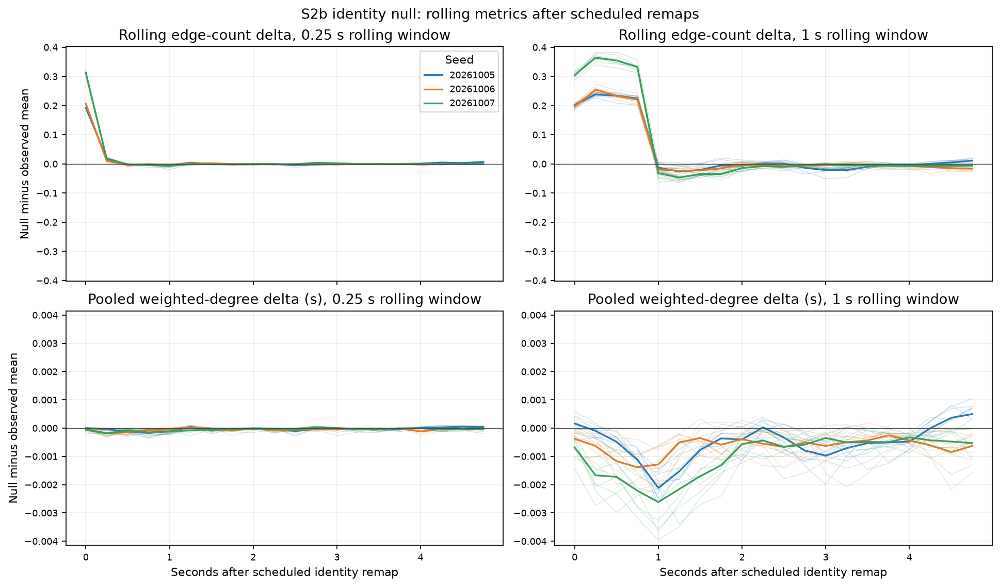

# S2b — Exact spatial movie, identity permutation null

**Result:** continuous identity changes temporal bookkeeping while the entire spatial movie stays fixed. Recent topology is closely reproduced, with a small rolling-edge excess concentrated after scheduled remaps and additional lifecycle effects. These differences diagnose identity continuity and null-boundary sensitivity; they do not demonstrate social organization.

## Question and scope

Given the exact same recorded colony spatial movie, does persistent ant identity / repeated partner continuity change the temporal encounter graph?

Fetched origin and continued the existing `ant-s2b-identity-null` branch at `0f49ba03c0e791cd8ad21368ab6b3273f731d927`, containing the [approved design](../../daily/2026-10-08-s2b-identity-null-design.md). Read the ANT guide, AGENTS and [S2a evidence](../2026-10-08-s2a-null/README.md) before edits. Replayed only the three committed [S0/S1 archives](../2026-10-07-social-graph/README.md), seeds 20261005/06/07, each 600 s. No natural ANT simulation was recaptured and production behavior was not modified; the required repository tests were run.

## Method

- Eight deterministic replicates per seed, 24 total. Dedicated null seed `ANT-S2b-2026-10-08-identity-v1`; replicate indices 0–7. The generator uses only hash-derived null randomness, instantiates no behavior system and consumes no behavior RNG. A fixture makes `Math.random` throw during generation/validation.
- A physical body is identified by its original archive ID handle, even if two bodies have identical tuples. Every original binary record remains in place. Only its four-byte ID index changes; all 48 bytes of `(x,y,vx,vy,heading,radius)` remain untouched at that record position. Header, frame count, timestamps and population are unchanged.
- Start with observed identity at t=0. Remap before observing ticks 300, 600, …, 35700: 119 boundaries at 5–595 s. The terminal t=600 frame closes the recording without a new shuffle. Blocks are defined by integer ticks, avoiding timestamp-roundoff boundary drift.
- At a scheduled boundary, Fisher–Yates permutes the lexically sorted active label list onto lexically sorted physical body handles. For shuffle index `i`, use uint32LE of SHA-256 over JSON `[nullSeed, sourceSeed, replicate, block, i, attempt]`; rejection sampling excludes modulo bias. Fixed points, including an identity permutation, are allowed.
- If membership changes, first discard dead bodies and expired labels, retain **every** binding whose body and label are both still active, then lexically zip vacant bodies and unused active labels. This retains the maximum possible number of valid old bindings and repairs only necessary vacancies. Repair precedes scheduled shuffle if both occur on the same frame.
- Every initial assignment, scheduled remap and membership repair is logged with tick/time, entry/exit body lists, full body-to-label mapping, changed labels and distance basis. Ledgers plus sources reproduce every virtual null archive; redundant physical archives are not stored.
- Reuse the exact archived `DynamicSocialGraph` and `TemporalSocialTopology`: k=2, encounter observations at 60 Hz, topology at 20 Hz, unchanged window/formation/fresh-support/persistence/component-transition/finish semantics. S2a's existing replay gained an optional detail collection hook; its default output and all committed observed results remain unchanged.
- 1 s is primary; 0.25 s is the transient/connector view. Existing 5/20 s replay cost no new analysis definition and is retained only as accumulated-memory sensitivity, not biological timescales.

This is an **identity/data-stream null**, not a simulated surrogate trajectory. The exact unlabeled spatial movie preserves recruitment/exit geography and collision-consistent configurations. Label-specific birth/exit position, individual personality assignment and body continuity are not preserved. An active label can jump to another physical body while its active window stays exactly fixed.

## Reporting

Each seed-run is the comparison unit; correlated frames are not research replicates. Run metrics use all 12,001 topology observations, including t=0. Weighted degree includes active isolates and pools node-time samples. Plots display 1 Hz timelines; the boundary comparisons use all 20 Hz samples. Completed lifetimes use existing observer endpoints and Type 7 quantiles; right-censored counts and elapsed durations remain separate.

[Comparisons](data/comparisons.csv) and [summary](data/summary.json) give seed-by-seed observed values, null mean/SD/min/p10/median/p90/max, differences, ratios, descriptive standardized differences and tie-aware midrank percentiles. Percentiles are not p-values or an emergence threshold. Missing episodes, zero denominators and zero SD remain missing where appropriate. Raw quantities repeat across window rows only for layout.

Each compressed [seed packet](data/) includes every remap/repair, virtual archive SHA-256, validation, temporal distributions, event counts, persistence durations, connector events, timelines and boundary diagnostics. Instantaneous edge counts and component-size multisets are **validation invariants**, never observed-versus-null findings.

## Primary 1 s results

Entries are observed / null mean [null p10–p90].

| Seed | Rolling edges | Weighted degree, s | Completed temporal-edge lifetime, s |
| --- | --- | --- | --- |
| 20261005 | 1.1346 / 1.1731 [1.1671–1.1779] | 0.033108 / 0.032602 [0.032458–0.032740] | 1.3538 / 1.3029 [1.2958–1.3089] |
| 20261006 | 1.0703 / 1.1072 [1.1034–1.1115] | 0.030565 / 0.029930 [0.029705–0.030094] | 1.3492 / 1.2866 [1.2764–1.2956] |
| 20261007 | 1.2396 / 1.2958 [1.2915–1.2996] | 0.043482 / 0.042489 [0.042232–0.042734] | 1.4729 / 1.3882 [1.3768–1.3967] |

Null rolling-edge means are about 3.40%, 3.45%, 4.53% higher. Null weighted-degree means are about 1.53%, 2.08%, 2.28% lower. All observed edge means rank below the eight null values; weighted degree and completed temporal lifetime rank above them. The magnitudes and boundary localization matter more than the extreme descriptive ranks in this small ensemble.

| Seed | Raw episodes | Completed raw mean lifetime, s | Bridge PERSIST | Merge / split counts |
| --- | --- | --- | --- | --- |
| 20261005 | 511 / 547.50 | 0.3618 / 0.3377 | 22 / 15.625 | 222 / 261.25; 456 / 480.75 |
| 20261006 | 483 / 522.00 | 0.3510 / 0.3247 | 14 / 10.750 | 223 / 262.25; 437 / 453.50 |
| 20261007 | 518 / 573.75 | 0.4644 / 0.4193 | 24 / 21.500 | 222 / 267.50; 456 / 477.875 |

Raw episodes increase 7.14%, 8.07%, 10.76% under relabeling, while total pair exposure stays 184.8833 / 169.2167 / 240.5500 s to floating-point summation precision, as expected from identical instantaneous geometry. More episode keys coincide with shorter completed means; censoring and same-key carry-through across body remaps also affect that summary. Tiny exposure differences in the CSV are roundoff, not physical findings. Observed raw right censoring is 0/1/0; null censoring is retained per replicate.

At 1 s, bridge persistence counts are lower in every null replicate. Bridge completed duration means are observed/null 1.2818/1.2652, 1.5214/1.5335, 1.9083/1.7204 s: duration direction is not consistent for all seeds. Articulation counts are 0/0/2 versus null means 0/0/2.75. Connector counts are 0/0/0 versus 0/0/0.625; the five null 1 s events occur only in seed 07. These rare events cannot support a role claim.

## Boundary association and identity discontinuities

Raw starts/ends are flagged within ±one 60 Hz sample of a boundary. Interval crossing requires an involved label to change between two non-null bodies. Rolling exposure asks whether `[t-W,t]` contains a boundary. Event counts record exact boundary time, `(boundary,boundary+W]`, relevant-label interval crossings, and any identity-jump exposure over onset-to-event time. Null events are compared with observed events at the same boundary times. Scheduled and lifecycle flags overlap and are not additive causal decompositions.

| Seed | Raw starts near scheduled boundary, observed / null mean | Null extra starts there / net episode increase | 1 s edge delta in scheduled-exposed samples | 1 s samples outside all actual identity jumps, mean per replicate |
| --- | --- | --- | --- | --- |
| 20261005 | 4 / 32.125 | 28.125 / 36.50 | +0.2176 | 2915.125 |
| 20261006 | 6 / 36.875 | 30.875 / 39.00 | +0.2175 | 3544.250 |
| 20261007 | 4 / 51.375 | 47.375 / 55.75 | +0.3255 | 3215.875 |

About 77–85% of the net extra raw starts are time-associated with scheduled boundaries by this narrow flag. The 2,499 scheduled-exposed 1 s samples per run are 20.82% of all samples; their positive edge excess exceeds the run-wide net excess because some other samples have negative deltas. The [phase diagnostic](plots/scheduled-boundary-phase-deltas.png) shows the excess sharply within the first rolling window after the 5 s remap. **This concentration is a null artifact, not a social result.**

For both 0.25 and 1 s, every replicate's rolling-edge and pooled weighted-degree deltas are exactly zero in the cohort whose window contains no actual surviving-label jump from either scheduled remaps or lifecycle repairs. The mean 0.25 s cohort sizes are 8286.875 / 8523.375 / 8348.375. This is a descriptive matched subset, not a corrected graph, and does not prove persistence state has washed out.

Lifecycle repairs also matter. There are 1477 / 1374 / 1441 logged membership events per replicate, including entries/exits requiring no surviving-label jump. Mean surviving-label reassignment counts are 692.875 / 640.125 / 674.125 per run. At 1 s, actual lifecycle-jump exposure covers a mean 8268 / 7619.375 / 8010.375 samples; mean weighted-degree deltas in those cohorts are −0.000720 / −0.000969 / −0.001430 s. The observer discards history for inactive labels even when another physical body continues; the exact active ID set therefore does not make retained label history invariant.

Lifecycle-driven identity jumps occur much more often than the 119 scheduled remaps. Preserving the exact active ID mask therefore makes this a five-second block permutation **plus necessary lifecycle repairs**, not a clean five-second-only intervention. Many observed recruitment episodes also start at membership boundaries; high raw counts in a lifecycle band alone cannot show that repair caused them. The packets retain time-matched observed controls for that reason.

Scheduled remaps reassign a mean 2067 / 2064.125 / 2095 surviving labels per run. Their pooled mean **same-frame old-body/new-body separation** is 0.4023 / 0.4003 / 0.4001 normalized arena units; p90 is about 0.68. Lifecycle-repair distances average 0.5733 / 0.5794 / 0.5760, using the last old-body sample when the old body has exited and same-frame positions otherwise. These are explicitly logged remap distances, not speeds or a finite-difference displacement of a physically moving ant. Saved velocity and heading stay with the body tuple and do not describe the identity jump.

Per-event exact/post-window counts and actor-associated duration cohorts for raw encounters, temporal edges, bridges, articulation and connectors are retained in `boundary.scheduled`, `boundary.lifecycleRepairs` and `boundary.allIdentityBoundaries` in each packet. Actor fields do not include every node capable of affecting a bridge/articulation's graph support. `noRelevantLabelIntervalCrossingCount` means only that the listed actors did not cross a jump; it does **not** mean unaffected support. The companion any-jump interval flag is conservative. No boundary filtering or observer-state reset is performed.

## Transients and sensitivity

| Seed | 0.25 s connector PERSIST, observed / null mean [range] | Descriptive midrank |
| --- | --- | --- |
| 20261005 | 3 / 3.000 [3–3] | 50% |
| 20261006 | 3 / 3.875 [3–4] | 6.25% |
| 20261007 | 5 / 5.875 [4–7] | 31.25% |

The original 11 recruitment-origin-local connector events remain the same observed events. Physical recruitment geography is held fixed here, but label birth/body alignment and retrospective component identity are not. Extra null connectors can reflect those bookkeeping changes. They remain rare and do not establish social preference, pioneers or roles.

At 5 s, mean edges are observed/null 4.2854/4.2900, 4.0729/4.1073, 4.4682/4.5257. At 20 s, they are 8.5449/8.1174, 8.3461/7.9763, 8.7925/8.4749. All bridge/articulation/connector persistence counts are zero in both 5/20 s observed and null runs. Scheduled exposure covers 11,901/12,001 samples in these sensitivity cases; the only 100 identity-jump-free samples are the initial unshuffled five seconds. Thus there is no mature boundary-free comparison at these windows. The changed 20 s retention and merge/split counts are memory/turnover sensitivity, not biological scales.

## Validation and provenance

- Original inputs are checked against committed Git blobs before replay and rehashed afterward. No source archive is an output target. All source archives and production files remain unchanged.
- Every one of 24 nulls passes all 36,001 frames: exact header/timestamp/count bytes, identical physical tuple bytes at each original record position (stronger than multiset equality), exact active ID set, bijective ledger mapping, finite values, positive radii, and exact instantaneous k=2 edge count/component-size multiset. Edge predicates come from the existing observer; the component traversal is a validation oracle only.
- All null binary bytes and complete ledgers are generated twice identically. All virtual hashes are distinct within seed. Independent `--verify` regenerates **all 24** and repeats full graph/topology/boundary analysis, checking exact equality.
- Each observed replay matches all archived S0 encounters/events, S1 events/temporal lifetimes and every saved 1 Hz topology snapshot at all four windows. The optional detail hook leaves the committed S2a observed packets unchanged for all seeds.
- Synthetic fixtures cover duplicate physical tuples, signed zero, variable radii, nontrivial known permutation, births/exits inside blocks, retention of valid bindings, terminal-frame policy, inverse relabeling, deterministic RNG independence and rejection of altered tuples/IDs/ledger. Boundary self-check covers matched observed controls, lifecycle-vs-membership flags, actor-limited exposure and persistence-duration cohorts.
- Focused tests 6/6; full tests **273/273**; build passes. Codec and boundary self-checks pass. Fixed-scale plots validate finite arrays, identical cadence, bins and histogram normalization and were visually inspected. Build retains the existing large-bundle advisory.

Compressed trajectory SHA-256:

| Seed | SHA-256 |
| --- | --- |
| 20261005 | `bce5ab225b8a03924f205458c57416fb7f35796ed0940d6d9efafeea9f42b904` |
| 20261006 | `f5ddf63e5f9cbab58079197e934ecaffc0d96bec4f285dabd573e5e206aaf064` |
| 20261007 | `b0a660dcbc5bda49b02d3eb625c47fa30e9c786a0576dfb1ccc72e7f4332c31f` |

[Validation ledger](data/validation.json), [provenance](validation/provenance.json) and [checksums](checksums.json) retain complete source/code hashes, parameters, tooling commit, runtime and logs. Package Git attributes preserve evidence bytes through staging. The checksum file excludes itself.

## Fixed-scale plots and reproduction

[Run summaries](plots/run-summaries.png), [1 s timelines](plots/one-second-timelines.png), [completed lifetimes](plots/completed-lifetimes.png), [scheduled-boundary phase deltas](plots/scheduled-boundary-phase-deltas.png). [Metadata](plots/plot-metadata.json) records shared numeric axis limits. Bands are descriptive p10–p90, not confidence bands; boundary-phase scales are symmetric and shared across both primary views and all seeds.



From repository root at the tooling/evidence branch:

```powershell
npm test
npm run build
node --test tests/ant-social-identity-null.test.js tests/ant-social-null.test.js
node scripts/ant-social-evidence.js --selfcheck
node scripts/ant-social-identity-boundaries.js --selfcheck
node scripts/ant-social-identity-null.js --output=test-results/ant-s2b-reproduce
node scripts/ant-social-identity-null.js --verify --output=test-results/ant-s2b-reproduce
python -B scripts/ant-social-identity-null-plots.py --input test-results/ant-s2b-reproduce --output test-results/ant-s2b-reproduce/plots
```

Plotting requires matplotlib/numpy. This pass used temporary uv packages matplotlib 3.11.2 and numpy 2.3.5, without project dependency changes. Disjoint `--seed=20261005` / 06 / 07 jobs can run in parallel, then `--summarize` with the same output directory. Default and maximum ensemble size are eight per seed.

## Decision and interpretation boundary

Implemented fact: the single deterministic identity null preserves the exact spatial movie and observer semantics. Descriptive result: much recent topology is reproduced, while raw episodes, rolling retention and persistence/transition bookkeeping change around intentional identity breaks. Strongest permitted research conclusion: temporal structure depends on continuous individual identity / repeated partner continuity **in these observer definitions under this remap/repair intervention**. This does not isolate a natural partner-continuity effect from artificial boundaries and turnover.

Persistent ANT identity also carries inertia, personality, hesitation, pheromone adherence/history, occupancy interactions and path dependence. This test cannot isolate social preference, social memory, roles, pioneers or emergent social organization. Raw episode count and extreme empirical ranks cannot carry that inference; persistence payloads do not allow complete causal support attribution. The eight-run pilot and fixed five-second intervention do not establish robustness to another block duration or a physically continuous surrogate.

The next decision is review of metric robustness and boundary/turnover semantics, under separate authorization. No next null, spectral gate, feedback, coupling, audio or substrate pass is started. Research interpretation remains separate from artistic interpretation; no artistic mapping or social narrative is added. Stop after separate tooling/evidence commits and branch push.
