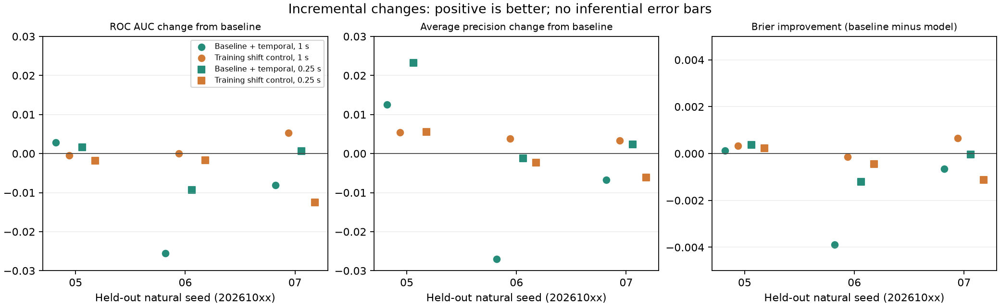

# S2c — incremental predictive value, 2026-10-08

**Question:** «Do simple temporal social-graph observables add useful predictive information beyond raw movement / population / spatial-density observables already present in the simulation?»

**Decision: spectral SKIP for the current research gate.** The selected temporal summaries show no consistent held-out improvement over the compact spatial/movement baseline. Primary 1 s predictors slightly improve seed 05 but worsen seeds 06 and 07 on all three reported performance measures. This is a bounded negative predictive result, not proof that all temporal history is redundant. No numeric acceptance threshold, significance claim or automatic escalation is used.

## Data and exact target

Only the three committed natural S0/S1 600 s archives, seeds 20261005/06/07, are used. No natural behavior is rerun, modified or retuned. No S2a/S2b null trajectory is used for fitting or evaluation. Existing source hashes, natural replay and lifecycle/finite-value validation are reused from the archive tooling.

Each seed contributes 599 eligible samples at nominal times **t = 1, 2, …, 599 s**, using the existing 1 Hz saved analysis cadence. The 60 Hz lossless trajectories and 20 Hz topology observer retain their original semantics. Time zero lacks a saved analysis row; 600 s lacks a complete future horizon. No sample is randomly shuffled across training and evaluation.

The single binary target is **at least one existing k=2 / W=1 s `COMPONENT_MERGE` event in (t, t+1 s]**. Multiple events within that horizon count once. Labels come directly from the committed raw `TemporalSocialTopology` event stream, after exact replay confirms all archived events and snapshots. Integer 60 Hz ticks resolve nominal open/closed endpoints without floating-point boundary drift; off-cadence events or incomplete horizons fail validation. Existing merge semantics compare successive component partitions through surviving stable IDs, including the implementation's handling of compound transitions. No second merge definition is introduced.

| Natural seed | Eligible samples | Positive future horizons | Prevalence | Raw primary merge events over 600 s |
| --- | ---: | ---: | ---: | ---: |
| 20261005 | 599 | 181 | 30.217% | 222 |
| 20261006 | 599 | 190 | 31.720% | 223 |
| 20261007 | 599 | 184 | 30.718% | 222 |

Both classes are present in every held-out seed and training fold. Class rarity does not prevent this comparison. Samples are temporally dependent; **three source seeds are the research units**, not 1,797 independent experimental replicates.

## Features and leakage audit

All predictors are available at t. The baseline uses the current physical frame and instantaneous k=2 graph geometry. Its component traversal and density measurement reuse the existing evidence helpers; the proximity predicate comes from `DynamicSocialGraph`. Added features use the existing saved causal `TemporalSocialTopology` metrics. Observer implementations are unchanged.

| Group / field | Definition at t | History required |
| --- | --- | --- |
| Baseline: population | Number of active recorded bodies | None |
| Baseline: instantEdgeCount | Current k=2 proximity pair count, `distance / (radiusA + radiusB) <= 2` | None |
| Baseline: instantLargestComponentRatio | Largest instantaneous connected component / active population, including isolates | None |
| Baseline: meanNeighborsSenseRadius | Mean other-body count at strict center distance < 0.085; existing density helper | None |
| Baseline: meanSpeed | Mean `hypot(vx, vy)` from the current recorded tuple | None |
| Added: rollingEdgeCount | Current retained edge count in the selected observer window | Past/current only |
| Added: weightedDegreeMean | Sum of current per-ID weighted degrees / active population; each edge contributes to both endpoints; units seconds | Past/current only |
| Added: rollingLargestComponentRatio | Largest retained-window component / active population, including isolates | Past/current only |

Primary added predictors use **1 s**. A secondary **0.25 s predictor view** uses the same feature definitions and **the same future 1 s merge target**. It does not introduce another target or independent seed ensemble. The baseline fit is identical across both views. No 5 s or 20 s predictive analysis is included; shared natural replay checks those existing observer archives only.

Leakage controls:

- Feature extraction reads trajectory frames sequentially through t and requires saved snapshot time to equal t. Every stored row records `availableThroughTick = tick`.
- Instantaneous baseline fields read only active encounters and current positions/velocities; they do not read encounter history or endpoints.
- The social whitelist is limited to current edge count, current weighted degrees and current largest-component ratio. No merge/split history, bridges, articulations, connectors, completed durations or persistence endpoints enter either model.
- Retrospective connector/stability fields and observer finalization fields are ignored. Tests corrupt those fields without changing extracted predictors.
- Future trajectory and future snapshot changes cannot alter earlier fixture predictors. Future events enter target labeling only, after features are extracted.
- Means and population standard deviations are estimated from the two training seeds only. Held-out prediction cannot change model/scaler state. No held-out tuning, class weighting or probability recalibration is performed.
- The negative control touches training-seed social vectors only. It never accesses or shifts held-out data.

## Model, folds and metrics

Both nested models use deterministic standardized logistic regression. Baseline has five slopes; baseline+social has eight. The fixed objective is summed Bernoulli negative log likelihood plus **0.5 × sum(slope²)**; the intercept is unpenalized. Zero-variance scales become one. Newton fitting uses deterministic pivoting and decreasing-loss line search. Every fit converged; model/scaler coefficients and convergence diagnostics are retained. There is no hyperparameter grid, seed selection or added ML dependency.

Leave-one-seed-out evaluation trains on 1,198 rows from two complete seeds and evaluates on 599 chronological rows from the third. All three held-out seeds are reported separately. ROC AUC groups exact score ties and integrates the threshold ROC curve. PR performance is **noninterpolated average precision**, not trapezoidal PR area. Brier is mean squared probability error. Calibration uses ten fixed probability bins of width 0.1; bin counts, mean predictions and event fractions are saved.

## Primary 1 s results

Higher ROC AUC and average precision are better; lower Brier is better.

| Held-out seed | Model | ROC AUC | Average precision | Brier |
| --- | --- | ---: | ---: | ---: |
| 20261005 | Spatial baseline | 0.565228 | 0.370880 | 0.208970 |
| 20261005 | Baseline + temporal | 0.568083 | 0.383394 | 0.208836 |
| 20261006 | Spatial baseline | 0.632145 | 0.432355 | 0.206090 |
| 20261006 | Baseline + temporal | 0.606601 | 0.405345 | 0.209987 |
| 20261007 | Spatial baseline | 0.638528 | 0.418305 | 0.204129 |
| 20261007 | Baseline + temporal | 0.630448 | 0.411504 | 0.204789 |

| Held-out seed | Added-minus-baseline ROC AUC | Added-minus-baseline AP | Added-minus-baseline Brier |
| --- | ---: | ---: | ---: |
| 20261005 | +0.002855 | +0.012513 | −0.000134 |
| 20261006 | −0.025544 | −0.027010 | +0.003897 |
| 20261007 | −0.008080 | −0.006801 | +0.000660 |

The spatial baseline has modest discrimination. The additional summaries do not improve it consistently. Seed 06 has the largest deterioration. The small seed-05 improvement cannot support a general incremental-value claim.

Primary mean predicted probabilities for baseline / added are 0.30836 / 0.31092, 0.30347 / 0.30742 and 0.31114 / 0.30877. These are near each seed's overall prevalence, but agreement of means does not establish calibration. High-probability bins have very few observations and can produce extreme fractions. [Calibration counts and model parameters](data/summary.json) and the fixed-scale plot retain that limitation.

## Training alignment control and secondary view

One deterministic training-only control preserves each row's baseline and target while circularly shifting the **complete three-value social vector** within each training seed. Its nonzero offset is derived from SHA-256 of dedicated seed `ANT-S2c-2026-10-08-training-control-v1`, held-out seed, training seed and predictor window. Offsets are recorded in samples/seconds. Training rows stay in place. Evaluation uses unchanged causal held-out features. This is a single model-flexibility sanity check, not a new trajectory null family or an empirical null distribution.

| Primary held-out seed | Control-minus-baseline ROC AUC | Control-minus-baseline AP | Control-minus-baseline Brier |
| --- | ---: | ---: | ---: |
| 20261005 | −0.000502 | +0.005410 | −0.000334 |
| 20261006 | +0.000026 | +0.003808 | +0.000150 |
| 20261007 | +0.005304 | +0.003333 | −0.000649 |

Small improvements also occur after training alignment is broken. The aligned primary model does not reliably outperform this control. A single shift cannot establish a null distribution or significance, and other shifts are deliberately not searched.

| 0.25 s predictor view, same 1 s target | Added-minus-baseline ROC AUC | Added-minus-baseline AP | Added-minus-baseline Brier |
| --- | ---: | ---: | ---: |
| 20261005 | +0.001626 | +0.023254 | −0.000371 |
| 20261006 | −0.009330 | −0.001257 | +0.001197 |
| 20261007 | +0.000602 | +0.002312 | +0.000038 |

The secondary view does not resolve seed inconsistency: seed 06 worsens, and seed 07's rank improvements do not improve Brier. Full absolute results and secondary control results are in [comparisons.csv](data/comparisons.csv).

## Evidence and validation

- [summary.json](data/summary.json): source hashes, exact parameters, prevalence, folds, all models/scalers, control offsets, metrics and calibration bins.
- [analysis.json.gz](data/analysis.json.gz): compact lossless complete report with all causal feature rows, targets, held-out predictions and threshold curves. The uncompressed report is about 4 MB; only its compressed form is committed.
- [comparisons.csv](data/comparisons.csv): 18 model/fold/view comparisons, including deltas.
- [validation logs and provenance](validation/): focused **5/5**, full **278/278**, production build pass, binary codec self-check pass, independent full analysis reproduction byte-identical, package reproduction/source checks pass. Build retains existing Rollup annotation and large-chunk warnings.
- Each natural replay matches all committed k=2 encounter episodes/events, topology events/edge lifetimes and all saved snapshots for the four existing observer windows. Predictor density and instantaneous edge counts independently match source timeline fields.
- Source inputs match committed Git blobs before analysis and their hashes afterward. Source frames, timestamps, finite tuples, positive radii and contiguous ID lifecycles validate through the existing lossless index. No behavior object is constructed and no behavior RNG is called. Focused feature fixtures also reject any `Math.random` call.
- [checksums.json](checksums.json) covers package bytes except itself. Package-local Git attributes prevent text normalization. Provenance records unchanged source/observer files, base/tooling commits, runtime versions and reproducible report hashes.

Compressed source trajectory SHA-256:

| Seed | SHA-256 |
| --- | --- |
| 20261005 | `bce5ab225b8a03924f205458c57416fb7f35796ed0940d6d9efafeea9f42b904` |
| 20261006 | `f5ddf63e5f9cbab58079197e934ecaffc0d96bec4f285dabd573e5e206aaf064` |
| 20261007 | `b0a660dcbc5bda49b02d3eb625c47fa30e9c786a0576dfb1ccc72e7f4332c31f` |

## Fixed-scale diagnostics and reproduction

[Held-out performance](plots/held-out-performance.png), [incremental changes](plots/incremental-changes.png), [calibration](plots/calibration.png). [Plot metadata](plots/plot-metadata.json) records shared numerical scales across seeds/views. ROC/AP use [0,1], Brier [0,0.25], calibration both axes [0,1]. Incremental axes are symmetric and shared by both windows/control; the plotted Brier sign is reversed so positive means improvement. No frame-based confidence intervals are supplied.



From repository root:

```powershell
node --test tests/ant-social-predictive.test.js
npm test
npm run build
node scripts/ant-social-evidence.js --selfcheck
node scripts/ant-social-predictive.js --output=test-results/ant-s2c-reproduce
node scripts/ant-social-predictive.js --verify --output=test-results/ant-s2c-reproduce
python -B scripts/ant-social-predictive-plots.py --input test-results/ant-s2c-reproduce --output test-results/ant-s2c-reproduce/plots
```

Plotting requires matplotlib/numpy. This pass used temporary uv packages matplotlib 3.11.2 and numpy 2.3.5, without project dependency changes. After generation, compare the SHA-256 of uncompressed `analysis.json` with `validation/provenance.json`; the committed gzip decodes to the same bytes. Pinned plot command:

```powershell
uv run --no-project --with matplotlib==3.11.2 --with numpy==2.3.5 python -B scripts/ant-social-predictive-plots.py --input test-results/ant-s2c-reproduce --output test-results/ant-s2c-reproduce/plots
```

## Limitations and interpretation boundary

This checks one simple future observer-defined merge target, one compact baseline, three existing temporal summaries, one fixed regularization setting and three natural seeds. A different baseline or model could change the comparison. It does not establish an information-theoretic absence of temporal information. Adjacent samples, shared training seeds and the two predictor views are dependent; no independent-frame inference or population confidence interval is justified. The evaluation measures transfer across these simulation seeds, not generalization to biological colonies.

The target itself is derived from retained proximity geometry and lifecycle bookkeeping. Both feature groups are functions of recorded movement. Even a gain would show that temporal graph history compresses information missing from the chosen current-frame baseline; it would not isolate social preference, social memory, roles, pioneers or emergent organization. ANT continuity also contains inertia, personality, hesitation, pheromone adherence/history, occupancy interactions and path dependence. S2a's recruitment/seam confounds and S2b's artificial identity-boundary effects remain historical limitations; this natural-only predictive pass does not repair them.

Implemented fact: deterministic causal feature extraction, exact archived merge labeling and leave-one-seed-out logistic comparison pass validation. Descriptive result: small seed-dependent increments, with primary deterioration in two seeds and occasional gains in the broken-alignment control. Research decision: keep the social graph as a derived observation layer and **skip spectral diagnostics at this gate**. This is a scope decision from the measured comparison, not an acceptance threshold or claim that social organization was disproved.

Artistic interpretation is separate. No artistic graph-to-material mapping or biological graph-mode narrative is added. Stop after S2c verification, separate tooling/evidence commits and the requested branch push. Another null, spectral analysis, feedback, coupling, audio or behavior pass requires separate authorization.
