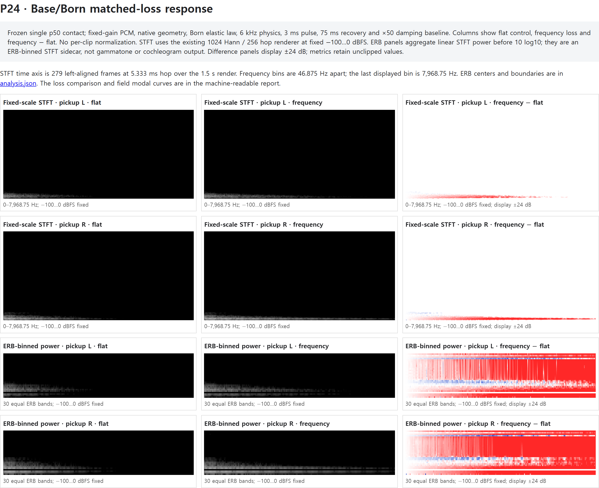

# 2026-10-14 — Base/Born loss-distribution comparison

## Question and decision

Does Base's frequency-selective loss do more than shorten the overall Born tail? This bounded shadow compares the existing frequency-loss term against a flat-loss control matched at spatial eigenvalue `q=4`. The Born elastic law, geometry, pickups, contact, and all other render conditions remain fixed.

**Decision: SUPPORTED for response responsibility under this frozen recipe.** In each of P1, P24, and P26, the frequency-loss arm slows the post-pulse decay of `q<4` modes, leaves the `q=4` pivot essentially matched, and speeds the `q>4` group. The same split leaves a substantial time-varying difference in the actual fixed-gain stereo pickup. Away from `q=4`, input gain changes by design as well as the pole; the pickup delta therefore includes both modal onset participation and subsequent decay. The independently measured post-pulse modal slopes establish the decay difference. This does not establish human audibility, preference, or production value.

No human listening assessment was performed. Production and the frozen `3 ms / 75 ms / ×50` sonic baseline are unchanged. No loss amount was tuned after seeing the result.

## Frozen conditions and manipulation

- Production reference: `main` at `d45823d40c9a87c1b333fa9872f3c897ee9ab01b`.
- Research input commit: `7761c4b10d77c657bc23c1691c95c04ea78bb739` on `codex/ant-base-born-causal-decomposition-20261014`.
- Frozen isolated single-contact input: p50, strength `0.035`, width `0.01`, hardness `0.5`, 18 steps at 6 kHz (3 ms), with 75 ms compliance/recovery. Six renders: flat and frequency-loss arms for P1/P24/P26. No natural-run contact archive was created.
- Born elastic law, material, solver mask, geometry, contact schedule, pickups, output routing, and readout are identical within each pair. Only the loss coefficient/operator differs. Runtime, formation, behavior/RNG, Base calibration, and Nodule/Z logic were untouched.
- `gammaBase48 = 0.0000616140594288357`; `gammaStar = 8 * gammaBase48 = 0.0004929124754306856`.
- Flat control: `gamma = 0`, `d = dBorn + 4 * gammaStar`.
- Frequency-loss arm: `gamma = gammaStar`, `d = dBorn`.

For the real-valued recurrence, the `q=4` pole coefficient and input gain match exactly: `aFlat = 2 - dBorn - 4*gammaStar - b*4² - tau*4 = aFrequency`, and `BFlat = 1 - dBorn - 4*gammaStar = BFrequency`. The `Float32` topology coefficient makes only a tiny residual. The per-plate requested/stored values and real/stored pole, gain, and radius residuals are in [`analysis.json`](analysis.json).

The renderer asserts that the paired schedule and all topology arrays, including geometry, elastic/material coefficients other than damping, and pickup indices, are unchanged. The new flat arm repeated bit-identically for PCM, full field, and raw pickup on every plate. The frequency arm reproduces the prior causal-decomposition render byte-for-byte.

Parity boundary: prior frequency-arm PCM/field/pickup were byte-compared to the existing causal-decomposition outputs. The new flat arm was checked for exact repeatability in the same offline shadow renderer; no separate browser `OfflineAudioWorklet` parity run was made for the new flat topology. This evidence therefore validates the matched response within the shadow renderer and does not claim a fresh browser parity result for that arm.

## Field and pickup measurements

Field modes use the symmetric masked four-neighbor Laplacian eigenbasis of each frozen geometry. We report mean-square projected displacement, divided by node count, in three exhaustive groups (`q<4`, `q=4`, `q>4`). These are descriptive displacement measures, not joules. Slopes are linear fits to 25 ms mean-square windows from the end of the 18-step contact pulse through the remaining 1.5 s render. More-negative values mean faster power decay. Each arm's onset and first post-pulse energy are retained separately in the machine data.

| Plate (solver nodes) | `q<4` slope, flat → frequency (dB/s) | `q=4` slope, flat → frequency (dB/s) | `q>4` slope, flat → frequency (dB/s) |
| --- | ---: | ---: | ---: |
| P1 (48) | −71.447 → −42.109 | −71.452 → −71.453 | −71.455 → −76.878 |
| P24 (277) | −71.485 → −35.100 | −71.482 → −71.433 | −71.479 → −76.472 |
| P26 (350) | −71.561 → −26.780 | −71.465 → −71.484 | −71.548 → −73.403 |

Actual pickup values below are the existing post-limiter, 48 kHz stereo output at fixed gain 1. Early RMS covers the first 25 ms after strike; late RMS covers 500 ms to the end of the 1.49 s measured output. The peak and RMS values remain native fixed-gain measurements.

| Plate | Whole-clip RMS, flat → frequency | Peak, flat → frequency | Early RMS, flat → frequency (`Δ dB`) | Late RMS, flat → frequency (`Δ dB`) | Whole-clip centroid change |
| --- | ---: | ---: | ---: | ---: | ---: |
| P1 | 0.0006496 → 0.0007829 (`+1.62 dB`) | 0.007252 → 0.007415 | 0.002283 → 0.002336 (`+0.20 dB`) | 0.00001370 → 0.00006194 (`+13.11 dB`) | −9.41 Hz |
| P24 | 0.002147 → 0.003091 (`+3.16 dB`) | 0.02324 → 0.02775 | 0.007433 → 0.007814 (`+0.43 dB`) | 0.00004971 → 0.0005379 (`+20.68 dB`) | −4.19 Hz |
| P26 | 0.001634 → 0.002642 (`+4.18 dB`) | 0.02507 → 0.02883 | 0.004695 → 0.005008 (`+0.56 dB`) | 0.00003466 → 0.0006919 (`+26.00 dB`) | −10.37 Hz |

Stereo pickup response also changes by geometry: the frequency arm's left/right RMS changes are P1 `+2.00/+1.18 dB`, P24 `+1.59/+3.24 dB`, and P26 `+2.20/+4.22 dB`. Whole-clip RMS and centroid alone do not describe the result: early pickup RMS differs by only `0.20–0.56 dB`, while late pickup RMS differs by `13.11–26.00 dB`. No frame reached the limiter's `|x| >= 1` threshold; measured soft-limiter RMS attenuation was at most `0.12 dB` per arm. Full limiter, stereo, envelope, onset, and energy-curve data are in `analysis.json`.

## STFT and ERB sidecar

The existing fixed-scale STFT is retained: symmetric Hann, FFT 1024, hop 256, 48 kHz, 279 frames, bins with centers from 0 through 7968.75 Hz, and a fixed `−100…0 dBFS` display. It is not replaced by the ERB diagnostic.

The sidecar aggregates the same STFT's linear one-sided bin power into 30 equal-width ERB-rate bands from 0 to 8 kHz using `E(f) = 21.4*log10(1 + 0.00437*f)`, then converts the band sums to dB. It does not average dB values. Bands use `[low, high)` boundaries; DC belongs to the first band and remains undoubled. The full ordered ERB-rate and Hz boundaries, centers, bin mapping, and normalization details are recorded in `analysis.json`. There is no per-clip normalization. The fixed `|rFFT|² / sum(Hann)²` scale is consistent for these paired comparisons, but absolute ERB levels are descriptive and not a Parseval-calibrated broadband energy estimate. This is an ERB-binned STFT sidecar, not a gammatone output or cochleogram.

P24's actual-pickup B−A late (500–1500 ms) ERB-group power differences are low `+21.90 dB`, mid `−3.23 dB`, and high `+17.89 dB`. Early (0–100 ms after pulse) differences are only `+1.86/−1.42/+1.22 dB`; the bands then diverge over time. P1 and P26 retain the low/high late-tail difference as well, while the mid group changes sign across geometries. These are fixed-gain readout differences; the descriptive ERB groups are not auditory thresholds, do not map one-to-one to spatial `q`, and do not establish audibility.

ERB adds a compact, time-resolved band-tail summary beyond a whole-clip centroid or a broad-band level. It does not add signal information beyond the underlying STFT; it reorganizes the same fixed-gain power bins. The native fixed-scale STFT and per-channel data remain available in the P24 visualization and machine-readable series.

The ERB implementation self-check passed: silence stays finite, 250 Hz and 4 kHz tones map in order to their expected low/high groups, band boundaries are monotonic and finite, identical inputs produce exactly zero dB difference, and doubling amplitude gives a fourfold power ratio. No level-normalized spectral-shape analysis was run.

## Listening and visuals



- [`p24-time-frequency.png`](p24-time-frequency.png) is the representative static evidence snapshot shown above. It captures the P24 flat, frequency-loss, and frequency − flat panels for both pickup channels, using the same chart data and fixed scales as the HTML.
- [`p24-time-frequency.html`](p24-time-frequency.html) is the exploratory/listening view. It embeds the same STFT and ERB arrays and retains the listening-only controls.
- `analysis.json` and `erb-time-series.json.gz` remain the machine-readable measurement/data sources. The PNG is a static snapshot, not a replacement source of truth. P1/P26 detailed measurements stay machine-readable; no extra plate visual sheets were generated.
- [`listening/p24-flat-fixed-gain.wav`](listening/p24-flat-fixed-gain.wav) and [`listening/p24-frequency-fixed-gain.wav`](listening/p24-frequency-fixed-gain.wav) are 32-bit float measurement exports at fixed gain 1.
- [`listening/p24-flat-rms-matched.wav`](listening/p24-flat-rms-matched.wav) and [`listening/p24-frequency-rms-matched.wav`](listening/p24-frequency-rms-matched.wav) share target RMS `0.02`; these 16-bit exports are listening-only character-comparison artifacts.
- [`listening-manifest.json`](listening-manifest.json) has WAV hashes, source PCM hashes, levels, and the explicit status: **No human listening assessment performed.** No automatic audible/preferred judgment was made.

## Evidence and reproduction

- [`analysis.json`](analysis.json): complete machine-readable mode slopes/curves, pickup RMS/peak/envelopes, stereo response, limiter contribution, fixed-scale STFT metrics, ERB definitions and band tails.
- [`erb-time-series.json.gz`](erb-time-series.json.gz): compact native fixed-gain ERB-time arrays for all three geometries.
- [`render-manifest.json`](render-manifest.json): all six isolated render rows, artifact sizes/SHA-256, exact condition metadata, old frequency-arm byte parity, and source-tool hashes. The 52,488,000 bytes of raw renders are under ignored `test-results/ant-base-born-loss-distribution-20261014/`.
- [`report-manifest.json`](report-manifest.json): analysis, ERB series, HTML/PNG and listening artifact hashes, plus the PNG export tool/browser version and pixel dimensions.
- [`validation.json`](validation.json): branch/baseline provenance, coefficient match, pair assertions, determinism, and focused validation status.
- [`../2026-10-14-base-born-causal-decomposition/README.md`](../2026-10-14-base-born-causal-decomposition/README.md) and [`responsibility-map.md`](../2026-10-14-base-born-causal-decomposition/responsibility-map.md): prior-pass setup and responsibilities.
- [`../../daily/2026-10-14-base-born-loss-distribution.md`](../../daily/2026-10-14-base-born-loss-distribution.md): decision chronology.

Reproduction commands from the repository root (the ignored causal-decomposition output is needed for the prior-frequency byte-parity assertion):

```powershell
node --expose-gc scripts/ant-base-born-loss-distribution.js
python scripts/ant-base-born-metrics.py test-results/ant-base-born-loss-distribution-20261014/render-index.json test-results/ant-base-born-loss-distribution-20261014/metrics.json
python scripts/ant-base-born-loss-analysis.py --self-check
python scripts/ant-base-born-loss-analysis.py
node scripts/ant-base-born-loss-visuals.js
node --input-type=module --eval "await import('./tests/ant-base-born-shadow.test.js'); await import('./tests/ant-sonic-shadow-render.test.js'); await import('./tests/compile-surface-topology.test.js'); await import('./tests/surface-plate-worklet.test.js'); await import('./tests/surface-audio-bridge.test.js'); await import('./tests/audio-snapshot-renderer.test.js');"
```

The render script checks the frozen-input SHA, the production worklet SHA, coefficient stability, matched geometry/input/elastic/pickup state, exact q=4 real-valued pole and input-gain equality, per-plate Float32 residuals, the previous frequency render's byte equality, and bit-identical flat repeats. The Python self-check covers silence, known tones, identical inputs, amplitude scaling, and band ordering.

## Limits and parked work

This establishes a repeatable response difference under the frozen p50 single-contact recipe, not a perceptual threshold or a universal auditory law. Because off-pivot input gain also differs, the complete pickup delta cannot be attributed to decay alone; the matched post-pulse modal slopes isolate the decay selectivity. Spatial mode groups are geometry-dependent; P1/P24/P26 are the fixed systematic trio, not a population sample. Mid ERB tails are not consistent across the trio. No p25/p50/p75 common-three-contact sensitivity was run, so contact-position generalization remains untested. No gammatone/cochleogram, loudness, roughness, sharpness, tonality, embeddings, parameter tuning, production adoption, or new natural-run archive was done. Those remain separate future decisions.
