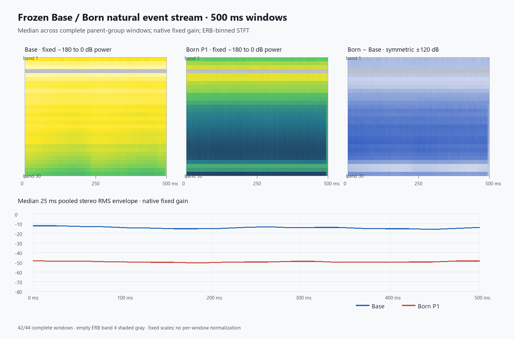
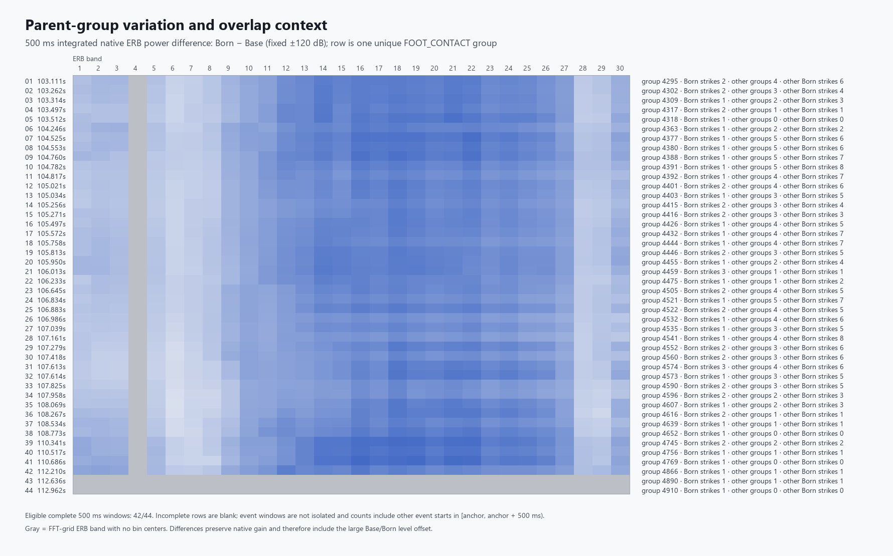

# Base / Born natural event ERB comparison — 2026-10-14

## Decision

**MIXED.** The frozen raw stems have a large native level gap, and the gap stays similar across the 100, 250, and 500 ms event windows. After each response is separately unit-sum normalized for the explicitly shape-only comparison, the ERB-time and integrated profiles remain substantially different. Some lower ERB bands show a repeated direction of normalized energy shift, but event-wise shape-change patterns vary, and most 500 ms windows contain several other event starts. These recordings therefore show more than a level offset, while they do not establish a clean, repeatable Base-versus-Born character independent of group-versus-foot event semantics and stream overlap.

This is a descriptive comparison of two existing raw worklet stems. A single exploratory blind-listening session was later collected on 2026-10-15; it is subjective single-listener evidence, not a formal discrimination result, and it does not establish preference, production quality, or a Base substrate design effect by itself. The session export is preserved under [`subjective-listening/`](subjective-listening/).

## Frozen sources and mapping

No simulation or audio render was run. The analysis reuses the two existing 10 s, stereo, 48 kHz, float32 raw worklet stems from the event-count-matched capture. Each PCM was checked by path, exact byte length, RIFF format, and SHA-256 against the original event report; the frozen gzip input was also rechecked.

| Source | Bytes | SHA-256 |
| --- | ---: | --- |
| `substrate-matched-parent-groups-raw-worklet-10s-48khz-f32.wav` | 3,840,044 | `5b79c9b8514cf022f8c6d9ea62b8d296e730a5f3a5ea8af88d80348196f49784` |
| `born-p1-63-raw-worklet-10s-48khz-f32.wav` | 3,840,044 | `19a02ff15c625d1bfc6d9a59244ce6d041d3d9944888300dcaf74d5d823c88b9` |
| `fresh-seed-20261005-through-first-birth-plus-10s.json.gz` | 1,144,018 | `25bf05aab8bbbb142be11b79f37a5988898d6069e24cae31bf721348b0bf7ff3` |

The original report is [`event-count-matched-report.json`](../2026-10-07-base-substrate-debug/audio/event-count-matched-substrate/event-count-matched-report.json). The frozen input is [`fresh-seed-20261005-through-first-birth-plus-10s.json.gz`](../2026-10-07-base-substrate-debug/audio/fresh-seed-20261005-through-first-birth-plus-10s.json.gz). The seed is `20261005`; the first Plate is `trail-plate-1`, born at `103.01666666667376 s`.

The report maps **63 accepted Born P1 foot strikes to 44 unique parent `FOOT_CONTACT` groups**. The Base stem schedules one generic event per unique group, so it has 44 events. Group multiplicities are 27 with one P1 strike, 15 with two, and 2 with three. No Base event was duplicated to match the 63 Born strikes. The new analyzer rechecked each exact timestamp, leg, position, group payload, requested frame, source group roster, and stored Base dispatch receipt against the frozen input and report.

Each analysis window starts at the common parent `requestedFrame = round((simulationTimeMs - birthMs) * 48)`. Born dispatch is sample-exact; Base dispatch is quantized to the next 128-frame boundary. The Base dispatch offset is median 56 frames, range 1–127 frames. That offset is retained rather than shifted out of the response, so the onset timing difference remains visible in the native comparison.

The captured Base worklet used the generic Plate setup (`normal`, stiffness `0.92`, damping `100`, pickups at `(-0.32,-0.18)` and `(0.32,-0.18)`). The Born arm is the frozen P1 worklet response with the existing 3 ms pulse, 75 ms recovery, and ×50 Plate damping semantics. The original capture report notes that the generic worklet's production `Math.random` jitter realization was not recorded. Since the frozen PCM exists and its hash matches, it is used as-is; no replay was substituted.

## ERB method

The analysis imports [`ant-base-born-loss-analysis.py`](../../../../scripts/ant-base-born-loss-analysis.py) without modifying its ERB mapping or helper semantics:

- 48 kHz; symmetric Hann FFT 1024; hop 256; bin centers through 7968.75 Hz (0–8 kHz range).
- 30 equal ERB-rate bands using `E(f) = 21.4 * log10(1 + 0.00437*f)`.
- One-sided linear STFT power is summed into half-open ERB bands before dB conversion. DC is included, undoubled, in the first band; positive-frequency bins are doubled.
- Stereo is pooled as the mean of left and right linear ERB power per time-band cell, matching the recent Plate ERB analyses.
- Band 4 (zero-based index 3; 98.5835–140.1117 Hz) has no FFT bin centers at this grid and remains empty. It is shaded gray in the figures and retained in the 30-band arrays.
- Native fixed-gain measurements use no per-response normalization. Cosines use a separate shape-only view: divide each response's nonnegative linear ERB-time power by its total, then compare the resulting distribution. No floor is used in shape normalization.
- Event windows use the existing helper's left-aligned STFT; a final partial FFT frame is zero-padded. Only complete 100/250/500 ms PCM windows are analyzed. No window is truncated.

For every complete window, the report contains native pooled and L/R RMS and peak, first and last 25 ms RMS, full ERB-time cosine, integrated 30-band cosine, late-half integrated cosine, shape total variation, and native Born-minus-Base ERB differences. The event-aligned 500 ms aggregate stores median and 10th/90th percentile Base, Born, paired difference, and 25 ms envelope arrays.

## Results

The whole 10 s raw stem RMS is `0.17080` for Base (`−15.35 dBFS`) and `0.003183` for Born (`−49.94 dBFS`), a Born-minus-Base difference of `−34.59 dB`. Whole-stem peak difference is `−26.89 dB`. Left and right levels are retained separately in [`analysis.json`](analysis.json).

| Complete window | Full ERB-time cosine, median (p10–p90) | Integrated profile cosine, median (p10–p90) | Late-half profile cosine, median (p10–p90) | Born-minus-Base RMS, median |
| --- | ---: | ---: | ---: | ---: |
| 100 ms, n=43 | 0.488 (0.292–0.734) | 0.603 (0.324–0.792) | 0.589 (0.321–0.826) | −36.73 dB |
| 250 ms, n=43 | 0.476 (0.304–0.714) | 0.672 (0.325–0.854) | 0.635 (0.359–0.891) | −35.94 dB |
| 500 ms, n=42 | 0.546 (0.301–0.696) | 0.668 (0.367–0.941) | 0.672 (0.395–0.890) | −35.30 dB |

The level gap is close to the whole-stem gap at each duration. At 500 ms, the median first-25-ms level difference is `−36.43 dB`; the median final-25-ms difference is `−34.40 dB`. That is a modest narrowing in this frozen window set. The shape-only cosines stay well below identity (`1.0`), so the ERB-time difference is not explained by a single global gain factor.

Across the 42 complete 500 ms windows, the cosine between each pair of event-wise shape-change vectors has median `0.497` (p10 `0.079`, p90 `0.720`, range `−0.543…0.986`; 861 event pairs). Normalized integrated energy shifts toward ERB bands 5–8 in most events: positive Born-minus-Base shape changes occur in 81%, 100%, 100%, and 74% of events for bands 5, 6, 7, and 8 respectively. This is a partial repeated lower-band pattern, not a uniform signature across all bands or events.

The windows contain overlapping event starts by construction. Among complete 500 ms windows, the median count is 3 other parent groups and 5 other Born strikes starting inside the window; 39/42 have at least one of each. At 100 ms, 13/43 windows contain another group/strike start. Shape distance has no clear positive monotonic relation to these counts in this frozen sample (500 ms Spearman: `−0.201` for other groups, `−0.321` for other Born strikes; 100 ms: `+0.108` / `+0.056`). These are descriptive correlations only; prior event tails also remain in the continuous streams, and the windows are not isolated.

Taken together, the native streams differ strongly in level and retain additional normalized ERB-time shape differences. The lower-band direction repeats to a degree, while event-level shape changes remain variable. Because Base contributes one group-level excitation while Born retains one or more foot responses per parent group, and because later windows overlap several event starts, the result is **MIXED** for repeated Base/Born character across this frozen stream.

## Visual and listening artifacts

[`listening.html`](listening.html) is the reusable static viewer for the existing q25/q50/q75 clips. Its blind first-listen mode randomizes trial order and anonymous A/B side assignment from an exported session seed. One hidden A/A catch reuses the exact q50 Base source bytes on both sides; it is an exploratory difference-seeking-bias check, not a formal psychophysical statistic and not part of the scientific result. It uses the same 12 WAVs and their recorded metadata from [`listening-manifest.json`](listening-manifest.json); no audio was rendered again. RMS-matched playback is the default listening-only character comparison, not audibility evidence. Fixed-gain playback preserves amplitude / transfer context. Reveal shows condition identity and metadata, plus A/B/difference ERB from fixed-gain clips only on the existing shared scales. [`viewer-config.json`](viewer-config.json) is the declarative input, and [`viewer-validation.json`](viewer-validation.json) records the WAV receipts, catch source identity, reused ERB helper, fixed scales, and generated HTML hash. Subjective session exports remain separate from measurement evidence.

The 2026-10-15 exploratory single-listener session predates the later playback-gain revision. Its committed JSON and original judgments remain historical evidence: the hidden q50 Base/Base A/A catch was judged `no difference`; the q25 and q75 RMS-matched Base/Born pairs were judged different before reveal; the q50 fixed-gain comparison was not useful as a character judgment because the Born arm was reported as effectively inaudible at that playback level. The viewer's later convenience gain does not retroactively change that session. The new matched-playback stage targets digital pooled stereo RMS **0.08** using a Web Audio gain calculated independently for each q pair. It leaves all 12 WAVs, fixed-gain playback, and fixed-gain ERB analysis unchanged. This is not calibrated SPL or equal-loudness evidence. The subjective session does not establish general perceptual discrimination or preference, and the scientific result remains **MIXED**.





The absolute ERB panels share the fixed `−180…0 dB power` display scale; their median 25 ms RMS envelope shares a fixed `−80…0 dBFS` scale. Both difference views use a common symmetric `−120…+120 dB` scale. There is no per-window or per-panel normalization, and no displayed cells clip. The two final groups without complete 500 ms windows are blank in the group figure.

[`listening/`](listening/) contains 12 deterministic float32 WAVs: fixed-gain Base/Born clips and RMS-matched listening-only versions for three complete 500 ms groups selected by the predeclared chronological 25/50/75% index rule. The selected groups are 4392, 4475, and 4573. RMS-matched clips use one shared scalar per stereo clip and target the lower arm's native RMS. The 2026-10-15 listening assessment is the separate historical session described above; its pre-gain playback level remains part of its provenance.

## Evidence and reproduction

- [`analysis.json`](analysis.json): source receipts, exact ERB definition, validation, per-event/per-window measurements, overlap counts, aggregate arrays, and decision.
- [`validation.json`](validation.json): frozen-source and 63-to-44 mapping assertions, ERB self-checks, complete-window counts, and production-boundary provenance.
- [`event-pairs.csv`](event-pairs.csv): one row per unique parent group, with exact native and shape-only metrics for 100/250/500 ms and complete-window flags.
- [`report-manifest.json`](report-manifest.json): evidence file sizes and SHA-256 values, PNG dimensions, source hashes, and Python/NumPy/Pillow/helper provenance. Its own recursive hash is omitted.
- [`listening-manifest.json`](listening-manifest.json): selection rule, source mapping, per-clip gains/levels, hashes, and the no-listening-assessment boundary.
- [`2026-10-14-base-born-natural-event-erb.md`](../../daily/2026-10-14-base-born-natural-event-erb.md): chronology and decision record.

From the repository root:

```powershell
python scripts/ant-base-born-natural-event-erb.py
```

This command verifies the existing source hashes and mapping, reruns the ERB self-check and deterministic analysis/export, and writes only the evidence package. It does not invoke a simulator or audio renderer. No production `src/`, `static/`, worklet, bridge, or physics source was changed.
