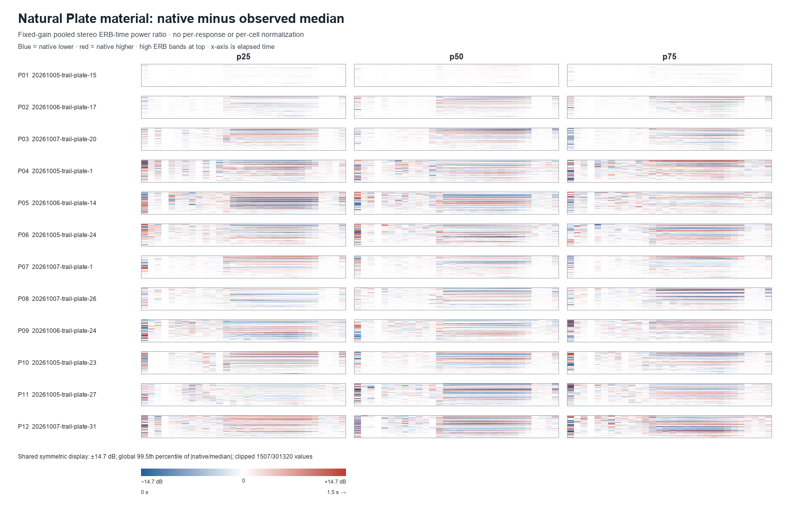
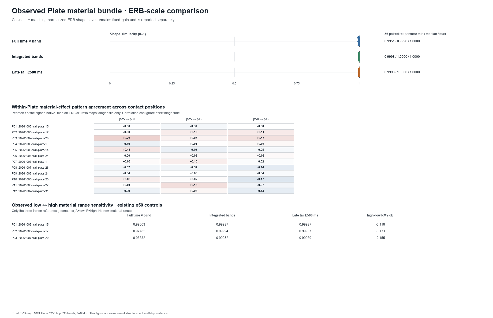

# Plate material contribution at ERB scale — 2026-10-14

## Decision

**NEGATIVE for a broad, repeatable native-versus-median ERB identity or spectral-tail signature in this frozen recipe.** The 36 matched native/material-median responses have near-identical unit-sum ERB-time, integrated-band, and late-tail shapes, and their fixed-gain level changes are small. The three observed low/high controls show a small, directionally repeated shift in a few low-frequency FFT bins and modest time-resolved differences, but their integrated and late ERB profiles also remain nearly coincident. This is a bounded negative result about broad ERB structure, not a claim that material has no physical effect.

No audibility, preference, Plate-identification, or production-quality claim is made. The prior sonic-individuality pass reported fine modal-spectrum and accumulated-phase changes; phase was not measured here. Stiffness and damping covary in the natural corpus, so all results concern the observed **material bundle**, not either coefficient alone.

## Frozen inputs and manipulation

This pass reanalyzed existing fixed-gain stereo PCM only. It ran no simulation and rendered no audio. Before analysis, all 78 distinct PCM files were checked against the prior render manifest for path, byte size, and SHA-256: 72 files for 36 native/material-median pairs and six files for three observed low/high controls.

The primary roster is the same twelve frozen natural Plates as the sonic-individuality pass, each at p25, p50, and p75: `20261005-trail-plate-15`, `20261006-trail-plate-17`, `20261007-trail-plate-20`, `20261005-trail-plate-1`, `20261006-trail-plate-14`, `20261005-trail-plate-24`, `20261007-trail-plate-1`, `20261007-trail-plate-26`, `20261006-trail-plate-24`, `20261005-trail-plate-23`, `20261005-trail-plate-27`, and `20261007-trail-plate-31`. Each matched pair retains the same geometry/topology, contact fraction and schedule, strength/footprint, pickup/readout, solver/rate, 3 ms pulse, 75 ms recovery, and ×50 damping semantics; only the Plate material object changes.

The sensitivity controls reuse p50 low/high responses for the first three reference geometries: P15, P17, and P20. They are the frozen observed-range endpoints, not a new sweep. Frozen material values are:

| Material | Stiffness | Density | Damping |
| --- | ---: | ---: | ---: |
| Observed median | 0.9124881966538272 | 1.2 | 0.35499527866153086 |
| Observed low | 0.9045947712179081 | 1.2 | 0.35183790848716323 |
| Observed high | 0.9208084698448359 | 1.2 | 0.35832338793793433 |

Across the source corpus, `damping = 0.4 * stiffness - 0.01`; density remains 1.2. The material endpoints therefore do not isolate stiffness from damping.

## Representation and metrics

The analysis reuses the 2026-10-14 loss-distribution ERB helper and the position-identity band mapping: 48 kHz PCM, 1024-point symmetric Hann STFT, 256-sample hop, 279 left-aligned frames, and 30 equal ERB-rate bands over 0–8 kHz using `E(f) = 21.4 * log10(1 + 0.00437 * f)`. The highest included FFT-bin center is 7968.75 Hz. Exact ERB-rate edges, frequency boundaries, and centers are recorded in `analysis.json`.

Bands use half-open intervals; FFT bin centers are assigned with the existing `searchsorted(side="right")` rule. DC is retained in band 0 and is not doubled; included positive-frequency one-sided linear power is doubled. Linear power is summed inside each band before dB conversion. Left/right band powers are averaged in linear power. Native fixed-gain results have no per-response normalization. The reported absolute ERB scale is descriptive and is not Parseval-calibrated broadband energy.

Shape-only cosines are a separate diagnostic: each response's linear ERB power is unit-sum normalized before flattening for the full time-frequency cosine; integrated and ≥500 ms late-tail profiles are independently unit-sum normalized over their 30 bands. No floor or dB values enter the cosine metrics. Signed difference maps use native-minus-median band-time power ratios in dB with a `1e-30` log floor; early summaries use frame starts from the strike frame to <100 ms after strike, and late summaries use frame starts ≥500 ms.

This is an **ERB-binned STFT** diagnostic, not a gammatone filterbank or cochleogram. One band (band 3; approximately 98.6–140.1 Hz) contains no 1024-point FFT bin centers, so its 279 frame cells are silent for every response. These expected empty cells do not enter the shape cosines; they are handled by the logged floor only in difference maps. The lowest bands are sparsely resolved at this FFT size: for example, bands 0–2 contain DC, 46.875 Hz, and 93.75 Hz bin centers respectively. Small directional endpoint differences in those cells should not be read as resolved broad auditory bands.

## Results

### Native versus observed median: 36 matched pairs

| Metric | Median | Range |
| --- | ---: | ---: |
| Full ERB-time shape cosine | 0.999601 | 0.995097–1.000000 |
| Time-integrated 30-band profile cosine | 0.999992 | 0.999830–1.000000 |
| Late-tail profile cosine, frame starts ≥500 ms | 0.999994 | 0.999848–1.000000 |
| Fixed-gain RMS change, native minus median | +0.0027 dB | −0.0884–+0.0944 dB |
| Fixed-gain peak change, native minus median | −0.0004 dB | −0.0635–+0.0594 dB |

The normalized full ERB-time and late/integrated summaries remain very close across the 36 matched pairs. Difference-map patterns across p25/p50/p75 do not form a consistent full time-frequency signature: the 36 within-Plate position-pair Pearson correlations have median 0.0008 and range −0.172 to +0.239. Integrated and late band-pattern correlations have medians 0.607 and 0.663, but span almost the full −1 to +1 range; their signs and strengths vary by Plate and position pair. These correlations describe pattern agreement only; they do not override the small native/median effect magnitude.

### Observed low versus high: three p50 controls

Full ERB-time shape cosine is 0.977845–0.995030; integrated profile cosine is 0.999524–0.999944; late-tail cosine is 0.999394–0.999873. Low-minus-high fixed-gain RMS is +0.118 to +0.155 dB across P15/P17/P20. In the full window, low-minus-high power has the same sign across all three geometries in bands 0–2 and 5, and the opposite sign in bands 10 and 26; the early and late band directions are not identical. The low endpoint is slightly stronger in the few lowest FFT-bin cells, while the integrated and late 30-band distributions remain almost unchanged. This is a small observed-range sensitivity, not evidence of broad spectral-tail separation.

### Contact-position context

On the same unit-sum ERB coordinates, median native/median shape distance (`1 − cosine`) is 0.000399 full, 0.000008 integrated, and 0.000006 late. The prior native cross-position distances in the selected frozen set have medians 0.520296, 0.172108, and 0.195111 for those views. This comparison is descriptive only, not a variance decomposition or causal percentage: it indicates that the material substitution is much smaller than changing contact position for this set and recipe.

## Static figures

The difference grid uses one symmetric scale for all 36 primary cells: ±14.67496 dB, set to the global 99.5th percentile of absolute full-map differences. It clips 1,507 of 301,320 values. There is no per-cell autoscale or per-response normalization.



The summary shows the full/integrated/late shape distributions, per-Plate p25/p50/p75 difference-pattern agreement, and the three low/high controls. Its correlation scale is fixed at −1 to +1.



## Validation and provenance

- All 78 PCM path/size/SHA-256 receipts matched the source render manifest and local raw files; each PCM is 576,000 bytes (1.5 s, stereo Float32 at 48 kHz).
- Assertions verified all 36 matched primary pairs, the three p50 low/high controls, frozen position labels/coordinates, schedules, geometry/pickup fingerprints, native materials, observed endpoint values, and ×50 damping semantics.
- The reused ERB self-check passed finite silence, expected 250 Hz/4 kHz band ordering, monotonic boundaries, same-input zero difference, and 2× amplitude → 4× power. The identity diagnostic returned cosine 1 for identical input and for a scalar-rescaled response. No per-response fixed-gain or display normalization was applied.
- Both PNGs were regenerated twice from the same frozen inputs with matching bytes and expected dimensions: 1580×1014 and 1840×1190. Exact source and output hashes are in `validation.json` and `report-manifest.json`.
- The frozen PCM-producing renderer, worklet, topology, and descriptor source hashes match the original manifest. One listed post-render measurement-only script, `scripts/ant-sonic-response-metrics.py`, has a different current hash; its role is recorded as analysis-only and it does not generate or alter PCM. The PCM receipts themselves match.
- Production `src/` and `static/` match `main` at `d45823d40c9a87c1b333fa9872f3c897ee9ab01b`. No production source was changed.
- No human listening assessment was performed. No audibility or preference conclusion was inferred.

Reproduce from a checkout with the original ignored raw input package under `test-results/ant-plate-sonic-individuality-20261013/`, Python 3, NumPy, and Pillow:

```sh
python scripts/ant-plate-erb-material-contribution.py --self-check
python scripts/ant-plate-erb-material-contribution.py
```

## Artifacts

- [`analysis.json`](analysis.json): exact definitions, decision, distributions, pair metrics, per-response levels, band differences, and position context.
- [`matched-pairs.csv`](matched-pairs.csv): 36 primary pairs plus three low/high sensitivity pairs.
- [`erb-difference-series.json.gz`](erb-difference-series.json.gz): exact paired ERB band-time dB difference maps.
- [`validation.json`](validation.json): source receipts, manipulation assertions, self-check, PNG validation, and production comparison.
- [`report-manifest.json`](report-manifest.json): source/input hashes, tool versions, output sizes, dimensions, and SHA-256 values.
- [`plate-erb-native-median-difference.png`](plate-erb-native-median-difference.png): shared-scale 12×3 primary difference grid.
- [`plate-erb-material-summary.png`](plate-erb-material-summary.png): similarity distributions, position-pattern summary, and observed-range controls.
