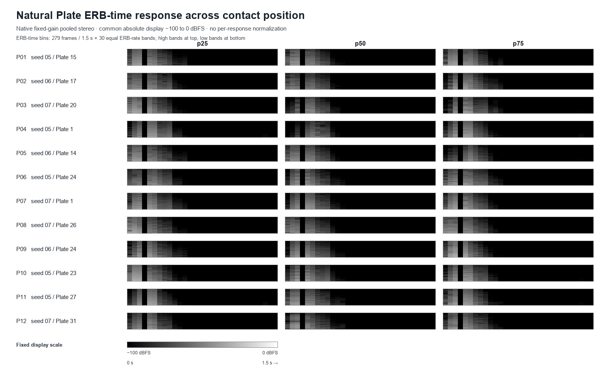
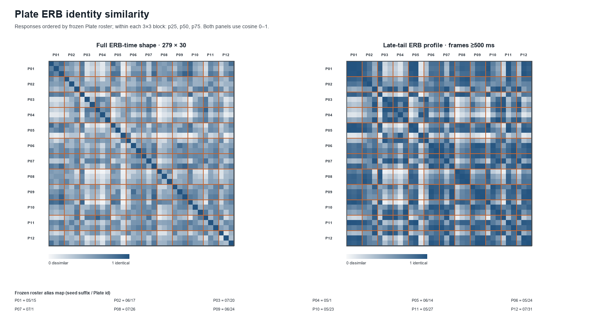

# Plate ERB position identity — 2026-10-14

## Decision

**MIXED.** Same-Plate responses are more similar after time integration and in the late-tail band profile, but not in the primary full ERB-time representation. The similarity matrix shows local Plate blocks rather than a consistent diagonal grouping across the frozen set. Contact position therefore changes the measured time-frequency response enough that these data do not support stable full-response Plate identity across p25/p50/p75.

This is a descriptive result for twelve selected Plates. It does not establish that people can identify Plates, or that the differences are audible, preferred, or production quality.

## Question and scope

For each frozen natural Plate, does its pooled stereo ERB-time response stay more similar across contact positions than responses from different Plates at the same position label?

Only the 36 existing native isolated one-contact PCM files were analyzed. Each response is stereo 48 kHz, fixed gain 1, 1.5 s, from the existing 6 kHz physics run with a 3 ms contact pulse, 75 ms recovery, and ×50 damping. No Plate, contact, simulation, or physics render was added. Geometry, native material, pickups, routing, and contact recipe remain those of the original frozen renders.

The production baseline recorded by the source manifest and local `main` is `d45823d40c9a87c1b333fa9872f3c897ee9ab01b`. Every source PCM path, byte count, and SHA-256 was checked against that frozen manifest before any ERB analysis. The 36 files total 20,736,000 bytes. Receipts are in [`validation.json`](validation.json); source hashes and tool provenance are in [`report-manifest.json`](report-manifest.json).

| Alias | Frozen Plate | Positions |
| --- | --- | --- |
| P01 | `20261005-trail-plate-15` | p25, p50, p75 |
| P02 | `20261006-trail-plate-17` | p25, p50, p75 |
| P03 | `20261007-trail-plate-20` | p25, p50, p75 |
| P04 | `20261005-trail-plate-1` | p25, p50, p75 |
| P05 | `20261006-trail-plate-14` | p25, p50, p75 |
| P06 | `20261005-trail-plate-24` | p25, p50, p75 |
| P07 | `20261007-trail-plate-1` | p25, p50, p75 |
| P08 | `20261007-trail-plate-26` | p25, p50, p75 |
| P09 | `20261006-trail-plate-24` | p25, p50, p75 |
| P10 | `20261005-trail-plate-23` | p25, p50, p75 |
| P11 | `20261005-trail-plate-27` | p25, p50, p75 |
| P12 | `20261007-trail-plate-31` | p25, p50, p75 |

## Measurement

The analysis reuses the loss-distribution pass's ERB-binned STFT helper without changing its mapping: 1024-point symmetric Hann, hop 256, 48 kHz, frequency-bin centers through 7968.75 Hz, and 30 equal ERB-rate bands spanning 0–8 kHz. ERB rate is `E(f)=21.4*log10(1+0.00437*f)`. The 31 Hz-bin centers are assigned to half-open `[low, high)` boundaries; DC is included in band 0 and its one-sided power is not doubled. Positive-frequency bins are doubled. Linear power is summed into bands before any dB conversion. Exact boundaries, centers, pooling rule, and floor use are recorded in [`analysis.json`](analysis.json).

Left and right linear ERB power are averaged per frame. Native fixed-gain power remains unnormalized and is used by the position grid. For the shape-only identity diagnostic, each response's nonnegative linear power is divided by its total over all 279 × 30 cells; cosine similarity is then computed on the flattened distribution. No floor or dB conversion enters the identity metrics. Time-integrated and ≥500 ms late-tail profiles are separately unit-sum normalized over their 30 bands. RMS and peak remain fixed-gain level measurements and are not part of the similarity metric.

The within-Plate set contains 36 p25↔p50, p25↔p75, and p50↔p75 pairs. The between-Plate control contains 198 different-Plate, same-position pairs. Pair values are descriptive and dependent; no inferential test or arbitrary pass threshold was introduced.

## Results

| Similarity | Within-Plate cross-position, n=36 | Between-Plate same-position, n=198 | Median within − between | Within-over-between pairwise dominance |
| --- | ---: | ---: | ---: | ---: |
| Full ERB-time shape | median 0.480 (0.094–0.849) | median 0.529 (0.067–0.904) | −0.050 | 47.2% |
| Time-integrated ERB profile | median 0.828 (0.086–0.998) | median 0.722 (0.071–0.998) | +0.106 | 58.5% |
| Late-tail ERB profile, frame starts ≥500 ms | median 0.805 (0.062–0.997) | median 0.713 (0.063–1.000) | +0.092 | 58.4% |

Full ERB-time similarity is not consistently preserved across contact position: its within-Plate median is lower than the between-Plate control, and the within value exceeds a between value in 47.2% of all pairwise cross-set comparisons. The three within-position-pair medians are 0.469 (p25–p50), 0.617 (p25–p75), and 0.468 (p50–p75); the same-position between medians are 0.534 (p25), 0.478 (p50), and 0.579 (p75). The higher p25–p75 result does not generalize to the other two position pairs.

After time integration, the same Plate's 30-band profile is more similar on average in this frozen sample; the late-tail profile has the same direction. These profile summaries do not preserve temporal ordering. Per-Plate full ERB-time medians range from 0.197 to 0.721; integrated medians range from 0.306 to 0.989. The difference between these views, along with broad pair-value overlap, supports a mixed result rather than a general Plate identity claim. Full per-Plate and per-position distributions are in [`analysis.json`](analysis.json), and all 234 pair values are in [`pairwise-comparisons.csv`](pairwise-comparisons.csv).

Descriptive nearest-neighbor retrieval over the 36 responses found **0/36** queries whose nearest other response was the same Plate at a different position; **18/36** nearest neighbors were different Plates with the same position label. This is grouping within the selected frozen set, not classification accuracy or generalization.

Fixed-gain RMS is reported separately: median −46.20 dBFS, range −58.04 to −37.74 dBFS. Similarity results use unit-sum shape and do not encode these native level differences. The largest exact-zero share was 3.33% of a response's ERB-time cells; no positive ERB power fell below the display floor. The identity metrics use unfloored linear power, so floor handling did not create their grouping pattern.

## Static views

The first image shows all 36 fixed-gain native ERB-time responses at one common −100 to 0 dBFS display scale, with no per-response normalization.



The second image shows cosine similarity matrices ordered by frozen Plate roster and p25/p50/p75, for full ERB-time shape and the late-tail profile. Orange guides mark the 3×3 Plate blocks.



## Validation and reproduction

- All 36 source paths, sizes, and SHA-256 values matched the original render manifest before analysis; each Plate's topology hash, native material, and node count matched across its three positions.
- The reused ERB self-check passed silence, 250 Hz and 4 kHz tones, same-input difference, positive amplitude scaling, finite output, and monotonic band boundaries. Identity cosine also returned 1 for identical and positively rescaled shapes.
- Pair-count assertions passed: 36 within-Plate and 198 between-Plate pairs. The output records 279 frames × 30 bands, finite positive response mass, and no floor in identity calculations.
- Repeat-run checks produced identical artifact SHA-256 values; the final PNG hashes are in the report manifest.
- No human listening assessment was performed. No audibility, preference, or production sonic-quality judgment was inferred.
- Production `src/` and `static/` are unchanged from `main`.

Reproduce on a checkout that has the original ignored raw package at `test-results/ant-plate-sonic-individuality-20261013/`, plus Python 3, NumPy, and Pillow:

```sh
python scripts/ant-plate-erb-position-identity.py --self-check
python scripts/ant-plate-erb-position-identity.py
```

The raw PCM and its render index are ignored local inputs; this package retains their path/hash receipts and the derived measurement data, not copies of the source PCM.

## Artifacts

- [`analysis.json`](analysis.json): measurement definitions, decision, distributions, per-Plate summaries, matrices, levels, and floor diagnostics.
- [`pairwise-comparisons.csv`](pairwise-comparisons.csv): all 36 within-Plate and 198 between-Plate pair metrics.
- [`erb-time-series.json.gz`](erb-time-series.json.gz): pooled native fixed-gain linear ERB power for all responses.
- [`validation.json`](validation.json): source receipts and checks.
- [`report-manifest.json`](report-manifest.json): input/source hashes, tool versions, output sizes and SHA-256 values.
- [`plate-erb-position-grid.png`](plate-erb-position-grid.png): fixed-scale native time-frequency grid.
- [`plate-erb-identity-summary.png`](plate-erb-identity-summary.png): full and late-tail similarity matrices.

The ERB-binned STFT is a spectral diagnostic sidecar. It is not a gammatone filterbank, cochleogram, or human auditory model. No audio physics, contact, pickup, material, or damping setting was tuned or adopted.
