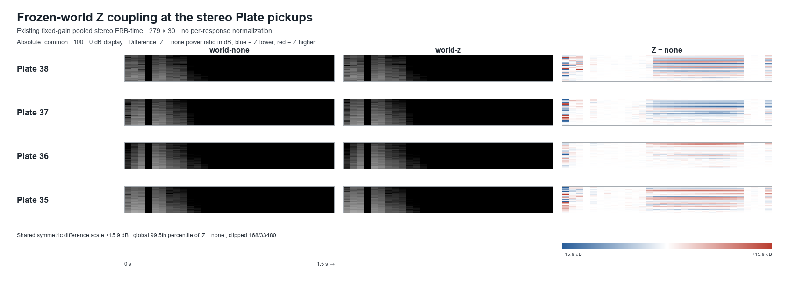
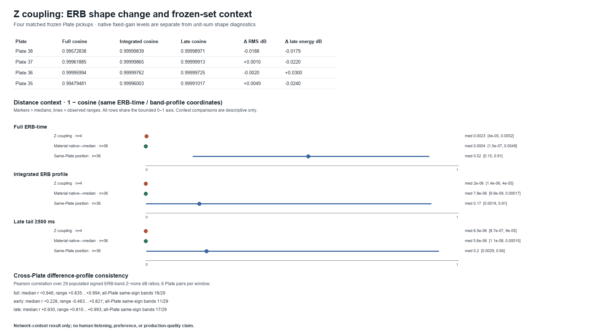

# Plate ERB response under frozen-world Z coupling

## Result

**Decision: MIXED.** The four frozen stereo pickups contain a small, partly repeated Z-minus-none pattern in the full ERB-time map. The time-integrated and late-tail ERB profiles remain almost unchanged, and fixed-gain RMS and late energy move by only a few hundredths of a decibel. The effect is not consistently larger than the earlier natural-material variation and is far smaller than the earlier contact-position variation in the same ERB distance coordinates.

This is a response measurement for four existing one-shot world probes. It does not show that listeners can identify the difference or that the difference is musically useful.





## Implementation fact

The source is the existing frozen seed-07 final current-law world used in the 2026-10-13 Plate sonic-individuality pass. The analysis reuses Plates **38, 37, 36, and 35**, the four exposed Plates with the largest exposed-cell counts, at their existing path-midpoint-nearest exposed cells. Each comparison is `world-none` versus `world-z`. No simulation or audio render was created for this pass.

All 16 PCM files (four conditions per Plate) match the original render manifest by path, byte count, and SHA-256. In each Plate, `world-isolated` and `world-none` are byte-identical, and `world-z` and `world-zn` are byte-identical. The original generator and production capture sources match their recorded hashes, apart from the separately identified post-render metrics script. The frozen generator creates `world-none` by zeroing only the adjacent inter-layer link arrays on a copy of the `world-z` topology. The matched one-contact schedule, exposed position, frozen material object, solver rate, node count, and pickup mix are equal; the existing 3 ms pulse, 75 ms recovery, and ×50 Plate damping semantics are retained.

These controls verify the intended shadow manipulation for these saved responses. `world-z` versus `world-zn` equality is limited to these four probes; it is not evidence that Nodules are generally silent or redundant.

## Measurement

### ERB representation

The raw input is existing 48 kHz stereo PCM at fixed gain 1, 72,000 frames per response. The analyzer reuses `scripts/ant-base-born-loss-analysis.py` and the same mapping verified in the previous Plate ERB passes:

- 1024-point symmetric Hann STFT, hop 256, 279 left-aligned frames.
- Positive-frequency bins through 7968.75 Hz, assigned to 30 equal ERB-rate bands over 0–8 kHz using `E(f)=21.4*log10(1+0.00437*f)`.
- Half-open band boundaries; DC stays in the first band and is not doubled; included positive-frequency one-sided linear power is doubled.
- The 30-band representation retains every planned band, but band 3 (98.58–140.11 Hz) contains no FFT-bin centers at 46.875 Hz spacing. It remains zero in the ERB vectors and is excluded only from cross-Plate correlations and shared-sign counts; those summaries use 29 populated bands.
- Linear bin power is summed within each band. L/R band power is averaged in linear power before profiles, shape metrics, or dB conversion.
- Fixed-gain ERB output is not normalized per response. The static absolute panels use one common −100 to 0 dB display range.
- Shape-only cosine uses each response's pooled linear ERB power divided by its own total for the selected domain. It is diagnostic-only and does not contain native output level.

The difference view is `world-z − world-none` as a band-time power ratio in dB, after linear ERB aggregation and the existing `1e-30` display floor. Its single symmetric display limit is the global 99.5th percentile of absolute differences across all four maps: **±15.9 dB**, clipping **168 / 33,480** values. No row or response receives its own display normalization. The difference image shows relative changes, including cells with little native energy. The unit-sum cosine is a shape-only diagnostic; fixed-gain RMS, peak, and energy metrics carry output-level information.

### Per-Plate response

Cosines use unit-sum shape diagnostics; level and energy deltas are `world-z − world-none`.

| Plate | Full ERB-time cosine | Integrated profile cosine | Late profile cosine (≥500 ms) | RMS delta (dB) | Peak delta (dB) | Late energy delta (dB) |
| --- | ---: | ---: | ---: | ---: | ---: | ---: |
| 38 | 0.99572838 | 0.99999839 | 0.99998971 | −0.0188 | −0.0081 | −0.0179 |
| 37 | 0.99961885 | 0.99999865 | 0.99999913 | +0.0010 | +0.1639 | −0.0220 |
| 36 | 0.99995994 | 0.99999762 | 0.99999725 | −0.0020 | +0.0058 | +0.0300 |
| 35 | 0.99479481 | 0.99996003 | 0.99991017 | +0.0049 | −0.0873 | −0.0240 |

Across all four, RMS moved **−0.0188 to +0.0049 dB**, late energy **−0.0240 to +0.0300 dB**, and peak **−0.0873 to +0.1639 dB**. Left-channel RMS delta ranged **−0.0516 to +0.0326 dB**; right-channel RMS delta ranged **−0.0744 to +0.0217 dB**. The ERB band-time difference maps show a repeated, low-level pattern in the four actual pickups; full and late signed 29-populated-band delta profiles have median cross-Plate Pearson correlations of **+0.946** and **+0.930**, respectively. The early profile correlation is less consistent (**+0.228** median, with both positive and negative pairwise values). Full and late profiles have the same nonzero sign across all four Plates in **16/29** and **17/29** populated bands, respectively. An all-zero band is not counted as directional agreement.

These profile correlations describe similarity among four band-delta vectors, not effect size or audibility. The integrated and late-tail cosine values remain extremely close to one, even where the relative difference map displays bands with higher ratios.

### Context in the same ERB distance coordinates

The following are descriptive `1 − cosine` distributions from this frozen set, not a variance decomposition. Material compares 36 same-position native-to-median pairs; position compares 36 same-Plate cross-position pairs. Z has four pairs.

| Shape representation | Z median (range) | Natural material median (range) | Contact-position median (range) |
| --- | ---: | ---: | ---: |
| Full ERB-time | 0.002326 (0.000040–0.005205) | 0.000399 (0.00000015–0.004903) | 0.520296 (0.150869–0.906247) |
| Integrated ERB profile | 0.000001995 (0.000001351–0.000039970) | 0.000007833 (0.000000010–0.000169613) | 0.172108 (0.001886–0.913605) |
| Late ERB profile | 0.000006520 (0.000000869–0.000089828) | 0.000005557 (0.000000011–0.000152232) | 0.195111 (0.002894–0.937640) |

The full time-frequency distance is higher than the material median for some probes, but overlaps the natural-material range and varies strongly by Plate. Integrated and late-tail Z distances sit around or below the material median. All three Z distance distributions are much smaller than contact-position variation in this comparison set.

## Research interpretation

The strongest reading supported here is **MIXED**: Z coupling leaves a weak but partly repeated ERB-time signature in the actual stereo pickup, especially in the full and late signed band-delta patterns. At the same time, the native integrated/late ERB shapes and total tail energy are nearly preserved. The magnitude is not consistently above observed material variation, and it is far below the same-Plate contact-position variation. This does not support a strong, independent broad spectral-tail responsibility beyond the earlier fine phase/transfer observation.

This result is specific to the four frozen top-layer, isolated one-contact probes and the existing 1.5 s readout. It does not measure dense simultaneous contact, older/deeper excitation, or a universal world response.

## Artistic / perceptual boundary

No human listening assessment was collected. The results do not establish listener discrimination, preference, musical usefulness, or production sonic quality. The comparisons do not tune Z coefficients, pickups, damping, or contact. Production `src/` and `static/` remain unchanged.

## Artifacts and reproduction

- [`analysis.json`](analysis.json): exact ERB mapping, per-Plate metrics, band deltas, cross-Plate pattern summaries, and same-coordinate context distributions.
- [`matched-pairs.csv`](matched-pairs.csv): compact exact values for the four `world-none` / `world-z` pickup pairs.
- [`erb-difference-series.json.gz`](erb-difference-series.json.gz): machine-readable 279 × 30 difference fields and full/early/late per-band deltas.
- [`validation.json`](validation.json): source path/size/hash receipts, exact-PCM controls, manipulation assertions, ERB self-checks, PNG determinism, and production-source check.
- [`report-manifest.json`](report-manifest.json): artifact hashes, image dimensions, source/helper/generator/tool provenance, and reproduction command.
- [`plate-erb-z-coupling-difference.png`](plate-erb-z-coupling-difference.png): four-row fixed-scale comparison.
- [`plate-erb-z-coupling-summary.png`](plate-erb-z-coupling-summary.png): per-Plate metrics and descriptive material/position context.

Reproduce the analysis from the existing ignored PCM package:

```powershell
python scripts/ant-plate-erb-z-coupling.py
node --test tests/ant-sonic-shadow-render.test.js
```

The Python environment needs NumPy and Pillow. The analyzer verifies original PCM receipts and prior context artifacts before writing output. It does not invoke a renderer.
