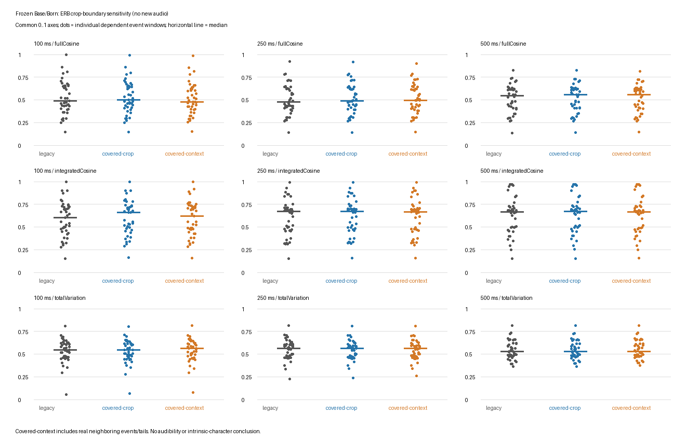

# Frozen natural-event ERB window-boundary sensitivity — 2026-10-15

**Decision: broad shape separation survives these boundary policies; individual short-window measurements remain context-sensitive.** The previous natural Base/Born **MIXED** causal verdict is retained. This is an analysis-sensitivity result for the same historical recordings, not intrinsic character, audibility, production balance, or a reason to replace the shared ERB helper.

## Why this pass

The prior independent methodology review identified a possible edge effect: the existing analyzer crops at a requested event frame and starts a symmetric Hann window there. Hann's first sample is zero, and the earliest crop samples lack preceding overlapping windows. Base also has a recorded 1–127-sample dispatch delay relative to Born. This pass checks boundary coverage without shifting either recording or optimizing any alignment. The original ERB code, evidence and audio are preserved.

The initially contemplated modal-participation pass was already complete in current main (`c12ed56`); this pass deliberately does not repeat it or the completed blind-viewer work.

Baseline: `a9c138e8fff3ebfec45c09f2f391d8e6f5aedfdd`. The [protocol](protocol.md) was written before running the analysis. The [runner](../../../../scripts/ant-erb-window-boundary.py) imports existing source readers, mapping validators and the unchanged ERB helper. No simulation, new audio render, playback export, listening assessment, production code edit or parameter tuning occurred.

## Three comparisons

All policies retain 48 kHz, symmetric Hann 1024, hop 256, 30 ERB-rate bands over 0–8 kHz, linear power pooling, and the original sample anchor.

| Policy | Frame support | Meaning |
| --- | --- | --- |
| `legacy` | Existing cropped helper, including its last partial zero-padded frame | Exact reproduction of prior analysis |
| `covered-crop` | Every hop-aligned Hann frame overlapping the same crop, zero outside it | Restores leading **and trailing** window coverage without adding any source audio samples |
| `covered-context` | Identical frame starts, real surrounding stream samples | Sensitivity to real preceding/following context; not an isolated response or a correctness reference |

Covered starts run from -768 samples to the final multiple of 256 strictly below crop length. Centers are start + 511.5 samples and may lie outside the crop. All legacy frames remain bit-identical inside `covered-crop`. All frames wholly contained in the crop agree exactly with `covered-context`. Thus the changed metrics come from boundary-support changes, not altered interior FFTs or frequency mapping. No eligible contextual frame extends beyond the recorded 10 s stream.

## Results

Cosine 1 means scalar-related band-power vectors; it is not a hearing threshold. Total variation is computed on unit-sum linear ERB-time power. Values below are separate policy medians, **not medians of paired changes**.

| Window / count | Full ERB-time cosine: legacy / covered crop / context | Integrated profile cosine: legacy / covered crop / context | Total variation: legacy / covered crop / context |
| --- | --- | --- | --- |
| 100 ms / 43 | 0.4881 / 0.4980 / 0.4759 | 0.6026 / 0.6604 / 0.6173 | 0.5463 / 0.5439 / 0.5656 |
| 250 ms / 43 | 0.4760 / 0.4862 / 0.4959 | 0.6716 / 0.6729 / 0.6683 | 0.5657 / 0.5644 / 0.5621 |
| 500 ms / 42 | 0.5458 / 0.5571 / 0.5548 | 0.6681 / 0.6721 / 0.6642 | 0.5281 / 0.5265 / 0.5313 |



The paired full-cosine changes expose limits hidden by those similar medians:

| Window | Covered crop minus legacy: median [min, max] | Context minus covered crop: median [min, max] |
| --- | --- | --- |
| 100 ms | +0.0050 [−0.0402, +0.0401] | −0.0076 [−0.1983, +0.0177] |
| 250 ms | +0.0016 [−0.0192, +0.0654] | −0.0012 [−0.0868, +0.2020] |
| 500 ms | +0.0006 [−0.0194, +0.0523] | −0.0018 [−0.0630, +0.0506] |

On the same underlying crop samples, legacy captures median 84.70% / 85.05% of the fully covered ERB-band-power sum for Base / Born at 100 ms, 92.62% / 92.51% at 250 ms, and 96.29% / 96.37% at 500 ms. These are ratios of this analyzer's summed band-time power, **not lost acoustic energy, joules, loudness, or PCM RMS**. `analysis.json` separates leading and trailing omitted fractions. An impulse at the very first crop sample gives zero legacy STFT power but nonzero covered power, confirming the edge mechanism. That synthetic counterexample does not imply the natural response is lost in full.

All native window RMS/peak measurements reproduce the old JSON exactly because source samples and window anchors never change. Restoring full overlap of the zero-extended crop does not collapse the substantial normalized shape differences. Real surrounding context can nevertheless change individual windows by about 0.2 cosine in either direction. Short-window ERB readings should therefore identify their crop/frame policy explicitly.

## Interpretation and limits

- **Measured:** these three policies preserve aggregate Base/Born shape separation in the frozen sample; per-window numbers are not invariant to edge context.
- **Inference:** missing boundary coverage alone is insufficient to explain the prior broad separation. This is robustness to the tested policies, not all possible window or frequency-resolution choices.
- **Not isolated:** 63 Born feet versus 44 Base groups, overlapping current/prior events, old Born readout, generic jitter realization, nonlinear readout, and dispatch delay remain as before. No intrinsic Base/Born character attribution follows.
- Coverage restoration includes both crop boundaries. It does not isolate the 3 ms onset, quantify a delay-only cause, or remove the pre-existing tails already inside the crop. Zero-extension may itself introduce edge spectral leakage; the context policy assesses the alternative without designating it ground truth.
- The windows overlap and share recordings. Distributions are descriptive, not independent observations or inferential significance tests. The 30-band mapping still has its known empty low-frequency band and limited low-frequency resolution.
- No automatic ERB helper/viewer migration, new auditory model, production adoption or follow-up experiment is part of this pass.

## Verification and reproduction

- Original WAV/gzip receipts and 44-group/63-foot mapping checked by the existing source validator.
- 43 / 43 / 42 eligible windows reproduced, for 128 paired windows total. Maximum difference from the previous shape metrics: `9.992007221626409e-16`; fixed-gain metrics exactly equal.
- Silence, identical inputs, scalar-gain shape identity, onset impulse, all 256 phases of squared-Hann overlap, direct contextual extraction, exact legacy-frame reuse and exact interior-frame agreement checked.
- Symmetric-Hann squared-overlap relative variation across hop phases is `8.821760688723201e-05`; no claim of mathematically exact constant overlap is made.
- Source receipts are compared before and after analysis. Machine output is finite and records source/helper/protocol hashes and runtime versions.

```powershell
& 'C:\Users\5dudt\.cache\codex-runtimes\codex-primary-runtime\dependencies\python\python.exe' -B scripts/ant-erb-window-boundary.py --self-check
& 'C:\Users\5dudt\.cache\codex-runtimes\codex-primary-runtime\dependencies\python\python.exe' -B scripts/ant-erb-window-boundary.py
```

The runner writes only this new package's `analysis.json`, `boundary-sensitivity.png` and `report-manifest.json`. The analysis JSON contains every eligible event and paired result. Original artifacts remain in the [natural-event package](../2026-10-14-base-born-natural-event-erb/README.md). A fresh independent review found no blocking defect within the stated descriptive scope; the full rerun produced byte-identical outputs. See the [review and verification record](independent-review.md) for checked items and remaining limits.
