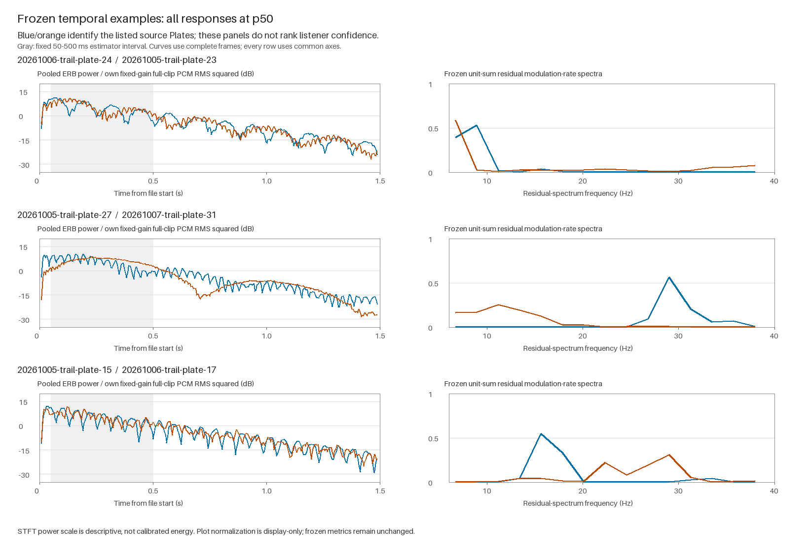

# Plate temporal envelope and modulation — 2026-10-18

## Decisions

**A — MIXED: temporal structure adds a useful descriptive coordinate for particular responses, but the frozen modulation measure does not explain the listener's strong-versus-weak judgments consistently or better overall than integrated ERB.** P27/P31 has a large temporal contrast hidden by its similar integrated spectrum. However, the weak P15/P17 comparison has a much lower modulation cosine than the strongest P24/P23 comparison. Attack shape and response buildup remain substantial alternative explanations.

**B — MIXED: there is a small descriptive within-Plate advantage, but stable Plate identity across contact positions is not supported.** Valid within-Plate modulation cosine has median **0.2851**, versus **0.2037** between Plates at the same position. The distributions overlap widely; some individual Plates change markedly across positions. This is a candidate response coordinate with limited grouping, not an established identity signature or a human identification result.

The pass stops here. No production mechanism, auditory frontend, pickup change, pulse change, or DSP tuning is selected.

## Scope and pre-interpretation freeze

Starting latest `origin/main`: **`3a5fde4c2de32d8d414734610a43003703e0d56f`**. The primary checkout uses branch `codex/ant-plate-temporal-modulation-20261018`; no new worktree was created.

The full diagnostic method and corpus outputs were committed in **`b5a9d0041499455e530f0f6cd6a9d0c2a5c0bd47` before the subjective join**. [Protocol](protocol.md), [freeze receipt](freeze.json), and [freeze hash](freeze.sha256) record the boundary. Freeze SHA-256:

```text
219eaa9ea07aff8f2fc08b03293317eef662e193d0bddf8b90bb544c15d3b332
```

The method implementer and method reviewer did not inspect the new subjective exports or their pair judgments. The parent already knew the examples supplied in the request, so this was not an entirely blind parent investigation. Method choices were delegated without those judgments. Sampling/calibration corrections occurred before corpus output and freeze; the frozen method was not modified after interpretation began. The mandated current ANT guide contains unrelated older listening context; this was disclosed and excluded from method selection. The parent inspected export structure and file hashes before freeze, but not the judgment values or pair join.

Corpus: **36 natural native responses** (12 frozen Plates × p25/p50/p75), plus **six controlled synthetic geometries**. All are existing isolated, fixed-gain stereo responses: 48 kHz, 72,000 frames, 1.5 s. Natural sources are original Float32 PCM; synthetic sources are the original gain-1 Float32 WAVs. RMS-matched listening copies never enter signal analysis. There are 861 unordered pairs, including the predefined 36 same-Plate cross-position and 198 different-Plate same-position comparisons. Other pair classes are retained separately.

## Representation and why it was chosen

The [existing loss-analysis helper](../../../../scripts/ant-base-born-loss-analysis.py) remains unchanged: 1024-sample symmetric Hann, 256-sample hop, 30 equal ERB-rate bands over 0–8 kHz, linear one-sided STFT power. Left/right power is averaged, then band powers are summed into fixed groups `[0,10)`, `[10,20)`, `[20,30)`. Their boundaries are approximately **0–526.48, 526.48–2264.22, and 2264.22–8000 Hz**. Empty band 3 is retained as empty rather than imputed.

For each group, fit a line to log power over the **84 complete frames centered from 50 to 500 ms**, subtract the line and residual mean, then take a Hann-windowed residual periodogram. Weight each group's periodogram by its mean linear group-power share in that interval. Sum, select bins **3–17**, and normalize selected power to unit sum. Pair similarity is cosine on that 15-bin vector. The exact range is **6.696428571–37.946428571 Hz**, with **2.232142857 Hz** bin spacing.

This starts from the existing ERB-time data because its sampling supports a bounded slow-envelope question. The 187.5 Hz envelope sampling rate has a 93.75 Hz Nyquist limit, but its 21.33 ms STFT window smooths modulation. Same-pipeline AM tests across low/mid/high coherent carriers and two phases validate the selected range. Three cycles set the lower candidate; the upper candidates remain at or below 40 Hz. The retained upper bin recovers about 71.7% of injected fundamental depth in the most attenuated probe. These are numerical fidelity choices, not perceptual acceptance thresholds.

Two guards prevent an arbitrary normalized direction: a calibrated no-AM residual floor of about **0.001 dB**, and at least **1% of total non-DC residual-periodogram power in the selected band**. The latter rejects the tested out-of-band leakage cases. One natural response, `20261005-trail-plate-1-p25-native`, has only **0.2187%** in band, so its modulation shape is unavailable; its other measurements remain. All 42 responses were analyzed, and missing shape values are not zeros.

The companion descriptors are separate:

- Energy-weighted residual RMS in dB, per-group residual RMS and group weights retain modulation depth and participation.
- Group log-power slopes, complete-frame pooled-power t90, and ≥500 ms / 50–500 ms summed-power ratios retain decay/buildup context.
- Original fixed-gain peak and RMS windows retain physical output level. Crest and early/whole RMS ratios are explicitly derived from those fixed-gain samples for level-invariant attack context.
- The historical integrated and late ERB profiles retain all 279 frames and their original timing definitions. Temporal descriptors exclude the final partially padded frame; they use window-center times. All 234 old pair values and medians are reconciled for full ERB-time, integrated, and late-tail cosine.

Energy weighting was selected after an AM self-check exposed spurious doubled-rate peaks from nearly silent groups under unweighted log-residual pooling. This happened before corpus analysis, without listener judgments. The final coordinate is not independent of spectral balance. In this corpus the low group has **99.9876–99.9999%** of natural interval power and **99.9966–99.9999%** of synthetic power. The pooled coordinate consequently describes mainly low-frequency body-envelope variation; it does not establish the absence of perceptually relevant higher-band motion.

## Natural blind comparisons

Source: unchanged [natural session JSON](../../subjective-listening/2026-10-13-plate-sonic-individuality-subjective-listening.json), session `aev-mvdgk4oe-4022e9d6`. Use immutable first pre-reveal judgments and their notes. All six real comparisons were judged different; confidence and the notes carry the descriptive distinction. The natural A/A was judged no-difference, confidence 4; it is context, not an accuracy score.

In this table `05`, `06`, `07` denote seeds `20261005`, `20261006`, `20261007`. All natural entries are p50. Cosines are similarities; lower means more measured difference. Residual-depth gap is an absolute difference in dB-envelope RMS, not a difference in output level.

| Frozen Plate pair | First judgment / confidence | Integrated ERB | Late ERB | Modulation cosine | Residual-depth gap (dB) |
| --- | --- | ---: | ---: | ---: | ---: |
| 05/P15 – 06/P17 | different / 1 | 0.8151 | 0.8046 | 0.1233 | 1.4750 |
| 05/P1 – 07/P20 | different / 3 | 0.9024 | 0.8894 | 0.1210 | 1.2066 |
| 06/P14 – 05/P24 | different / 2 | 0.8430 | 0.8388 | 0.4867 | 1.4075 |
| 07/P26 – 07/P1 | different / 4 | 0.3692 | 0.3600 | 0.3529 | 0.6107 |
| 06/P24 – 05/P23 | different / 5 | 0.9478 | 0.9388 | 0.6179 | 0.3405 |
| 05/P27 – 07/P31 | different / 4 | 0.9511 | 0.9563 | 0.0352 | 0.3524 |

**`20261006-trail-plate-24` / `20261005-trail-plate-23`: partial temporal contrast, not a strong modulation-shape separation.** The first notes contrast a drum/leather-like onset with a clear stone/bowl-like onset and layered body. The selected residual peaks are 8.93 versus 6.70 Hz, but cosine 0.6179 is the highest among these six comparisons. Early 13–50 ms / whole RMS is 6.736 versus 4.781 dB, a 1.955 dB shape difference after level matching. Crest differs by only 0.055 dB. t90 differs by 26.7 ms and late/early power ratio by 0.709 dB. Temporal/attack context adds detail to the similar integrated ERB profile, but this result does not isolate modulation as the cause of confidence 5.

**`20261005-trail-plate-27` / `20261007-trail-plate-31`: the clearest added temporal coordinate.** Integrated/late ERB remain 0.9511/0.9563, while modulation cosine is 0.0352. Selected residual-spectrum peaks are 29.02 versus 11.16 Hz. The low-group fitted slope is −27.074 versus **+1.630 dB/s**: the second response builds within this fixed interval rather than following one simple declining envelope. The early/whole RMS ratios are 6.095 versus −2.108 dB, an **8.203 dB** difference; crest differs by 2.305 dB. t90 differs by 37.3 ms and tail ratio by 1.224 dB. This describes a different time course consistent with the notes' different string/body characters. It cannot separate modulation from delayed buildup and attack participation, and the positive slope is not evidence of a growing physical pole or negative damping.

**`20261005-trail-plate-15` / `20261006-trail-plate-17`: the counterexample to a modulation explanation of weak similarity.** The listener described mostly a pitch difference, confidence 1. The modulation spectra are nevertheless dissimilar (0.1233), with peaks at 15.63 versus 29.02 Hz and residual RMS 3.595 versus 2.120 dB. Thus its selected modulation-rate structure does **not** remain comparatively similar. Its slower envelope companions do: t90 differs by only 5.3 ms, tail ratio by 0.085 dB, low-group slope by 1.105 dB/s, and crest by 0.129 dB. These shared gross-envelope features offer descriptive context, but do not establish why this listener found the sounds similar.

The remaining comparisons reinforce the limit: a confidence-3 pair has modulation cosine 0.1210, nearly identical to the confidence-1 comparator; the confidence-4 07/P26–07/P1 pair already has broad spectral separation. No simple confidence ordering follows from modulation cosine or depth. This pass does not fit a model to six judgments or infer statistical significance.



Blue is the first listed Plate and orange the second. Left panels show complete-frame pooled ERB power divided by each response's original full-clip PCM RMS squared, in dB. This display normalization corresponds to equal scaling of original fixed-gain samples; it is not a new measurement source. Every row uses common axes. Gray marks the fixed estimator interval. Right panels show the already-frozen spectra; no confidence ranking is encoded.

## Contact position and Plate identity

| Descriptor | Within-Plate median | Between-Plate same-position median | Within-over-between descriptive dominance |
| --- | ---: | ---: | ---: |
| Modulation cosine, 34 / 187 valid pairs | 0.2851 | 0.2037 | 56.70% |
| Full ERB-time cosine, 36 / 198 | 0.4797 | 0.5295 | 47.18% |
| Integrated ERB cosine, 36 / 198 | 0.8279 | 0.7220 | 58.54% |
| Late ERB cosine, 36 / 198 | 0.8049 | 0.7128 | 58.36% |

Dominance enumerates all within/between value combinations, counting ties as one half. These are dependent descriptions, not probabilities of identification or independent inferential observations. The modulation comparison omits pairs involving the one unavailable response. Its within IQR is **0.1180–0.5941**, versus **0.0840–0.4571** between, with substantial overlap.

There are strong position-specific counterexamples. `20261007-trail-plate-20` has one position pair at 0.9964 but its other two around 0.0555. `20261006-trail-plate-24` has all three position cosines only 0.1167–0.1525. For modulation depth, median absolute gaps are 0.6524 dB within and 0.7192 dB between, but the expected-direction dominance is only 48.85%. t90 gaps have the same 10.67 ms median in both sets. No consistent depth/timing invariance supports identity.

Compared with the [existing ERB-position result](../2026-10-14-plate-erb-position-identity/README.md), the phase-free modulation spectrum gives a modest positive grouping direction where full ERB-time does not. It still has broad overlap and contact-dependent changes. Integrated and late ERB already had a similarly limited aggregate advantage. These findings complement the earlier **MIXED** conclusion and do not replace it.

## Synthetic geometry comparisons

Source: unchanged [synthetic session JSON](../../subjective-listening/2026-10-18-synthetic-plate-shape-capability-subjective-listening.json), session `aev-mvdhibq8-a4d0d0a8`. All six shapes share material, input and source/pickup anchor cells; compiled geometry, area and node count differ as already documented. This is one response per engineering fixture, not a synthetic cross-position identity test.

| Geometry pair | First judgment / confidence | Integrated ERB | Modulation cosine | Residual RMS of shapes (dB) |
| --- | --- | ---: | ---: | ---: |
| compact – elongated | no difference / 2 | 0.9688 | 0.4064 | 2.060 / 2.776 |
| elongated – curved | different / 4 | 0.7698 | 0.3177 | 2.776 / 4.801 |
| curved – Y-branch | different / 4 | 0.9361 | 0.1904 | 4.801 / 3.274 |
| Y-branch – loop-like | different / 2 | 0.9976 | 0.8957 | 3.274 / 3.669 |
| loop-like – concave / irregular broad | different / 2 | 0.9731 | 0.4978 | 3.669 / 4.453 |
| concave / irregular broad – compact | different / 4 | 0.7483 | 0.4227 | 4.453 / 2.060 |

Selected spectrum peaks for compact, elongated, curved, Y-branch, loop-like and concave are respectively **15.63, 29.02, 20.09, 15.63, 6.70 and 11.16 Hz**. These are peaks of the frozen residual descriptor, not directly identified beat frequencies or biological material classes. Curved and concave have larger residual depth than compact; t90 spans 0.459–0.528 s.

There is descriptive agreement for the high modulation similarity of weak Y-branch/loop-like and lower similarity of the strong curved comparisons. However, compact/elongated (no difference, confidence 2) has nearly the same modulation cosine as concave/compact (different, confidence 4). Curved/Y-branch was described as similar in character except for a much stronger Y attack: the level-invariant crest difference is **5.649 dB**, and early/whole RMS differs by **2.025 dB**. Its low modulation cosine therefore does not establish that modulation caused the perceptual contrast. The original note about trembling in curved/elongated is compatible with temporal structure, but broad ERB and transient differences also remain.

**Synthetic A/A correction:** raw trial `shape-catch-aa` says `different=yes`, confidence 5. The user explicitly confirmed a UI selection mistake; intended answer is `different=no`, confidence 5, consistent with the contemporaneous free note. [Separate correction annotation](../../subjective-listening/2026-10-18-synthetic-plate-shape-capability-corrections.json) retains session/trial IDs, raw and corrected fields, reason and an unknown/null correction timestamp. The original JSON is unchanged. Only interpretation applies this correction; the catch is not a test score.

## Responsibility and limits

- **Implemented facts:** the sources use the existing compiler, solver, 3 ms pulse, 75 ms recovery, ×50 damping and point readout. No production source or input signal changed.
- **Measured observations:** fixed-gain and normalized output envelopes, residual spectra, attack ratios and pair comparisons differ. These are properties of the rendered response at its contact and pickups.
- **Existing mechanistic support:** the [modal participation audit](../2026-10-15-plate-modal-participation/README.md) establishes shared poles/eigenspaces with contact-dependent source projections and fixed pickup observability for **`20261005-trail-plate-24` only**, over its verified autonomous suffix. It does not establish that mechanism separately for the other natural P24 or all six synthetic fixtures. The [loss control](../2026-10-14-base-born-loss-distribution/README.md) independently separates q-dependent decay from a q=4-matched control; its off-pivot onset gains also change. This pass does not manipulate loss.
- **Interpretation:** modal superposition and geometry-conditioned source/readout participation are compatible explanations of measured envelope structure. Synthetic controls establish geometry-conditioned output differences under common anchors, not an isolated causal allocation among poles, excitation participation and point observability. Natural contact position can alter participation without changing Plate poles. Fixed pickup coordinates do not imply identical modal observability across different geometries.
- **Unresolved:** no new modal decomposition, field/readout ablation or pickup intervention was performed. Readout arrival and active-set expansion can affect early output; contact-window PCM RMS is not delivered contact impulse. Pooled stereo power also omits inter-channel phase/spatial character. Residual spectra discard phase and order, and can reflect envelope curvature, not periodic modulation alone. Motion slower than 6.7 Hz, faster than 38 Hz, and detailed post-500 ms modulation remain outside this primary coordinate.

These are exploratory observations from one listener and one session per corpus. Confidence is descriptive, not a calibrated distance or a statistical weight. Digital RMS matching is not equal loudness or calibrated SPL. No p-value, perceptual acceptance threshold, preference recommendation, population claim, or stable identity mechanism is inferred.

## Artifacts, validation and reproduction

- [analysis.json](analysis.json): all 42 response descriptors, source receipts, method definitions, cross-position summaries and historical ERB reconciliation.
- [pairwise-metrics.csv](pairwise-metrics.csv): all 861 frozen pair comparisons, with unavailable values left missing.
- [response-series.json.gz](response-series.json.gz): original fixed-gain ERB/group power and detrended envelope series.
- [validation.json](validation.json): known AM, decay, identical-input, silence and level-scaling checks.
- [freeze.json](freeze.json): script, helper, protocol, source manifests, 42 sources and four output-artifact hashes; exact repeat evidence.
- [subjective-pairs.json](subjective-pairs.json) and [CSV](subjective-pairs.csv): post-freeze first judgments, notes, correction application and oriented response context. JSON `A`/`B` descriptors follow listener sides; nested `frozenPairMetrics` retains the original metric CSV order identified by `metricCsvOrder`. Its asymmetric `...A/B` fields must not be read as listener-side labels.
- [interpretation-manifest.json](interpretation-manifest.json): post-freeze source/artifact validation and reproduction receipts.
- [temporal-examples.png](temporal-examples.png) and [visualization-manifest.json](visualization-manifest.json): one static view of the requested examples, with source, script and image hashes.
- [Independent review](independent-review.md) and [daily record](../../daily/2026-10-18-plate-temporal-modulation.md).
- [final-validation.json](final-validation.json): final repeated-run hashes, source preservation, Git boundaries and environment checks.

The CSV `freeNoteJson` field JSON-encodes each complete free note, preserving embedded newlines and trailing spaces without literal whitespace at line ends. Decode it with a JSON parser. The joined JSON and original exports retain the note strings verbatim.

All 36 original natural PCM byte lengths and SHA-256 values match their original manifest: **20,736,000 bytes**. All six synthetic gain-1 WAV receipts match their render manifest. Input hashes are rechecked before output. Repeated full corpus runs produce identical bytes; all 234 previous ERB pairs and within/between medians reproduce. Current worklet/compiler hashes match the synthetic frozen manifest. The raw subjective exports retain SHA-256 **`00288a49e243e821169861f6d4a989c8df387400c65969e7b246e061d8fa930a`** and **`b529dc9f2215d6f26401406c5b5f73cdea32b959eded0e7c4384acb4f17baa9b`**.

Those raw hashes describe the original CRLF working-file bytes. Git already stored their LF-normalized blobs before this pass. The same applies to the natural render manifest, descriptor roster and listening manifest. Exact-file `.gitattributes` rules now retain CRLF on checkout for those five existing inputs, preserving their recorded byte hashes without editing their contents. New diagnostic scripts and artifacts use LF. The raw exports have no Git content diff; the distinction between Git blob bytes and exported-file bytes is explicit in final validation.

From repository root, with the existing ignored natural render package available:

```powershell
& 'C:\Users\5dudt\.cache\codex-runtimes\codex-primary-runtime\dependencies\python\python.exe' -B scripts/ant-plate-temporal-modulation.py --self-check
& 'C:\Users\5dudt\.cache\codex-runtimes\codex-primary-runtime\dependencies\python\python.exe' -B scripts/ant-plate-temporal-modulation.py
& 'C:\Users\5dudt\.cache\codex-runtimes\codex-primary-runtime\dependencies\python\python.exe' -B scripts/ant-plate-temporal-interpretation.py
& 'C:\Users\5dudt\.cache\codex-runtimes\codex-primary-runtime\dependencies\python\python.exe' -B scripts/ant-plate-temporal-visuals.py
git diff --check
git diff origin/main -- src static
```

Python 3.12, NumPy and Pillow are sufficient; no dependency is added. The diagnostic refuses differing existing frozen outputs instead of silently updating them. Natural raw PCM/index files remain ignored local inputs, so a fresh clone needs the existing frozen raw package to rerun signal analysis; the committed metrics and series remain inspectable without it. The static views are derived illustrations, not measurement sources.

Production `src/` and `static/` remain identical to `origin/main`. Original subjective exports, WAV and PCM sources remain unchanged. No new audio render or production test intervention was made.

Sampling references: the frequency bins follow [NumPy's real-FFT frequency definition](https://numpy.org/doc/stable/reference/generated/numpy.fft.rfftfreq.html); window resolution and time-frequency cells follow [Julius O. Smith's STFT treatment](https://www.dsprelated.com/freebooks/sasp/STFT_Time_Frequency_Distribution.html). The usable range here is validated by this exact pipeline's probes rather than inferred from those references alone.
