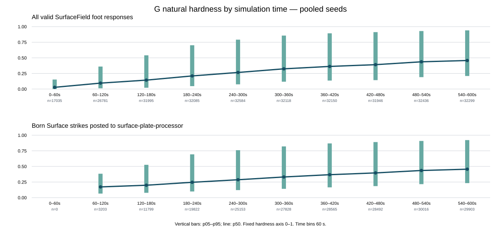

# G Natural Hardness Distribution

## Result

Across three matched 600 s production-G natural runs, 204,781 `strike` payloads were actually posted by `SurfaceAudioBridge` to the `surface-plate-processor`. Their hardness median was **0.3580**, mean **0.4053**, and 5th–95th percentile range **0.1331–0.8591**. The routed population became harder over the run: its 60 s median rose from **0.172** in 60–120 s to **0.456** in 540–600 s. There were no routed strikes in the first 60 s, although 17,035 valid foot responses occurred then.

The 301,429 valid `SurfaceField` foot responses from the same runs had median **0.2882** and mean **0.3358**. Exposed-Plate routing is therefore associated with a higher observed hardness distribution, especially in its lower tail. This is a descriptive selection difference: it does not show that routing causes hardness to rise.

No hardness-to-pulse mapping was tested or adopted. The production contact pulse remains 3 ms.

## Implementation facts

- `SurfaceField.applyFootContact()` samples compaction before depositing that foot's contact, then returns `hardness = compaction`.
- It also derives `footprintRadius = 0.014 - 0.005 × hardness` and `strengthTransfer = 0.95 + 0.1 × hardness`. These are deterministic functions of hardness, not independent observations.
- `SurfaceAudioBridge.handleFootContact()` joins those responses to the event's feet, routes only feet over exposed Plates, clamps hardness to `[0,1]`, and posts a `strike` payload to the `surface-plate-processor`.
- The worklet's current `applyStrike()` does not read `hardness`; the fixed 3 ms pulse law remains unchanged.
- Current source was inspected at the fresh `origin/main` baseline `4f0f8624c47ed310d7a6a4a37d43e3d0e7756b4b`. Relevant source hashes are recorded in `summary.json`.

## Capture protocol

The runner uses the production-shaped G controller and actual `AntEnvironmentAudioBridge` / `SurfaceAudioBridge` routing. A capture-only port records the exact `postMessage({ type: 'strike', payload })` call. The worklet DSP and PCM rendering are not run. A wrapper records each valid response immediately after the original `SurfaceField.applyFootContact()` call and returns the original response array unchanged.

Runs use seeds `20261005`, `20261006`, and `20261007`, 600 simulated seconds, and a fixed `1/60 s` timestep. The fixed histogram has ten `[0.0,0.1) ... [0.9,1.0]` bins. Time summaries use fixed 60 s bins. Quantiles are Type 7; standard deviation uses the population denominator. The preregistration is [PREREGISTRATION.md](PREREGISTRATION.md).

## Hardness summary

Values below are the actual hardness field from each population. Quantiles are shown as p01 / p05 / p25 / p50 / p75 / p95 / p99.

| Seed | Population | n | Min–max | Mean ± SD | p01 / p05 / p25 / p50 / p75 / p95 / p99 |
|---|---|---:|---:|---:|---|
| 20261005 | Routed strikes | 67,071 | 0.0071–0.9777 | 0.4066 ± 0.2135 | 0.0821 / 0.1365 / 0.2474 / 0.3601 / 0.5182 / 0.8625 / 0.9569 |
| 20261005 | All valid foot responses | 99,469 | 0–0.9777 | 0.3330 ± 0.2422 | 0.0012 / 0.0249 / 0.1446 / 0.2863 / 0.4617 / 0.8488 / 0.9533 |
| 20261006 | Routed strikes | 70,983 | 0.0038–0.9739 | 0.4074 ± 0.2194 | 0.0785 / 0.1312 / 0.2425 / 0.3573 / 0.5261 / 0.8743 / 0.9589 |
| 20261006 | All valid foot responses | 101,243 | 0–0.9739 | 0.3385 ± 0.2433 | 0.0024 / 0.0290 / 0.1509 / 0.2892 / 0.4690 / 0.8569 / 0.9560 |
| 20261007 | Routed strikes | 66,727 | 0–0.9774 | 0.4017 ± 0.2092 | 0.0792 / 0.1316 / 0.2470 / 0.3566 / 0.5157 / 0.8401 / 0.9476 |
| 20261007 | All valid foot responses | 100,717 | 0–0.9774 | 0.3358 ± 0.2422 | 0.0010 / 0.0251 / 0.1485 / 0.2892 / 0.4659 / 0.8494 / 0.9529 |
| Pooled | Routed strikes | 204,781 | 0–0.9777 | 0.4053 ± 0.2142 | 0.0799 / 0.1331 / 0.2457 / 0.3580 / 0.5199 / 0.8591 / 0.9554 |
| Pooled | All valid foot responses | 301,429 | 0–0.9777 | 0.3358 ± 0.2426 | 0.0014 / 0.0262 / 0.1481 / 0.2882 / 0.4656 / 0.8520 / 0.9542 |

| Fixed hardness bin | Routed strikes | All valid foot responses |
|---|---:|---:|
| `[0.0, 0.1)` | 4,170 | 51,105 |
| `[0.1, 0.2)` | 27,541 | 51,997 |
| `[0.2, 0.3)` | 44,544 | 53,720 |
| `[0.3, 0.4)` | 43,392 | 46,813 |
| `[0.4, 0.5)` | 29,534 | 31,440 |
| `[0.5, 0.6)` | 18,054 | 19,812 |
| `[0.6, 0.7)` | 12,613 | 14,330 |
| `[0.7, 0.8)` | 9,782 | 11,681 |
| `[0.8, 0.9)` | 8,230 | 10,671 |
| `[0.9, 1.0]` | 6,921 | 9,860 |

The routed population has 96,648 fewer rows than the all-response context. Its pooled mean is higher by **0.06948**, median by **0.06976**, and p95 by **0.00708**. The largest selection difference is in the low tail: p05 is 0.1331 for routed strikes versus 0.0262 for all valid responses.

## Change over simulation time

Pooled summaries by the preregistered 60 s bins. `Routed` and `All responses` are count / p05 / median / p95. The 0–60 s routed population is empty because no exposed Plate received a routed strike in that interval.

| Simulated seconds | Routed count / p05 / p50 / p95 | All responses count / p05 / p50 / p95 |
|---|---|---|
| 0–60 | 0 / — / — / — | 17,035 / 0.000 / 0.028 / 0.152 |
| 60–120 | 3,203 / 0.065 / 0.172 / 0.383 | 26,781 / 0.012 / 0.095 / 0.360 |
| 120–180 | 11,799 / 0.077 / 0.199 / 0.526 | 31,995 / 0.021 / 0.143 / 0.540 |
| 180–240 | 19,822 / 0.099 / 0.246 / 0.694 | 32,085 / 0.047 / 0.210 / 0.702 |
| 240–300 | 25,153 / 0.121 / 0.287 / 0.760 | 32,584 / 0.075 / 0.266 / 0.791 |
| 300–360 | 27,828 / 0.141 / 0.331 / 0.821 | 32,118 / 0.117 / 0.324 / 0.856 |
| 360–420 | 28,565 / 0.165 / 0.368 / 0.869 | 32,150 / 0.136 / 0.362 / 0.893 |
| 420–480 | 28,492 / 0.185 / 0.396 / 0.890 | 31,946 / 0.143 / 0.391 / 0.912 |
| 480–540 | 30,016 / 0.216 / 0.435 / 0.908 | 32,436 / 0.191 / 0.436 / 0.929 |
| 540–600 | 29,903 / 0.233 / 0.456 / 0.922 | 32,299 / 0.209 / 0.457 / 0.940 |

The median and lower tail rise over time in both populations. In the last two bins, routed and all-response medians nearly coincide. The routed count rise also reflects the changing exposed-Plate population; it should not be read as hardness alone.



## Plate summaries

The [plate-summary.csv](plate-summary.csv) file gives count and hardness median, p25, p75, and IQR for each of the 111 seed-by-Plate groups. Compact counts are:

| Seed | Plates with strikes | Routed strikes | Per-Plate strike count, min / median / max | Median of Plate medians | Median within-Plate IQR |
|---|---:|---:|---:|---:|---:|
| 20261005 | 36 | 67,071 | 626 / 1,824 / 4,331 | 0.367 | 0.222 |
| 20261006 | 38 | 70,983 | 125 / 1,883.5 / 3,687 | 0.394 | 0.227 |
| 20261007 | 37 | 66,727 | 136 / 1,758 / 4,514 | 0.375 | 0.225 |

Natural-run conformance reports first Plate birth at 84.017 s, 96.017 s, and 92.017 s for seeds 20261005, 20261006, and 20261007, respectively. The full contact and Plate event results match the saved production-G run.

## Capture and world parity

| Seed | Captured actual worklet posts | Bridge direct strikes | All valid foot responses | Hardness matches same response | Invalid hardness |
|---|---:|---:|---:|---|---:|
| 20261005 | 67,071 | 67,071 | 99,469 | yes | 0 |
| 20261006 | 70,983 | 70,983 | 101,243 | yes | 0 |
| 20261007 | 66,727 | 66,727 | 100,717 | yes | 0 |

For all three seeds, every saved trace check passed: initial fingerprint, per-second agent state, per-second contact buckets, Plate births, Nodule births, contact and Plate event hashes, contact count, Plate count, and first Plate time. The capture added no RNG calls. Production source/worklet comparison against fresh `origin/main` found no changed or untracked source/worklet files.

## Evidence and reproduction

- [Raw capture and source hashes](data/) — one compressed JSON file per seed; each raw SHA and matched frozen-G baseline SHA is recorded in `VALIDATION.json`.
- [Summary and complete quantiles](summary.json)
- [60 s detailed time bins](time-bins.csv)
- [Per-Plate summary](plate-summary.csv)
- [Fixed-scale time plot](hardness-time.svg)
- [Preregistered protocol](PREREGISTRATION.md)
- [Validation receipt](VALIDATION.json)

Reproduce the capture and summaries from the repository root:

```powershell
node scripts/ant-g-natural-hardness-distribution.js
```

Check only the deterministic statistics/plot from existing raw captures:

```powershell
node scripts/ant-g-natural-hardness-distribution.js --selfcheck
```

## Bounded interpretation

The routed hardness distribution spans most of the `[0,1]` domain, with its central range rising as the natural world accumulates exposed Plate contacts. Compared with all foot responses, exposed-Plate routing selects fewer low-hardness events; by late time the two medians are close. This gives a measured input range for a later, separately authorized hardness-to-pulse shadow. It does not select a mapping direction, curve, duration, perceptual interpretation, or adoption criterion. The worklet currently ignores hardness, and this pass did not run audio DSP or listening tests.
