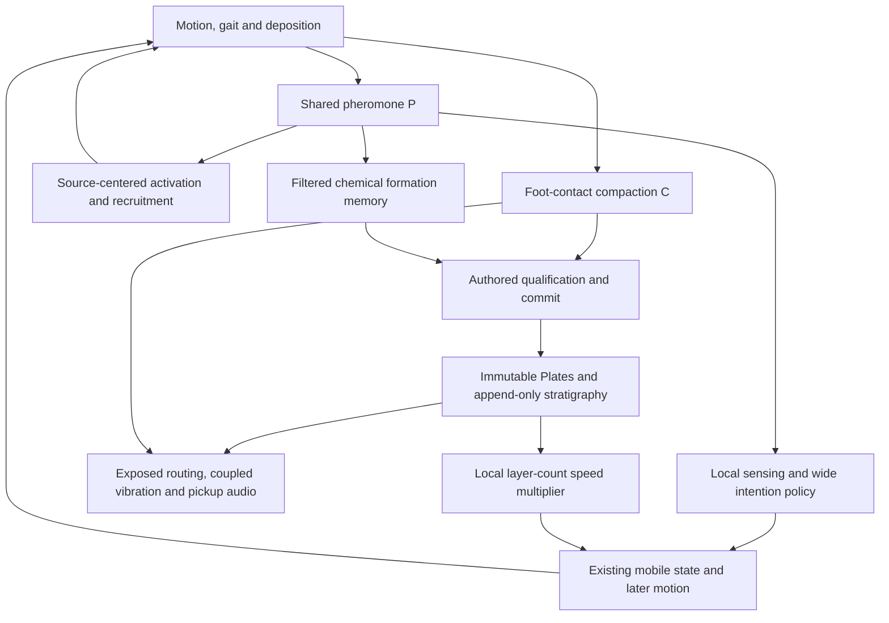

# Causal-memory responsibility review

## Decision

**Add no production mechanism now.** Current ANT already transports environmental history across individual lifecycles and already feeds history back into behavior. The most informative missing result is what that existing feedback changes in realized movement and subsequent inscription, rather than whether another memory store can be added.

[New measurement] A bounded current-G frozen decision diagnostic advances the retired-pheromone claim from sampled presence to **conditional, immediate wide-intention responsibility**: removing retired-authored input changes the selected option in 284/1,507 sampled decisions. Replacing that input by its footprint-wide mean changes 246/1,507. This does not establish later trajectory, deposition, material, audio, circulation, or artistic consequences. It does not establish that ANT recognizes author retirement.

[Modeling hypothesis] The next responsibility worth investigating is **history-dependent re-inscription**: can inherited environmental history change where later organisms move and write the next environmental history, through the existing policy? A new state or a stronger feedback law is not necessary to ask this question.

## Authority and scope

- Fresh fetched `origin/main`: `4135d4fb4ab8ec5d46297893fbc9c1c5f4f3e785`.
- Its difference from `aeefa12d8de9da400cb8a2a3d4b5080a21ba0292` is the requested Argon archive; production behavior is unchanged.
- Research parent: `bbadf7ffd41d9a0f48f803925af75f7fdb23763f`.
- Branch: `codex/ant-causal-memory-responsibilities-20261028`.
- Production `src/`, `static/` and canonical `docs/ant/README.md` are preserved. No production adoption, renderer change, DSP change, PR or merge.
- New acquisition: seed `20261005`, current G/H0 defaults, 60 Hz, 0–120 model seconds, Audio Off, no audio bridge. All counterfactuals run offline on frozen inputs; no altered natural trajectory is executed.

Claim labels distinguish [Implementation], [Existing ANT evidence], [New measurement], [Modeling hypothesis] and [Artistic interpretation]. An implementation link is not a measurement of its importance. A frozen policy effect is not a perceptual result.

## What the current world already does

[Implementation] The return path is already present. `AntController` senses pheromone, updates adherence and intention, applies continuous local steering, crowding and bounded turning/motion, and then writes later pheromone/contacts. Recruitment also reads pheromone around a privileged entry region. `SurfaceField` records feet, while pheromone is deposited behind the gaster. These are different acquisition geometries, even though both originate in traffic.

[Implementation] Existing mobile state includes position, velocity, heading, intent, confidence/adherence and decision clocks, with gait, body-pose and gaster state influencing later contacts and deposition. Changed motion can transport a consequence from X to Y without a new organism-held history payload. Individual retirement ends that organism's state; shared fields and retained material can survive the turnover. Social graph systems remain observers rather than partner-memory or relationship feedback.

### Channels are distinguished by information and consumer, not only decay time

| State/channel | Acquisition and retained information | Current responsibility | What remains unproven |
| --- | --- | --- | --- |
| Pheromone, 316-grid | Gaster deposition, location and recent accumulated use; decays | Local steering/adherence, wide intention, recruitment, formation input | Quantitative contribution of retired authors to realized movement, subsequent history and recruitment |
| Colony activation, scalar | Source-centered nonlinear samples of P, then a 45 s filter | Population/admission limit | Independent information source; low-frequency filtering alone does not make it one |
| Formation chemical memory, 96-grid | Nonlinear response to P, then a 20 s EMA | Candidate qualification | Its independent explanatory value beyond recent P history |
| SurfaceField compaction | Actual feet, saturating mechanical history, 1,800 s half-life | Mechanical support, contact footprint/transfer response | Its incremental importance in natural regimes; weak rejection at one birth is not global redundancy |
| Plate/stratigraphy | Discrete immutable geometry/properties, insertion order, overlap, exposure and column depth | Finite resonators; exposed/buried coupling; aggregate L input to locomotion | Event-relative local-history ownership; final behavioral meaning |
| Organism state | Current motion and policy state, gait and pending deposition | Carries consequences while moving; affects later encounters and inscriptions | A separate payload not already represented by these states |
| Worklet vibration | Current contacts and coupled topology | Physical temporal response and pickup output | Mature current-G realtime reliability; no master-output-to-behavior loop |

[Implementation] Activation and formation EMA derive from P, but retain temporal information not recoverable from **one instantaneous P snapshot**. Shared acquisition does not make them identical; distinct filter constants do not prove independent causal responsibilities either. SurfaceField acquires feet rather than gaster deposits. Material stores order/exposure/topology that a scalar chemical concentration does not contain. No cross-channel regression or empirical redundancy decomposition was performed here.

## Retired pheromone: what is established now

### Existing provenance result

[Existing ANT evidence] Parent `bbadf7f`, three current-G 600 s natural runs: pooled sensor-sampled signal is approximately self 0.027%, alive-other 34.936%, retired-author 65.038%; 98.329% of positive samples include retired contribution. Retired signal-weighted mean age is about 28.54 s versus 5.29 s for alive-other. Among reads whose sensor points are more than 0.30 world units from the origin, retired authors supply about 79.94% of sampled signal. This is a within-band signal share, not a share of points or the fraction of all retired signal located there.

These are input attribution statistics. They do not say that 65% of behavior is caused by retired authors. The original observer wraps local/wide ant sensing, not `ColonyActivation` recruitment reads. A far retired-authored deposit is local substrate history deposited there by an earlier organism, not evidence of transfer by a carrier at the later read.

### New bounded intervention

[New measurement] Previous aggregate output did not preserve the inputs and random tape of particular decisions, so a minimum matched prefix was acquired. Prospective sampling retained the first actual clock/crowding-triggered choice per ant per integer model second, plus local sensing once per second for each living ant. It did not select cases by effect or by visible outcome.

For wide policy, replay the unmodified production `updateIntention` and `senseTrail` with identical initial state, actual local profile, headings, crowding and random draws:

- **F:** actual full wide-sensor scalar inputs.
- **R:** remove retired-authored contributions at the captured read points.
- **U:** replace those contributions by their mean across the actual valid read footprint.

U preserves the unweighted sum of retired raw reads. It does not preserve physical field mass, spatial area, directional sensor maxima, weighted response, Hill response or each heading's magnitude. It is a deliberately limited common-mode comparison, not a pure spatial-geometry intervention.

| Readout | R versus F | U versus F |
| --- | ---: | ---: |
| Selected option changed, 1,507 sampled choices | 284 (18.85%) | 246 (16.32%) |
| Wide sensory argmax changed | 366 | 394 |
| Mean absolute intent-heading difference | 0.12565 rad | 0.10604 rad |
| Mean absolute confidence difference | 0.24035 | 0.22335 |

The two argmax counts are sensor-output readouts, not direct measurements of final option-score rank. Cases share one evolving world and are correlated; percentages are descriptive, not a population estimate or an independent-trial confidence interval.

| Fixed model-time band | Choices | R changed | U changed |
| --- | ---: | ---: | ---: |
| 0–30 s | 251 | 6 | 7 |
| 30–60 s | 364 | 43 | 46 |
| 60–90 s | 417 | 99 | 91 |
| 90–120 s | 475 | 136 | 102 |

[Research-supported interpretation] Retired-authored input is not merely a large but behaviorally irrelevant scalar in every sampled state. It can affect the actual intention policy with other immediate inputs and random draws fixed. Neither the non-retired input retained under R nor this raw-sum-preserving uniform replacement reproduces all decisions. Author status is not deposit age. This weakens a universal redundancy claim, while leaving regime-specific redundancy open.

Crucially, the wide intervention holds the **full actual local profile** fixed. Its adherence and other initial state can already contain effects of retired pheromone. This is a controlled wide-path effect, not total removal of retired authors from the world or organism history. Changes in intended direction still pass through local steering, crowding, turn-rate and motor dynamics. No realized trajectory or descendant history was measured.

### Numerical counterexample and valid local sensitivity

[New measurement] A small signed reconstruction residual is harmless relative to the full field yet can dominate the remainder after subtracting the large retired component. Original R local footprints contain negative reads in 844/1,458 cases (3,893 reads; minimum about −6.16e−7). There are 41 nonfinite profiles and another 176 finite profiles with coherence outside [0,1]. Their original aggregate coherence magnitudes are **invalid counterfactual artifacts**, not large behavioral effects. Production itself did not encounter these transformed negative inputs.

A frozen-only follow-up was registered before execution. It compares symmetric nonnegative author sums: `Fhat=self+aliveOther+retired`, `Rhat=self+aliveOther`, and corresponding uniform replacement. The residual is removed from **both** sides, never assigned to an author or silently clamped.

- Fhat numeric sham changes **0/1,507** wide choices. Maximum confidence difference from actual F is about 2.09e−6.
- Rhat/Uhat reproduce the same 284/246 changed-choice counts; every transformed selected index matches its original R/U counterpart.
- All 1,458 residual-free local profiles remain finite and within the strength/coherence domain.
- Mean absolute local steering-profile difference: Rhat 0.06766, Uhat 0.05488. These are sensor-profile values, not realized turning angles.
- Mean absolute one-tick next-adherence difference: Rhat 0.004063, Uhat 0.003027.
- Maximum Fhat-versus-F local steering difference is 4.57e−7; maximum next-adherence difference is 4.43e−8.

[Research-supported interpretation] A separate local sensor/adherence sensitivity exists in this symmetric author-sum diagnostic. It does not rescue the invalid original R aggregate, combine local and wide effects, or quantify total motion mediation. The important methodological finding is that full-signal reconstruction tolerance does not by itself validate subtractive counterfactual conditioning.

## What permanent material adds, and what it need not add

[Implementation] Material already has an independent physical responsibility: finite mask and properties, layer identity/order, exposure and burial, reciprocal coupling, later Nodule foundations and physical pickup response. Ordinary feet directly excite exposed top material. Buried layers participate through coupling. These are richer than chemical concentration or L.

[Implementation] The locomotion consumer sees only the tick-entry public local column count:

`m(L) = 1 - 0.10 * (1 - exp(-L / 4))`.

It scales desired speed, with at most 10% slowdown, without directly changing heading or steering. It is a causal link from retained state to later movement, not proof that slowdown is the final responsibility of material. P can decay while L persists, so L is not interchangeable with instantaneous P; a stronger claim about unique behavioral information requires a matched causal comparison.

[Implementation] SurfaceField is also not an unused timer: pre-contact compaction maps to footprint radius and strength transfer (roughly 0.014→0.009 and 0.95→1.05). The deposit radius and the audio excitation footprint must not be conflated. Hardness remains a varying payload rather than a pulse-duration consumer; production keeps the 3 ms pulse, 75 ms local recovery and existing damping.

[Existing ANT evidence, pre-G] The 2026-10-12 material causal-tail study found existing-state sufficiency after a focal resistance impulse in five uncensored cases; four retirement-censored cases were not null effects. Current state restoration recovered the matched outcome. This is a useful counterexample to demanding new organism memory from trajectory divergence, **not a new current-G natural effect estimate**.

[Modeling hypothesis] Material could ultimately be a long-timescale local condition, traffic-geography constraint, chemistry modifier, organism-state input, or primarily a mechanical/acoustic body. These are alternatives, not missing features that must all be supplied. Adding chemical suppression or steering would add a world law and should wait for an identified responsibility that current P/C/L cannot provide.

## Carrier: new content and output are required

[Implementation] The complete-state null already has a source-level mobile route: history at X changes a policy/motion state; that organism moves; altered position, contacts, deposition or occupancy affects Y. This pass measures only the input-to-intention part of that route. Thus **spatial non-locality alone is not sufficient novelty**, although it is a necessary distinction for the particular proposed transport role. The contrast is not substrate-only memoryless agents versus the first mobile memory.

[Modeling hypothesis] A useful carrier proposal must specify all of:

1. What information about X is stored beyond current motion/adherence/clocks/gait/deposition state.
2. Where it is acquired, how it changes or expires, and its bounded resource/transfer budget.
3. An output at Y that local substrate and ordinary transported kinematics cannot explain.
4. Why an encounter changes that output, rather than merely changing traffic or copying local steering.

The smallest falsifier is a matched-Y comparison: hold current receiving environment, pose/motion/policy state and random input fixed; vary only a specified carried payload and its permitted encounter readout. Before introducing payload, first test whether existing motion/deposition explains the alleged distant consequence. If it does, park the payload. Any hypothetical payload effect is authored mechanism capability, not evidence that a missing natural responsibility existed.

[Artistic interpretation] Encounter-mediated nonlocal inheritance could become a different work. Its value depends on wanting that relationship, not on an implementation deficit in temporal persistence.

## Source, lifecycle and circulation are different questions

[Implementation] The interior origin at `(0.5,0.72)` organizes entry and its heading prior, source-centered activation/recruitment, and the Plate source annulus. The formation selector also requires observation-boundary targets and macroscopic reach. These coordinate several engineering responsibilities; they do not establish that the observation edge is a physical destination or materialization cause.

[Existing ANT evidence] Lifecycle branch `a8e5e03` prioritizes history-inhibited single-opening admission after structural comparisons. It has not run the closed-loop ANT cycle. Current G already shows substantial 4×4 local body-center vacancy/reuse despite a globally busy population; that sampling is not proof of ecological absence, regional abandonment, circulation or silence.

[Research-supported interpretation] History-inhibited admission answers **when/how much entry is allowed at an existing opening**. It does not answer **why this privileged opening exists**, or whether activity migrates locally. It can strengthen interior-source ontology while reducing population. A new lower busy equilibrium or mean-arrival reduction remains a strong competing explanation.

The source question should precede a lifecycle architecture choice: retain an authored interior opening, or treat entries as flux across a finite observation window? Neither answer is an automatic production decision. Removing source/boundary checks requires replacing their scale/selectivity/provenance responsibilities; it is not deleting two conditions.

## Plate EVENT is clearer than support ownership

[Implementation] Current candidate lineage, 20 s stability, 10 s global gap, newest-similar-birth 90 s refractory and new-contact requirement distribute identity continuity, maturation, duplicate suppression and repeat eligibility. Commit freezes a descriptor; it need not terminate the connection. Reuse of the same place can form a later layer.

[Existing ANT evidence] Current-G ledger/gate/support reports distinguish durable omitted reconnections from raster noise, show that lineage age is not cell-wise 20 s maturation, and reject WHERE-only completion. Local occupancy has no natural unique cutoff; inherited and event-period evidence mix, and simple masks fragment or broaden. Pre-G local-accretion's late dense union is an explicit counterexample, not a current-G measurement.

[Research-supported interpretation] The remaining interface is **which contribution belongs to which commit when a connection survives several commits**. That is distinct from deciding a display style or making a Plate a stronger behavior mask. Using an unsettled support mask for macro feedback would magnify an unchosen attribution rule.

## External exploration audit

Only the user-requested Argon world-architecture archive was consulted as historical external-model exploration. Its observations are not evidence or adopted design.

| Proposal/claim | Assessment against source and evidence |
| --- | --- |
| The proposed substrate-mediated arm treats organisms as memoryless local responders | An inaccurate null for current ANT: current organisms have adherence, intention, clocks and motion state; current P already bridges turnover |
| A carrier's distinct role is spatial transport | Useful starting requirement, overstated as sufficient: existing organism state already transports consequences |
| A temporary payload with explicit encounter readout could add a responsibility | Plausible authored alternative; content, need and matched null remain unspecified |
| Remove material slowdown while adding chemistry sinks/edge steering, versus adding encounter/adherence payloads | Multi-law architecture contrasts, not isolated causal comparisons; no immediate justification to implement these arms |
| Region vacancy demonstrates circulation or a world resting phase | Unsupported; current-G local vacancy is already substantial and may coexist with busy global activity |
| Another timescale makes a new memory channel necessary | Unsupported without distinct acquisition/information/consumer responsibility |
| Exponential payload decay and attenuated transfers guarantee exact extinction within a finite time/radius | Overstated: they bound amplitude, but exponential tails do not end at a finite time without an explicit cutoff; replenishment and encounter schedules also matter |

No external literature verification or biology claim is made from these model-generated documents.

## Next research priorities: only three, sequential and conditional

### 1. Existing pheromone feedback → realized re-inscription

**First priority.** Use one current-G frozen state with complete focal state and fields. Replay joint local-plus-wide input under a numerically valid attribution pair; first inspect the actual one-tick motor outcome with other agents/occupancy/RNG controlled. Only if that manipulation is valid, follow one bounded continuation and distinguish immediate motor mediation from later collisions, deposition and shared-RNG schedule amplification. Select the focal opportunity prospectively, not by a desired divergent trajectory.

**Falsifies:** the claim that retired input is only sampled history or only an intention-level difference with no realized consequence in the chosen regime. It can also weaken the claim that particular retired spatial organization matters beyond a common cue.

**Stops:** on invalid nonnegative-input/sham/tape checks; if intended-choice differences are absorbed by the motor path, report that bounded null rather than enlarging the sample to find a visible effect. If a valid motor effect exists, stop at attribution of the bounded continuation, without new payload, steering law or long-horizon pattern tuning. Descendant divergence alone is not a unique mediator or organism memory. The current packet alone lacks a full-world counterfactual fork, so this continuation was **not** executed here.

### 2. Commit → local-history ownership interface

Only after keeping the first result's limits clear, reuse the existing Plate1→Plate2 evidence. Separate candidate-lineage time from post-commit contribution time; test a descriptive attribution ledger for history before and after commit. Ask whether later loading can be assigned to a later immutable layer without merely duplicating inherited EMA. Do not choose a support threshold or mask yet.

**Falsifies:** the assumption that naming finite events already supplies WHERE ownership, or that a finite window alone avoids cumulative traffic filling.

**Stops:** if alternatives differ chiefly in artistic meaning, prepare the smallest event-meaning review; if attribution only relabels the same inherited signal or requires mutable/merging bodies, record that boundary. No strong Plate-based macro feedback before this interface is defensible.

### 3. Source responsibility before a closed-loop admission candidate

First choose the research interpretation of the opening, with explicit dependencies for entry/heading, activation and Plate rooting. If an interior opening remains desired, compare history-inhibited admission with an offered/accepted-flux control matched in mean rate before claiming circulation. If observation-window flux is desired, audit source-root/scale dependencies before replacing entry.

**Falsifies:** that local vacancy or fewer arrivals necessarily means migration/circulation, and that admission modulation answers source ontology.

**Stops:** if the candidate only changes mean population or settles at another busy equilibrium, preserve that result and do not add openings/carriers to rescue it. A source interpretation may require artist judgment before any closed-loop law is appropriate.

Carrier implementation, stronger material feedback, chemistry conversion and additional temporal filters are parked. No evidence here requires any of them. Mature audio remains a real separate constraint; this Audio-Off policy pass does not measure it.

## Inspection and limits

Current source inspected includes `AntController`, `AntAgent`, `PheromoneField`, `GasterDeposition`, gait/contacts, `SurfaceField`, `ColonyActivation`, `TrailPlateBirth`, `MaterialStratigraphy`, the audio bridge/compiler/worklet contracts and relevant tests. Canonical guide and G adoption evidence were checked. Prior branch reports were read through pinned Git objects, not merged into production:

- Provenance: `bbadf7ffd41d9a0f48f803925af75f7fdb23763f`, [package](../2026-10-28-pheromone-cross-lifecycle-provenance/README.md).
- Lifecycle: `a8e5e03f8d3dfd3ecb1ca8ac2499d121ba0d9334`, `docs/ant/evidence/2026-10-28-open-world-lifecycle-architecture/`.
- Event contract: `12473f9ec8c7057ea033d9f72fa68c236c60bb50`, `docs/ant/evidence/2026-10-28-materialization-event-state/`.
- Support: `f47a9dcaa5d127f0ac7c4547ee8a240f9ff5af4a`, `docs/ant/evidence/2026-10-28-event-scoped-material-support/`.
- Ledger: `fd2a42875cc93eedeb319eae14b0e8de21e429d7`; gate: `0d5096a920e1ebb2086fa1dae782c5d4e871b590`.
- Historical counterexamples: pre-G local-accretion/interior-endpoint and [material causal-tail](../2026-10-12-material-causal-tail/README.md).
- Design only: `world-model.md` and the explicitly requested Argon archive.

New measurements are one early current-G seed, not three-seed generalization or mature behavior. No human viewing/listening, long-horizon causal counterfactual, joint motor intervention, recruitment-authorship counterfactual, channel-redundancy fit or new carrier test was executed. These limits do not erase the narrow immediate policy result; they define its scope.
