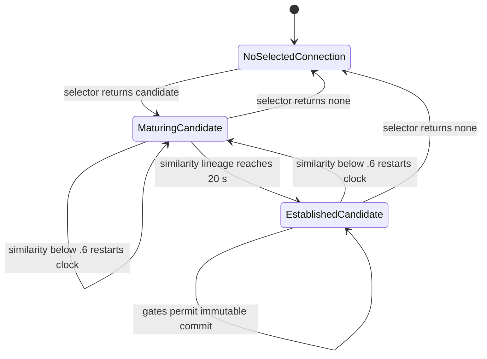

# Materialization event-state gate

## Decision

**Stop at this mission's Gate 2: retain the current authored maturation/commit/reissue semantics.** The two frozen births and a bounded reuse fixture do not identify a better environmental segmentation signal. A commit can close a material descriptor while the connection remains active. Inventing a fresh episode detector would add a new world law rather than recover a missing implementation fact.

This is a temporal-policy recommendation, not adoption of a new formation mechanism and not a complete realization of the working ontology. Current route extraction still determines the Plate ribbon; source and observation-boundary conditions still supply selection. Their open-world meaning and the later WHERE/geometry contract remain unresolved. The previous support study's bounded negative is preserved. Its Gate 2 had a different definition: neither tested support probe was a complete formation law.

No production implementation is recommended now. Do not clear/reset a production candidate at birth merely to make an attractive state-machine diagram.

## Authority, scope and evidence labels

- Fresh `origin/main`: `aeefa12d8de9da400cb8a2a3d4b5080a21ba0292`.
- Research parent: `f47a9dcaa5d127f0ac7c4547ee8a240f9ff5af4a`; branch `codex/ant-materialization-event-state-20261028`.
- Production `src/`, `static/` and canonical `docs/ant/README.md` are unchanged. Earlier evidence and unrelated attachments are preserved.
- **[Implementation]** means current main source. **[Existing ANT evidence]** identifies its original baseline. **[New measurement]** is the frozen reconstruction or explicitly clamped fixture here. **[Modeling hypothesis]** and **[Artistic interpretation]** are proposals, not measured states.
- Primary history: current G, production H0, seed `20261005`, 60 Hz, Audio Off, 0–120 model seconds. Its 120 actual analysis anchors run from 0.016667 to 119.016667 s. No natural world was rerun, no new seed or audio/render experiment was made.

The input packet is inherited from the [formation gate](../2026-10-28-plate-formation-gate/README.md). Gzip SHA-256: `909516b870b4ddce04ab661c4e7cd4113c52dc16ed35e414142fceb2cff0b1bc`; decoded SHA-256: `fba546769a1ddc552247a93f5c2d3719193b8d4785ed672442dcae1960e25339`. See [PLAN](PLAN.md) for registration and cost boundaries, [README](README.md) for reproduction and validation.

## Pass sequence

| Pass | Question / distinction | Result and next decision |
| --- | --- | --- |
| 1. Frozen production state reconstruction | Which gates actually operate before/after both births? Exact saved selector inputs and original feet, unchanged temporal methods | All 120 candidates and both complete birth receipts match. Plate 2 is unmatched to Plate 1 despite overlap. The 120 s history cannot exercise a full 90 s repeat; one class-only fixture is justified. |
| 2. Existing reuse contract | Fixed first-birth input, only post-commit foot schedule differs | No load prevents repeats; continuous load permits 90 s reissue; an early burst can be banked. Current policy is explicit and coherent as an authored bounded-rate policy. Stop; no alternative law or natural replay. |
| Existing long horizon, within pass 2 | What do already committed current-G 600 s receipts establish? | 36/38/37 births, all gaps at least 10 s. Records lack repeat-gate states; do not classify the natural births as repeat versus unmatched. |

## Implicit production machine

**[Implementation]** There is one selected-candidate tracker and an append-only collection of immutable commit records. The following labels are an observer's projection; production does not contain these named states or explicit event IDs.

A commit additionally appends a frozen Plate, appends its match/contact record and updates the global birth clock. The tracking loop does not leave its candidate merely because it committed. A descriptor is closed immediately by immutable geometry/provenance; the live connection, chemical memory and cumulative foot counts remain active.

Three identities must stay separate:

1. **Selected-candidate lineage:** adjacent-analysis continuity carries the maturation timer.
2. **Prior-corridor match:** a fresh comparison against all committed records chooses the newest qualifying match. This controls repeat eligibility.
3. **Committed Plate identity:** a finite frozen descriptor and later stratigraphic layer.

The similarity relation is not a stable equivalence class: it takes the maximum of mask Jaccard and a neighbor-tolerant directional path score. Either proxy can carry continuity. Path score is asymmetric; neither transitivity nor fixed biological identity is established. A changed lineage can match an old Plate, and an overlapping new lineage can remain unmatched.

## Responsibilities currently bundled into heuristics

**[Implementation]** Source: [TrailPlateBirth](../../../../src/lib/agents/ant/TrailPlateBirth.js).

| Rule | Actual responsibility | What it does not establish |
| --- | --- | --- |
| Chemical memory and SurfaceField support | Instantaneous supported eligibility before graph extraction; memory integrates activity | A separate use episode, per-cell 20 s maturation, or exclusive ownership by this candidate |
| Source annulus, component selection and deterministic root | Provenance anchor, connected-family selection and reproducible root for geodesics | Universal physical origin of material; root is not ant identity or a global reward |
| Observation-boundary targets | Reach/scale proxy, extraction terminals and selectivity | Physical wall, destination, activity completion or cause of phase transition |
| Minimum geodesic and winning component | Reject short routes; select one macroscopic candidate family | All supported environmental history deserving retention |
| Max(mask, path) similarity at .6 | Carry/restart candidate timer and separately match old records | Stable event identity, all-cell continuity or a natural topology transition |
| 20 s candidate age | Authored lineage-level maturation/commit permission | Natural end of use; every final cell having matured for 20 s |
| 10 s global birth gap | All-birth rate suppression | Per-connection epoch boundary or finite total material |
| Newest matching prior, 90 s age | Reissue rate suppression relative to that prior commit | Quiet interval, aging-induced physical closure or guaranteed same corridor forever |
| 30 additional individual feet on that prior frozen ribbon | Post-prior loading burden for a matched repeat | 30 independent visits, distinct agents, recurrence episodes or event-only field contribution |
| Immutable descriptor and append-only stratigraphy | Close committed geometry; allow later overlap/burial | End the connection or prevent future layers at the same location |
| 256 transport/storage ceiling | Technical safety stop without eviction | Physical capacity, saturation law or artistic material budget |

The first or an unmatched candidate has no additional 30-new-foot gate. Feet can have contributed earlier to SurfaceField, but that is different from the explicit repeat delta.

**[Modeling interpretation]** Source/boundary are not just two removable predicates. They currently provide root, scale, terminals and selectivity together. Future open-world work must replace or explicitly reinterpret these responsibilities. Keeping the temporal policy does not justify turning the observation edge into a physical cause.

## Reconstructed first two commits

**[New measurement, exact frozen reconstruction]**

| Time (s) | Observed action | Consequence |
| --- | --- | --- |
| 64.016667 | First selected qualifying connection; lineage 1 starts | Candidate clock starts; no earlier selected candidate in packet |
| 84.016667 | Plate 1 commits, lineage age 20 s | 356-cell mask; candidate remains present |
| 85.016667 | Same lineage, age 21 s; match Plate 1 | 24 post-commit feet; global gap, repeat age and foot gates block |
| 86.016667 | Continuity falls below .6; lineage 2 starts | Adjacent mask .597353, path .522388; no match to Plate 1 |
| 106.016667 | Plate 2 commits, lineage age 20 s | 544-cell mask; no matched prior despite 223-cell overlap |
| 108.016667 | Lineage 2 still present; match Plate 2 | 34 post-commit feet, age 2 s; global/refractory clocks block |
| 109.016667 | Lineage 3 starts | Mask .446199, path .520548; E changes 36 cells but ribbon changes 561 |
| 111.016667 | Lineage 4 starts | Mask .598823, path .450704; E changes 23 cells but ribbon changes 477 |
| 119.016667 | Lineage 4 age 8 s, right-censored | No third commit; final qualified E=1,536, selected network=358, ribbon=1,076 cells |

The full [timeline CSV](data/timeline.csv) and [scalar/descriptor packet](data/event-state.json) retain exact times, geometry changes and gate flags. First blocking gates across the 120 anchors are: no selected candidate 64, maturation 51, global gap 3, no blocker/commit 2. A later gate can also be false when the global gap is the first blocker.

At Plate 2 commit, mask similarity to Plate 1 is **0.3293943870**, path similarity **0.2222222222**, maximum below .6. Thus the 22 s birth interval does not violate the 90 s rule: it is an unmatched candidate. Overlap is 223 cells; 321 Plate-2 cells lie outside Plate 1; combined union is 677 cells. Spatial novelty is neither required nor sufficient for the match decision.

The 86/109/111 s restarts show the timer's sensitivity to extracted geometry. Their local E changes do not by themselves prove a qualitative environmental reorganization. No new transition detector is justified by calling these restarts episodes.

## Reuse fixture and long-horizon implications

**[New measurement, deliberately clamped logical fixture]** Actual first-birth B/E/support are held fixed; production selector and commit methods run at 1 s cadence for 0–600 s. No chemical decay, gait, movement or feedback is integrated. The initial 20 in-mask feet and geometry are identical across schedules. Only post-commit loading differs. This is a contract counterexample, not a current-G natural prediction.

| Post-commit schedule | Exact commits (s) | Interpretation |
| --- | --- | --- |
| No more feet | 20 | Elapsed time and persistent cue alone do not reissue this matched corridor |
| One foot each second | 20, 110, 200, 290, 380, 470, 560 | Ongoing use can deposit repeated layers with no candidate reset or spatial novelty |
| Exactly 30 feet at 40 s, then none | 20, 110 | Loading can be banked during refractory; a fresh visit at commit is unnecessary |

All previous descriptors remain byte-identical and frozen. The selected lineage starts at 0 throughout; repeat matches use the newest preceding commit. The fixtures do not reach the 256 ceiling.

**[Implementation + logical implication]** The policy bounds rate, not eventual total material: at least 10 s between any births and at least 90 s from the newest matched prior when one exists. Sufficient persistent qualifying inputs and loading can keep producing layers until the technical cap. Changing shapes can become unmatched sooner. There is no physical total-dose/saturation model and no guarantee against cumulative world coverage.

**[Existing ANT evidence, adoption-conformant current G, Audio Off]** The already committed 600 s seed archives have 36/38/37 births; minimum gaps approximately 10/10/10 s, median 11/12/11 s. All their stored exact mask hashes are distinct within each seed. Distinct hashes do not mean distinct corridors or spatial novelty. Archives lack per-analysis matches, so their cadence cannot establish how many are repeats. These are existing longer runs, not extra natural runs or mature Audio-On reliability measurements. Their provenance text is checked against its archival LF hash; the working CRLF copy remains untouched, and both hashes are recorded.

## Candidate event contracts and counterexamples

| Candidate | Assessment | Disposition |
| --- | --- | --- |
| A: established connection epoch | If the existing similarity clock and commit are retained, A is D under another name. Mandatory reset at every commit changes repeat timing and history accounting; no observed need identifies that change. | Retain as vocabulary only; no new reset/epoch mechanism |
| B: inscription/re-inscription | Current newest-prior age plus new-foot burden already implements a weak authored re-inscription policy. It needs no quiet interval and does not distinguish renewed local chemistry from inherited fields. | Keep explicit existing semantics; do not claim genuine separated episodes |
| C: state-transition commit | Would need a specified state variable and transition meaning. Neither continued activity nor geometry-sensitive restarts identifies a unique change worth committing. | Underdefined; no topology score, timeout or transition shadow added |
| D: current authored commit with separated responsibilities | Complete description of current maturation, commit and duplicate/reissue policy; fits immutable strata without an environmental endpoint. Does not solve support/geometry or open-world selection. | Best justified temporal contract; stop at Gate 2 |

**[Existing ANT evidence, pre-G]** Local accretion already used local qualification, reset/rematuration, persistence and contact evidence. Its late 64–65% coverage and roughly 99.4–99.7% material in one component remain a counterexample to equating finite epochs with selective accumulation. The rejected interior-endpoint experiment also warns that simply admitting more branches can increase redundant overlap. Neither old result predicts current-G outcomes here.

**[Existing ANT evidence, separate pre-G temporal observer]** Commit `70bef249a` records the 2026-10-13 seed06/07 strict-comparator stop, on production baseline `d45823d40c9a87c1b333fa9872f3c897ee9ab01b`. Neither 600 s run had a group with the same exact candidate geometry and prior Plate observed under both continued and restarted lineage. Local eligibility returns occurred without tracker restarts. That was an inconclusive controlled comparison and a bounded decision to park richer episode state, not proof that temporal history is irrelevant. It is not a current-G result and is not pooled with this packet. The present fixtures do not relax or claim to satisfy that older exact comparator; they test existing source policy under clamped input.

**[Existing ANT evidence, current G]** The preceding support atlas found no naturally selected occupancy cutoff, broad inherited/event-window overlap and disconnected or pickup-invalid local masks. This event study has not repaired those WHERE failures. A new event label is not a substitute for physical support or acoustic-domain validation.

**Strongest counterargument:** the current timer/matcher can issue many overlapping layers, and its edge-rooted selector conflicts with a literal open-world formation story. Those are real limits. They do not identify whether to require quiet intervals, saturation, a new transition or a new root-free selector. Choosing one would be a new authored decision. The available evidence supports retaining the temporal policy provisionally, not declaring it optimal or physically inevitable.

## Exact retained contract and unresolved support interface

**[Implementation, interpreted as authored policy]**

- **START:** the current selector first returns a qualifying candidate; a low-similarity replacement starts another maturation lineage.
- **IDENTITY:** adjacent mask/path proxy continuity retains the tracker start time. It is neither a permanent event ID nor exclusive environmental ownership.
- **ELIGIBILITY:** supported source-to-boundary reach plus 20 s lineage maturation, global gap, and applicable newest-prior age/loading gates. No claim that every supported cell independently matures.
- **COMMIT:** append one finite immutable descriptor/record and advance the global birth clock.
- **CLOSURE:** committed descriptor stops changing immediately. Live tracker and fields do not close/reset.
- **REUSE:** tracking continues immediately; a matching repeat waits on newest-prior age and its post-commit foot burden. An unmatched sufficiently mature candidate uses only ordinary commit gates. Same-place layering is allowed.
- **SELECTIVITY:** current detector rejects many inputs and gates suppress rate/duplicates. They do not guarantee finite total material or exclude eventual broad coverage.
- **OPEN WORLD:** unresolved spatial detector responsibility; no claim that window edges physically cause materialization.
- **SUPPORT INTERFACE:** not implemented. Preserve distinct lineage and prior-commit clocks rather than pretending there is already one exclusive event window.

**[Modeling proposal, no production change]** A later support experiment should receive: proposed commit identity/time, selector lineage start and changing connection provenance, matched prior commit identity/time/frozen mask if any, post-prior foot baseline/delta, and original local field/contact histories. Keep carried-in history separate from contribution since each relevant anchor. For a repeated commit the lineage may predate the previous Plate; `[lineage start, commit]` is therefore not automatically its deposition window. The current repeat counter measures feet on the prior frozen mask, not exclusive support in the current candidate.

**Exact remaining WHERE question:** which local history is attributable to one closed deposition at a proposed commit, especially when the connection never ends? Must a support contribution be new since the previous matching commit, may inherited eligibility carry it, and how does that evidence yield a useful finite connected mask/pickups without copying the selected ribbon or accumulating every eligible footprint? No scalar occupancy/contact cutoff is selected here.

## Architecture and next action

**[Implementation]** Retaining D changes neither immutable Plate identity, MaterialStratigraphy insertion/exposure/burial, overlap nor later Nodule foundations. The same finite descriptor still reaches the 96→32 compiler and existing pickup rules. No new mask or solver domain was proposed, so the prior support probes' compile failures remain unresolved rather than silently repaired. The worklet preserves state only for compatible layer identity/node layout; growing/merging bodies are not needed or justified by this study. More repeated layers can still aggravate the known mature-runtime risk; no Audio-On result was measured here.

**Next smallest research pass, if continued:** hold the retained temporal/reuse policy fixed and write/test one explicit support-attribution interface for first/unmatched versus matched-repeat commits, using frozen histories and keeping lineage age separate from post-commit loading. First make the ownership/window contract falsifiable; do not start another mask sweep. Production implementation should wait until that WHERE/geometry/audio contract is complete. No artist choice is requested between A and D renamings or incomplete C proposals.

Gate 1 is not claimed because open-world selection and support interface are incomplete. Gate 3 is unnecessary because an authored policy need not be a recovered natural episode. Gate 4 would manufacture a choice among unequally specified variants. Gate 5 is not reached: immutable architecture can retain current temporal semantics. Additional seeds or natural time would not resolve the semantic ownership question and were not run.
