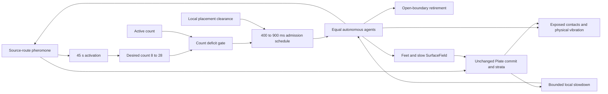
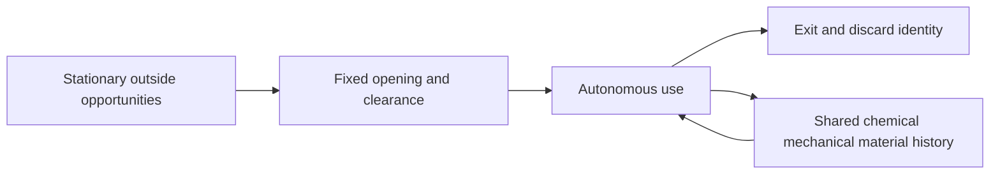
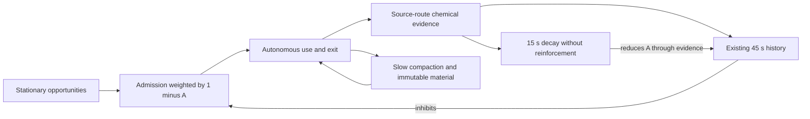
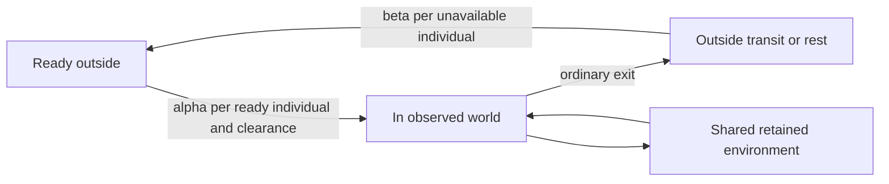
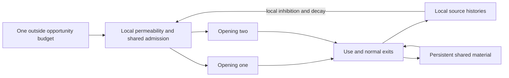

# Four complete lifecycle contracts

All alternatives below are **[Modeling hypothesis]**, not current production or biological claims. Parameters express responsibilities, not selected production tuning. The design target is activity that can change through its own causal conditions while memories outlive individuals. A visually oscillating population graph is not required. Material may remain one-way while activity and chemistry change.

## Current implemented world

**[Implementation fact]** Current ANT is an open outflow patch with one abstract interior source, not a partial view of a simulated outside population. Departed objects/IDs are removed; outside chemical samples are zero. Source position, recruitment sensing and Plate annulus rooting share `(0.5,0.72)` as a coordinate, although their footprints differ. The source disk is radius .018; recruitment samples three radii .06/.09/.12 in 16 sectors, averages the four strongest sector means and filters that evidence for 45 s. This is an entrance-route observation, not world knowledge or a population measurement.

**[Implementation fact]** A target decrease caused by activation does not cull living agents. Explicit population reconfiguration can cull and is a different path; none is used here. Residence has no authored lifetime or return-to-nest objective. Movement, collision, hesitation, trail history and the open crossing determine it. Fresh entrants receive fresh behavioral state. Gaster flush, per-ant gait cleanup and environment clocks remain intact at exits.

**[Existing ANT evidence]** Current G's late roughly 20 active ants coexist with about 1.4–1.5 sampled arrivals/s. This supports a throughput/residence explanation rather than ceiling28 directly maintaining twenty. The old forced-zero experiment is pre-G: it demonstrates a capability to advance retained fields/material/timers without ants, not a naturally empty G lifecycle or audio continuity.

## Shared implementation contracts for alternatives

- AntController still coordinates; agent/field behavior stays outside renderer. All current motion, founder refinement, collision, gait, deposition and material laws remain unchanged in an initial lifecycle shadow.
- World/model time drives all rates. Never schedule a burst to catch up after a slow browser frame. No wall-clock seasons.
- A rate is an **offered opportunity**, not a guaranteed arrival. Existing clearance must succeed. One failed opportunity is dropped in the proposed rate laws; do not accumulate a backlog or accelerate offered traffic through 120 ms retries. Retaining the current retry rule would be a different scheduler contract and must be measured separately. This intentionally replaces that production scheduling detail in a shadow, not in production now.
- For a future Poisson-hazard implementation, use integrated hazard or thinning in model time, with explicit handling of multiple opportunities and the existing per-tick admission limit. Record offered/accepted/blocked separately. A per-tick Bernoulli approximation must state its truncation error rather than silently claim exact continuous-time Poisson traffic.
- A technical overload guard aborts a research run; it must not quietly become a new desired population. Do not cull to implement decline.
- Retain current Plate20s candidate maturation, global10s gap, matched90s plus30-foot rules. Committing freezes a descriptor, not ongoing use. No lifecycle trigger forces a Plate or resets a candidate, field, material column or audio state.
- Audio remains exposed contact, topology and physical vibration. Zero bodies, zero new strikes, sleeping solver nodes and silence are distinct. Never interpret runtime deficit as quiet. Audio Off still permits world development; Audio On later starts new audio state on current topology, not retained PCM.

## A — Stationary visitors: minimal external flux

### Complete law

**OUTSIDE:** an inexhaustible stationary stream of independent opportunities. No modeled external history, named returning individuals, season or high/low mode.

**ARRIVAL:** opportunities have constant intensity `lambda0`; admission never reads N or a desired N. For a like-flux null use the existing nominal `1/.65 per s`; a sparse stream is a separate deliberate flux reduction, not an emergent-cycle result.

**SPATIAL ENTRY:** keep the current interior opening/disk/north heading initially. It can be interpreted as a local aperture to unseen traffic. An actual boundary-sampling interpretation would require a distinct spatial contract; do not silently move entry there.

**RESIDENCE / DEPARTURE:** current autonomous movement and open exit. Departed identity is discarded; a later visitor is not claimed to be that individual returning.

**DECLINE / ABSENCE / RETURN:** stochastic input gaps plus exits can lower occupancy; another independent opportunity ends absence. No internal state makes a busy period weaken. Zero is possible under the model but may be extremely rare at high offered load; low traffic does not have to reach zero.

**ENVIRONMENT / MATERIAL:** current chemical traces steer later visitors until they fade; SurfaceField retains loading, influences contact response and formation; stratigraphy alters local speed and topology. These affect residence/trajectory, not the external rate. Material is a condition and record, not an attraction/repulsion rule.

**AUDIO:** stochastic contacts on changing retained topology. A low chosen rate can expose decays; current-like rate can retain a global dense mix even when individual regions are vacated.

**LONG RUN:** under independent residence and bounded mean service, stationary occupancy is expected. In actual ANT residence depends on shared fields/crowding, so that simple queue is a null, not its exact distribution. Ten minutes may remain busy; an hour adds material and changes residence/topology; there is no total material bound beyond technical caps.

**FAILURE / FALSIFIER:** at current-like throughput it remains busy; lowering lambda only buys quiet through an externally chosen scarcity. If the mission requires endogenous change in activity rather than stationary local turnover, A is insufficient. Keep A as the matched control and a valid minimal outside ontology, not the proposed redesign endpoint.

## B — History-inhibited opening: a used approach becomes less admitting

### Complete law

**OUTSIDE:** stationary weakly specified visitors are available beyond one opening. The outside supplies opportunities but has no timer or variable population. The **opening's current local history**, not the unseen world, modulates which opportunities enter.

**STATE:** reuse the implemented source-route evidence `e(P)` and its existing 45 s filtered state `A`, with `dA/dt=(e-A)/45`. Do not add a refractory energy/capacity scalar. This changes the meaning of the existing signal from positive recruitment support to reduced admission through recent use. That sign is a new authored world law, not a biological assertion or established pheromone mechanism.

**ARRIVAL:** the initial strong diagnostic contract is `lambda(A)=lambdaHigh*(1-A)`, `lambdaHigh=1/.65 per s`. There is no active-count floor or target. High/low endpoint values are explicitly a research choice, not production calibration. The source admits in proportion to how little sustained entrance-route chemical evidence it currently carries.

**SPATIAL ENTRY:** same disk, center, north heading and clearance in the first shadow. Preserve the current spatial connection to Plate rooting. This changes admission timing, not inflow migration or ant steering. The place remains a special opening; it is not an unbiased world.

**RESIDENCE / DEPARTURE:** agents already inside continue under current motion and leave normally. Reduced admission cannot remove one. Surface/material effects can alter residence indirectly; do not infer reduced N from reduced offered rate alone.

**ACTIVITY DECLINE:** activity deposits chemistry near the source-route observation; persistent evidence raises A, lowering later admissions. Existing individuals leave. This is a local negative feedback loop, not a switch after N seconds of busyness. If current activity does not maintain the observed approach, the gate can reopen even while ants remain elsewhere; that locality is part of the law.

**LOW ACTIVITY:** no guaranteed zero or prescribed duration. The law may thin traffic, reach a stationary busy point or fluctuate. It does not guarantee a 60 s empty scene. With finite production field cap8, `e <= 8/(8+.04) < 1`; starting A=0 keeps A below this bound. Thus a valid normal state has positive offered rate even at maximal cue. Placement can block traffic while the opening is crowded, but a zero-ant world has no crowding obstacle.

**RETURN:** lack of reinforcement lets chemistry decay on its15s half-life and A follow on its45s filter. Admission rises continuously; no separate restart action is scheduled. The stochastic opportunity stream provides fresh attempts. Constant high cue must remain inhibitory; it must not reopen because an arbitrary refractory countdown expired. Return is a new visitor, not an identity restoration.

**ENVIRONMENT / MATERIAL:** chemistry acts both on local movement and on admission, with distinct operators/scales. Slow SurfaceField and immutable material persist through low ingress. Old material still changes speed and resonant topology; it does not globally close the source. Long absence can remove chemical path attraction while old material still conditions speed/contact/vibration. Old material is not therefore a persistent heading command.

**AUDIO:** possible dense-to-thinner contacts, residual vibration and re-excitation of old material. This is a predicted structure only. Local vacancy already occurs in G; fewer aggregate contacts may expose it or may merely reduce loudness. Native AV review would be required after causal/runtime checks, without selective listening or per-segment normalization.

**LONG RUN:** the loop admits an equilibrium; delay/nonlinearity/noise may produce excursions but do not prove a cycle. At ten minutes it may settle or remain variable. At an hour chemical conditions can keep changing while compaction relaxes much more slowly and material accumulates. Permanent layers can still reach runtime/storage limits. This is not an answer to indefinite openness.

**MAIN FAILURE:** another steady regime with the same normalized space/time usage, plus less aggregate traffic; source remains continuously active, Plate birth nearly disappears, or slow material-induced residence offsets lower flux. This is not rescued by lowering a rate until a pleasing empty scene occurs.

**FALSIFICATION:** in the first closed-loop shadow, reject advancement if reduced mean flux is the only change and time-normalized regional gap/use structure remains compatible with a matched-rate stationary control. Also stop on failed restart in an empty/decaying world, observer/source-law mismatch, overload, or a need to tune new thresholds/cycle durations. Preserve a negative result; do not add a second inhibitory channel.

## C — Finite outside availability: conserved circulation

### Complete law

**OUTSIDE:** K equal visitor tokens/individuals occupy ready R, in-window N, or outside-transit/recovery U states; `R+N+U=K`. U has the explicit meaning of being unavailable during unobserved travel/rest, not a generic environmental energy meter. If actual identities are preserved, they are stored outside; no behavior/role memory is added. A token abstraction instead conserves deployment capacity and must not claim to conserve identifiable ants.

**ARRIVAL:** each ready individual attempts at independent rate alpha, giving total `alpha*R`; successful placement transfers one R to N. Failed placement leaves it ready, with no accumulated admission debt. This is finite availability, not a desired observed N.

**SPATIAL ENTRY:** current one opening. Exits from any edge are abstracted into unavailable outside transit, not claimed as a simulated route back to the opening. A strict larger-world observation interpretation would require an explicit exterior geometry; this minimal version is an exchange model.

**RESIDENCE / DEPARTURE:** existing in-window motion; actual exit transfers N to U. No culling or travel-to-nest target. Independent exponential recovery at rate beta per U returns availability to R; it has no shared high/low clock and no synchronized restart time.

**DECLINE / ABSENCE / RETURN:** deployment consumes R and temporarily limits further arrivals. Exits and outside recovery restore R, enabling return. Zero N is allowed, not required. With positive alpha/beta and continuing exits the chain can revisit absence, but does not guarantee long episodes. Without beta it can exhaust ready availability; without alpha there is no return. Neither is quietly replenished from nowhere.

**ENVIRONMENT / MATERIAL:** retained conditions affect in-window residence and footprints. Slower departure can tie up more of K inside and reduce ready supply; that is a real conservation feedback. Material is not consumed on entry or reset outside. Outside ant IDs do not own the shared field.

**AUDIO:** total contact budget is indirectly limited by K and duty cycle. Repeated identities do not themselves imply sonic motifs; only their interactions with topology produce sound. Physical decay continues during outside absence when audio runs.

**LONG RUN:** under independent ready/active/recovery stages, each individual has a stationary duty fraction; total N is binomial. A finite pool can be *less* likely to empty than an infinite immigration model with the same mean. A ten-minute or hourly view need not contain a cycle. Shared environmental feedback can alter this null but must be measured. Material/runtime caps remain.

**FAILURE / FALSIFIER:** conservation alone produces a busy stationary duty cycle. If meaningful phases require a synchronized recovery timer, extra outside resource or oscillator, C has not explained circulation cheaply. Reject it as the primary activity mechanism; retain only if outside identity/finite population is itself desired. Do not combine C with B just to rescue the graph without isolating its new causal responsibility.

## D — Competing visitation openings: spatial abandonment rather than global emptiness

### Complete law

**OUTSIDE:** one stationary opportunity stream with total budget Lambda can reach several authored openings. Ports have actual declared locations; they are not random blobs. Each has a copy of the same local evidence/filter operator `(e_j,A_j)` with a boundary-aware observation domain. This changes source ontology and founder input.

**ARRIVAL / SPATIAL ENTRY:** let permeability `w_j=1-A_j`. A master stream at rate Lambda is admitted with probability `mean(w_j)`; choose port j proportional to w_j, then apply its clearance and inward/local heading contract. Thus total offered ingress is `Lambda*mean(w_j)`, not m times Lambda. At all w=0 there is no admission until local field/filter states permit it; a positive independent exploratory term could be explicitly authored if needed, not added invisibly. Under normal finite-cap evidence w remains positive.

For a concrete future fixture, two side openings `(0.02,.5)` and `(.98,.5)` use the current .018 disk radius and inward headings0/pi with the same ±.3 spread, under one equal total opportunity budget. These are proposed values, not tested ones. Define each observer explicitly: keep the current16 angular rays and three radii; omit out-of-domain sample points; average valid samples on each nonempty ray; average the strongest `ceil(validRayCount/4)` ray means; then use the same45s filter. A port with no valid ray is invalid and must fail configuration, rather than report zero use. Current field.sample=0 beyond the window would otherwise bias boundary ports toward admission. This is a new boundary-aware observation operator, not the unchanged interior operator.

**RESIDENCE / DEPARTURE:** existing autonomous movement; no port-directed destination. Any edge exit discards identity in this abstract-stream variant. Successful admissions, not port count, determine aggregate ingress.

**DECLINE / LOW ACTIVITY / RETURN:** a used apron inhibits its port, shifting opportunities toward the less used one. A vacated apron loses chemistry and reopens. All ports heavily used can reduce total traffic; global zero is optional. If only normalized allocation changes while total rate is held fixed, only local migration is promised. Both meanings must not be mixed after seeing results; the proposed law includes reduced total permeability.

**ENVIRONMENT / MATERIAL:** local chemical history selects where opportunities enter, then normal shared motion applies. Surface and material retain local histories during abandonment. Old material neither permanently repels nor guarantees return. Relative entry weights can lock to one port if its observed cue stays anomalously low; positive feedback in internal trails can also preserve old corridors.

**PLATE DEPENDENCY:** present Plate roots are tied to the central source annulus. Side-port traffic may never form eligible source-rooted routes, or may form only those crossing the center. It is not acceptable to fix that by silently editing TrailPlateBirth or moving all roots. D is a coherent broader-world proposal, but not a technically complete drop-in lifecycle candidate under the required fixed formation contract. A separate source-provenance decision would be necessary before full ANT implementation.

**AUDIO:** activity may leave one old sounding region while continuing elsewhere. The native full mix may obscure that local difference; no selective-readout fix is adopted here. More openings must not be mistaken for more energy or better spatial listening.

**LONG RUN:** competition can settle into balanced continuous traffic or an asymmetric locked state. A ten-minute region change does not establish hourly migration. Permeability/recovery could support switching, not guarantee it. One-way strata and runtime limits remain.

**FAILURE / FALSIFIER:** total flux grows with port count, activity merely adds rather than reallocates, one port locks permanently, normalization of missing observations manufactures preference, or useful material formation disappears because of the central root. Do not interpret an attractive two-source image as survival of these tests.

## Preserved, changed and sacrificed

| Strength | A / B | C | D |
| --- | --- | --- | --- |
| Equal agents; no leader/caste/roles | Preserved | Preserved; outside availability state is new | Preserved |
| Shared environmental memory and fresh entrant behavior | Preserved | Environment shared; returning identity optional and explicit | Preserved |
| Open exit / turnover | Preserved | Exit becomes transfer to outside state | Preserved |
| One special source / founder geometry | Preserved | Preserved, with abstract return transport | Changed to multiple declared ports |
| Current motion/gait/contact/material/audio laws | Preserved | In-window laws preserved | Intended preserved; Plate root compatibility unresolved |
| Current desired-count controller | Replaced with opportunity law | Replaced with finite availability | Replaced with shared opportunity budget |
| Strict fully simulated external world | Not claimed | Not claimed by aggregate reservoir | Not claimed |
| Natural long quiet / periodic circulation | Not guaranteed | Not guaranteed | Not guaranteed |

## What is deliberately rejected

- Timer-only busy/rest modes, sine rates, an unexplained Cox high/low state and a target renamed outside activity do not supply the requested causal explanation.
- An opportunity/resource field without a stated consumed object, location and recovery meaning is a hidden controller. No such energy meter is added.
- Permanent material inhibition can trap the world in lasting decline; material attraction can lock it to old paths. Neither is needed for the initial lifecycle link.
- Raw compaction is a meaningful slow state, but reading it as inverse source permeability is another authored law and introduces its1800s timescale. It is not silently combined with chemical inhibition to manufacture shorter cycles.
- Fast-minus-slow novelty gating is different from sustained-use inhibition: an adapted high cue can reopen a novelty gate. It is not substituted for B after results.
- Multiple independent full-rate sources increase traffic; finite pools alone cap it. Neither entails activity circulation.

## External mechanism boundary

**[External research]** MIT's queueing treatment gives Poisson stationary occupancy for independent Poisson arrivals/exponential residence with unlimited service. We use it as an analytic null, not a claim that interacting ANT agents satisfy those assumptions. [MIT, section4.6.2](https://web.mit.edu/urban_or_book/www/book/chapter4/4.6.2.html).

**[External research]** Prabhakar, Dektar and Gordon2012 model recruitment from interactions with successful returning foragers. Pagliara, Gordon and Leonard2018 explicitly couple outgoing activity, return delays and excitable dynamics; their model can stabilize to sustained foraging or stop and includes a phenomenological oscillator. Neither licenses an ANT rule that labels every open-boundary exit a successful food return, imports caste/patrollers, or promises nonscripted cycles. [2012 primary paper](https://journals.plos.org/ploscompbiol/article?id=10.1371/journal.pcbi.1002670), [2018 primary paper](https://journals.plos.org/ploscompbiol/article?id=10.1371/journal.pcbi.1006200).

**[External research]** Yi et al.2000 analyze adaptation to persistent signals and integral feedback under specified biochemical assumptions. The useful contrast here is response to change versus sustained stimulation. Our rejected low-pass subtraction control is not their molecular mechanism or a robust perfect-adaptation implementation. [PNAS primary paper](https://pmc.ncbi.nlm.nih.gov/articles/PMC18287/).
