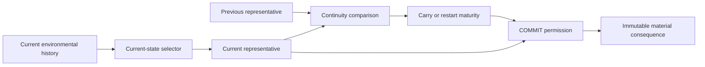

# Event-evolved scope: process continuity is real; spatial selection remains separate

## 1. Answer and working architecture

**[Architectural inference]** Current ANT supports **one evolving representative whose membership may change while one process-level lineage matures**. It does not support the stronger claim that the event's temporal evolution itself generates or bounds that spatial membership. Production selects a fresh representative from current fields first; only afterward does the previous representative determine whether the maturity clock continues.

The useful simplification is therefore:

1. Environmental history supplies current structural proposals.
2. A declared spatial selection/update rule supplies one finite current representative.
3. The event tracks continuity of that changing representative, without preserving every member or branch ID.
4. COMMIT freezes its current representative; no old-selection union is owed.
5. The simple BODY and immutable geology remain downstream.

**[Authored semantics]** This is coherent selective/lossy materialization, not a discovered source-free material law. Current I remains a temporary rooted realization. No evidence here makes a new nucleus, growth budget, competing tracker or simultaneous Plate scheduler necessary.

**[Bounded negative]** A clock or temporal-attachment relation is not sufficient spatial selectivity. **[Supported narrow result]** Process continuity can survive substantial membership change without stable branch genealogy. These two conclusions are compatible.

## 2. Authority, scope and evidence tiers

- Fresh fetched main: `4135d4fb4ab8ec5d46297893fbc9c1c5f4f3e785`.
- Research parent: `58ce59fcdb01187cbaf0b6453199556f2c4b5331`.
- Branch: `codex/ant-event-evolved-scope-20261029`.
- Current G/H0, seed20261005, original60Hz, Audio Off. Existing 0–120s packet has120production analysis anchors,0.016667–119.016667s. P1/P2 maturation windows each contain21anchors,64.016667–84.016667 and86.016667–106.016667s.
- This pass creates no natural simulation, field replay, BODY, new selector or audio output. The only non-natural fixture tests the continuity interface, not an ANT trajectory or birth.

Labels separate **[Implementation]**, **[Prior evidence]**, **[New temporal measurement]**, **[Architectural inference]**, **[Authored semantics]** and **[Unresolved responsibility]**. Technical continuity is not an artistic judgment, biological episode or persistent physical branch.

### Provenance clarification

**[New source/evidence inspection]** The small42-anchor structural packet omitted ribbon and ordered paths. The original Git packet at0d5096a contains `J_candidate_ribbon`, ordered `principalPath`, and `components[].parentEdges/chosenRoot/qualifiedTargets`. Those parent edges were computed by the transformed **diagnostic selector at capture**, whose selected output was checked against production. They are frozen observer results, not production-maintained branch IDs or the private production parent array.

The preceding joint grammar's statement that raw parent-edge bytes were unavailable was too broad about this upstream diagnostic packet. Its distinction between reconstructed edges and private production genealogy remains valid. This pass narrows that provenance claim without rewriting old evidence or changing its measurements. The new compact input retains the relevant saved diagnostic edges. Actual continuity scalars are recomputed from saved mask/path inputs using function slices read from current production source; they were not serialized as scalars in the capture's candidate object.

## 3. Current responsibility audit

**[Implementation]** `selectCandidate(mask,supports,chemicalMemory)` receives no previous representative, lineage clock or committed Plate list. It skeletonizes current supported E; finds source-annulus components; chooses one root per eligible component; computes deterministic parent paths to boundary terminals; unions qualifying paths; and chooses the component with greatest geodesic reach, with source-index tie-breaking. It is current-state projection, not event-local growth.

`advance` subsequently compares the old/new candidate using:

`max(ribbon-mask Jaccard, neighbor-tolerant principal-path similarity) >= .6`

Mask Jaccard is symmetric. Path comparison counts old path cells located on/next to the new path and divides by the larger path length; it can be asymmetric. A passing comparison retains `startedAtMs`; a failing comparison restarts it. No candidate clears it. The previous complete representative is stored, but only used for this continuity test, not to propose current members.

| Responsibility | Current implementation | What it does not establish |
| --- | --- | --- |
| Current scope selection | Fresh source/boundary parent-route projection | Event-local preference for an incumbent or exhaustive history retention |
| Same-event interpretation | One-step representative comparison and carried start time | Equivalence class, fixed place, branch ancestry or unchanged topology |
| Maturation | At least20s along a passing sequence | Maximum event duration, spatial growth budget or20s tenure of every final cell |
| COMMIT permission | Maturity plus global/repeat/load/cap gates | Natural termination of activity |
| Descriptor closure | Freeze current geometry/character and append | Stop/reset live candidate or absorb future history |
| Reuse | Newest matching prior record,90s and30additional feet;10s global gap | Spatial novelty or a new independent event per branch |

**[Architectural inference]** The timer is not causally irrelevant: it selects **when a snapshot may become material**, and therefore can change which later snapshot is frozen. The narrower point is that it does not directly choose **where the current representative extends**. Temporal selection of a material snapshot and spatial generation of that snapshot are distinct responsibilities.

No arrow from the previous representative back into the current selector exists in this production path. Such an arrow would be a new selection responsibility, not merely renaming the existing timer.

## 4. New temporal measurements

### 4.1 Actual continuity inputs and clock parity

**[New temporal measurement]** Re-evaluated the unchanged production functions on all120saved mask/path inputs. Replaying only the start/age rule matches every saved candidate start and stable age, including absent-candidate anchors. This is frozen scalar parity, not a new world/selector replay or revalidation of the original7,201tick observer parity.

| Within-event transitions | P1 | P2 |
| --- | ---: | ---: |
| Ribbon and path both pass.6 |20/20|18/20|
| Path alone preserves clock |0/20|2/20|
| Ribbon alone preserves clock |0/20|0/20|
| Ribbon similarity min / median |.785100 / .971044|.504394 / .857876|
| Forward path similarity min / median |.772727 /1|.808824 / .992857|

P2 at88.016667s: ribbon.546139, path.893939. At92.016667s: ribbon.504394, path.926471. The existing OR/max law carries lineage across those ribbon changes. A hypothetical mask-only timer would reset there, but no such replacement law is proposed or implemented.

This explains why low START-to-COMMIT I Jaccard (.243243/.299611, prior measurement) does not contradict continuity. The production predicate uses adjacent **ribbon/path**, not the endpoint I set.

### 4.2 Membership turnover is heterogeneous

All totals below count **cell transitions**, including a coordinate again if it leaves/returns at another anchor. They are not unique cells, agents, episodes or branch counts.

| Across20transitions | P1 | P2 |
| --- | ---: | ---: |
| I lost / gained |74 /134|490 /518|
| Lost from previous principal path / off-path |47 /27|116 /374|
| Gained on current principal path / off-path |77 /57|125 /393|
| Largest one-step lost+gained |33|106|
| Exactly unchanged I steps |2|0|
| Largest lost / gained8-connected patch |6 /22|60 /70|
| Root / principal target changes |0 /2|3 /3|

P1 is mostly modest incremental change, with a larger path reorganization at78.016667s (6lost/27gained;22path cells replaced in each direction). P2 includes punctuated selected-network changes. At92.016667s it loses30/gains76cells, while its principal path loses4/gains7. At94.016667s it loses16/gains74 with **unchanged principal path**. At104.016667s it loses62/gains15, again with unchanged principal path. This is substantial off-principal selection turnover, not evidence of a whole-route replacement or persistent branch identity.

Changed-set components and saved parent-edge changes are available at every row in [analysis](analysis.json). They are coordinate/adjacency observations. A connected changed patch is not automatically one biological branch or one new material event.

### 4.3 Selection changes frequently retain qualified environmental support

| Transition population | H∩E at comparison anchor | E-only | Neither |
| --- | ---: | ---: | ---: |
| P1 losses, next anchor |43|28|3|
| P2 losses, next anchor |347|133|10|
| P1 gains, previous anchor |77|32|25|
| P2 gains, previous anchor |333|132|53|

Thus71/74 P1 loss transitions and480/490 P2 losses are still E-qualified afterward. Conversely109/134 and465/518 gains were already E-qualified before being selected. Valid environmental history enters/leaves the representative without having to appear/disappear as qualified history at that same coordinate.

The previous **entire principal path** remains inside next E at18/20 P1 and15/20 P2transitions. It still changes selection in13 and11 of those transitions. The previous entire I remains inside next E at17/20 and10/20. By contrast the old full principal route remains in next H at only7/20 and6/20. This separates qualified-support availability from skeleton/projection membership.

**[Architectural inference, bounded]** Selection turnover is not adequately described as local material eligibility simply disappearing. But this is not a causal decomposition: support changes elsewhere can alter skeletonization, root/target paths and all selected routes. Continuing an old E-supported path is a possible authored responsibility; these counts do not prove that production ought to prefer it, or that the old path satisfies every live selector condition unchanged.

### 4.4 Candidate competition was not observed in the current admitted pool

**[New temporal measurement]** Of120analyses,64have zero source/boundary/geodesic-eligible components and56have exactly one. None has two simultaneously eligible component candidates. Multiple boundary targets inside a component are **unioned** into I, not competing event representatives. Source candidates are reduced to a deterministic root before route extraction.

Production contains a stateless best-component choice, but this packet does not demonstrate meaningful temporal competition between admitted representatives. Many rejected/omitted structures still exist; they are not invalid history. A broader source-free proposal pool would be a new pool definition, not evidence already supplied by this census. No new seed search was launched to manufacture competition.

## 5. One non-natural continuity fixture

**[Logical counterexample, not ANT behavior]** Copy exact P1 START path/ribbon/I and translate them left by one96-grid cell each synthetic second for20seconds. Every coordinate stays in bounds; cardinalities/internal geometry are unchanged. No new BODY is generated, no source/eligibility selector runs, and no actual birth is simulated.

Every adjacent continuity maximum equals1; the unchanged20s maturity clock can continue. At the endpoint, I shares **zero** cells with START, and mask/path similarity to START is0. This demonstrates that locally passing comparisons do not enforce global retention of an initial place/member set. It is consistent with a moving process identity and incompatible with interpreting that timer as a fixed spatial nucleus.

It does not show ANT naturally produces this motion, that a drifting event is artistically right, or that current source/boundary qualification would accept the translated input. Crucially, the fixture's finite input was supplied by the fixture; the clock did not create its finite scope.

## 6. Old negatives under the present ontology

| Prior result | Still negative | What it does not decide |
| --- | --- | --- |
| Pre-G interior-endpoint selector | Extra retained routes mostly increased overlap/redundancy; more valid history was insufficient | Whether an endpoint is inherently wrong, whether every broader body fails, or which causal share came from endpoints versus scope breadth |
| Pre-G source-free local accretion | Persistent qualified cells, reset/rematuration and permanent batch union reached a broad connected mass | That source-free formation is impossible. It already had finite maturation batches, so “add a finite event” alone is not a remedy |
| Current-G C0 | Individually finite, commit-associated masks still repeated broad sheets over600s | That finite commit closure supplies spatial selectivity |
| C1 | Sampled temporal ancestry kept almost all C0 | That temporal association alone creates a bounded representative |
| Broad alternative scaffold T/R | Minimum sleeve on all alternatives was already broad | That every sustained route must belong to one body, or that valid omitted history was false |
| P2 closure audit | Relevant E support was already connected; apparent new closure was representation-level | A natural closure-history router; an authored COMMIT snapshot remains a different claim |

**[Architectural inference]** The new ontology removes a completeness obligation; it does not retroactively establish a new selector. Interior-endpoint evidence cannot isolate “wrong terminals” from “too much history in one object,” because that experiment did not vary those independently. Local accretion's failure is consistent with absolute eligibility plus cumulative permanent support, but causal shares of broad sampling/common traffic/selection were not isolated. Do not relabel it as a pure failure of source freedom, or claim it lacked every form of finite event bookkeeping.

The old interior-endpoint candidate still required a source-rooted component with a qualifying boundary target and kept the existing geodesic floor. It added paths to eligible interior endpoints; it was not a full removal of source/boundary selection. Neither that result nor local accretion tests the present event-conditioned representative hypothesis directly.

## 7. Event→scope architectures considered

### A. Revisable current representative with process-level identity — recommended working contract

- **START:** an admitted current structural proposal exists.
- **Identity:** successive representations pass a declared continuity relation; no branch genealogy.
- **Entry/exit:** current selection can gain/drop members. Earlier members are not unioned or owed later materialization.
- **Finiteness:** a positive spatial proposal/update rule supplies a finite set. The timer alone does not supply it.
- **COMMIT:** current representative closes; live process and future layers may continue.
- **Outside history:** all valid unselected history remains outside without being called unreal.
- **Open world:** the interface does not require a nest/edge; current proposal implementation still does.
- **Evidence:**120clock matches, coherent early selected snapshots, mixed gradual/punctuated turnover. This supports a working authored process contract, not independently discovered natural event identity.

“Episodic capture at mature COMMIT” is A under another name if it uses the same clock/current proposal. A new qualitative-transition detector would be an additional law, unsupported by this packet. Same-place later layering remains compatible with existing immutable commit/reissue policy.

### B. Event-conditioned incumbent continuation — smallest distinct research candidate

The previous representative influences **selection before** the identity comparison: an existing supported relation receives incumbency rather than always being replaced by the newest projection. No fixed branch IDs or all-history union are inherently required. Reconfiguration can replace the current representative; membership need not freeze at START forever.

Its explicit new assumption is: *continued admissibility of a selected relation is a reason to keep representing it*. Current source does not implement that responsibility. The observed old-route E availability makes a small test possible; it does not prove this privilege is necessary or physically natural. A continuing component, partial route and whole selected network are different possible incumbents, so a precise admissibility/update contract is still required.

Lossiness already permits dropping valid, still-supported history. Incumbency is therefore not a correction of invalid omission. It could merely preserve an accidental early projection for longer; that is its strongest simple counterinterpretation. It should be tested as an authored selection responsibility only if continued representation is intended to influence later selection, not because the old history deserved complete retention.

Finiteness would still come from finite admitted/replacement proposals, not incumbency itself. Keeping earlier scope while arbitrarily appending new supported members would reintroduce a growth/union problem. A source-free proposal rule is not solved by B; temporary rooted inputs can isolate the new temporal selection link first.

**Disposition:** one narrowly justified next offline comparison, not an adopted selector or an implementation-ready formation law.

### C. Nucleus plus bounded growth

No current event variable supplies a spatial nucleus, front speed, capacity or maximum event age. `startedAtMs` is a time anchor. The20s value is minimum maturity; refractory/load/global gates may delay commits without capping candidate age. Same-neighbor ancestry can expand broadly, as C1 already showed.

Parts could join/leave through a future finite attachment law, but that law is the missing responsibility. An arbitrary radius/area budget would hide it. No body/growth prototype is warranted merely to make the candidate finite. **Disposition:** under-specified, not favored as the next step.

### D. Competing or multiple concurrent events

One stateless best-component chooser is not a population of maturing representatives. The actual admitted pool never presents two candidates here. An event-aware competition policy might be meaningful with an explicitly different proposal pool, but no observed rivalry requires it. Handwritten score maximization or random variety would add assumptions without evidence.

Multiple independent timers/IDs additionally change event cardinality, repeat semantics, pickups, append rate and runtime cost. One broad history containing several finite units does not demonstrate several temporal events. **Disposition:** park competition/multiple trackers; do not force plurality.

## 8. Exact unresolved responsibility and next closed pass

**[Unresolved responsibility]** Specify **representative admission and continuation**: which finite relation is proposed, and whether its prior selection should influence the next proposal. This is smaller than a new BODY, branch genealogy, lifecycle or multi-event architecture. It remains larger than renaming the maturity timer. Evidence does not yet justify calling the eventual source-free replacement “modest.”

If process-level grouping of current projections is the intended meaning, architecture A needs no new selection memory. If the stronger intention is that the event **participates in choosing its own next scope**, the minimal missing causal link is previous representative to current proposal selection. Testing that continuation link first is smaller than inventing source-free initial admission, and could reject an unnecessary incumbency mechanism before that larger design. It cannot settle initial admission by itself.

**Recommended next closed pass:** test **whole-proposal retention under an all-I-in-E hold proxy**, using the same frozen P1/P2 inputs and original horizons. This is not a pure I-scope experiment or a complete selector-admissibility test.

Predefine the experimental scope-update contract before output:

1. Baseline chooses each saved current production proposal.
2. Countermodel starts with the same first saved proposal. While every member of its current I remains in current E, retain that entire saved proposal; on failure, replace it with that anchor's actual production proposal. No partial clipping, cleanup, extra alternatives, new radius or relaxed percentage. This proxy checks pointwise qualified support, not current skeleton/component, source/root, boundary/route/geodesic or winner status. Retaining an unchosen but E-supported proposal is the explicit new incumbency assumption.
3. Keep each retained proposal's saved path/ribbon as continuity inputs; generate no BODY. Holding the whole proposal also holds comparator inputs, so similarity1 during held intervals is mechanically coupled to treatment, not independent evidence that scope is coherent. Report the unchanged maturity rule only as a downstream compatibility readout. At replacement, let the existing similarity decide whether age carries. If the clock does not mature by actual COMMIT, record timing incompatibility; do not extend the horizon or change timers to rescue it.
4. Compare only membership evolution, update/replacement points, finite connectedness and clock compatibility. One event tracker, no natural feedback, no actual new births or inferred reissue/audio validity.

**Falsifiers / stop:** if the countermodel reproduces the same representative stream, this preference adds no demonstrated scope consequence here. A failed hold proxy invokes the predefined fallback; count those replacements rather than inventing a failure-frequency cutoff. If the countermodel clock is not mature at an original COMMIT, record incompatibility at that fixed endpoint. If it requires neighbor tolerances, threshold relaxation or scope union to rescue a desired result, stop rather than tune. A different finite retained proposal shows a continuation responsibility is technically expressible, not artistic necessity or full current-selector eligibility. A negative rejects this exact all-or-replace proxy, not every partial/event-conditioned continuation.

The probe starts from an actual already finite I and holds or replaces with other actual finite proposals. It therefore tests **continuation**, not the initial emergence of finite scope, source-free selectivity or long-term accumulation. If a later question specifically requires an I-only manipulation, keep the original clock as a fixed reference and do not report a counterfactual maturity outcome from a stale ribbon; that would be a different experiment.

This test distinguishes **event-conditioned selection** from **event identity after stateless projection**. It is not another local-accretion experiment: it never turns all qualified E into members and never unions all previous selections. It also does not inherit a proof against later coalescence. A source-free generator would remain a later separate question.

No such incumbent shadow was run in this pass. The present investigation stops after temporal measurement, responsibility audit and one logical continuity counterexample. BODY, source/admission, COMMIT timing and production remain unchanged.

## 9. Limits

One current-G/H0 seed; two20s maturation windows and120saved analysis inputs, approximately1s apart. No subsecond turnover classification, independent biological episodes, persistent branch identity, material meaning or audience assessment. Availability at a coordinate is not a causal decomposition; globally changed support may reproject other still-qualified cells. Exact frozen diagnostic edges are not private production genealogy. No new source-free selector, nucleus, multi-tracker, new memory channel, candidate adoption, BODY/renderer/audio change, natural/600s run, PR or merge.
