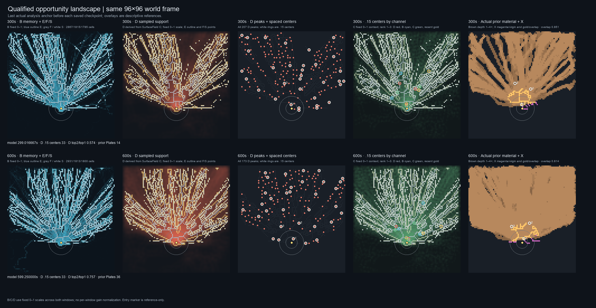
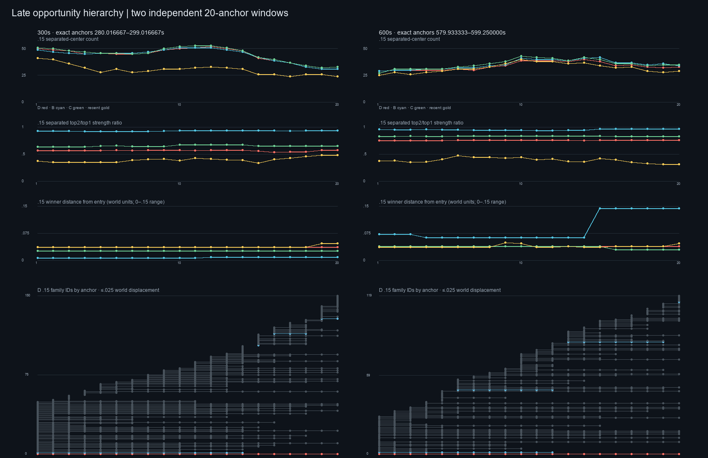

# Late Qualified Opportunity Capture

## Decision

**LATE HIERARCHY PERSISTS.** In the mechanically conditioned, edge-bearing structural domain `S`, the D rank-1 center remained the same entry-near cell at every sampled anchor **within each 20-state window** (index 6287 near 300 s; index 6289 near 600 s). These are different cells across the two windows; no cross-window track is claimed. D's separated rank-2 center was consistently outside entry and in the same F component as rank 1. Its median strength rose from 0.569 of rank 1 near 300 s to 0.757 near 600 s. This is a stronger late secondary tier, but it remains below the stable rank-1 region. No numerical rule for calling the regions “comparable” was preregistered or added.

The late world therefore preserves an entry-dominant **D hierarchy**, with persistent qualified secondary structure. Chemical B remains much flatter than D; C also becomes flatter by 600 s. These are separate channel observations, not a combined opportunity score. The results describe this one validated seed and these two sampled windows. They do not select an allocation policy.

## Question and authority

This pass fills the missing late qualified measurement from the early Opportunity Landscape Audit. It asks whether its entry-region dominant D opportunity, weaker persistent secondary regions, and transient peak background remain after material and mechanical history accumulate.

- Production authority: `origin/main` = `4135d4fb4ab8ec5d46297893fbc9c1c5f4f3e785`.
- Research parent: `codex/ant-opportunity-landscape-audit-20261029` = `2000d16b361dfeaf4ef915de460ea9c3e0fd0146`.
- New branch: `codex/ant-late-qualified-opportunity-capture-20261029`.
- Configuration: current-G/H0, seed `20261005`, 60 Hz, Audio Off.
- The early reference is the existing 0–120 s audit: 120 actual analysis states, 109 with edge-bearing `S`. Its measured D `.15` separated top2/top1 median was `.5993`; B was `.9423`. The existing early report and measurements were not changed.

The refreshed remote `main` ref matched the production authority. Current production source and canonical `docs/ant/README.md` were checked against that authority. Source semantics were read from `src/lib/agents/ant/TrailPlateBirth.js` and `SurfaceField.js`; implementation fact is kept separate from diagnostic interpretation below.

## Implementation fact

Current production `TrailPlateBirth` updates chemical memory `B`, derives the qualification mask `E` from the current B and sampled mechanical support `D`, then thins `E` into `F` using the existing thinning implementation. `S` is the edge-bearing node subset of `F`. `SurfaceField` stores compaction `C`; `D` is its current center-weighted `.025` support readout. B, C, D, and recent feet remain distinct channels. The measurements do not combine them.

The production rules were not changed. The observer copied states after the native field update, ran no RNG calls, and did not feed values back into the world. Actual material context uses the 36 immutable Plate masks whose IDs, times, and mask hashes match the stored G birth receipts. A Plate counts as pre-existing only when its recorded birth time is strictly earlier than an analysis anchor. C0/shadow descriptors are not treated as actual material.

## Data provenance and replay

Existing frozen G evidence was available but did not contain late B/E/F opportunity states. A source-conformant deterministic reconstruction was therefore necessary. It used the existing runner `scripts/ant-g-production-candidate-natural.js` with a read-only observer and retained only the 20 actual analysis anchors before each checkpoint. It did not create a new seed or a separately chosen behavior trajectory.

Frozen inputs:

- G raw trajectory: `docs/ant/evidence/2026-10-25-g-production-candidate-review/data/seed20261005-G-raw.json.gz`, SHA-256 `a52dd67cd3cab53e8bbdd6df7bb2e536a211d0a6872ebc03342111c8127f0414`.
- Checkpoint checksums: SHA-256 `ba32ccc7c16d134eba7f896cb2621a4d938e642561989bb719fcf42f66d0ec45`.
- G conformance receipt: SHA-256 `17840bd09d5dae760ae6ea2d2cfc96ab5b3494f85cd9901eb7a94815497c3deb`.
- Actual mask packet: `docs/ant/evidence/2026-10-29-stratigraphy-signal-audit/data/reconstructed-commit-context.json.gz`, SHA-256 `a62ad65b772db8d040ed9ebf636e8af32d2d185ea65fead4a431262964df0e5`.

Replay parity passed before interpretation:

- Initial state matched.
- All 600 saved per-second agent identity/position snapshots matched.
- All 600 contact-count buckets and the full FOOT_CONTACT payload hash matched.
- All 36 actual Plate birth receipts and mask hashes matched.
- At stored 30, 60, 120, 300, and 600 s checkpoints, pheromone, SurfaceField, occupancy, persistent mask, RNG state/call count, contact stream, and birth timing matched exactly.
- Final RNG state/call count matched; the observer made zero RNG calls.
- The 300 s and 600 s stored SurfaceField values matched exactly. The corresponding D maps were recomputed by the current pure `.025` readout and recorded with hashes.

Three source-hash differences from the older stored capture were disclosed and checked: `PheromoneField.js`, `scripts/ant-founder-evidence.js`, and `docs/ant/README.md`. The PheromoneField difference is the post-capture API/resolution conversion; the other two are runner/documentation changes. The reconstruction ran current `main` source, and the complete replay anchors above matched the frozen trajectory. There was no unexplained parity failure.

The complete receipt is [REPLAY-PARITY.json](REPLAY-PARITY.json). It contains all current source hashes, original stored-capture hashes, the exact differences, checkpoint receipts, all 40 state hashes, and exact model times.

## Exact analyzed states

These are actual observer analysis anchors, not a new fixed-rate interpolation grid. The machine-readable millisecond values and ticks are retained in `data/late-input.json.gz` and `analysis.json`.

**Window before 300 s** (20 states; 1.000000 s between adjacent anchors):

`280.016667, 281.016667, 282.016667, 283.016667, 284.016667, 285.016667, 286.016667, 287.016667, 288.016667, 289.016667, 290.016667, 291.016667, 292.016667, 293.016667, 294.016667, 295.016667, 296.016667, 297.016667, 298.016667, 299.016667 s`

**Window before 600 s** (20 states; 1.016667 s between adjacent anchors):

`579.933333, 580.950000, 581.966667, 582.983333, 584.000000, 585.016667, 586.033333, 587.050000, 588.066667, 589.083333, 590.100000, 591.116667, 592.133333, 593.150000, 594.166667, 595.183333, 596.200000, 597.216667, 598.233333, 599.250000 s`

The two windows are analyzed independently. No track is claimed across the unobserved interval between them.

## Measurement conventions

The parent audit's definitions were retained: exact-equal 8-neighbor plateau maxima on `S`; all observed peaks; 8-neighbor F components; component-aware strongest-first `.15` grouping as primary and `.30` as descriptive spatial sensitivity; reciprocal-nearest temporal correspondence at `.025` primary and `.075` sensitivity; recent feet in `(t−20 s,t]` with the existing `.037` neighborhood context. These group counts and correspondences are descriptive conventions, not a discovered natural count, entity identity, or allocation law. No new threshold, winner score, channel composite, or per-window gain normalization was introduced.

In tables below, “peaks / .15 / .30” gives median raw S-peak count, median separated-center count at `.15`, and median count at `.30`. `top2/top1` and `top3/top1` compare separated centers only. Entry distance is measured from the existing entry coordinate as context.

## Cardinality and strength

| Channel | Early 0–120 s peaks / .15 / .30 | Near 300 s peaks / .15 / .30 | Near 600 s peaks / .15 / .30 |
| --- | ---: | ---: | ---: |
| D sampled support | 79 / 18 / 14 | 219 / 46 / 36 | 172 / 33 / 22 |
| B chemical memory | 114 / 18 / 13 | 373 / 46 / 36 | 346 / 35 / 22 |
| C raw compaction | 106 / 18 / 14 | 380 / 47 / 36 | 352 / 36 / 22 |
| Recent feet | 74 / 17 / 12 | 182 / 31 / 20 | 208 / 32 / 20 |

Late windows have no missing `S` states. The peak and center distributions, including quartiles and tails, are preserved in `analysis.json` and the full measurements file. The rise in raw peaks/centers means the late field is more richly decomposed under the same descriptive convention; it is not a count of distinct natural opportunities.

| Channel | Early `.15` top2/top1 | Near 300 s top2/top1; top3/top1 | Near 600 s top2/top1; top3/top1 |
| --- | ---: | ---: | ---: |
| D | .5993 | .5691; .4951 | .7565; .7379 |
| B | .9423 | .9330; .9213 | .9516; .9398 |
| C | .7063 | .6521; .5441 | .8320; .8024 |
| Recent feet | .6931 | .3942; .3317 | .3976; .3467 |

| Channel | Median winner distance from entry at 300 s | At 600 s | Median strongest outside-entry center / channel winner at 300 s | At 600 s |
| --- | ---: | ---: | ---: | ---: |
| D | .0362 | .0391 | .5691 | .7565 |
| B | .0067 | .0626 | .9267 | .9516 |
| C | .0258 | .0391 | .6521 | .8320 |
| Recent feet | .0362 | .0365 | .3942 | .3976 |

For D, `.15` rank 1 was in the entry `R=.15` region at all 20 anchors in both windows and remained the exact same cell within each window: index 6287 in the 300 s window and 6289 in the 600 s window. Its median entry distances were `.03617` at 300 s and `.03912` at 600 s. D rank 2 was outside entry at 20/20 anchors in each window, and rank 1/rank 2 remained in the same F component at 20/20 anchors. The median rank-1 to rank-2 spatial separation was `.1554` at 300 s and `.1565` at 600 s. The rank-2 strength moved closer to rank 1 by 600 s, but stayed lower at every anchor. This supports “stronger secondary tier,” not a thresholded claim of equivalence.

The unconditioned full-grid D outside-entry/global-maximum ratio was `.6494` median in the 300 s window and `.8234` in the 600 s window. This is close to the earlier stored checkpoint values `.6633` at 300 s and `.8251` at 600 s. It is **not** the qualified hierarchy: on `S`, the strongest separated outside-entry D centers were `.5691` and `.7565` of their respective D winners. The distinction prevents an unqualified raw-field maximum from standing in for a qualified structural opportunity.

D `.30` center counts were lower than `.15` counts (medians 36 vs 46 at 300 s; 22 vs 33 at 600 s). This expected convention sensitivity is retained; `.30` was not selected as a better grouping scale. The early `.15` D ratio is the directly comparable parent median; the parent report also preserves the corresponding early `.30` distributions.

## Temporal correspondence

At the primary `.025` displacement convention, the D channel produced 151 correspondence tracks in the 300 s window (45 single-anchor, 106 multiple-anchor) and 120 in the 600 s window (31 single-anchor, 89 multiple-anchor). These are reciprocal-nearest center correspondences, not natural identities. D rank 1 was one family observed at all 20 anchors in each window and remained in its same exact cell; 33 D centers were present at each window's final anchor.

At rank 2, the `.025` receipt has four correspondence families in each window; three in each were seen at multiple anchors, and one was present at the final anchor. The most-observed rank-2 family spans 14 anchors in the 300 s window and 7 in the 600 s window. Rank 3 also has multi-anchor families. Thus the late second tier has spatially recurrent structure while the precise center/rank correspondences remain sensitive and fragmented; the rank-1 permanence does not imply that all secondary centers are stationary.

At `.075`, D rank 2 merges into one 20-anchor correspondence family at 300 s and two multi-anchor families at 600 s. This broad sensitivity result is reported as such; it does not replace the primary `.025` receipt. Exact family counts and all transition matches are in the data. These two windows are not joined into one long track.

## Material and recent loading context

Strict pre-existing actual material grows from 13–14 Plates and 4,536–4,703 occupied union cells at the sampled 300 s window to 36 Plates and 5,711 cells at 600 s. D rank-1 points sit on material with median layer count 2 at 300 s and 6 at 600 s. All D rank-1, rank-2 and rank-3 centers were on some prior material in 20/20 states at both windows.

The D-winner X reference capture (`R=.15`, same existing capture operator) overlapped pre-existing actual material by median `.7794` at 300 s and `.8385` at 600 s. This indicates strong repetition in the reference footprint, not a material policy or a causal effect of allocation.

A material-free D nonwinner existed somewhere in the separated-center list at every late anchor, but it was substantially weaker: median strength relative to rank 1 `.2011` at 300 s and `.1936` at 600 s. Its median distance from the winner was `.561` and `.396` world units respectively. This does not support a strong material-free alternative among the leading D centers. It also does not mean that free territory should be deprioritized or that repeated geology is required.

As descriptive recent-loading context, D rank 1's `.037`-neighborhood trailing-20-second contact count had medians 198 at 300 s and 162 at 600 s; latest nearby contact age medians were `.086 s` and `.071 s`. For ranks 2 and 3, corresponding count medians were 58/39 at 300 s and 49/35 at 600 s; latest-contact-age medians were `.203/.947 s` and `.950/.783 s`. This supports the narrow description “currently reinforced,” while keeping the contact context non-causal and separate from D's long memory.

## Atlas and interpretation boundary

Both images use a fixed 96×96 world frame. B/C/D use fixed 0–1 channel scales across both windows. `E`, `F`, `S`, entry reference circles, center ranks, previous material, and the descriptive D-centered X capture are shown only as context. The atlas is an inspection aid; the decision rests on the recorded arrays and summaries.

**[Measurement result]** Late qualified D remains entry-dominant. A separate outside-entry D center persists in the same F component and becomes closer in strength by 600 s. The window-median prior-material overlap of the D-centered X reference is higher near 600 s; it does not rise monotonically at every anchor. B's separated hierarchy is already flat and stays flat; C's secondary strength rises by 600 s; recent-foot centers remain more transient and less balanced.

**[Interpretation]** In this frozen world, discovery does not collapse to one available structural center, but D still presents a stable strongest region with weaker alternatives. The 600 s secondary tier is meaningfully more substantial descriptively, yet “comparable” has no authored boundary here. The evidence isolates an allocation responsibility; it does not resolve it.

**[Artistic/modeling boundary]** No preference for strongest conditioning, novelty, fairness, depletion, round-robin, simultaneous episodes, repeated material, or unmaterialized territory follows from these measurements. `Other qualified opportunities exist` does not imply `the system should choose them`. No allocation law, UPDATE, maturation, BODY, material mapping, audio, or production behavior was changed.

## Smallest justified next question

If allocation design continues, the smallest question is whether the authored intention is to preserve strongest-D priority when the stable leading D center and its X reference footprint increasingly coincide with existing material, while weaker persistent alternatives remain. This pass does not recommend or implement either preference. Do not move to UPDATE until that priority responsibility is stated.

## Evidence files

- [Replay and source provenance](REPLAY-PARITY.json)
- [Exact input states and fields](data/late-input.json.gz)
- [Full measurements and correspondences](data/measurements.json.gz)
- [Machine-readable summaries](analysis.json)
- [Validation and limitations](VALIDATION.md)
- [SHA-256 manifest](manifest.json)
- [Concise chronology](../../daily/2026-10-29-late-qualified-opportunity-capture.md)
