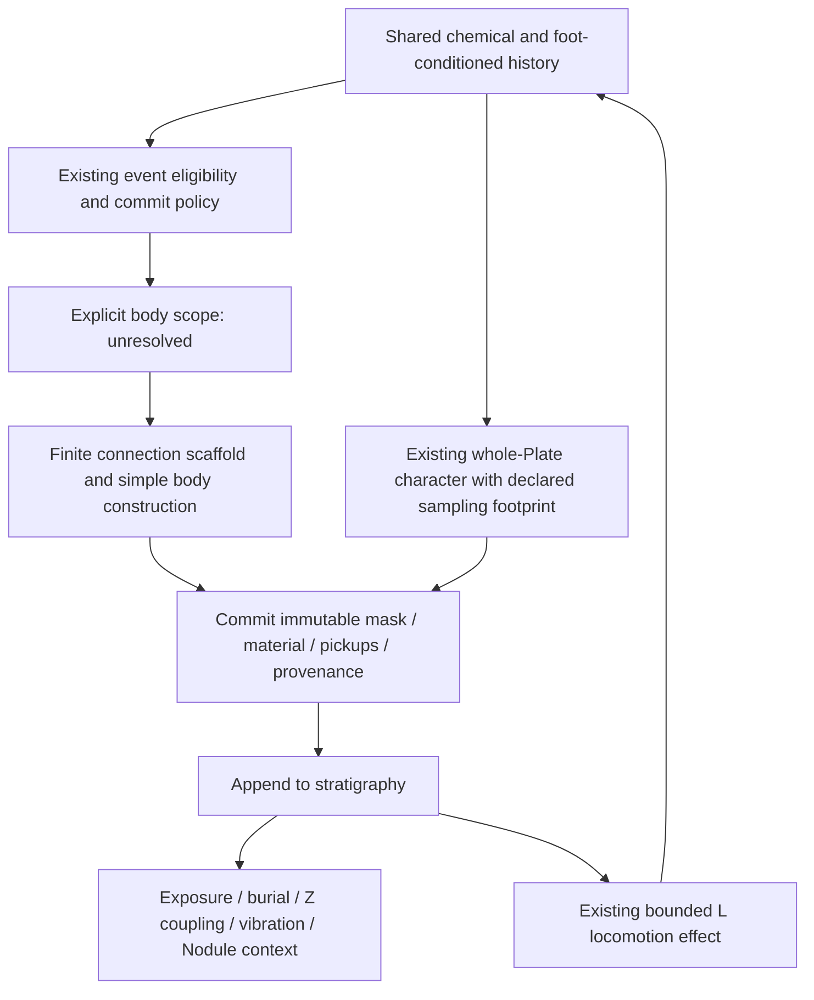

# Plate가 읽을 정보와 책임의 재분리

## 1. 결론과 조사 경계

**[New synthesis/inference]** 가장 단순한 작업용 architecture는 **scoped connection body / whole-Plate character / post-commit geology**다. 형성의 모든 세부 기록을 geometry로 옮기는 일을 Plate의 의무로 두지 않는다. 기존 정보 중 일부는 qualification, 일부는 물성, 일부는 provenance, 일부는 나중의 층서적 관계에 남는다.

**권고 문장:** Plate는 명시적으로 범위를 정한 connection event가 commit한 유한한 몸체이며, 형성 맥락에서 고정된 물성을 갖고, 이후 다른 물질과의 관계 속에서 노출·매몰·하중·결합·진동에 참여한다.

이는 작업용 해석이다. 현재 production의 자연 법칙을 발견했다는 뜻이 아니다. Body-scope 계약이 미완성이므로 production 구현 사양까지 확정하지 않는다. W/U/Q 또는 source→boundary I를 새 표준으로 채택하지 않는다.

**[Implementation]** Fresh fetch 결과 `origin/main=4135d4fb4ab8ec5d46297893fbc9c1c5f4f3e785`. Clean parent `d16eef17d3afefda2a8ecf829e4a38f4cc72faa8`에서 별도 branch를 만들었다. Parent의 `src/`, `static/`, canonical ANT README는 main과 동일하다. 이 pass는 기존 source·branch evidence를 읽고 문서를 작성했다. 자연 실행, counterfactual, 새 body, 렌더, 음향 측정을 하지 않았다.

표기:

- **[Implementation]**: fresh main source의 구현 사실.
- **[Prior experimental evidence]**: 원래 pass의 조건과 한계를 유지한 기존 결과.
- **[New synthesis/inference]**: 이번 책임 배치와 비교 판단. 새 측정이 아니다.
- **[Artistic/modeling interpretation]**: 선택 가능한 저술 의미. 구현 또는 증거로 승격하지 않는다.
- **[Unresolved decision]**: 현재 자료로 결정되지 않는 계약.

## 2. 증거가 허용하는 정보의 위계

| 신호 | 존재·보존에 관한 근거 | 아직 말할 수 없는 것 | 현재 권고 |
| --- | --- | --- | --- |
| Connection / I / alternatives | 실제 selector 구조와 지속적인 omitted history가 확인됨. I는 단일 principal path보다 넓지만 authored source→boundary network임 | I가 유일한 물리적 body이거나 모든 alternative가 같은 body라는 결론 | EVENT의 구조적 근거와 명시적 SCOPE를 분리. I는 임시 비교 구조 |
| Chemical memory B | 현재 qualification·corridor·whole-Plate 물성에 이미 사용. W/U는 local B 배치가 source geometry를 바꿀 수 있음을 보임 | local chemistry가 반드시 local width여야 함; B가 물질량·독점 소유량이라는 해석 | 기존 qualification / whole-body character 유지. Local section mapping은 선택적 가설 |
| SurfaceField C / sampled support D | 발에서 발생하는 느린 compaction. 기존 support qualification·density 집계·접촉 응답·후속 Nodule에 사용 | literal height, force, shear, levee, local thickness라는 해석 | Mechanical conditioning의 기존 역할. 새 shape channel 불필요 |
| Actual motion | Signed travel·tick turning은 정적 무방향 graph에 없음 | scaffold-specific flow, 일반적 opposing flow, material anisotropy의 필요성 | Formation 입력 없음. 진단/provenance로 보류 |
| Raw contact / gait | Leg·tripod·ant·sub-grid position·time은 scalar endpoint에 없음 | trajectory/gait를 조건화한 독립 material cause 또는 압력 | 기존 scalar load·SurfaceField·직접 excitation 유지. 새 gait material field 없음 |
| Stratigraphy | 실제 immutable stack, order, count, burial/exposure가 남음. 이진 overlap만으로 손실되는 과거 맥락 존재 | 현재 fields/geometry에 대한 조건부 독립성; 새 Plate가 stack을 읽어야 한다는 당위 | Commit 뒤 geology가 주 책임. Formation feedback 추가 안 함 |

**[New synthesis/inference]** `더 많은 정보를 보존한다`와 `더 많은 물질 책임이 필요하다`는 별개다. 서로 다른 causal ancestry도 정보의 조건부 독립성을 자동 보장하지 않는다. 반대로 높은 correlation은 raw history와 scalar endpoint의 정보 동등성도 뜻하지 않는다.

**[Implementation]** 316-grid pheromone은 organism의 shared sensor input이고, 96-grid B는 그 입력을 nonlinear projection / 20 s EMA로 읽는 formation memory다. 독립된 원자료 두 개로 세지 않는다. C는 별도 foot-written channel이며 D는 C의 spatial support readout이다. Exact cumulative foot counts는 repeat gate, retained load는 후속 geology, SurfaceField는 relaxation·spread가 있는 compaction을 담당한다. Count와 C가 상관된다고 이 소비자들을 하나의 동일 array로 취급하거나 삭제하지 않는다.

### 2.1 Connection과 field membership의 반례

**[Prior experimental evidence, current G/H0, seed20261005, Audio Off]** Formation ledger의 P1 funnel은 B=1,075, E=1,074, H=628, I=122, 실제 ribbon=356 cells다. Support gate가 이 순간 1 cell만 거른 사실은 해당 순간의 비선택성을 뜻한다. Mechanical memory 전체가 불필요하다는 결론은 아니다.

P1의 H\I 506 cells 중 366개 longer-terminal alternatives는 선택된 I와 persistence/contact 분포가 겹쳤다. Equal-shortest 보존으로 회수한 것은 22/506뿐이었다. 따라서 단순 tie-break 수리로 scope가 해결되지 않는다. Skeleton의 raster 연결을 독립적인 물리적 통로나 하중 경로로 해석하지 않는다.

**[Prior experimental evidence]** C0는 실제 commit 시점의 event-associated E를 모두 포함했다. P1/P2는 901/1,172 cells로 유한하고 compiler-valid였지만, current-G 36 actual commit의 600 s shadow union은 5,785/9,216=62.77%였다. Late successive overlap은 약 90%였다. C1-8은 P1/P2 C0의 96.45%/99.74%를 그대로 남겼다. 이 두 결과는 field membership과 sampled temporal attachment만으로 충분한 WHERE selectivity를 얻지 못한 bounded negative다.

**[Prior experimental evidence, pre-G]** Local-accretion은 source/boundary/skeleton을 없애고 local qualification·20 s persistence·반복 contact를 사용했지만, 세 seed의 마지막 관측에서 coverage 64.18–65.13%, largest component 99.43–99.72% of material로 수렴했다. Immutable maturation batch였으며 acoustic Plate 실험은 아니었다. Current G의 예측치로 이월하지 않는다.

**[New synthesis/inference]** 이것은 모든 broad material이나 반복 층이 미학적으로 실패라는 선언이 아니다. 이 pass들의 목적이었던 별도 spatial selectivity를 membership만으로 설명하지 못했다는 반례다. 새 anatomy를 만들기 전 어느 history가 한 body의 의무적 구성원인지 밝혀야 한다.

### 2.2 Motion / gait: richer record, no demonstrated material duty

**[Prior experimental evidence, current G P1/P2]** Traffic audit의 mean axial alignment는 event-wide 단일 방향 countermodel로 거의 재현된다: P1 observed .78225 / countermodel .78261, P2 .74977 / .75426. Countermodel은 in-sample이며 null test가 아니다. Tick turning은 I의 축이 고정된 동안 변하지만, local scaffold-linked turning이나 확실한 junction traversal은 입증하지 못했다. 원래 frozen packet에 모든 60 Hz position이 없어서 contact/birth/field/source parity anchors를 갖춘 재구성을 사용했다.

Gait audit는 P1 832 groups/2,470 feet, P2 849/2,507을 분석했다. Count–SurfaceField correlation은 .92803/.93557이다. A/B alternation·leg mapping은 fixed gait가 정확히 설명했다. 같은 count와 인접 SurfaceField rank에서 raw organization이 다르지만, 정확히 동일한 scalar pair/ROI 또는 trajectory-conditioned residual은 없었다. 따라서 정보를 버리는 압축이라는 사실과 새로운 물질 원인이 필요하다는 주장은 구별한다.

**[New synthesis/inference]** Actual traffic를 path tangent로 대체하면 안 된다. 그러나 실제 direction을 추가 body field로 만들 이유도 아직 없다. Raw gait를 texture·anisotropy·hardness에 붙이는 것은 현재 증거에서 나온 설계가 아니다. `No current formation role`은 데이터의 가치가 없다는 판정이 아니다.

### 2.3 Stratigraphy: 가장 분명한 persistent context, 자동 formation input은 아님

**[Prior experimental evidence, current-G reconstruction, one seed/600 s/36 commits]** Pre-commit mask-cell observations 66,089개 중 virgin 5,711, single-layer 5,572, multi-layer 54,806이었다. Pre-existing L은 0–34였다. P2는 223/544 cells에 이전 Plate가 있지만 multi-layer substrate는 아직 없었다. 같은 장소의 후속 층은 spatial novelty 없이도 성립한다.

P31/P35는 binary prior-overlap fraction .998990/.998820이지만 layer-count distribution distance는 .1209다. 그러나 mask Jaccard는 .304이며 동일 geometry 비교가 아니다. 전체 mask-pair similarity와 stack-distribution distance의 상관은 r=-.713, rho=-.728이다. Current mechanical fields와도 중간 정도의 상관이 있다. Exact same-cell/full-scalar-state matches는 없었다. 따라서 conditional independence나 새 물성 매핑의 효과는 입증되지 않았다.

Count와 buried depth는 이 sequence에서 r=.9989로 거의 중복된다. Ordered IDs는 event provenance를 보존하지만 ID 자체가 별도 constitutive physics는 아니다. **`totalDepthByCellMeters`는 foundation 위에 쌓인 두께의 합이다. Single-layer cell의 값은 0이다. 전체 stack thickness나 지형 높이로 읽지 않는다.**

**출처 한계:** 36 masks와 per-commit fields는 재구성 결과다. 저장된 motion/contact/birth/checkpoint/RNG anchors는 일치했지만 frozen `PheromoneField.js` hash는 current main과 달랐다. Event-time pheromone 비교는 frozen-source-byte identity가 아닌 replay-anchor 근거다. `TrailPlateBirth`, `SurfaceField`, `MaterialStratigraphy` source는 해당 receipt와 일치한다. 직접 append/column reconstruction의 근거와 field 비교의 한계를 섞지 않는다.

## 3. Production이 이미 수행하는 책임

**[Implementation]** [TrailPlateBirth](../../../../src/lib/agents/ant/TrailPlateBirth.js)는 chemical memory와 SurfaceField를 읽고, qualified region을 skeletonize한 뒤 source annulus에서 boundary target까지 network를 선택한다. 20 s는 변경되는 candidate lineage의 성숙 timer다. P1 final 356 cells 중 20 s sampled E tenure를 가진 것은 161개였다. Timer는 모든 final cell의 동시 숙성 보증이 아니다.

Commit은 activity termination이 아니다. Descriptor만 닫히며 live candidate는 reset되지 않는다. 10 s global gap, newest matching prior에 대한 90 s refractory와 30 new feet가 재발행을 제한한다. P1/P2는 22 s 간격이지만 unmatched라서 90 s 규칙 위반이 아니다. 같은 위치의 후속 사용은 새 layer가 될 수 있다. 이 규칙은 rate를 제한하며 유한한 총량·평형을 보장하지 않는다.

**[Implementation]** 현재 geometry는 selected network의 각 지점에서 supported-corridor edge distance를 .012–.030에 clamp한 ribbon이다. 이미 field-derived geometry이며, field가 전혀 shape에 관여하지 않는 baseline은 아니다. Descriptor의 stiffness/damping은 mean chemical, density는 mean support에서 정한다. 이 평균은 **최종 ribbon이 아니라 source-connected supported corridor 전체**에서 구한다. `history character`는 이미 있지만 그 집계 footprint와 몸체 footprint는 같지 않다.

**[New synthesis/inference]** 위 footprint 차이는 곧바로 버그가 아니다. Whole event context를 물성으로 받는 저술로 읽을 수 있다. 다만 body-only character로 설명하려면 잘못이다. 향후 바꾸면 집계 영역 변경 자체가 독립 manipulation이다. Q는 기존 식을 K footprint에 재평가했으며, 단순 재명명이 아니다.

**[Implementation]** Commit은 mask, structural metadata, pickups, material tuple, metrics/provenance를 고정한다. MaterialStratigraphy가 descriptor를 clone/freeze하고 ordered columns를 append한다. Whole-Plate thickness는 명시값이 없으면 `clamp(.001+.05*meanHalfWidth,.001,.01)` m에서 정해진다. Local thickness/stiffness/density map은 현재 compiler interface가 아니다.

**[Implementation]** [MaterialStratigraphy](../../../../src/lib/agents/ant/MaterialStratigraphy.js)는 이후 exposure/burial/depth와 foot load를 갱신하고, foundation·compaction·load·persistence로 Nodule을 형성한다. [Compiler](../../../../src/lib/audio/compileSurfaceTopology.js)는 96 mask를 32 solver grid로 옮기며 frozen tuple을 layer coefficients로 바꾼다. Source-cell overlap/order는 adjacent Z links를 만든다. 일반 발은 [exposed top](../../../../src/lib/audio/SurfaceAudioBridge.js)에 직접 strike하고 buried layers는 coupling으로 참여한다. Layer가 같은 ID라는 이유로 disconnected solver islands 사이에 wave propagation이 생기지 않는다.

**[Implementation]** Audio vibration은 mutable state다. Descriptor의 불변성과 진동의 불변성은 다르다. [Worklet](../../../../static/worklets/surface-plate.worklet.js)의 topology install은 compatible ID/node layout에서만 기존 state를 보존한다. Growing/merging Plate의 seamless state continuity는 제공하지 않는다. 단일 finite layer, 유효한 pickups, useful solver domain을 유지하는 architecture가 현재 계약과 맞는다. Synthetic shape listening 5/6은 isolated capability이며 자연 formation의 타당성이나 native mix 인식을 증명하지 않는다.

**[Implementation]** [AntController](../../../../src/lib/agents/ant/AntController.js)는 tick-entry L로 `m(L)=1-.10*(1-exp(-L/4))`를 적용한다. 따라서 geology는 이미 later activity/fields를 간접적으로 바꿀 수 있다. 아래 `post-formation context only`는 이 기존 loop를 지우자는 뜻이 아니다. **새 direct stack→Plate formation read를 추가하지 않는다**는 뜻이다. Slowdown의 최종 예술적 적합성까지 검증된 것은 아니다.

## 4. 필요한 최소 책임과 signal routing

EVENT/SCOPE는 body construction보다 먼저 온다. SCOPE는 별도 mutable environmental field가 아니라 어느 connection history를 하나의 commit에 귀속시키는지 설명하는 계약이다.

| 단계 | 꼭 필요한 책임 | 지금 허용할 입력 / 출력 | 현재 unresolved |
| --- | --- | --- | --- |
| EVENT / COMMIT | 성숙·재발행·불변 descriptor closure | 기존 timer/matcher/contact gates를 잠정 유지. Lineage/prior-match/Plate identity 구분 | Open-world event eligibility의 공간적 뜻 |
| SCOPE | 이 body가 대표할 connection 부분과 제외 이유 | 명시적 connection-family provenance. I는 diagnostic proxy | 이미 정한 EVENT에서 sustained alternative가 이 frozen layer에 반드시 포함돼야 하는지 |
| SCAFFOLD | 유한 topology/extent의 조직 | 승인된 scope의 graph/connection. Principal path 한 개로 축소하지 않음 | 어떤 선택 법칙이 source/edge 의미 없이 그 scope를 구현하는가 |
| BODY | 유한 binary support와 일관된 section/descriptor | 가장 단순한 bounded construction을 null로 둠. 현재 width convention은 가용 scale이지 증명된 물리 법칙 아님 | Uniform section으로 충분한지, local variation이 필요한지 |
| CHARACTER | 형성 맥락에 따른 fixed whole-Plate response | 기존 B/support 집계와 tuple을 보존하는 것이 최소. 평균 footprint를 명시 | 다른 sampling footprint 또는 새 매핑의 책임·효과 |
| STRATIGRAPHY / LATER GEOLOGY | 층 순서·노출·매몰·겹침·하중·결합 | Commit 후 append; 기존 count/depth/columns/Nodule/audio | 추가 formation responsibility는 현재 없음 |
| PROVENANCE | 현재 layer가 어떤 history를 참고했는지 | Carried-in / commit-owned / future를 구분 | Ownership은 membership·물질량·독점 causal support가 아님 |

**사용하지 않을 입력:** actual heading/turn, raw tripod/leg sequence, gaster dab/segment primitives, LocalOccupancy directional crowding을 새 Plate law로 읽지 않는다. 앞의 두 항목은 최근 audit에서도 material responsibility를 확립하지 못했다. Responsibility가 없다는 증거는 아니며 관련성은 미검증이다. 뒤의 두 항목은 dedicated material-relevance audit가 없으므로 검토·기각 또는 정보 중복으로 선언하지 않는다. 현재는 필요성이 정의되지 않았다. No new signal field나 원자료의 production 장기 보존도 제안하지 않는다.

**[Artistic/modeling interpretation]** Chemical은 `organisms가 공유한 형성 맥락`, SurfaceField는 `실제 발에 의해 조건화된 느린 기계적 기억`, stratigraphy는 `이미 commit된 물질과의 관계`로 역할을 나눌 수 있다. 이는 각 channel을 물리적 질량·압력·실제 지형으로 동정하지 않는 최소 해석이다.

## 5. 세 가지 coherent architecture와 반례

세 architecture 모두 기존 event timing을 provisional로 유지하고, scope를 먼저 명시하며, commit 뒤 immutable layer/append-only stratigraphy를 유지한다. Motion/gait raw history와 ownership ratio는 formation input에서 제외한다. None is adopted.

| 책임 | A. Scoped body + whole-Plate character | B. Scoped body + local chemical sections | C. Substrate-conditioned character |
| --- | --- | --- | --- |
| EVENT | 기존 authored maturation/commit/reissue | A와 같음 | A와 같음 |
| SCOPE / SCAFFOLD | 명시한 finite connection family. I를 임시 comparator로만 사용 | A와 동일해야 비교 가능 | A와 같음 |
| BODY | Local B variation이 꼭 필요하다고 가정하지 않음. 단순 section construction을 null로 둠 | Local B가 section radius를 변조. W가 한 구현 예시 | A의 geometry, stack으로 shape 변경 안 함 |
| CHARACTER | 기존 mean chemical/support tuple. 집계 footprint를 명시 | 같은 tuple을 고정해야 local geometry 기여를 분리 | Pre-append geology가 제한된 whole-body character를 추가 조건화 |
| STRATIGRAPHY | Commit 이후 context. 기존 exposure/coupling/load/Nodule/locomotion | A와 같음 | 위 기존 역할 + formation-time character input 하나 |
| COMMIT / 불변량 | 유한 mask/metadata/material/pickups, whole-Plate thickness convention | A와 같되 local sections가 frozen mask에 반영 | A와 같되 substrate-conditioned tuple도 고정 |
| 이후 변화 | Columns·exposure·burial·load·vibration, 별도 Nodule | A와 같음 | A와 같음. 태어난 layer의 tuple을 나중에 다시 계산하지 않음 |
| 필요한 새 mechanism | 아직 미정인 scope/body construction. 새 memory channel 없음 | A에 더해 authored local chemical→section law | A에 더해 stack→material mapping·새 direct feedback |
| 증거 수준 | Existing responsibilities와 호환. Simplicity에 근거한 작업용 권고 | 두 frozen cases에서 technical viability. Necessity/meaning 미검증 | Persistent substrate context와 호환. Mapping/need는 unsupported |

### A 평가 — 최소 책임 구조

**[New synthesis/inference]** A를 작업용 architecture로 권고한다. 전체 material이 local field의 복제여야 할 이유가 없다. Finite organized geometry, fixed material response, contact loading, later overlap/coupling만으로도 material의 책임은 존재한다. P1/P2가 다른 body geometry와 layer relation을 가질 수 있으며, 모든 차이가 새 local channel일 필요는 없다.

A는 U의 production adoption이 아니다. U의 uniform radius도 W의 event mean에서 가져오므로 `history-free body`가 아니다. U/Q/K의 radius·평균 footprint를 지금 결정하지 않는다. A는 local geometry로 정보를 더 보존해야 한다는 의무를 먼저 보류하는 선택이다. Whole-body character도 기존 식의 자연성·청각적 효과가 증명됐다는 뜻은 아니다.

화학·기계 신호에 대칭적인 역할을 줄 필요도 없다. 기존 stiffness와 damping은 같은 mean chemical에서 함께 변하며 두 독립 history channel이 아니다. Q의 density는 두 사례 모두 1.2로 포화됐다. Mechanical input의 존재가 물성 차이의 유효 범위나 청각적 기여를 입증하지 않는다. 이를 해결하려고 새 gain이나 mapping을 만들지 않는다.

C0/C1 반례에 대응해야 할 위치는 제한된 scope의 construction이다. 하지만 그 제한이 어떤 법칙인지는 아직 해결되지 않았다. 따라서 A도 long-run selectivity를 획득했다고 주장할 수 없다. `Finite`를 `selective`로 바꾸어 쓰지 않는다.

### B 평가 — W는 유효한 가설, 필수 역할은 아님

**[Prior experimental evidence]** W는 `r(i)=.012+.018*B(i)`의 scaffold-centered discs union이다. U는 같은 I와 같은 mean mapped radius를 사용한다. W/U source XOR는 P1/P2 49/79 cells, Jaccard .911/.906이다. Solver occupancy의 서로 다른 cells는 5/8개뿐이다. No sound/listening effect was measured.

**[New synthesis/inference]** W는 단순 mean widening 이상으로 일을 한다. 따라서 완전히 cosmetic하거나 U와 같은 geometry라고 할 수 없다. 그러나 그 위치별 차이를 material이 반드시 보존해야 할 이유는 아직 없다. 32-grid projection에서 occupied cells 차이는 5/8개로 남으며, 그 sonic significance는 모른다. 96-grid exposure/routing/stratigraphy 차이도 별도로 남을 수 있다. Acoustic importance, visual reading, ontology는 따로 판단한다.

W의 35.5%/31.4% body cells는 commit E 밖이다. 이는 authored construction이며 local support를 발견한 것이 아니다. Technical fixture는 기존 `meanHalfWidth`/thickness를 고정했다. 새 section radius에서 descriptor width/thickness를 어떻게 정할지는 별도 계약이다. P2에는 frame을 넘어가는 sections와 clipped border cells도 있다. Observation edge가 실제 body closure라는 결론을 내리지 않는다.

**Scaffold counterexample:** 전체 non-pendant terminal set의 minimum-width T만으로도 1,069/1,275 cells다. Chemical R은 1,135/1,367, mechanical M과 R의 overlap은 약 94–95%다. 이 particular formula 아래에서 넓은 scaffold가 결과를 지배했다. 이것은 chemical/mechanical signal의 일반적 동등성을 뜻하지 않는다. W는 기존 I의 선택성을 물려받았으며 지속 alternative의 귀속을 해결하지 않았다.

### C 평가 — narrower than geometry feedback, still unnecessary now

**[Artistic/modeling interpretation]** 새 물질이 이미 매몰된 ground 위에 생겼다는 사실이 동일 event history라도 다른 character를 가져야 한다는 의미를 선택할 수는 있다. C는 geometry를 고정하므로 stack-conditioned shape보다 작고 명료한 가설이다.

**[New synthesis/inference]** 현재는 C를 보류한다. 이미 geology가 exposure, Z coupling, foundation coupling, slowdown에 쓰인다. 새로운 tuple까지 stack에 의존시킬 필요는 입증되지 않았다. Count/depth를 두 독립 knob로 넣으면 사실상 같은 정보를 중복 반영할 수 있다. Geometry와 stack의 상관도 커서 apparent gain을 독립 substrate 효과로 읽기 어렵다. 매핑의 방향·단위·효과가 정의되지 않았으므로 formula를 만들지 않는다.

**직접 substrate-conditioned formation**은 C보다 더 큰 recursive feedback이다. Re-layering을 L로 억제하거나 오래된 곳에 더 많은 material을 강제하는 것은 artist decision 없이 geology의 역할을 바꾼다. 가장 강한 이유가 필요한 선택이며 이번 shortlist에서 제외한다. 이미 있는 간접 locomotion loop는 보존한다.

### 탈락·보류한 다른 구조

- **History-membership-first body:** C0/C1로 충분한 selectivity가 없었다. 다른 threshold·occupancy ratio로 다시 이름 붙이지 않는다.
- **All sustained connections as one body:** broader scaffold가 이미 넓은 body를 만든다. Sustained history의 가치와 같은 layer membership은 다르다.
- **Motion/gait-driven anatomy:** 추가 record는 있으나 역할 근거 없음. Fixed gait·event-wide direction이라는 더 단순한 설명을 먼저 유지한다.
- **Raw pockets / membranes / automatic branch Plates:** 전자는 raster adjacency 의존성이 컸고 후자는 event granularity와 many-layer cost를 새로 정해야 한다. Architecture의 구멍을 geometry cleanup이나 shard IDs로 숨기지 않는다.
- **Growing/merging acoustic domains:** 현재 immutable compiler/state 계약 밖이다. 이번 결론에 필요하지 않다.

## 6. Working architecture와 genuine artist decisions

**[New synthesis/inference]** A는 책임 배치로서 가장 작지만 구체적인 geometry law로 완성되지 않았다. A를 고르는 이유는 더 예쁘거나 물리적으로 발견됐기 때문이 아니라, 새 channel·recursive mapping을 요구하지 않으면서 현재 material 계약을 설명하기 때문이다.

**[Unresolved decision, 우선 1개]** 이미 합의한 evolving connection EVENT와 현재 COMMIT 정책을 유지할 때, 지속적인 대체 연결은 이번 frozen Plate에 반드시 표현돼야 하는가, 아니면 이 layer 밖의 shared environmental history로 남을 수 있는가? 포함이 필수라면 current I의 body-scope가 부족하다. 그러나 모든 E나 terminal hull을 그대로 넣으라는 결론도 아니다. 이 선택은 BODY/SCOPE 책임을 명확히 하며, 이미 정리한 EVENT 의미나 COMMIT timing을 다시 고르는 질문이 아니다. Dijkstra tie-break·threshold·branch count를 작가에게 정해 달라는 요청도 아니다.

**[Unresolved decision, 후순위/선택적]** Local chemical variation이 몸체의 위치별 signature로 남아야 하는가, whole-body response와 이후 geology에만 남아도 되는가? 필요성을 선택한 경우에만 B/W의 별도 역할이 생긴다. 이 선택은 scope 문제를 대신 해결하지 않는다.

Source가 영구 root이거나 canvas edge가 materialization cause라는 의미는 요구하지 않는다. 현 I에는 그 authorship이 남으므로 open-world-compatible final law라고 부르지 않는다. Source/lifecycle 교체는 이번 설계의 선행 구현 과제가 아니다. 향후 scope selector가 그 engineering responsibilities를 어떻게 대체하는지는 별도 blocker로 남긴다.

## 7. 가장 작은 다음 closed pass — 기존 evidence의 body-scope 의미 판정

**실행하지 않았다. 새로운 geometry/prototype 측정에 앞서는 bounded artist gate다.**

- **하나의 질문:** 이미 합의한 EVENT와 COMMIT을 고정할 때, P1에서 persistence/contact가 겹치는 longer reconnection이 *이번 frozen Plate에 의무적으로 표현돼야 하는가*, 아니면 이 layer 밖의 environmental history로 남을 수 있는가?
- **Frozen baseline:** seed20261005/H0/current-G/Audio Off, 실제 P1 lineage 64.016667–84.016667 s와 실제 commit. 기존 formation-gate history/terminal classification과 body atlas의 P/K/T를 그대로 사용한다. P2는 동일 의미를 적용할 수 있는지 확인하는 한 번의 보조 사례다.
- **주요 distinction:** `history가 실제로 존재·지속함`과 `동일 body membership의 의무`를 구분한다. 새 threshold, body mask, width, renderer 또는 material tuple을 만들지 않는다. 기존 진단 색상은 class 표시이며 Plate renderer의 제안이 아니다.
- **리뷰 순서:** 동일 좌표의 I, longer alternatives, E/history를 확인하고, 기존 P/K/T에서 그 scope가 만드는 결과를 본다. W/U의 세부 section 선호는 이 질문의 판단 근거로 사용하지 않는다. `어느 mask가 더 좋은가`라고 묻지 않는다.
- **정보가 되는 결과:** 그 reconnection이 이번 layer 밖에 남아도 된다면, 최소 A와 explicit body-scope selectivity 연구를 계속할 수 있다. 반드시 표현돼야 한다면, current I를 충분한 scaffold로 삼는 구현을 보류하고 BODY/SCOPE 계약을 보완한다. EVENT/COMMIT timing은 이 판정으로 바꾸지 않는다. Shape를 넓혀 자동 해결하지 않는다.
- **Falsifier:** `persistent connection evidence면 same Plate membership이 자동으로 따라온다`는 가정, 또는 반대로 `current I면 당연히 충분하다`는 가정을 검토한다. Artistic judgement는 causal measurement의 지지/기각으로 부르지 않는다.
- **Validity:** 기존 class 정의·provenance·원본 규모를 유지한다. P1 선택 이유는 이미 측정된 366 longer-alternative contrast이며 좋은 모양을 찾기 위한 사례 선택이 아니다. P2는 같은 seed의 unmatched event이며 일반화 proof가 아니다.
- **Stop:** 의미가 결정되지 않으면 artist gate에서 멈춘다. 선택된 의미가 arbitrary ranking이나 window-edge physical closure를 필요로 하면 새 generator를 시작하지 않고 그 미완성을 기록한다. No seed/horizon expansion, no tuning.

이번 Plate에 포함할 의무가 없다는 판단은 그 연결이 공유 history가 아니거나 미래 layer로 표현될 수 없다는 뜻이 아니다. 현재 layer의 representation 의무만 구분한다.

그 이후에만 구체적인 selector나 local-section falsification을 별도 closed pass로 등록한다. 이번 synthesis는 구현 roadmap 전체를 승인하지 않으며, another 600 s accumulation run을 자동 추천하지 않는다.

## 8. 판단의 한계

**[New synthesis/inference]** A는 evidence-compatible하고 추가 가정이 적은 작업용 architecture다. Evidence-validated final formation law는 없다. B는 기술적으로 가능한 authored 해석이며 필요성이 미검증이다. C와 direct stratigraphic formation은 현재 역할 근거가 부족하다.

현재 충분히 말할 수 있는 것은 `무엇이 더 풍부한 기록인가`, `무엇이 이미 물질/지질 단계에서 사용되는가`, `무슨 책임을 새로 추가할 근거가 없는가`다. 어떤 field가 자연적인 Plate boundary를 유일하게 결정한다거나 observer가 retained history를 지각한다는 결론은 없다.

Single-seed P1/P2, one-seed 600 s stack audit, sampled history, source-version caveat를 유지한다. 새 compiler qualification·acoustic render/listening·mature realtime·multi-seed·production test/build를 실행하지 않았다. 기존 결과의 수치를 재인용했으며 새 simulation 결과로 세지 않는다. [Pinned evidence](SOURCES.md)와 [validation](VALIDATION.md)을 함께 읽는다.
