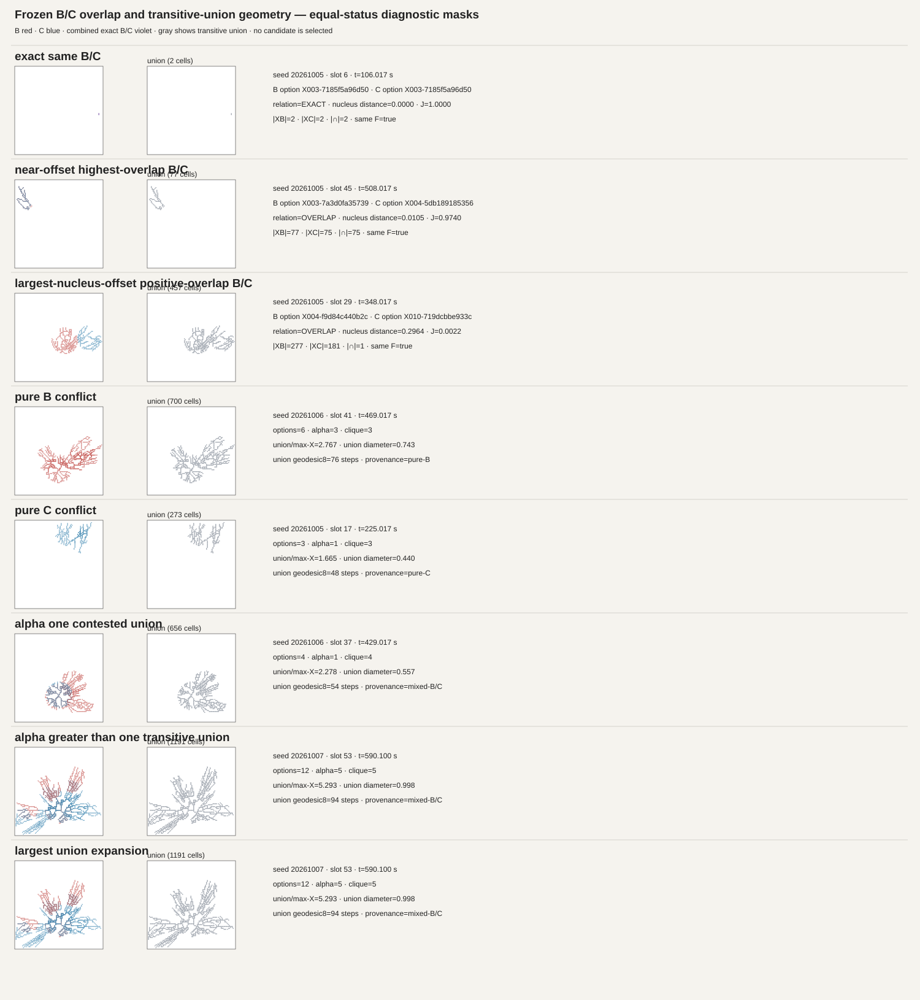

# Frozen B/C overlap provenance and transitive-union audit

**Result:** Part A — **MIXED B/C CONFLICT ORIGIN**. Part B — **MIXED / SCALE-DEPENDENT**.

This read-only audit asks why mature B and C X captures overlap, whether overlap means near-duplicate capture, and what happens geometrically if every exact-overlap connected component is replaced by the union of all its X masks. It does not choose or simulate any materialization rule.

## Decision summary

- The zero count of {B,C} nodes inside contested components is partly a representation convention: exact same-X B/C candidates are collapsed to one spatial option before conflict components are formed. It is not evidence that the two responsibilities never agree.
- That collapse describes a real repeated geometric coincidence: 664 of 665 exact B/C X pairs equal their entire frozen F component. The remaining case is also non-conflicting with the other four X options in that F component.
- Positive B/C overlap is not one near-offset regime. Of 293 positive but non-identical pairs, median X Jaccard is 0.226, median nucleus distance 0.160 world units, and the distributions extend from near-identical captures to almost disjoint-sized masks.
- There are both within-channel and cross-channel conflicts. Contested components are 61 pure B, 17 pure C, and 153 mixed B/C. Size-two components are mostly B-C pairs (70/120), with 50 same-channel pairs.
- Uniting all members preserves a fairly compact scale for the 143 clique components, but expands the 88 components with alpha greater than one: median union size is 520 cells and 2.25 times the largest member X; median union Euclidean diameter is 0.675 and 2.25 times the largest member diameter. The maximum union reaches 1,191 cells and 1.086 world units.
- Exact maximum independent sets show geometrically compatible alternatives can have distinct footprints and provenance. This is an existence result, not a recommendation to select a maximum independent set or to commit every compatible option.

The measurements do not support treating a transitive overlap component as one automatically local body. They also do not define a replacement rule.

## Authority and scope

Production authority represented by the frozen opportunity histories: **main@bc045dc3caa5954df633ecbee37fbabcb8224f30**.

Frozen lineage reused:

- opportunity histories: **codex/ant-local-opportunity-competition-audit-20261031@da599d9f385f53d0bb24df3e737c5ed2e2eb6a23**
- dual maturation: **codex/ant-bc-dual-material-shadow-20261031@248da39a4d7d342022a27a5b9ec183cad9b160e2**
- commit-slot ambiguity: **codex/ant-bc-commit-slot-ambiguity-audit-20261101@e960d135afec30e7c9f35722359e15f0f2d39ce3**
- local conflict decomposition: **codex/ant-bc-local-conflict-decomposition-20261101@86f0b57bb67bc2b60794108ce5e04dc5e761d45a**
- topology: **codex/ant-bc-local-conflict-topology-audit-20261101@526cbfd526cf0d4a6348cc4c6942fe6bdee09ddf**
- capacity audit: **codex/ant-bc-material-capacity-necessity-audit-20261101@ebd1f34c5d2322bd5d3c3d6c8b83bad5a8fd7b6e**

The analysis reuses the exact 163 slots and saved candidate X masks. No simulation, deterministic replay, RNG, winner selection, Plate creation, or production behavior change was performed. Production TrailPlateBirth remains the authored source-to-boundary selector.

The stored production Plate geometry packet is from **1bf3d1d491bb5dd3ccb7ed43f3de62e9eecaca44**. It is used only as a geometric reference after checking that this revision is an ancestor of the production authority, src/ and static/ are byte-identical between those authorities, the saved simulation source LF hashes match the checked source, every frozen F mask matches the saved shadow F mask at all 599 anchors per seed, and saved Plate IDs/times match (maximum time difference 5.83e-11 ms). It is context, not ground truth.

## A. Why do B and C X captures overlap?

### A1. Contested-component provenance

Across the 231 contested components, the graph contains 463 B-only and 262 C-only nodes, with no dual-provenance node. Components divide into 61 pure B, 17 pure C, and 153 mixed B/C. By seed:

| Seed | Pure B | Pure C | Mixed B/C |
|---|---:|---:|---:|
| 20261005 | 21 | 4 | 50 |
| 20261006 | 21 | 5 | 53 |
| 20261007 | 19 | 8 | 50 |

For the 120 size-two components, the pairs are 35 B-B, 15 C-C, and 70 B-C. Thus cross-channel conflict is common, but same-channel local peaks also conflict. A connected mixed component can contain several same-channel and cross-channel edges; component labels alone do not identify the edge-level cause.

Exact same-X B/C records are collapsed into one {B,C} spatial option by the locked upstream identity rule. That is why a contested node cannot carry both labels in this graph. The resulting absence of dual nodes in contested components is partly definitional.

### A2. Same-slot B/C geometry

The all-pairs denominator is the full same-slot Cartesian product, not one-to-one matches: 10,680 B×C pairs over the frozen boundaries. Classification uses exact equality and positive cell intersection only.

| Relation | Pairs | Nucleus distance, median (q10–q90) | X Jaccard, median (q10–q90) | X cell count B / C, median | Same frozen F component |
|---|---:|---:|---:|---:|---:|
| EXACT | 665 | 0.0105 (0–0.0211) | 1.000 (1–1) | 2 / 2 | 665/665 |
| OVERLAP, non-identical | 293 | 0.1603 (0.0298–0.2640) | 0.226 (0.026–0.846) | 161 / 158 | 293/293 |
| DISJOINT | 9,722 | 0.5405 (0.2000–0.8808) | 0 (0–0) | 8 / 3 | 1,235/9,722 (12.7%) |

The positive-overlap pairs have intersection size median 51 cells (q10 8, q90 145) and symmetric difference median 175 (q10 15, q90 376). They span nearly coincident and spatially distinct captures: the largest Jaccard is 0.974 at nucleus distance 0.0105, while the smallest positive-overlap Jaccard is 0.00219 at distance 0.2964. There is no single “one- or two-cell offset” description for this group.

All 293 positive-overlap pairs lie in the same F component, as expected when both X masks are subsets of that frozen carrier. This does not mean their nuclei or captured shapes are locally equivalent. The positive-overlap X union occupies a median 16.5% of that F component (q10 4.9%, q90 26.6%); that F component contains a median seven other mature X options.

Entry classification for the 665 exact pairs is 662 non-entry/non-entry, 2 entry/entry, and 1 non-entry/entry. For the 293 positive overlaps it is 193 non-entry/non-entry, 29 entry/entry, 43 entry/non-entry, and 28 non-entry/entry. The per-pair distances, positions, sizes, component IDs, and intersections are retained in the [B/C pair receipt](analysis/bc-cross-channel-pairs.json). These are pair statistics and can count one candidate repeatedly.

For additional context, per-option summaries compare each X to the union of every opposite-channel X in the same slot; these are not nearest-neighbor matches and do not select candidates. B options have median three cells absent from the opposite-channel union (756/1,449 have any unique cell); C has median zero (367/1,062 have any). The per-slot B-only, C-only, and shared union footprints are separately recorded in the summary receipt.

### A3. Exact matches and F confinement

There are 665 original exact B/C pair appearances. In 664, X equals the entire connected F component. The component-size distribution is median 2, q90 5, maximum 1,529 cells; the X/F ratio is 1 for the median and q90. In the exception, seed 20261007, slot 32 (379.017 s), the identical 42-cell X sits inside a 1,529-cell F component (2.75%); four other mature X options share that F component, but all four are disjoint from the exact B/C X. No exact case has a positive-overlap competitor among other mature options in that same F component.

The contrast with positive-overlap pairs is large: their F components have median 1,609 cells and the pair union is 16.5% of F at the median. This supports a geometric confinement account for most exact agreement. It does not establish that every exact B/C match is forced by F topology: the one exception shows an exact pair inside a large F component.

The exact match itself is stronger than a small-offset approximation: the X masks and Jaccard are exactly equal, while nuclei can be separated by up to 0.0632. This audit cannot distinguish common carrier geometry from any causal convergence between B and C.

The zero median nearest B/C maturation lag was already present under the shared 20 s / .60 maturation grammar, which predates the 10 s commit-slot audit. It must not be attributed to 10 s quantization or treated as evidence for a shared biological event.

### A4. Compatible histories inside conflict components

The overlap graph is unchanged: one node per registered unique X, edge iff the masks share at least one cell. Exact maximum independent sets were exhaustively enumerated for every contested component with alpha greater than one (component maximum size 12).

| Quantity | Result |
|---|---:|
| alpha > 1 components | 88 |
| Exact maximum independent sets enumerated | 228 |
| Unique compatible nodes across those components | 361 |
| Compatible nodes present in at least one maximum set | 321 |
| Compatible nodes present in every maximum set | 122 |
| Compatible-node cases absent from every other member X, median (q90) | 67 (159) cells |
| Footprint range across maximum sets per component, median (q90) | 6 (154) cells |

Across the 228 maximum sets, 118 contain both B and C, 95 are B-only, and 15 are C-only; 213 include B, 133 include C, and none are dual-only. Every maximum set contains at least one non-entry option; 103 also contain an entry option. This is possible provenance composition, not a balance target.

There are 361 nodes with at least one non-neighbor in their component. Their channel composition is 248 B-only and 113 C-only; 75 are entry-class and 286 non-entry. Of these, 321 appear in at least one maximum independent set. A compatible option can carry cells absent from every other member capture in its component (median 67 cells). The 40 compatible nodes absent from any maximum set remain compatible with at least one partner, but are not part of a maximum-cardinality packing under the exact graph.

The earlier +123 across slots is the sum of alpha minus component counts. It is not a unique list of 123 discarded X masks. Maximum sets are often non-unique, and their footprints vary.

## B. Would transitive union preserve local X?

For each contested component, the measured union is the exact union of its member X masks. It is not proposed as a Plate mask or a new body definition. Euclidean diameter is the maximum pairwise distance between cell-center coordinates; the graph span is the longest shortest-path distance in the induced 8-neighbor union mask, reported in edges. Bounding-box diagonal is the diagonal of the cell-center bounds.

| Contested graph class | Components | Union cells, median (q90; max) | Union / largest member X, median (q90; max) | Union diameter, median (q90; max) | Diameter / largest member, median (q90; max) | 8-neighbor span, median (q90; max) | Span / largest member, median (q90; max) |
|---|---:|---:|---:|---:|---:|---:|---:|
| alpha = 1 (cliques) | 143 | 162 (364; 656) | 1.157 (1.544; 2.278) | 0.363 (0.491; 0.567) | 1.240 (1.646; 1.912) | 38 (54; 73) edges | 1.119 (1.450; 1.818) |
| alpha > 1 | 88 | 520 (780; 1,191) | 2.254 (3.159; 5.293) | 0.675 (0.904; 1.086) | 2.254 (3.029; 3.630) | 68 (94; 114) edges | 1.659 (2.233; 2.714) |

Across the contested set, bounding-box diagonal has median 0.512 (q90 0.916; max 1.236); width median 0.347 (q90 0.642), height median 0.368 (q90 0.653). The union centroid is a median 0.298 from entry. 119 unions touch the entry-radius region, 6 touch the world boundary, and 2 touch both. Per-seed alpha>1 median union/largest-X ratios are 2.28, 2.12, and 2.30 for seeds 20261005, 20261006, and 20261007.

The corresponding bounding-box diagonal for alpha=1 has median 0.426 (q90 0.584; max 0.724); for alpha>1 it is 0.770 (q90 1.028; max 1.236). Alpha>1 bounding-box width is median 0.568 (q90 0.726), and height median 0.495 (q90 0.842).

Maximum distance from any member nucleus to any union cell has median 0.357 (q90 0.708; max 0.981) across the contested set. The corresponding alpha=1 distribution is 0.302 (q90 0.387; max 0.440), versus 0.583 (q90 0.825; max 0.981) for alpha>1.

Two contested unions have a measured entry-to-world-boundary span: 0.381 at seed 20261005 / slot 19 and 0.562 at seed 20261006 / slot 39. Both are alpha=4 unions. The other contested unions have no such span.

All 231 contested union masks are 8-connected, and each is contained in exactly one frozen F component. This is expected from connected X members joined by positive-overlap graph paths; it does not turn the union into one local X capture.

The alpha=1 result is comparatively compact. Alpha>1 transitive components are substantially larger in cell count and path/diameter span than their own largest member X in all three seeds. This is direct evidence against treating connectedness as proof that the composite union retains the local scale of one X.

### Comparison with actual production Plates

The 93 saved production Plate masks are connected; 69 touch the world boundary. Pooled production Plate mask size has median 1,570 cells (q10 1,078, q90 1,916); diameter median 1.219 (q10 1.097, q90 1.311); 8-neighbor geodesic span median 122 (q10 108, q90 134) edges.

Alpha>1 union medians (520 cells, diameter 0.675, 68 edges) are below production Plate medians. Their upper tails approach but generally remain below the production ranges; the largest union is 1,191 cells, 1.086 diameter, and 114 edges. These ranges overlap at the upper end. This comparison says union can approach the scale of the source-to-boundary bodies, not that it recreates their formation semantics. A research X union is not a production Plate.

| Seed | Actual Plate count | Plate mask cells, median | Plate diameter, median |
|---|---:|---:|---:|
| 20261005 | 37 | 1,699 | 1.197 |
| 20261006 | 23 | 1,455 | 1.249 |
| 20261007 | 33 | 1,554 | 1.222 |

## Interpretation matrix

| Hypothesis | Assessment | Basis and limit |
|---|---|---|
| H1 — Exact same-X B/C is special causal agreement | **Not supported** | Exact mask identity recurs, but most instances coincide with an entire small F component. The shared 20 s / .60 maturation grammar influences event timing. Frozen geometry cannot establish a causal B-to-C or C-to-B agreement mechanism. |
| H2 — Zero dual nodes in contested components is mostly collapse/confinement-related | **Supported narrowly** | Same-X candidates are explicitly collapsed upstream; 664/665 exact masks equal the F component and the exception has only disjoint same-F alternatives. However, positive-overlap pairs are mixed in similarity and include many B-C conflicts. “Mostly near-offset” is not supported. |
| H3 — Transitive component union preserves locality | **Not supported in general** | Alpha>1 unions expand median 2.25× in both cell count and Euclidean diameter relative to their largest member X, across all seeds. Alpha=1 unions are more compact, making the overall result scale-dependent. |
| H4 — One-per-component could discard meaningful compatible local histories | **Geometric possibility supported; importance unresolved** | Alpha>1 components have 228 exact maximum sets with B/C and entry/non-entry variation; compatible options can contribute cells absent from all other member masks. No utility, artistic value, or correct commit interpretation was measured. |

### Required classifications

- **Part A:** MIXED B/C CONFLICT ORIGIN.
- **Part B:** MIXED / SCALE-DEPENDENT.

The exact and positive-overlap groups have different F geometry, while the positive-overlap group itself spans both very similar and highly distinct X masks. Union preserves modest local scale for alpha=1 but not consistently for alpha>1. These results must remain separate; no winner, packer, local material ontology, capacity rule, or B/C preference follows from them.

## Objective atlas

The objective case selection receipt records the deterministic seed, slot, exact saved timestamp, option IDs, relation, and graph component for each available case. The atlas gives all options equal status; gray indicates the measured transitive union only. It does not mark a winning set.

## Machine-readable receipts

- [B/C cross-channel exact / overlap / disjoint pairs](analysis/bc-cross-channel-pairs.json)
- [Contested provenance composition](analysis/contested-provenance.json)
- [Exact F confinement and same-F opportunity context](analysis/exact-f-confinement.json)
- [Contested union geometry](analysis/contested-union-geometry.json)
- [Exact maximum independent sets and node compatibility](analysis/maximum-independent-sets.json)
- [Objective case selection](analysis/objective-cases.json)
- [Production Plate geometry context](analysis/production-plate-geometry.json)
- [Aggregate summary](analysis/summary.json)
- [Independent arithmetic review](analysis/independent-arithmetic-review.json)
- [Validation receipts](analysis/validation.json)
- [Reproduction script](../../../../scripts/ant-frozen-overlap-bc-topology-audit.cjs)
- [Protocol](PROTOCOL.md) · [Validation](VALIDATION.md) · [Manifest](manifest.json)
- [SHA-256 file list](SHA256SUMS.txt)

## Closure

This completes the authorized observer-only formation-structure audit. The frozen evidence is internally consistent enough to close this static line. The next category is the planned **singleton-only closed-loop feedback sensitivity probe**, under separate authorization. This report does not implement it or prescribe any formation/commit law.
