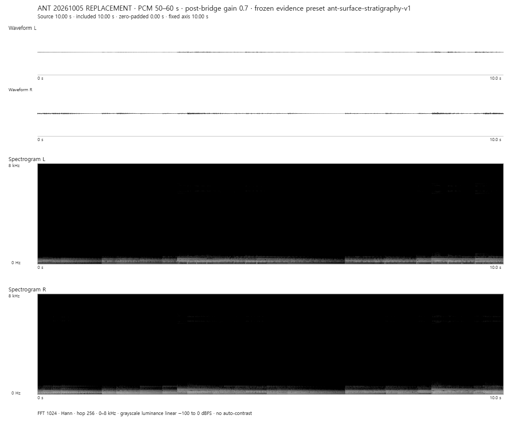
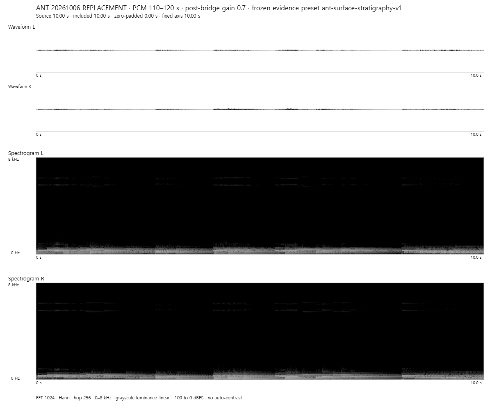
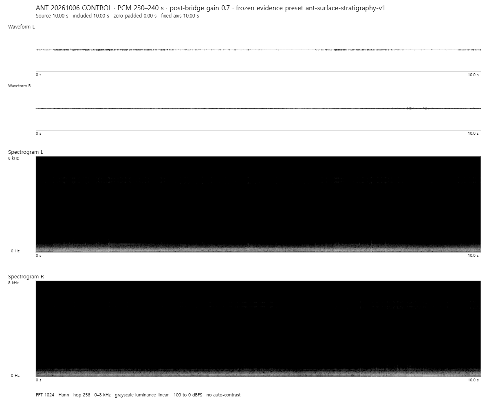
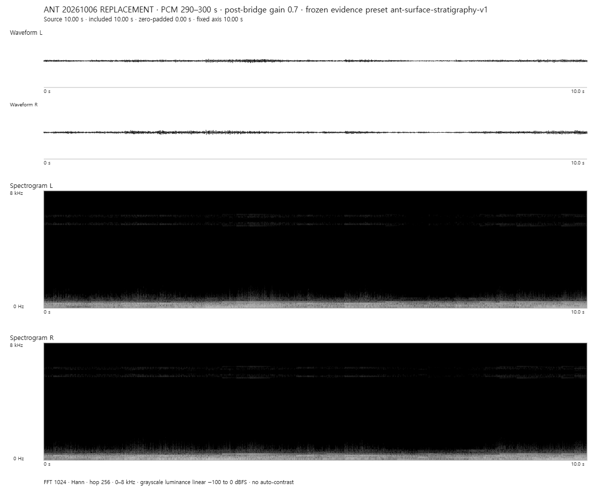
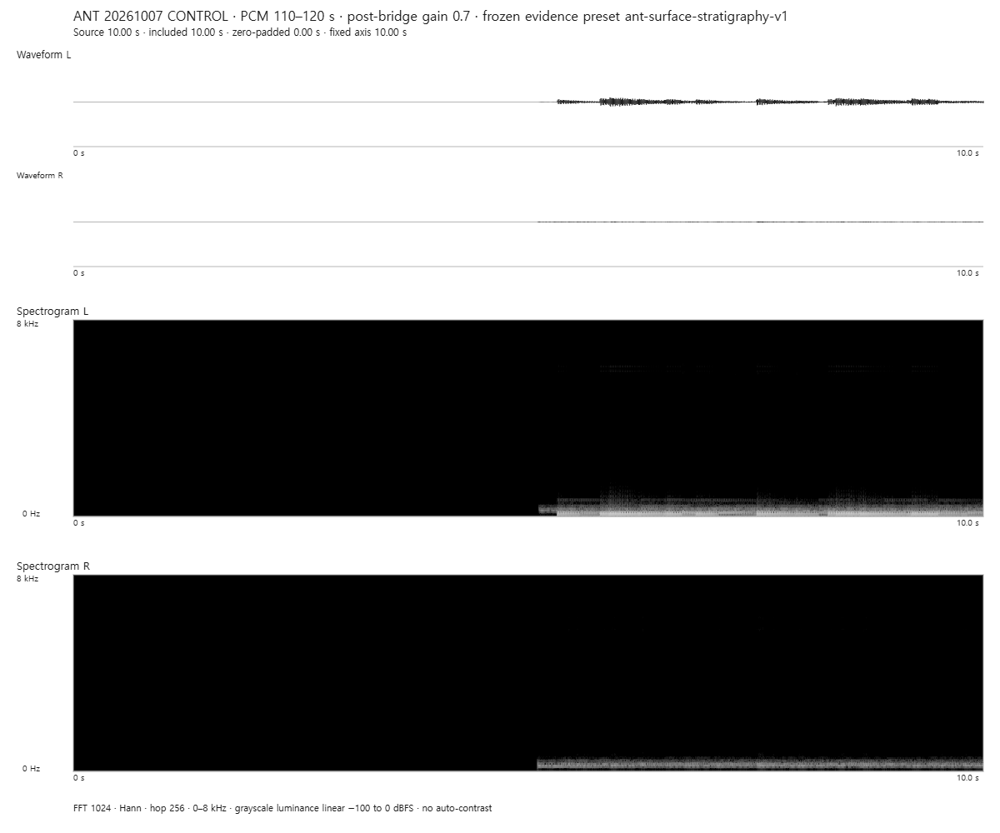
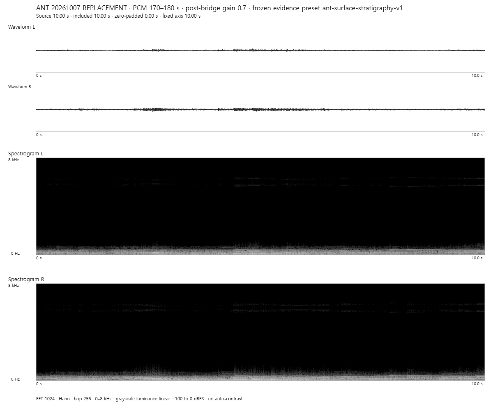

# Fixed local-X audio atlas

All thirty panels use the existing ANT fixed frontend: separate L/R waveform at ±1; 48 kHz, FFT 1024 symmetric Hann, hop 256, 0–8 kHz, -100…0 dBFS, grayscale, gamma 1. There is no per-image normalization. Each panel is an exact 10 s cut from a continuous 300 s model-time-locked render, at fixed post-bridge gain 0.7. Black silence and small waveforms are valid fixed-scale results. Open an image for its native 1200×1000 pixels.

Primary [absolute linear-power ERB](audio-analysis/visual/erb-absolute-power.svg) uses one shared vertical scale across all streams/windows. Secondary [unit-sum shape ERB](audio-analysis/visual/erb-unit-shape.svg) discards overall power. These are descriptive STFT-band summaries, not listening verdicts. [Arrays and frame support](audio-analysis/analysis.json), [visual receipts](audio-analysis/visual/plot-manifest.json), [interpretation](REPORT.md).

## Seed 20261005

| Model window | CONTROL | REPLACEMENT |
|---|---|---|
| 50–60 s |  |  |
| 110–120 s |  |  |
| 170–180 s |  |  |
| 230–240 s |  |  |
| 290–300 s |  |  |

## Seed 20261006

| Model window | CONTROL | REPLACEMENT |
|---|---|---|
| 50–60 s |  |  |
| 110–120 s |  |  |
| 170–180 s |  |  |
| 230–240 s |  |  |
| 290–300 s |  |  |

## Seed 20261007

| Model window | CONTROL | REPLACEMENT |
|---|---|---|
| 50–60 s |  |  |
| 110–120 s |  |  |
| 170–180 s |  |  |
| 230–240 s |  |  |
| 290–300 s |  |  |
