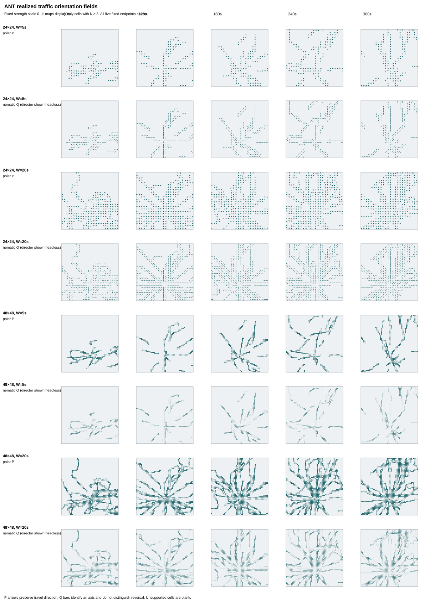
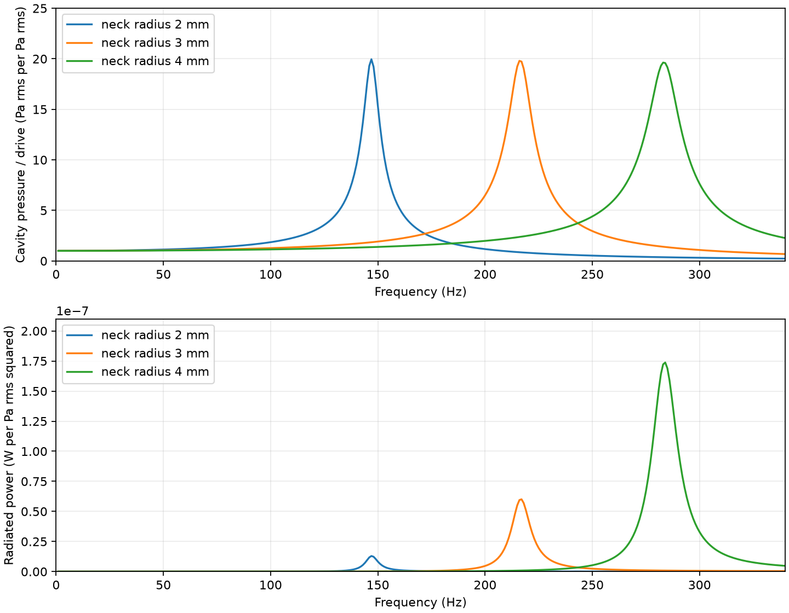
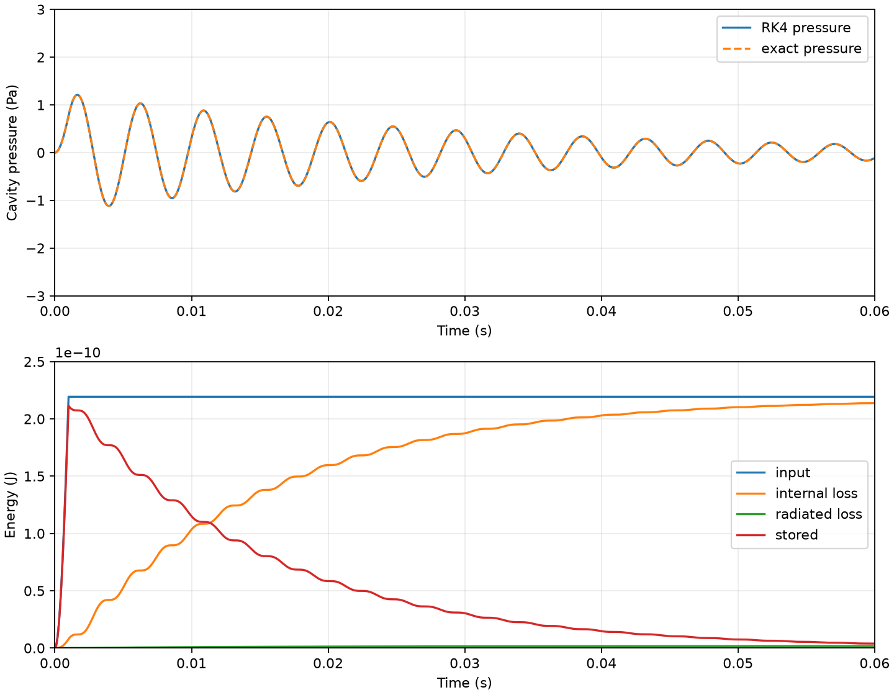
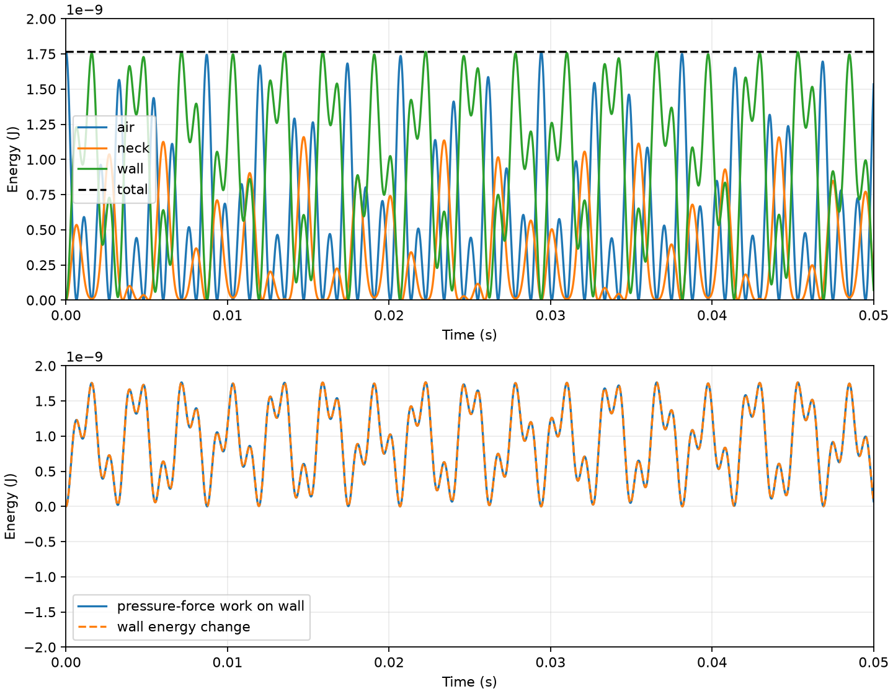
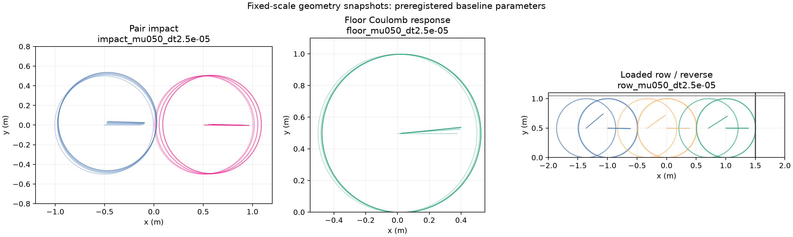
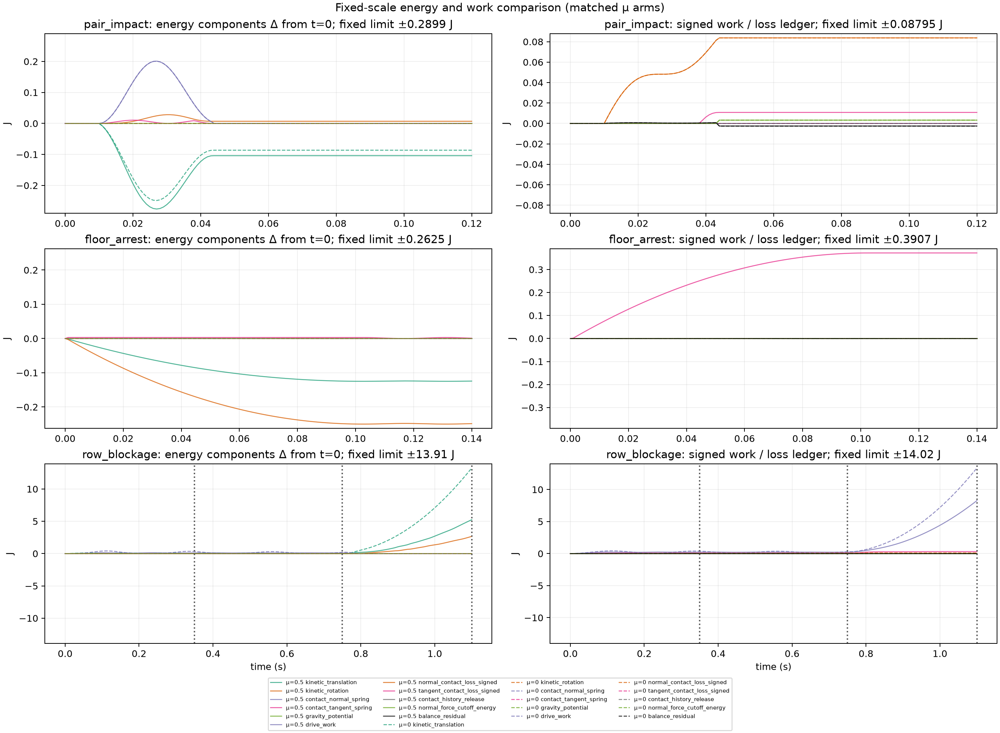

# Technical atlas

These figures show different physical responsibilities. Their colors and units are not a common score or visual ranking. Read each family's validity and input assumptions beside its panels.

## A. Existing wet film — no new 25-run campaign

The [original fixed atlas](../2026-11-02-wet-film-formation-first-probe/ATLAS.md) preserves initial states and fixed times, height scale 0–1.2 and difference scale ±.5 across frozen, heat and film arms. It includes the negative supply-off case and the conditional assumed-dose ANT input. No image or observer level was changed here.

## B. Current-production directional field

The [fixed orientation atlas](orientation/ATLAS.svg) displays both polar arrows and headless nematic directors for all 24/48 grids, 5/20-second windows, and 60/120/180/240/300-second endpoints. Strength remains 0–1; N≥3 is a display-support mask only. All N≥1/3/5 statistics and local fields remain in the machine receipts. A blank cell is unsupported, not necessarily disordered material. This is movement organization, not a material or stress map.

## C. Supplied air chamber

The accepted frequency axis is 1–340 Hz for all three apertures, within the declared compactness screen. The curves use the same pressure drive and loss scenario. Open grooves do not appear as invented zero-frequency or zero-pressure curves; their actual response is unestimated. The 1,715 Hz roofed-duct reference is a different geometry and remains in the report table.

The pulse uses the frozen-radiation ODE. Its energy terms are in joules, with input, loss and remaining state shown separately.

The wall figure is a supplied two-DOF mathematical surrogate. The high eigenroot exceeds the accepted compactness screen and is not a validated real cavity mode.

## D. Controlled dry fragments

The geometry timeline shows the registered base cases at shared physical scales within each fixture. No “settled” aesthetic frame was selected. Pair contact, floor braking and wall-supported reverse release have different constraints; this figure does not establish a permanently anchored object or collective jam.

The matched timestep/stiffness/friction histories share each fixture's energy axes. The contact-balance curves are signed numerical bookkeeping. Energy-work closure is inconclusive; plotting those terms does not turn them into measured physical dissipation.

