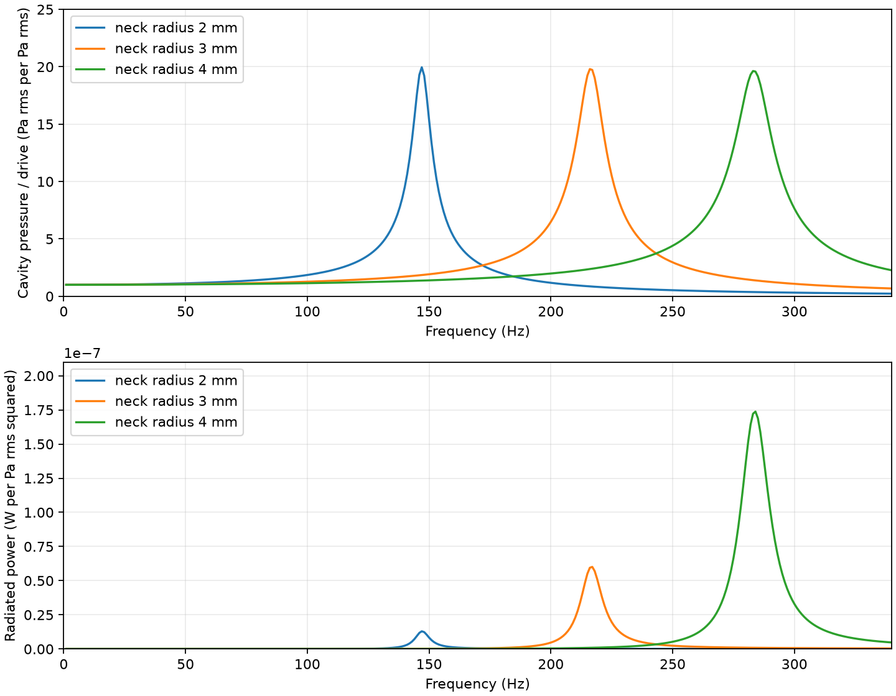
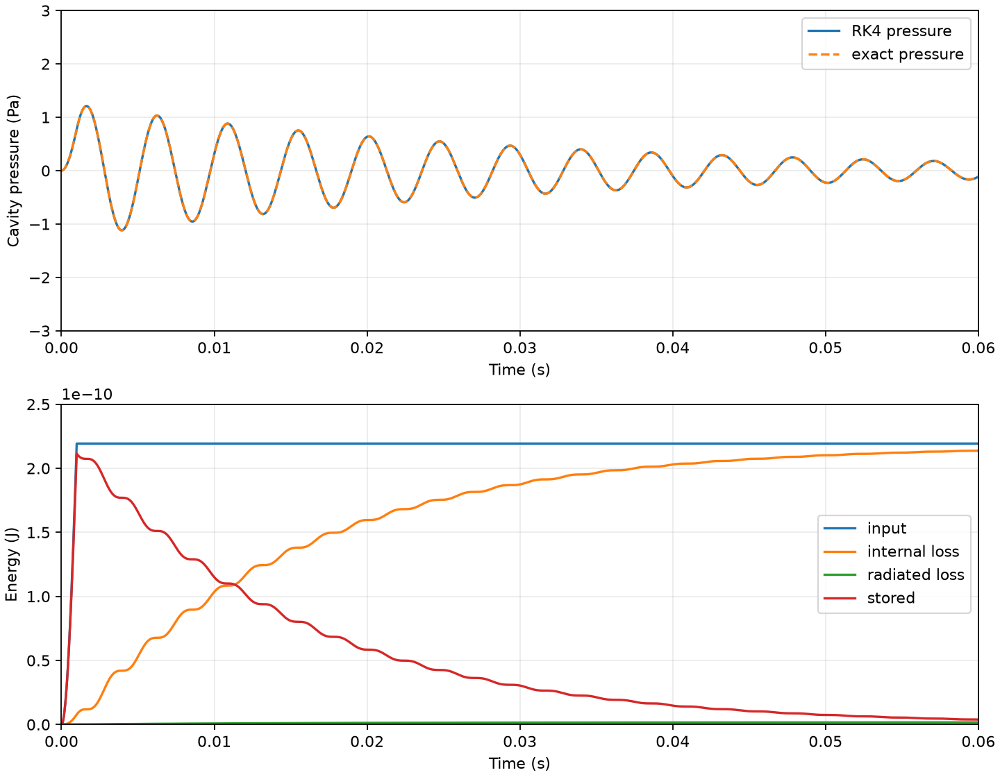
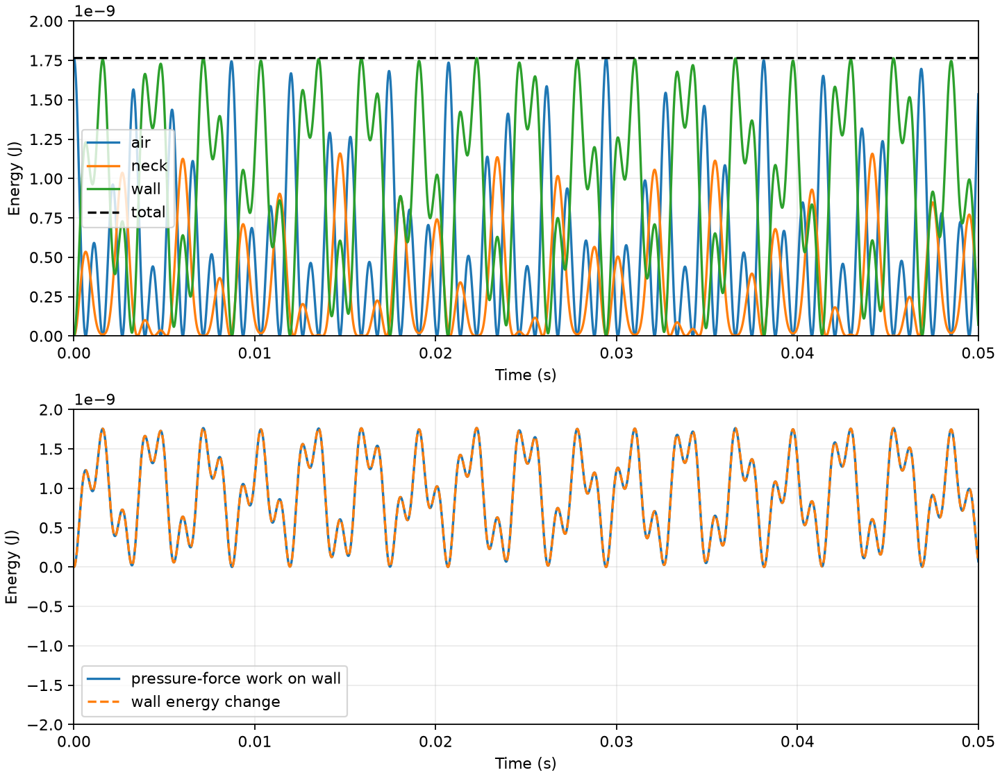

# Cavity / air-volume minimum study

**Recorded:** 2026-11-02  
**Research branch starting commit:** `796d5c7`  
**Inspected production main:** `5bdd516`  
**Scope:** analytical / lumped acoustics and small deterministic ODE checks. No 3D solver and no ANT production changes.

The accepted frequency sweep is 1–340 Hz, limited by the preregistered study screen `kDmax ≤ 0.25` at the upper edge; `ka` is at most 0.025 there. This is a conservative comparison boundary, not a universal acoustic error guarantee. A preceding 1–5 kHz export is preserved as an extrapolation diagnostic in [`preparation/full-band-extrapolation-diagnostic/`](preparation/full-band-extrapolation-diagnostic/) and is not interpreted outside the compact band.

## Decision

- **SUPPORTED — model-internal consistency only.** The declared rigid chamber + circular neck has a compact, long-wavelength Helmholtz solution. Its frequency sweep, pressure response, radiation receipt, and time-domain energy receipt agree with their registered analytical checks.
- **UNSUPPORTED — current ANT cavity mapping.** A closed 2D solid/material loop does not provide a roof, enclosed height, neck, or sealed air volume. The inspected production acoustic path compiles 2D masks to plate solver nodes; it does not create an air domain ([`compileSurfaceTopology.js`](../../../../../src/lib/audio/compileSurfaceTopology.js), [`surface-plate.worklet.js`](../../../../../static/worklets/surface-plate.worklet.js)). These files are unchanged from inspected `main` `5bdd516`.
- **UNRESOLVED — open groove and broad-mouth recess response.** Their listed geometric voids and apertures do not define a lumped cavity + neck. Their actual pressure and radiation are not zero; they were left unestimated because no conforming air model or measured enclosure geometry was supplied.
- **REJECTED — rigid-wall assumption for the illustrative compliant-wall example.** Its wall-to-air compliance ratio is 1.807 and the coupled model has two modes well away from the rigid-wall prediction. Those wall parameters are a counterexample only, not ANT material measurements.

The Helmholtz model is appropriate for a volume connected to the exterior by a small neck when the cavity pressure is nearly uniform and the characteristic dimensions are small relative to wavelength; neck/cavity junction geometry affects the effective length and can require multidimensional analysis outside that limit. [Dickey & Selamet](https://mae.osu.edu/sites/default/files/2021-12/J16.pdf), [Brandão & Schnitzer](https://arxiv.org/abs/2001.09353), [Monkewitz & Nguyen-Vo](https://ntrs.nasa.gov/citations/19850044764).

## Geometry comparison

All geometries below are illustrative controls. The `geometric void` is the recess space below its rim; it is not automatically a sealed acoustic volume.

| Case | Geometry entered | Geometric void | Opening | Acoustic result |
|---|---|---:|---:|---|
| Open-top groove | 100 × 20 × 5 mm; top fully open | 10 cm³ under rim | 2,000 mm² open top | No sealed volume or neck. No lumped pressure, resonance, loss, or radiation value assigned. |
| Broad-mouth partial recess | 40 × 40 × 10 mm; 20% of top covered | 16 cm³ under rim | 1,280 mm² open face | Broad face, no defined neck. No lumped pressure, resonance, loss, or radiation value assigned. |
| Added-roof duct counterexample | Same 100 mm groove length, roof added, both ends pressure-release | — | 20 × 5 mm cross-section | Ideal open-open first axial mode: **1,715 Hz**. End correction, loss, and radiation omitted. This is not the open-top groove. [MIT OCW](https://ocw.mit.edu/courses/21m-380-music-and-technology-sound-design-spring-2016/73bb2f51aa991effbdb315e9d49f8d08_MIT21M_380S16_lec_slides.pdf). |
| Canonical chamber + neck | Rigid 40 × 40 × 25 mm box with 40 mm circular neck, base radius 3 mm | **40 cm³ sealed** | **28.27 mm² neck** | Lumped response calculated; dimensions and assumptions below. |

The open-top cases have finite geometric recess spaces, but ambient air can exchange over the broad opening and no neck plug / uniform-pressure chamber has been defined. Reporting a Helmholtz frequency there would confuse an unmodeled open boundary with a necked resonator. Adding a roof changes the air domain: the ideal roofed reference has a distributed duct mode, not the open groove’s response.

## Canonical chamber + neck response

The base case uses `rho = 1.20 kg/m³`, `c = 343 m/s`, `V = 40 cm³`, neck radius `a = 3 mm`, and physical neck length `L = 40 mm`. These are declared scenario values, not site measurements. The long-neck correction uses `L_eff = L + 1.6434a`; the source’s `0.8217a` end correction is the large-aspect-ratio circular-neck limit. At the base radius `L/(2a) = 6.667`; the correction is still approximate and no error bound is claimed. [Brandão & Schnitzer](https://arxiv.org/abs/2001.09353).

| Quantity | Base result |
|---|---:|
| Aperture area `A` | 28.274 mm² |
| Effective neck length `L_eff` | 44.930 mm |
| Acoustic inertance `M_a = rho L_eff/A` | 1.906897 × 10³ Pa·s²/m³ |
| Air compliance `C_a = V/(rho c²)` | 2.833287 × 10⁻¹⁰ m³/Pa |
| Analytic Helmholtz `f0` | **216.527 Hz** |
| Frequency-grid response maximum | **216 Hz** |
| Peak chamber pressure / 1 Pa RMS drive | **19.799 Pa RMS/Pa RMS** |
| `kDmax`, `ka`, `kL` at analytic `f0` | 0.1587, 0.0119, 0.1587 |
| `Q_internal` scenario / `Q_radiation` / combined `Q` | 20 / 2,517 / 19.842 |
| Radiation share of input power at analytic `f0` | **0.788%** |
| Baffled-monopole far-field pressure at 1 m / 1 Pa drive at analytic `f0` | **1.987 × 10⁻³ Pa RMS/Pa RMS** |

The `Q_internal = 20` value defines an equivalent series resistance `R_internal = omega0 M_a / 20`; it is not derived from a measured wall, air path, leakage, or real material. Radiation uses the small-`ka` baffled-piston resistance. The JASA derivation gives normalized piston resistance `sigma ≈ (ka)²/2`; dividing its specific resistance by aperture area yields `R_rad = rho c (ka)²/(2A)` for the volume-flow circuit. The same baffled half-space model gives the far-field pressure and power receipt used here. [García et al., JASA](https://doi.org/10.1121/10.0013569).

At fixed chamber volume, physical neck length, and internal-Q scenario, the predeclared aperture sweep gives:

| Neck radius | Aperture area | Analytic `f0` | Grid peak | Peak pressure ratio | `Q_radiation` | Radiation share | Radiated power / Pa² at `f0` |
|---:|---:|---:|---:|---:|---:|---:|---:|
| 2 mm | 12.566 mm² | 147.066 Hz | 147 Hz | 19.956 | 8,034 | 0.248% | 1.297 × 10⁻⁸ W |
| 3 mm | 28.274 mm² | 216.527 Hz | 216 Hz | 19.799 | 2,517 | 0.788% | 6.029 × 10⁻⁸ W |
| 4 mm | 50.265 mm² | 283.563 Hz | 283 Hz | 19.630 | 1,121 | 1.753% | 1.739 × 10⁻⁷ W |

The low-`ka` compact-aperture model predicts that the wider neck moves the breathing frequency up and increases the radiation share. Internal loss still dominates because the same illustrative `Q_internal` was imposed across the sweep. These are model consequences, not real-groove measurements or an optimized resonance search.



## Time-domain and energy checks

For the base 3 mm neck, a 1 Pa, 1 ms pressure pulse produced the following frozen-`R_rad(f0)` transient receipt over 100 ms:

| Receipt | Energy |
|---|---:|
| Input work | 2.193033 × 10⁻¹⁰ J |
| Internal loss | 2.173390 × 10⁻¹⁰ J |
| Radiated loss | 1.726787 × 10⁻¹² J |
| Stored energy at 100 ms | 2.415265 × 10⁻¹³ J |
| Balance residual | −4.007182 × 10⁻¹⁵ J (**1.827 × 10⁻⁵** of input) |
| RK4 vs exact pulse pressure trace | 4.333 × 10⁻⁹ relative max error |
| RK4 vs exact pulse flow trace | 4.506 × 10⁻⁹ relative max error |

The sweep uses frequency-dependent `R_rad(f)`, while this constant-coefficient transient freezes radiation resistance at `f0`; they are related but distinct damping approximations. The exact trace comparison is against the same frozen-resistance ODE. The frequency-domain receipts separately close input power against internal plus radiated power, and the integrated half-space far-field pressure returns the same radiation power within floating-point rounding.



## Wall-compliance rejection example

A one-mode uniform-piston wall surrogate used the chamber top area `A_w = 0.0016 m²`, modal mass `m_w = 0.002 kg`, and stiffness `K_w = 5,000 N/m`. These are chosen illustrative values, not a plate measurement. Its wall compliance is `C_w = A_w²/K_w = 5.12 × 10⁻¹⁰ m³/Pa`, so `C_w/C_a = 1.807`. The rigid-wall prediction is 216.527 Hz; the two undamped eigenfrequencies of the reduced surrogate are **118.749 Hz** and **458.850 Hz**. Using the 40 mm neck length for `kD = 2πfL/c`, these give `kD = 0.0870` and `0.3362`, respectively. The lower root is inside the study's `kD ≤ 0.25` compactness screen; the upper root is outside it and is reported only as an eigenfrequency of the mathematical surrogate, with no physical validation claim. The wall’s uncoupled mode is 251.646 Hz. The in-screen result demonstrates that a compliant boundary can change the rigid-wall prediction in this illustrative model. Published compliant-wall Helmholtz work likewise treats wall motion as a coupled system rather than silently preserving the rigid-cavity model. [Pishvar & Harne, ASME](https://doi.org/10.1115/1.4052870).

An undamped 2DOF integration began from `q(0) = 1 × 10⁻⁹ m³`, with other initial states zero. With inward-positive wall displacement, `p_c = (q + A_w x)/C_a` and pressure force on the wall is `−A_w p_c`. Across 100 ms, total quadratic energy drift was **5.98 × 10⁻⁸** of initial energy; the maximum discrepancy between integrated pressure-force work and wall-energy change was **1.448 × 10⁻⁴** of initial energy. The numeric eigenvalue roots agreed with the closed-form 2×2 characteristic roots to `3.35 × 10⁻¹⁵` relative error. This verifies the declared surrogate’s energy exchange and eigensystem, not a real flexible ANT Plate.



## Reproduction and artifacts

Run the deterministic output pass from the repository root:

```powershell
& 'C:\AI\ComfyUI_windows_portable\python_embeded\python.exe' -B scripts/ant-multiphysics-cavity.py
& 'C:\AI\ComfyUI_windows_portable\python_embeded\python.exe' -B -m unittest discover -s tests -p test_ant_multiphysics_cavity.py -v
```

The run writes `summary.json`, `frequency_response.csv` (1–340 Hz), `aperture_sweep.csv`, `transient_energy.csv`, `wall_coupling_energy.csv`, and three fixed-axis PNG figures. [`PROTOCOL.md`](PROTOCOL.md) records the frozen model, formulas, parameters, acceptance checks, compact-band boundary, and primary sources. [`PREPARATION.md`](PREPARATION.md) explains both superseded diagnostics; the short-neck files remain under [`preparation/initial-short-neck-diagnostic/`](preparation/initial-short-neck-diagnostic/) and the full-band export under [`preparation/full-band-extrapolation-diagnostic/`](preparation/full-band-extrapolation-diagnostic/).

The nine dedicated tests cover compact-band conformance, open-top rejection, the roofed reference, parameter trend and resonance-grid agreement, radiation/power closure, exact/ODE agreement, input validation, wall-coupling energy/work, and coupled eigenfrequency agreement. A second run produced byte-identical SHA-256 values for all eight generated data and figure outputs; `OUTPUTS.sha256` records the checked hashes. No 3D physical validation, measured cavity response, site geometry, or production acoustic implementation was performed.
