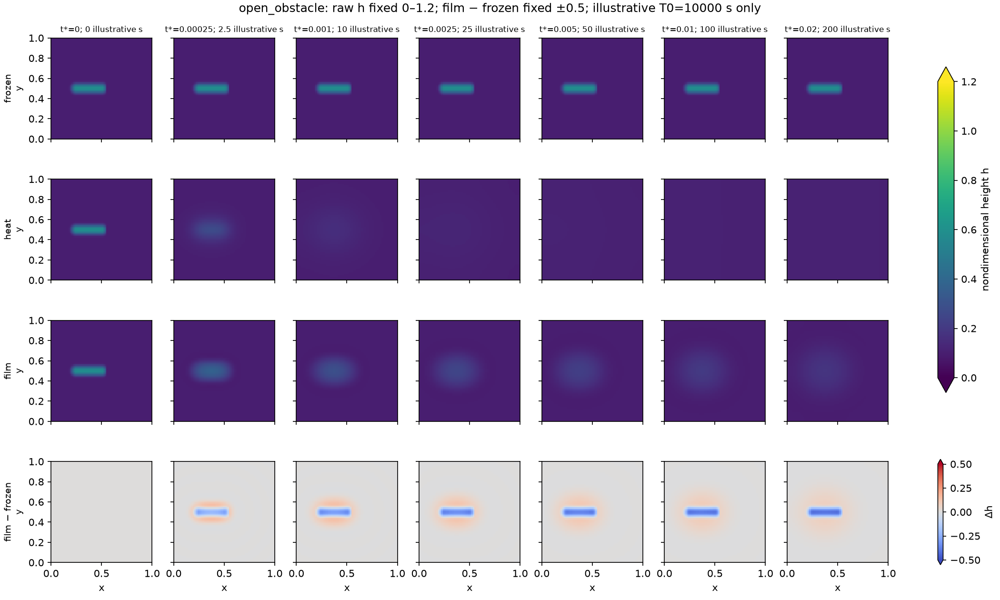
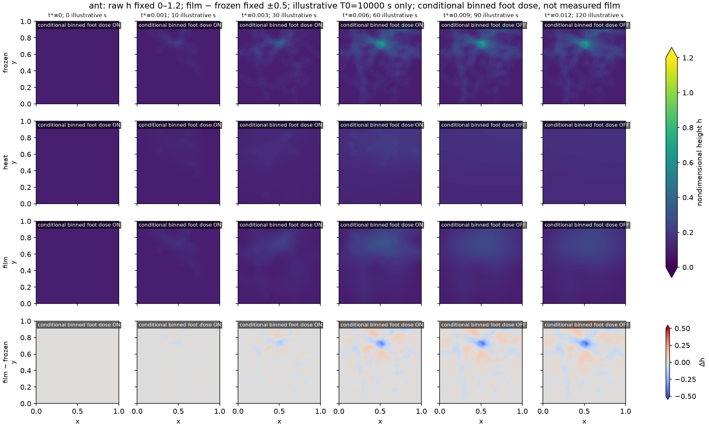
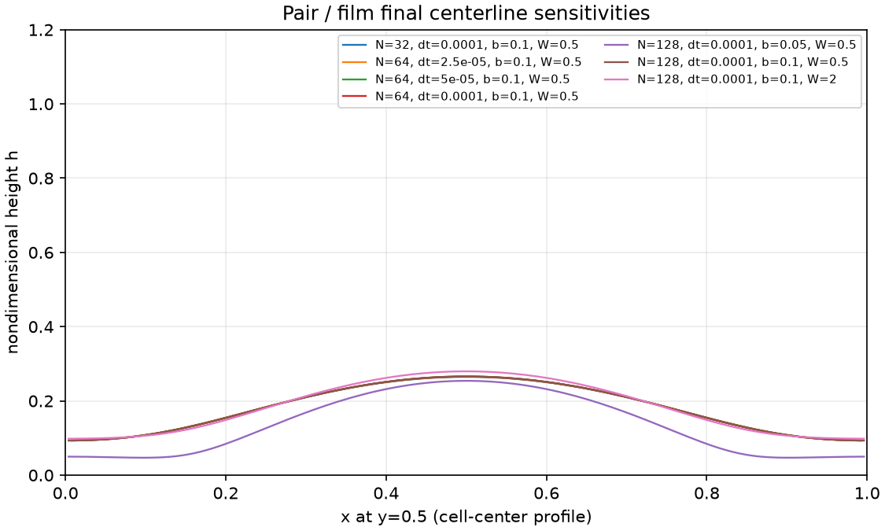

# Fixed-scale technical atlas

All panels use the unit square, identical axes and raw nondimensional height scale0–1.2. The fourth row is film minus frozen at the same time, fixed±.5. No per-panel normalization, geometry repair or favorable-window selection. Colorbar extensions mark out-of-range differences; [receipts](visual/plot-receipts.json) retain counts/extrema. All raw heights remain within the fixed height range. Difference values below−.5 occur in120 displayed samples (minimum−.79835); stored data are not clipped.

Each controlled atlas includes all seven registered times, from0 to.02. Labels convert to illustrative seconds using T0=10000s, not a measured ANT liquid clock. Source annotations are explicit. The ANT atlas uses all six registered times through120 assumed seconds and identifies the conditional binned foot-dose source. Gray hatching is an excluded no-flux domain, not deposited material or a simulated3D object.

## Separated excess ridges

## Crossed initial height field

## Impermeable excluded region

## Same inscription with the excluded region opened

## Prescribed supply followed by inactivity

## Conditional fixed ANT contact input

## Pair refinement and physical-parameter sensitivity

Profiles retain the fixed0–1.2 height scale. Changes in b alter the background liquid, not only numerical resolution. Equal final shapes or a visually small difference must be assessed with the [quantitative comparisons](analysis/comparisons.json). Persistent threshold regions are observations over this horizon; no rigid body or irreversible bond was formed.
